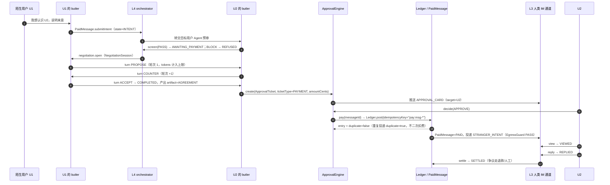
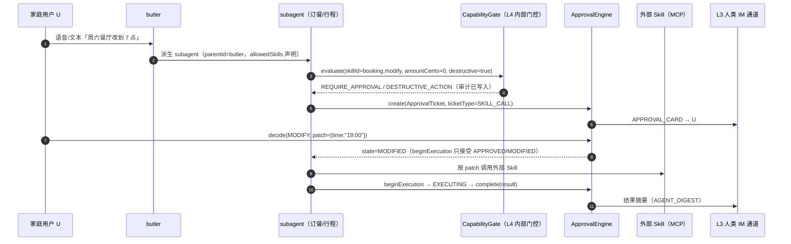
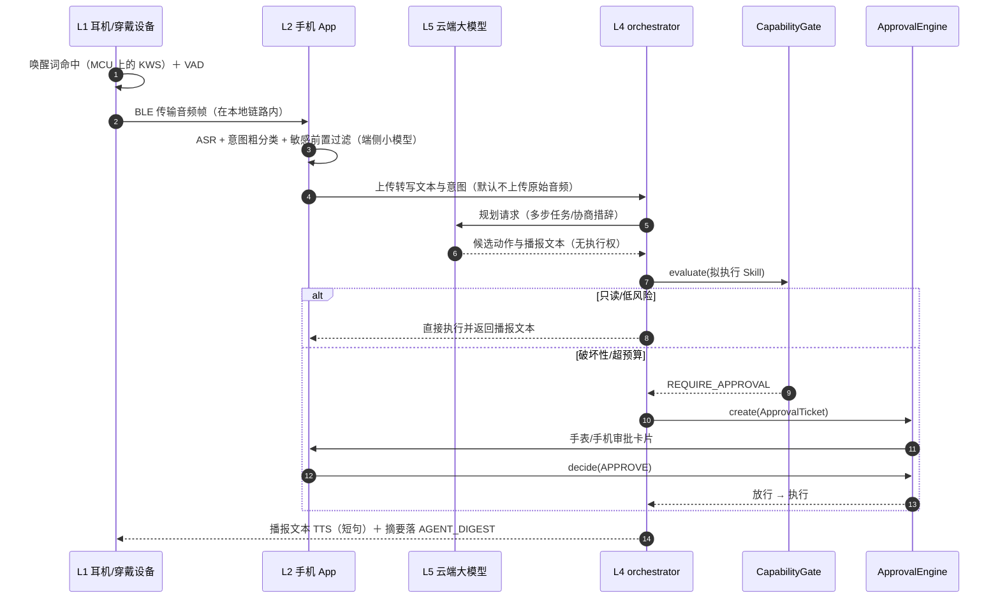

# 01 · 总体架构

> 版本 v1.0 · 对应契约 contracts/INTERFACES.md v1.0 · 作者：架构组

## 0. 文档定位与三个前提

读者：架构师、后端/端侧工程师、技术负责人。本文只描述**生产架构**，不描述本机实现细节。

三个必须先讲清的前提，否则后文会被误读：

1. **生产技术栈**是 Go + Go-Zero、gRPC/Protobuf、etcd、Kafka、PostgreSQL（含 pgvector）、Redis、MongoDB + OpenSearch、腾讯云 IM PaaS、Flutter 三端、端侧 TFLite Micro 与端侧小模型。这些是采购/立项后要落地的东西。
2. **仓库里的零依赖 Node ESM 代码是治理与编排层的可运行参考实现**，不是生产运行时。它的价值是：把「权限门控与状态机由代码强制、可被单元测试证明」这件事先做成可执行的规范（`services/orchestrator/src/capability-gate.mjs`、`approval-engine.mjs`、`negotiation-engine.mjs`、`services/payment/src/ledger.mjs` 等）。生产把同一套判定顺序、状态白名单、幂等键规则移植到 Go，而不是重新发明。
3. 两者之间的逐模块映射、哪些逻辑可逐行移植、哪些必须因并发/事务重写，见 [02-技术选型与框架.md §15](02-技术选型与框架.md)。本文出现的模块路径均指仓库内真实路径，契约来源一律是 `contracts/INTERFACES.md`。

术语与契约逐字一致：butler / subagent / skill、TrustZone、CapabilityGate、ApprovalTicket、NegotiationSession、EgressGuard、PaidMessage。状态枚举（`TICKET_STATE`、`TASK_STATE`、`MSG_STATE`、`TRUST_LEVELS`）不在本文重新定义，以契约为唯一来源。

---

## 1. 六层架构总览

### 1.1 分层图（自上而下）

```text
┌──────────────────────────────────────────────────────────────────────────────
│ L1 接入层（Devices & Access）
│   硬件：耳夹耳机 / AI 眼镜（BLE）· 手机 · PC · 手表 · Web
│   职责：采集、唤醒触发、音频播放、指示灯/物理静音、连接管理
│   禁止：任何权限判断、任何对外动作的直接发起
├──────────────────────────────────────────────────────────────────────────────
│ L2 端侧层（On-Device，手机 App 为主）
│   唤醒后 ASR · 意图粗分类 · 敏感内容前置过滤 · BLE 网关 · 离线审批缓存
│   职责：把「不该上云的内容」和「必须上云的最小请求」分开
│   禁止：执行破坏性 Skill；持有长期能力令牌
├──────────────────────────────────────────────────────────────────────────────
│ L3 IM 通信层（Human Channel）
│   腾讯云 IM PaaS：长连接 / 多端同步 / 离线推送 / 群组分发
│   + 消息服务：envelope.mjs · seq.mjs · dedupe.mjs（业务封装、序号、去重）
│   只承载「用户可见」消息与审批卡片；拒绝承载 Agent 协商中间过程
├──────────────────────────────────────────────────────────────────────────────
│ L4 Agent 编排层（Orchestration，自研核心）
│   AgentRegistry · SkillRuntime · NegotiationEngine（独立 gRPC 通道）
│   记忆分层（working / episodic / semantic）· ApprovalEngine
│   ┌── 强制门控子层（PreToolUse：位于每一次工具调用之前）─────────────────┐
│   │  CapabilityGate（权限门控）  +  EgressGuard（出口护栏）              │
│   │  门控不是并列的一层，而是 L4 内部、调用链路上的必经拦截点          │
│   └──────────────────────────────────────────────────────────────────────┘
├──────────────────────────────────────────────────────────────────────────────
│ L5 模型层（Intelligence）
│   端侧小模型：唤醒 / 意图 / 敏感过滤（守门人，跑在 L2 手机上）
│   云端大模型：多步规划 / 协商 / 专业推理（大脑，跑在推理集群）
│   职责：只产出「候选动作与文本」，不拥有权限；权限在 L4 门控
├──────────────────────────────────────────────────────────────────────────────
│ L6 数据层（Data & Infra）
│   PostgreSQL（关系链/信任档位/账本）· pgvector（记忆）
│   对象存储 + OpenSearch（归档检索）· 时序库（遥测）· 不可变审计
└──────────────────────────────────────────────────────────────────────────────
```

### 1.2 为什么「治理」必须是 L4 内部的门控子层，而不是并列的一层

这是本架构与普通 Agent 框架最重要的差别，单独论证：

把「治理与审批」画成与 L4 并列的一层，等于承认存在一条**不经过治理的调用路径**——调用方（Agent 运行时、某个新接的 Skill、某次"临时优化"）只要直接连下层服务，就绕开了它。并列层的边界是组织边界，不是代码边界；而权限必须落在**代码边界**上。

正确的位置是：`CapabilityGate` 与 `EgressGuard` 位于 **L4 内部、每一次工具调用（PreToolUse）之前**，是 SkillRuntime 的拦截器链，而不是可选的旁路服务。具体形态：

- 任何 Skill 调用在发出前**同步**过 `CapabilityGate.evaluate()`，判定顺序固定为契约 §3 的 1–7 条短路（`DENY` > `REQUIRE_APPROVAL` > `ALLOW`）；
- 任何外发内容（含发往其它 Agent 的协商内容）在发出前过 `EgressGuard.inspect()`，`BLOCK` 必拦截；
- 两者都不依赖模型自觉，也不接受「内部调用免检」的白名单；
- 每次判定无论放行与否都写审计，审计与请求绑定 `traceId`，可回放。

反例（必须避免的设计）：把审批做成独立的「审批服务」，编排层先执行、事后补审；或把策略写进系统提示词让模型自己遵守。这两类做法在演示里都成立，在事故里都失效。参考实现 `services/orchestrator/src/capability-gate.mjs` 的存在意义就是让这些判定可被单元测试证明，而不是文档承诺。

### 1.3 每层职责与禁止事项

| 层 | 核心职责 | 明确禁止 | 对应实现/文档 |
|---|---|---|---|
| L1 接入 | 采集、唤醒触发、播放、指示灯、BLE/网络连接 | 不解析业务语义；不做权限判断 | docs/04-SDK与端侧设计.md |
| L2 端侧 | ASR、意图粗分类、敏感前置过滤、BLE 网关、离线审批缓存 | 不上传原始音频（默认）；不执行破坏性 Skill | docs/04-SDK与端侧设计.md |
| L3 IM 通信 | 人类消息、卡片下发、多端同步、序号与去重 | 不承载协商中间过程；不做审批决策 | `services/messaging/src/*.mjs` |
| L4 编排 | 任务分解、协商、记忆、Skill 调用与**强制门控** | 不允许任何绕过门控的调用路径 | `services/orchestrator/src/*.mjs` |
| L5 模型 | 规划、协商措辞、摘要、意图分类 | 不授予权限；不直接触碰账本与关系链 | - |
| L6 数据 | 持久化、检索、向量、遥测、审计存储 | 不作为唯一状态源（状态以 L4 服务 + PG 为准） | docs/05-数据模型与存储.md |

模型层（L5）的边界要特别强调：云端大模型可以「建议」执行某个 Skill、可以生成审批卡片的说明文字，但它永远拿不到执行权。执行权由 L4 的 `CapabilityGate` 在每次调用时重新判定，`agent_capabilities` 是唯一依据。

### 1.4 层间通信规则

- **同步**：L1↔L2 走设备本地协议（BLE）；L2→L3/L4/L5 走 gRPC/Protobuf（经网关）；L4→门控是进程内/同服务的同步调用，不能异步「事后补审」。
- **异步**：审计事件、outbox、卡片推送、归档走 Kafka；进入异步通道的动作视为**已决策**，异步只负责投递。
- **协商专用通道**：`NegotiationEngine` 走独立 gRPC 通道（独立端口/独立配额/独立超时），不复用人类 IM 长连接。
- **禁止跨层**：L3 不得直接调用账本；L5 不得直接写数据库；L2 不得直接连 L6。

### 1.5 五条架构不变量

1. 默认信任档永远是 `STRANGER(4)`；任何缺失/过期的授权视同撤销。
2. `DENY` 优先于 `REQUIRE_APPROVAL` 优先于 `ALLOW`，短路顺序即契约 §3 的 1–7 条，不允许重排。
3. 审批状态机只允许契约 §4 白名单内的迁移，禁止跳步。
4. 账本只 INSERT；同一 `idempotencyKey` 全局唯一，重复投递返回首次结果。
5. 协商中间过程不对用户可见；只有终止态（含 `INPUT_REQUIRED`/`AUTH_REQUIRED` 中断点）产出用户可见物。

---

## 2. 三条流量分离

### 2.1 三条流的定义

| 维度 | ① 人类 IM 流量 | ② Agent 协商流量 | ③ 审批/审计事件流 |
|---|---|---|---|
| 产生方 | 人 | Agent（butler/subagent） | 门控/审批/账本/护栏 |
| 通道 | L3：IM PaaS 长连接 + 消息服务 | L4：独立 gRPC 流 + Kafka topic | Kafka（审计）+ PG（事件溯源） |
| 协议 | 业务 JSON 封装（`makeEnvelope`） | Protobuf / A2A（仅 Phase3 跨组织） | Protobuf + 只追加表 |
| 可见性 | 用户可见 | **默认不可见**，终止才产出 artifact | 仅用户授权范围/运营审计后台可见 |
| 顺序要求 | 会话内 `bizSeq` 单调 | 会话内 `turn` 顺序 | 每聚合根 `seq` 单调 |
| 存储 | PaaS 消息 + `messages_meta` | `negotiation_sessions`/`negotiation_turns` | `audit_events`/`approval_events` |
| 限流对象 | 用户/会话 | 会话/Agent（轮次、Token、墙钟） | 写入吞吐 |

### 2.2 为什么必须分离

三条流量的**生命周期、失败后果、合规属性**完全不同：

- 人类消息失败 = 用户当场可见的体验事故，要必达、要推送、要已读；
- 协商失败 = Agent 自动重试或降级为「请示用户」，用户不该看到中间过程；
- 审批/审计失败 = 治理失效或合规缺口，事后无法补救（账本错一笔，就是资金差错）。

**混在一起的三个具体后果**（不是抽象风险，是必然发生的故障）：

1. **计费与已读语义被污染**。若协商 turn 走 IM 通道，PaaS 的未读数、已读回执、会话列表全部把机器轮次算进去；`BIZ_TYPE.STRANGER_INTENT` 与协商 turn 混排后，用户看到「对方正在输入」其实是两个 Agent 在 `COUNTER`，付费消息的「已查看」也无法归属到人。
2. **限流互相踩踏**。协商在 300 秒窗口内最多 5 轮、每轮多 Token；这些流量会占用人类通道的推送配额与连接带宽。高峰期出现「人类消息发不出去，因为 Agent 在吵架」。
3. **审计与合规边界模糊**。审批事件必须可追溯到 `traceId`、`decision`、`actor`；让它与用户聊天记录同库同 topic，会导致**用户可读的存储里混入治理数据**，删除权（用户要求删除记忆/消息）与账本/审计的法定保留要求直接冲突，只能靠人工分库，成本远高于一开始就分离。

### 2.3 物理隔离的落地方式

| 隔离项 | 人类 IM | Agent 协商 | 审批/审计 |
|---|---|---|---|
| 数据库 schema | `im_*` | `neg_*` | `gov_*` |
| Kafka topic 前缀 | `im.` | `agent.negotiation.` | `gov.audit.` / `gov.approval.` |
| 服务账号 | `im-svc` | `orchestrator-svc` | `orchestrator-svc` 内的门控组件（同进程，独立审计出口） |
| 限流配额 | 按用户/会话 | 按 session（`maxRounds=5`、`maxTokens=4000`、`maxSeconds=300`） | 按聚合根 |
| 保留策略 | 消息留存（见 doc3 §11） | 协商记录 1 年 | 审计 3 年 / 账本 10 年（均待法务复核） |

**越界检查**：Code Review 与 CI 检查三项——(a) `negotiation-engine` 不得 import 任何 messaging 模块；(b) `EgressGuard` 必须同时覆盖「人与人」和「Agent 发往 Agent」的外发内容；(c) 所有审批卡片必须经 `BIZ_TYPE.APPROVAL_CARD` 单一入口，不允许 Agent 直接拼一条 `NORMAL_TEXT` 冒充卡片。

---

## 3. 关键业务时序

### 3.1 陌生人：双方 Agent 协商 → 审批卡片 → 付费 → 放行



要点：

- **预审先于付费**（`screen` 之后才允许 `pay`），付费永远不能绕过 `EgressGuard` 与目标用户 Agent 的预审；费用在 `pay()` 扣（`BILLING.SEND_PAY`），查看回复的计费（`BILLING.VIEW_REPLY_PAY`）在同一动作点触发。
- 审批卡片只出现在人这一侧；Agent 之间无论协商几轮，用户只看到一张卡。
- 任何一步失败都有明确终态：预审 BLOCK→`REFUSED`、超时→`EXPIRED`、重复支付→`charged:false`。资金侧唯一事实源是账本，`PaidMessage` 只是状态镜像（对账见 §6.3）。

### 3.2 熟人家事协调：子 Agent 改动 → 审批 → 执行



要点：

- `trust_levels` 决定 subagent 能作用于谁（`trustZoneMin`），但**破坏性动作永远要人批**，即使 `SELF` 档也一样：`DESTRUCTIVE_ACTION` 的优先级高于金额判断。
- `MODIFY` 产生 `patch`，Agent 只能执行 patch，不能回退成原方案；这是「人机混合」最重要的约束。
- 执行结果是 `COMPLETED/FAILED`，不允许停留在 `EXECUTING`；长任务由超时扫描兜底（`EXPIRED` 只对 `APPROVED/MODIFIED` 生效，进入 `EXECUTING` 后的失败必须是 `FAILED`）。

### 3.3 硬件语音：端侧过滤 → 云端规划 → 审批 → 播报



要点：

- 端侧过滤是**隐私边界**，不是性能优化：原始音频默认不离开 L2 端侧（设备→手机走本地 BLE，不上云）；L2 只上传转写/意图与过滤结论，供云端复核。
- 设备端与手机端都不做权限判断：设备只拥有「对本人播报」的本地能力，任何对外动作一律回云端过 `CapabilityGate`。
- 播报内容与执行结果分离：播报先发生（体感 ≤3 秒），审批后置或前置由风险决定；高风险路径先审批后播报，避免「先答应再补批」。

---

## 4. 五个关键设计决策

> 每个决策给：选择 / 被否决的替代方案 / 否决理由 / 反转触发条件。反转条件写成可观测指标，评审时只讨论阈值。

### D1 人类 IM 与 Agent 协商物理分离

- **选择**：L3 只在 IM PaaS 上跑用户可见消息；L4 协商走独立 gRPC/Kafka，与 L3 无共享 topic、无共享表。
- **被否替代**：统一消息总线（所有消息，含 Agent 轮次，统一走 IM PaaS，用自定义消息类型隐藏）。
- **否决理由**：PaaS 的会话模型以「人」为第一公民（未读、已读、会话列表、推送配额），Agent 轮次无法获得干净的可见性控制；且 PaaS 侧无法承载 `maxRounds/maxTokens` 的硬预算（预算必须在服务端同步短路）。后果见 §2.2 三条。
- **反转触发**：仅当 Agent 协商量长期 < 人类消息量的 1%，且 PaaS 提供「完全不可见、独立计费、独立配额」的系统消息通道，并经压测证明不污染未读数——此时可合并以省一套通道；否则不合并。

### D2 权限门控在代码层（L4 PreToolUse 拦截器），不靠模型自觉

- **选择**：所有 Skill 调用前同步过 `CapabilityGate.evaluate()`；判定顺序固定 1–7 短路；每次调用（无论放行）写审计。
- **被否替代**：提示词约束 + 模型自我审查（「请不要转账」「你不应访问他人记忆」）。
- **否决理由**：不可测（无法断言「模型不会」）、可被 prompt injection 绕过、无统一错误码（业务无法区分「被拒」与「没做」）、审计粒度只能到模型输出。参考实现 `services/orchestrator/src/capability-gate.mjs` 的存在意义就是让这些判定**可被单元测试证明**，而不是文档承诺。
- **反转触发**：不反转。可以在其上叠加「可验证策略签名/TEE 内执行」作为增强层，但不能替代门控；模型能力越强，越需要确定性的拒绝路径。

### D3 审批状态机自研，不引入工作流引擎（Phase0–2）

- **选择**：按契约 `TICKET_STATE` 九态白名单实现，事件溯源只追加，超时升级幂等；持久化在 PG（`approval_tickets`/`approval_events`）。
- **被否替代**：Temporal 式持久化工作流（Durable Execution）承载审批与协商生命周期。
- **否决理由**：Phase0–2 的审批生命周期是**分钟级、状态少、无跨系统补偿**，用 Temporal 会引入一整套集群运维、SDK 版本与本地开发复杂度；契约还要求状态名与迁移逐字可测，自研更容易对齐。代价必须明说：无 durable replay、无内建重试/补偿、超时靠扫描任务、可观测性要自建（见 [02 §11](02-技术选型与框架.md)）。
- **反转触发**：出现「跨 3 个以上外部系统、需要补偿事务、生命周期 > 24 小时、或需要精确 durable timer」的流程（例如跨组织 A2A 的长期合约），或超时扫描积压导致 P99 审批延迟超过 SLO 的 20%——此时把审批生命周期迁移到 Temporal 式引擎，状态机语义保持不变。

### D4 IM 用 PaaS，但关系链与账本必须自有

- **选择**：消息通道/推送/会话基础能力采购 IM PaaS；`trust_levels`、`agent_capabilities`、`paid_message_ledger`、`approval_tickets`、`negotiation_*` 全部自有落 PG。
- **被否替代**：全托管（PaaS 关系链 + PaaS 计费）；或全自研长连接。
- **否决理由**：PaaS 关系链是「好友/群」二值模型，无法表达五档 `TRUST_LEVELS`（0–4）、子 Agent 的 `trustZoneMin`、以及「授权过期视同撤销」；PaaS 计费模型无法承载「先预审后付费、`idempotencyKey` 恰好一次、按 `messageId` 退款」的语义，一旦上云托管，对账权与审计权都不在自己手里（合规上不可接受）。全自研长连接在 Phase0 是无底洞，否决。
- **反转触发**：自建 IM 的单用户成本低于 PaaS 报价的 60%（按 3 年 TCO 测算）且团队已有长连接运维能力；或 PaaS 无法满足数据驻留/私有化要求。触发后先迁「关系链之外的通道能力」，账本与权限永不自外迁。

### D5 端侧过滤优先，默认原始音频不出端侧（L2）

- **选择**：唤醒在设备 MCU（KWS），ASR 与敏感前置过滤在手机端侧小模型；云端只接收转写/意图与过滤结论。
- **被否替代**：全云方案（音频上传后云端 ASR + 云端过滤）。
- **否决理由**：隐私承诺（卧室/车内对话上云是不可接受的产品风险）、功耗与流量（常在线设备）、延迟（播报路径多一跳）。代价：端侧模型精度与可迭代性受限，误唤醒/漏检要靠 OTA 修。
- **反转触发**：端侧误唤醒率或漏检率达到不可接受阈值（需硬件实测标定），且手机端无法承载下一版模型——此时退回「端侧仅 VAD + 云端过滤」，但必须同步调整隐私声明与合规评估，不能静默降级。

---

## 5. 容量与延迟预算

所有数字是**容量假设**，不是实测结论；带「⚠ 需复核」的项必须在立项/压测阶段用真实数据替换。

### 5.1 规模假设

| 指标 | Phase1 | Phase2 | 依据/备注 |
|---|---|---|---|
| DAU | 5 万 | 50 万 | ⚠ 需与商业目标、09 开发计划对齐 |
| 人均日发消息 | 40 条 | 60 条 | 熟人社交参考值，⚠ 需复核 |
| 人均日审批卡片 | 1.2 张 | 2 张 | 与 Agent 自动化程度强相关，⚠ 需复核 |
| 人均日陌生人意图 | 0.5 次 | 1.0 次 | ⚠ 需复核 |
| Agent 协商会话/DAU/日 | 0.3 次 | 0.8 次 | ⚠ 需复核 |
| 单会话平均轮次 | 3（上限 5） | 3（上限 5） | 契约硬上限 `maxRounds=5` |
| 峰值系数（相对均值） | 5× | 5× | 晚高峰，⚠ 需复核 |

### 5.2 审批卡片推送 P99 ≤ 2s 的延迟预算

| 环节 | P99 预算 | 说明 |
|---|---|---|
| 事件产生 → orchestrator（内网 gRPC） | 120 ms | ≤2 跳 |
| `CapabilityGate` 判定 | 15 ms | 本地规则 + Redis 预算读 |
| `ApprovalTicket` 落库（PG 同步提交） | 80 ms | 单行 insert + 同事务事件 |
| outbox → Kafka 投递 | 50 ms | 事务性 outbox |
| 审批消费者 → 卡片构造 | 100 ms | 含模板/权限校验 |
| IM PaaS 推送 API 接收 | 300 ms | ⚠ 需实测厂商 API 延迟 |
| 厂商通道 → 端侧到达（前台） | 700 ms | ⚠ 需实测，后台可能更差 |
| 端侧渲染可交互 | 150 ms | 冷启动卡片可交互定义 |
| 抖动/重试余量 | 485 ms | 覆盖一次 2xx 超时重试 |
| **合计** | **≤ 2000 ms** | 后台/锁屏场景单独定义 SLO，不承诺 2s |

> 说明：P99 是不含「用户主动决策」的时间；若落到后台通道，只承诺「到达」，不承诺「可交互」。降级路径见 §6.2。

### 5.3 协商与 Agent 预算（硬上限，来自契约）

| 预算项 | 值 | 超限行为 |
|---|---|---|
| 轮次 | `maxRounds = 5` | `round > maxRounds` → `INPUT_REQUIRED`、`terminalReason=MAX_ROUNDS`，不抛异常 |
| Token | `maxTokens = 4000` | 同上，`terminalReason=TOKEN_BUDGET` |
| 墙钟 | `maxSeconds = 300` | 超时由编排层置终止并上抛（需在 Go 侧实现） |
| 单 Agent 日预算 | `budgetCentsPerDay` | 超限 `DENY / BUDGET_EXCEEDED`（不扣减） |
| 单笔审批阈值 | `approvalThresholdCents` | ≥ 阈值 → `REQUIRE_APPROVAL / AMOUNT_THRESHOLD` |

### 5.4 消息量与存储增长（Phase1 估算）

| 数据 | 单条估算 | 日增（5 万 DAU） | 年增 | 备注 |
|---|---|---|---|---|
| `messages_meta` | 1.2 KB | 2.4 GB | 约 0.9 TB | 正文在 PaaS/对象存储，另计 |
| 消息正文（对象存储） | 5 KB | 10 GB | 约 3.7 TB | 压缩/生命周期归档后下降 |
| `approval_tickets` + `approval_events` | 单票 ≈3 KB（1+4 事件） | 约 180 MB | 约 66 GB | 事件只追加 |
| `audit_events` | 0.5 KB | 约 100 MB | 约 37 GB | 按天分区，热 90 天 |
| `negotiation_sessions` + `turns` | 单 turn 0.8 KB | 约 36 MB | 约 13 GB | 轮次上限压住增长 |
| `paid_message_ledger` | 0.3 KB | 约 9 MB | 约 3.3 GB | 只追加，绝不改 |
| Agent 记忆（向量） | 单条 1 KB + 向量 | 约 0.5 GB | 约 0.2 TB | ⚠ 依记忆写入频率复核 |

容量结论：Phase1 单套 PG（主备）+ Redis + 3 broker Kafka 足够；进入 Phase2 前必须完成的不是扩机器，而是 §6 的单元化与分区。所有数字均为规划用，⚠ 需在压测环境复核并回填。

---

## 6. 多地域部署与故障模式

### 6.1 部署拓扑

```text
               ┌──────────── 全国 GSLB ────────────┐
               │                                   │
      ┌────────▼─────────┐               ┌─────────▼────────┐
      │ 地域 A（主，生产）│               │ 地域 B（热备/只读）│
      │ 单元 A1 / A2     │  异步复制      │ 单元 B1          │
      │ IM PaaS 接入      │ ────────────► │ 灾备只读 + 审批只读│
      │ 编排/门控/账本    │  (⚠方案需复核) │ 不承接写          │
      └────────┬─────────┘               └──────────────────┘
               │ 同城双可用区
      ┌────────▼─────────┐
      │ PG 主（AZ1）      │
      │ PG 同步备（AZ2）  │  RPO 目标 0（同城），⚠ 需压测验证
      │ Kafka 3 副本      │
      └──────────────────┘
```

- **写单元**：账本、审批、协商写操作固定在主地域；Phase0–2 不允许跨地域多写。
- **读单元**：归档检索、审计查询可走异地只读副本；读到的审批状态可能滞后，UI 必须显示「已提交，待同步」而不是假装实时。
- **单元化键**：`user_id`。审批/账本/会话都按用户归属单元路由，避免跨单元事务。
- RTO/RPO 目标由业务与合规评审确定，本文不编造具体数值：⚠ 需复核。

### 6.2 四类故障模式与兜底

| 故障 | 检测信号 | 影响面 | 兜底动作 | 恢复 | 一致性风险 |
|---|---|---|---|---|---|
| **IM PaaS 不可用**（推送/连接） | 探针失败、推送 5xx 率、连接建立失败率 | 人类消息与审批卡片不可达；Agent 可继续内部协商 | 人类消息进 outbox 重试；卡片降级为「站内待办 + 短信只发标题」；不重放协商 | 恢复后按 `bizSeq` 增量补拉；卡片按 ticket 状态幂等重推 | 消息可能延迟但有序；卡片重复推送会被 ticket 状态去重 |
| **编排层降级**（L4 不可用/错误率高） | gRPC 错误率、P99、熔断打开 | Agent 能力整体不可用；人类 IM 不受影响 | 开关切「只读模式」：仅允许只读 Skill，破坏性动作一律转人工审批；停派新的 subagent | 恢复后扫描 `EXECUTING` 超时票置 `FAILED`，人工核对后重试 | 不允许「猜结果」；未确认的外部副作用必须人工核对 |
| **审批单积压**（PENDING 堆积） | 最老 PENDING 年龄、`escalateOverdue` 积压量 | Agent 停摆、陌生人付费卡住、体验下降 | 按 `escalation.afterMs` 逐级升级（watch→sms），幂等不重复；低优先级合并为摘要卡片；超 deadline 置 `EXPIRED` 并释放预算 | 扩容审批消费者、临时提高自动放行白名单（仅非破坏性、低金额） | `EXPIRED` 后不可再 `decide`；预算预留必须随过期释放 |
| **账本对账失败** | 日终对账 diff、`ledger.stats` 与 `paid_messages` 不一致、渠道回调缺失 | 资金差错、客诉、可能资损 | 停止自动 `SETTLE`；相关条目标记 `SUSPECT` 并进人工工单；**不修改账本**，纠错用新条目（`REFUND`/新 `CHARGE` + 新 `idempotencyKey`） | 按渠道对账文件逐笔核销，输出对账报告与差异工单 | 账本只追加保证可审计；纠错留痕，不允许 delete/update |

### 6.3 三条日常对账

1. **资金对账**：`paid_message_ledger` ↔ 支付渠道流水 ↔ `paid_messages` 状态；日终 T+1，差异必须工单闭环。
2. **状态对账**：`PaidMessage` 状态 ↔ 账本条目（`pay:<messageId>` 唯一键），任何「已扣费但无消息」或反之都是 P0。
3. **审批对账**：`approval_tickets` ↔ `approval_events` 事件序列 ↔ 外部副作用记录；`EXECUTING` 超时票必须人工确认外部系统真实结果。

---

## 7. 参考实现如何证明架构不变量

仓库内零依赖 Node 参考实现不是「演示」，是治理与编排逻辑的可执行规格：

| 架构不变量 | 被哪个模块证明 | 证明方式 |
|---|---|---|
| 默认 `STRANGER(4)`、过期视同撤销 | `services/orchestrator/src/trust-zone.mjs` | 未授权/过期 `levelOf` 返回 4；`grant`/`revoke` 全审计 |
| `DENY > REQUIRE_APPROVAL > ALLOW` | `services/orchestrator/src/capability-gate.mjs` | 契约 §3 判定顺序 1–7 逐条断言 + 每次调用落审计 |
| 审批不可跳步 | `services/orchestrator/src/approval-engine.mjs` | 白名单迁移 + `ILLEGAL_TRANSITION` |
| 协商中间过程不可见、硬预算 | `services/orchestrator/src/negotiation-engine.mjs` | `MAX_ROUNDS`/`TOKEN_BUDGET` 不抛异常而是中断上抛 |
| 记忆按 Agent 隔离 | `services/orchestrator/src/memory-store.mjs` | 越权 `read/search` 抛 `MEMORY_ISOLATED`，`digest` 不含 content |
| 外发必过护栏 | `services/orchestrator/src/egress-guard.mjs` | `BLOCK` 拦截 + `contentHash` 可与 messageId 绑定审计 |
| 恰好一次扣费 | `services/payment/src/ledger.mjs` | 唯一 `idempotencyKey`，重复投递 `duplicate:true` |
| 付费不能绕过预审 | `services/payment/src/paid-message.mjs` | 未 `screen` 的 `pay` 抛 `NEEDS_SCREENING`；BLOCK 后不可支付 |

生产侧要做的事：把上述判定逻辑按 [02 §15 映射表](02-技术选型与框架.md) 移植为 Go 服务，**同时把测试用例一并移植**——测试是规格的一部分，不是实现细节。

---

## 8. 评审会待决事项（本文作者观点）

1. **审批卡片的通道归属**：卡片走 IM PaaS 自定义系统消息，会削弱「三条流量分离」的纯度（PaaS 未读/推送配额被治理流量占用）。备选：独立推送服务。需要决定是否在 Phase1 就拆。
2. **陌生人「先协商后付费」的资损敞口**：协商完成后若用户不付款，Agent 已消耗算力与轮次；是否对「协商发起」预扣/预授权，需要在合规（预付费）与体验之间裁决。
3. **原始音频是否上传**：D5 默认不上传，但识别质量与多语种/噪声场景需要实测；若必须上传，隐私声明、等保与硬件指示灯规格都要重做。
