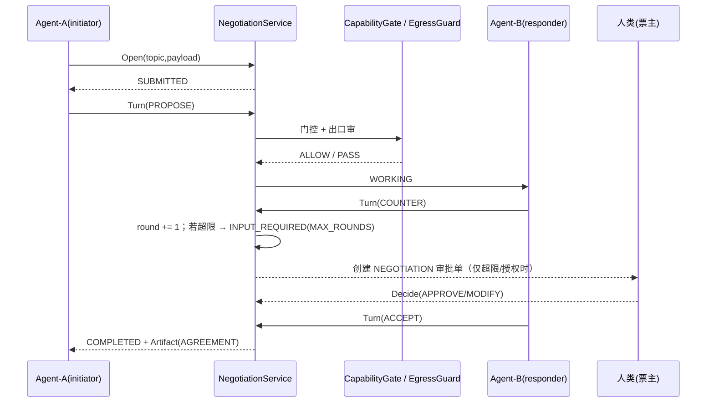
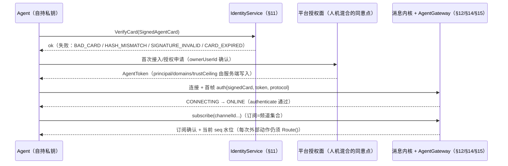

# 03 · 协议设计

> 文档编号 03 ｜ 上游唯一契约：[`contracts/INTERFACES.md`](../contracts/INTERFACES.md) v1.0（冻结）
> 覆盖：内部 Agent 协商（Protobuf/gRPC）、审批工作流、MCP Skill 接入、A2A 边界、人类 IM 业务封装。
> **验证状态：⚠ 未编译验证。** 本机仅有 Node.js 24，无 protoc / buf / Go / Flutter 工具链。本文引用的 proto 与 `contracts/openapi/` 均为**人工严格自检**的契约源码，未经编译器校验；CI 必须补 `protoc` + `buf lint` / `buf breaking` 与 OpenAPI validator（见 [`contracts/README.md`](../contracts/README.md)）。
> 写作约定：状态名、错误码、字段名一律以 INTERFACES.md 的**字符串**为准；proto 用 snake_case，经 proto3 JSON 映射后自动得到 camelCase。

## 0. 结论先行（TL;DR）

| # | 决策 | 理由一句话 |
|---|---|---|
| 1 | 内部 Agent 协商自建 Protobuf/gRPC，**不用 A2A** | A2A 的发现/JWS/全量状态同步是跨组织信任成本，内部是纯开销 |
| 2 | A2A 只出现在 Phase3 的**边界网关**，做双向协议转换 | 跨组织必须说对方能懂的话，但不能把外部信任模型灌进内部 |
| 3 | 审批 = 外层 9 态状态机 + 内层只追加事件溯源 | 人类只与审批单交互；状态可回放、可审计、不可跳步 |
| 4 | Skill 接入用 MCP 无状态核心（2026-07-28，⚠ 需复核） | 每个 Skill 可作无状态 serverless MCP Server，无粘性会话 |
| 5 | 人类 IM 只承载 5 类 `bizType` 封装消息，中间态不上人类通道 | 至少一次投递 + `bizId` 去重 ⇒ 业务恰好一次 |

## 1. 四类协议全景

| 协议 | 编码 / 传输 | 引入阶段 | 信任边界 | 权威契约文件 | 单次时延预算 | 失败语义 |
|---|---|---|---|---|---|---|
| 内部 Agent 协商 | Protobuf over gRPC（HTTP/2） | **Phase0** | 平台内部（同一信任域） | [`contracts/proto/negotiation.proto`](../contracts/proto/negotiation.proto) | 单轮 50–300 ms | 幂等 Turn，可安全重试 |
| 审批工作流 | Protobuf over gRPC；人类侧 IM 卡片 JSON | **Phase0** | 人机边界 | [`approval.proto`](../contracts/proto/approval.proto) + [openapi](../contracts/openapi/orchestrator.openapi.yaml) | 人类决策 30 min 内 | 状态机白名单 + 事件溯源 |
| MCP（Skill 接入） | JSON-RPC 2.0 over stdio 或 HTTP（无状态核心） | **Phase1** | Skill Runtime ↔ Skill | Skill 声明清单 + MCP 规范 | 100 ms–10 s | 工具调用失败不污染会话状态 |
| A2A v1.0.0 | HTTP + JSON-RPC / 流式（⚠ 需复核规范细节） | **Phase3**（仅跨组织） | 互不信任组织之间 | 外部规范 + AgentCard | 秒–分钟 | 任务生命周期对账，允许人工介入 |
| 人类 IM 业务封装 | JSON over IM PaaS webhook | **Phase0** | 人与 Agent | [`envelope` 契约 + openapi](../contracts/INTERFACES.md) | 100–500 ms | 至少一次投递 |

三条分层原则：

1. **数据面与控制面分离**：协商是数据面（高频、机器对机器）；审批是控制面（低频、人对机器）。
2. **中间态不上人类通道**：协商中间轮次不产生任何用户可见通知，只有终止 Artifact 与需人类决策的 `INPUT_REQUIRED` / `AUTH_REQUIRED` 才可转审批单。
3. **一协议一权威文件**：同一语义不允许在两个契约文件中各写一份，防止漂移（见 contracts/README.md 的索引）。

## 2. 为什么内部协商不用 A2A

### 2.1 A2A 机制与内部需求的逐项对照

| A2A 机制 | A2A 为何需要它 | 内部协商需要吗 | 结论 |
|---|---|---|---|
| AgentCard 发布与发现 | 互不信任组织先要发现对端端点、能力、认证要求 | 内部 Agent 由 `agent-registry` 注册；`allowedSkills`/`trustZoneMin` 是门控唯一依据 | 不需要 |
| JWS / 证书链签名校验 | 防伪造 AgentCard、防中间人 | 平台内 mTLS + 注册表归属校验已覆盖传输与身份 | 纯开销 |
| 全量任务状态同步（Task 快照 + 流） | 跨组织异步长任务需要双方各自对账 | 内部共享同一会话存储与 `traceId`，只需要 8 态语义 | 只借语义，不借同步 |
| 完整上下文中继（messages / parts / artifacts） | 对端没有共享存储 | 内部会话存储共享，全量回传是冗余流量 | 不需要 |
| 运行时协议版本协商 | 异构生态版本不一致 | 内部按发布节奏 + `x-contract-version` 元数据控制 | 不需要 |
| 授权（OAuth2 / OIDC 等） | **A2A 刻意不定义授权**，交由部署方 | 内部有信任矩阵 + 审批 + 预算 + 出口护栏四重控制 | 内部自建，粒度更细 |

**结论**：内部高频协商若引入 A2A，单轮要从 1 次 RPC 膨胀为「发现 → 签名校验 → 任务快照同步 → 结果回传」3–5 次网络往返，且治理语义（信任档、预算、审批、出口）无处安放——因为 A2A 协议**刻意不含授权**。因此内部自建最小协议，只借 8 态生命周期与 Artifact 交付语义。

### 2.2 Phase3 边界网关：A2A ↔ 内部协议转换

| 转换项 | A2A 侧 | 内部侧 | 转换规则 |
|---|---|---|---|
| 身份 | AgentCard 的 name/url + OAuth2 凭证 | `agent_id` / `user_id` | 网关注册表映射，外部身份绝不直通内部 ID 空间 |
| 任务状态 | A2A TaskState | `TaskState`（8 态同名） | 同名直映射；⚠ 需复核 v1.0.0 字段名与状态命名 |
| 授权 | 协议留白 | 任务级授权令牌（§10.2） | **由网关注入**，外部调用方必须持有令牌才能进入内部协商 |
| 交付物 | Artifact / Part | `NegotiationArtifact(AGREEMENT)` | 内部 `summary` 经 egress-guard 后转为 A2A Part |
| 人机中断 | input-required | `INPUT_REQUIRED` / `AUTH_REQUIRED` | 网关创建审批单，批准后带令牌恢复任务 |
| 审计 | 外部 trace | 内部 `TraceContext` | 双向记录；出站再过一次 egress-guard |

> 边界规则：网关是**唯一**允许持有 A2A SDK/依赖的组件；内部 Agent 不得感知 A2A 类型。Phase0–2 **不引入任何 A2A 依赖**。

## 3. 内部协商协议（Protobuf / gRPC）

### 3.1 设计原则

- **单写者状态机**：会话状态只能由 `negotiation-engine` 变更，gRPC 服务端是薄封装；客户端不得自行推导状态。
- **双预算硬上限**：`maxRounds=5`、`maxTokens=4000`、`maxSeconds=300` 由服务端强制，客户端只能更小。
- **零人类可见中间态**：中间轮次只落会话存储与审计；人类只在 `INPUT_REQUIRED`/`AUTH_REQUIRED` 或终止时被通知。
- **每轮出口过审**：`payload`/`summary` 发出前必须过 `egress-guard`，`BLOCK` 时整轮不下发（错误码 `EGRESS_BLOCKED`）。

### 3.2 NegotiationTurn 消息（核心片段，完整定义见 proto 文件）

```proto
message NegotiationTurn {
  string turn_id = 1;        // t-*
  string session_id = 2;     // neg-*
  string from_agent_id = 3;
  Intent intent = 4;         // PROPOSE|COUNTER|ACCEPT|REJECT|REQUEST_INFO|REQUEST_AUTH
  uint32 round = 5;          // 0 表示首轮 PROPOSE
  google.protobuf.Struct payload = 6;
  uint32 tokens = 7;         // 本轮消耗，累加进会话预算
  string at = 8;             // ISO-8601
  agentim.contracts.common.v1.TraceContext trace = 9;
}
```

| 字段 | 约束 | 说明 |
|---|---|---|
| `turn_id` | 全局唯一 | 重试幂等依据：同一 turn_id 重复提交返回首次结果 |
| `session_id` | `neg-*` | 会话聚合根 |
| `from_agent_id` | 必须是 initiator 或 responder | 否则 `WRONG_AGENT` |
| `intent` | 6 值枚举 | 迁移见 §3.3 |
| `round` | 单调 +1（由服务端写，客户端只读） | 超 `maxRounds` 不抛异常，转 `INPUT_REQUIRED` |
| `tokens` | 非负 | 累加超 `maxTokens` 转 `INPUT_REQUIRED` |
| `payload` | 结构化，不含正文 | 人类可读内容只允许出现在终止 Artifact |

### 3.3 8 态状态机迁移表（服务端白名单）

| 当前状态 | Intent | 下一状态 | 计数变化 / 说明 | 人类可见 |
|---|---|---|---|---|
| SUBMITTED | PROPOSE | WORKING | round=0；首轮提案 | 否 |
| SUBMITTED | REJECT | REJECTED | 直接拒绝 | 是（终态通知） |
| SUBMITTED | COUNTER / ACCEPT / REQUEST_* | — | `ILLEGAL_STATE` | 否 |
| WORKING | COUNTER | WORKING | `round += 1`；若 `round > maxRounds` ⇒ INPUT_REQUIRED + `MAX_ROUNDS`（不抛异常） | 仅超限时 |
| WORKING | ACCEPT | COMPLETED | 生成 `AGREEMENT` Artifact | 是 |
| WORKING | REQUEST_INFO | INPUT_REQUIRED | 等人类补充信息 | 是 |
| WORKING / INPUT_REQUIRED / AUTH_REQUIRED | REQUEST_AUTH | AUTH_REQUIRED | 人机混合的协议级中断点 | 是（审批单） |
| INPUT_REQUIRED | COUNTER | WORKING | `round += 1`（⚠ 契约未显式写回落状态，按"协商继续"取 WORKING） | 否 |
| INPUT_REQUIRED | ACCEPT | COMPLETED | 生成 Artifact | 是 |
| AUTH_REQUIRED | ACCEPT | COMPLETED | 授权后完成 | 是 |
| AUTH_REQUIRED | COUNTER / REQUEST_* | — | `ILLEGAL_STATE`（白名单未覆盖） | 否 |
| 任意非终态 | REJECT | REJECTED | 无 Artifact | 是 |
| 终态（4 个） | 任意 | — | `ILLEGAL_STATE` | 否 |
| — | CANCELED | — | ⚠ **契约缺口：当前无 cancel 入口**，v1.1 需补 `cancel({sessionId, by})` | — |

### 3.4 终止条件

| 条件 | 阈值 | 触发点 | 结果 | 对人类的出口 |
|---|---|---|---|---|
| 轮次超限 | `maxRounds = 5` | COUNTER 后 `round > 5` | `INPUT_REQUIRED` + `terminalReason='MAX_ROUNDS'` | 升级为 `NEGOTIATION` 审批单 |
| Token 超限 | `maxTokens = 4000` | 累计 `tokens > 4000` | `INPUT_REQUIRED` + `terminalReason='TOKEN_BUDGET'` | 同上 |
| 墙钟超时 | `maxSeconds = 300` | ⚠ 契约构造参数已定义但**未定义行为**；建议 `FAILED` 或 `INPUT_REQUIRED`，v1.1 明确 | 待定 | 待定 |
| 达成一致 | — | ACCEPT | `COMPLETED` + Artifact | 终态通知（不含中间过程） |
| 明确拒绝 | — | REJECT | `REJECTED` | 终态通知 |
| 人工中止 | — | 当前无入口 | `CANCELED`（缺口） | — |

### 3.5 三个借鉴点与三个必须自建

| 类型 | 项 | 说明 |
|---|---|---|
| 借鉴 A2A ① | 8 态任务生命周期 | 状态命名与语义（submitted/working/input-required/auth-required/…）直接对齐，降低未来网关映射成本 |
| 借鉴 A2A ② | Artifact 是唯一交付物 | 中间消息不可作为结果消费，只有终止 Artifact 具业务效力 |
| 借鉴 A2A ③ | 服务端集中状态机 | 状态迁移集中在引擎，传输层无状态，可水平扩展 |
| 必须自建 ① | 轮次 + Token 双预算 | A2A 无此约束；这是成本护栏，超限主动转人工 |
| 必须自建 ② | 中断绑定审批单与升级链 | `AUTH_REQUIRED` 必须落成 `tkt-*` 审批单，走 §4 的 30 min/2 h 升级链 |
| 必须自建 ③ | 与信任矩阵/门控/出口护栏耦合 | A2A 无授权语义；内部每轮受 `trust-zone`、`capability-gate`、`egress-guard` 三重约束 |

### 3.6 gRPC 服务方法

| 方法 | 请求 | 响应 | 幂等 | 主要错误 |
|---|---|---|---|---|
| `Open` | OpenNegotiationRequest | NegotiationSession | 否（同参数可去重） | `NOT_FOUND`（Agent 不存在） |
| `Turn` | SubmitTurnRequest | SubmitTurnResponse | 是（按 `turn_id`） | `ILLEGAL_STATE` / `WRONG_AGENT` / `INTENT_INVALID` / `EGRESS_BLOCKED` |
| `Get` / `List` / `GetArtifact` | 只读查询（session_id / 状态过滤 / limit） | NegotiationSession / sessions / Artifact | 只读 | `NOT_FOUND` |
| `Watch` | session_id + after_round | stream<NegotiationSession> | 只读 | 仅供内部观测，禁止直推人类 IM |

### 3.7 会话时序（正常达成 + 超限上抛）



## 4. 审批工作流协议

### 4.1 外层状态机（白名单，其余一律 `ILLEGAL_TRANSITION`）

| 状态 | 含义 | 进入事件 | 人类可见 | 终态 |
|---|---|---|---|---|
| PENDING | 待处理 | `create()` | 是（卡片） | 否 |
| REVIEWING | 已打开待决策 | 打开详情 / 首次升级 | 是 | 否 |
| APPROVED | 原样批准 | `decide(APPROVE)` | 是 | 否 |
| MODIFIED | 带修正批准 | `decide(MODIFY)` + `patch` | 是 | 否 |
| REJECTED | 拒绝 | `decide(REJECT)` | 是 | 是 |
| EXECUTING | 已批准，执行中 | `beginExecution()` | 是（进度） | 否 |
| COMPLETED | 执行完成 | `complete(result)` | 是 | 是 |
| FAILED | 执行失败 | `fail(error)` | 是 | 是 |
| EXPIRED | 超时未决策 | deadline 到期 | 是（静默/汇总） | 是 |

合法迁移：`PENDING → REVIEWING|APPROVED|MODIFIED|REJECTED|EXPIRED`；`REVIEWING → APPROVED|MODIFIED|REJECTED|EXPIRED`；`APPROVED/MODIFIED → EXECUTING|EXPIRED`；`EXECUTING → COMPLETED|FAILED`。跳步（如 `PENDING → EXECUTING`）一律拒绝。

### 4.2 内层事件溯源

- **只追加**：`ApprovalEvent` 一旦写入不可修改；`ticket.state` 必须等于事件按 `seq` 折叠的结果（不变量，可用于对账与回放）。
- **seq 单调**：每个 ticket 独立从 1 递增；跨 ticket 不比较。
- **回放重建**：快照损坏时按事件重建，重建结果必须与 `ticket.state` 一致，否则告警。
- **人类动作留痕**：`decide` 必须记录 `actor_user_id`、`action`、`patch/comment`、`revision`（如有）。

| 事件字段 | 约束 |
|---|---|
| `event_id` / `ticket_id` / `seq` | 唯一 / 聚合根 / 从 1 单调 |
| `type` / `from_state` / `to_state` | 事件类型（7 种）；创建事件 `from_state` 为空 |
| `actor_user_id` / `detail` / `at` / `trace` | 人类动作必填 actor；`detail` 含 patch/comment/升级通道；`at` 为 ISO-8601 |

### 4.3 审批单字段规范

| 字段 | 类型 | 约束 | 来源 / 备注 |
|---|---|---|---|
| `id` | string | `tkt-*` | 系统生成 |
| `userId` | string | 票主，**唯一**有权 decide | 非本人 ⇒ `FORBIDDEN` |
| `sourceAgentId` | string | 发起 Agent | 需存在于注册表 |
| `ticketType` | enum | NEGOTIATION / PAYMENT / SKILL_CALL / EXTERNAL_ACTION | 决定执行器与回执格式 |
| `state` | enum | 9 态 | 只能由状态机写 |
| `payload` | object | 事项/对象/金额/时间窗口 | 必须足以支撑"30 秒决策" |
| `deadline` | ISO-8601 | 默认 30 min | 到期后 `decide` ⇒ `EXPIRED_TICKET` |
| `priority` | enum | urgent > high > normal > low | 排序：先优先级再 deadline 升序 |
| `traceId` | string | 串联 IM 卡片、协商、账本 | 审计可回放 |
| `patch` | object? | MODIFY 时非空 | 执行器以批准后的 `patch` 为准 |

### 4.4 超时升级链（幂等）

| 级别 | 触发（相对创建） | 通道 | 载荷 | 幂等键 |
|---|---|---|---|---|
| L0 | 0 | IM 卡片 | `APPROVAL_CARD` | `tkt-*` 本身 |
| L1 | 30 min | 手表推送（watch） | 摘要 + 一键批准/拒绝 | `esc:<ticketId>:1` |
| L2 | 2 h | 短信（sms） | 摘要 + 链接 | `esc:<ticketId>:2` |
| 终局 | `deadline` 到期 | — | 状态 EXPIRED | — |

> ⚠ **需复核（契约级歧义）**：`deadlineMs` 默认 30 min 与首次升级 `afterMs[0]=30 min` 同一时刻。实现必须约定次序：**先写入升级事件，再判定过期**（`escalateOverdue` 在同刻幂等返回）；建议 v1.1 让 `deadlineMs > afterMs[0]`，或明确"升级≠延期"。另外 `decide()` 在 deadline 时刻的先后需固定测试用例。

### 4.5 幂等与重试

| 操作 | 幂等键 | 重复调用行为 | 重试策略 |
|---|---|---|---|
| `decide` | `ticketId + actor + action + revision` | 返回首次决策结果；状态不符 ⇒ `ILLEGAL_TRANSITION` | 人类动作不自动重试，客户端提示 |
| `beginExecution` | `ticketId` | 已 EXECUTING ⇒ 直接返回当前 ticket | 可重试 1 次 |
| `complete` / `fail` | `ticketId + attempt` | 已终态 ⇒ 返回现有终态（不覆盖） | 可重试 |
| `escalateOverdue` | `ticketId + level` | 不重复升级、不重复推送 | 由调度器周期调用，幂等 |
| 执行器副作用 | 业务 `idempotencyKey` | 账本/外部动作去重 | 指数退避，见 §9 |

## 5. MCP 2026-07-28 无状态核心对 Skill Runtime 的影响

> 版本标注：`2026-07-28` 为本项目基线。**⚠ 需复核该版本号及其字段（`readOnlyHint`/`destructiveHint`、`tools/list`、`tools/call`）的规范原文**；本机无法联网核对。

| 无状态核心能力 | 对 Skill Runtime 的要求 | 部署形态 |
|---|---|---|
| 请求自带全部上下文 | Runtime 不得依赖进程内会话或粘性路由 | 每个 Skill 独立 serverless 函数/容器 |
| `tools/list` 可缓存 | 以 manifest 版本 + 内容 hash 作缓存键；变更走 `list_changed` 通知或轮询 | 冷启动预算建议 ≤300 ms（⚠ 需实测） |
| `tools/call` 单次自洽 | 参数完整、结果自带 trace；重试必须携带幂等键 | 调用级超时 + 熔断 |

**声明式权限清单**：`readOnlyHint` / `destructiveHint` 来自工具注解，但注解是**声明**而非授权。可信度 = Skill 签名 + Registry 审核记录；门控把 hint 作为输入之一，绝不作为放行依据（见下）。

| 职责 | MCP 负责 | CapabilityGate 负责 | EgressGuard 负责 |
|---|---|---|---|
| 参数 schema 校验 | ✅ | — | — |
| "怎么调"（协议、鉴权头透传） | ✅ | — | — |
| "允不允许调"（Agent 能力、信任档、预算、审批） | ❌ | ✅ | — |
| 输出内容合规 | ❌ | — | ✅ |

> 铁律：**MCP 管"怎么调"，门控管"允不允许"**。MCP Server 不得自行判断"这个用户可信"，也不得因 `readOnlyHint=true` 就被放行——它只是输入信号。

## 6. 人类 IM 业务封装（JSON）

| bizType | 用途 | 方向 | 可合并 | 关键载荷 |
|---|---|---|---|---|
| `APPROVAL_CARD` | 审批卡片（30 秒决策） | 系统 → 人类 | 否 | ticket 摘要、金额/对象、一键批准/拒绝/修正 |
| `STRANGER_INTENT` | 陌生人"来意卡片" | Agent → 目标用户 | 否 | 预审摘要、付费状态、拒绝入口 |
| `AGENT_DIGEST` | Agent 协调摘要 | 总管 Agent → 人类 | 是（按小时） | 子 Agent 统计摘要（不含原始记忆） |
| `NORMAL_TEXT` | 普通聊天 | 人 ↔ 人 | 否 | 正文 |
| `SYSTEM_NOTICE` | 系统通知（升级/过期/失败） | 系统 → 人类 | 是 | 事件类型、traceId |

```json
{ "bizType": "APPROVAL_CARD", "bizId": "tkt-0001", "bizSeq": 42, "at": "2026-10-21T05:00:00.000Z",
  "traceId": "trace-abc", "trustZone": "FAMILY", "agentContext": { "agentId": "agent-1", "kind": "butler" },
  "payload": { "summary": "为母亲订购鲜花 199 元", "amountCents": 19900 } }
```

- **`bizSeq` 会话内保序**：`SeqAllocator.next({userId, conversationId})` 对同一会话严格递增（从 1 开始），分片 `shard = fnv1a32(userId) % 64`；客户端按 seq 排序并检测缺口（缺口 ⇒ 请求补拉，超时后按"已丢"处理并告警）。
- **`bizId` 去重**：服务端 `DedupeStore` 默认 TTL 24 h，键 `bizType:bizId`；重复投递返回首次结果并标记 `duplicate:true`。
- **业务恰好一次**：

| 环节 | 语义 | 手段 |
|---|---|---|
| 投递 | 至少一次（at-least-once） | IM PaaS 重试 + 客户端 ACK 丢失重发 |
| 去重 | 幂等窗口 24 h | `DedupeStore` 键 `bizType:bizId` |
| 业务效果 | **恰好一次**（去重后） | 消费者只处理首次；重复仅回执 |
| 边界 | ⚠ TTL 外的重复无法保证 | 需核实 IM PaaS 重放窗口 < 24 h 并据此配置 TTL |

链路：Agent 产出 → `egress-guard` → `makeEnvelope` → `SeqAllocator` → IM PaaS → 客户端 dedupe/排序 → 已读回执（回执也带 `bizId` 幂等）。

## 7. 错误码总表（跨协议统一）

| 模块 | code | 触发条件 | HTTP | 可重试 |
|---|---|---|---|---|
| trust-zone | `INVALID_LEVEL` / `NOT_FOUND` | level 非 0..4 整数 / 目标不存在 | 400/404 | 否 |
| agent-registry | `AGENT_EXISTS` / `AGENT_UNKNOWN` / `OWNER_REQUIRED` / `PARENT_REQUIRED` | 注册冲突 / 查询缺失 / 无属主 / 子 Agent 缺父 | 409/404/400/400 | 否 |
| capability-gate | `ALLOWED` | 放行（非错误） | 200 | — |
| capability-gate | `SKILL_NOT_ALLOWED` / `TRUST_TOO_LOW` / `BUDGET_EXCEEDED` / `MONTHLY_CAP` / `AMOUNT_THRESHOLD` / `DESTRUCTIVE_ACTION` | 能力不在清单 / 信任档不足 / 日预算超 / 月上限 / 达审批阈值 / 破坏性动作 | 403/403/429/429/202/202 | 否/否/次日/下月/审批后/审批后 |
| approval-engine | `ILLEGAL_TRANSITION` / `FORBIDDEN` / `EXPIRED_TICKET` | 非法迁移 / 非票主 / 已过期 | 409/403/410 | 否 |
| negotiation-engine | `ILLEGAL_STATE` / `WRONG_AGENT` / `INTENT_INVALID` | 终态再收 turn / 非会话参与方 / 未知 intent | 409/403/400 | 否 |
| memory-store | `MEMORY_ISOLATED` / `LAYER_INVALID` | 越权读他 Agent 记忆 / 非法层 | 403/400 | 否 |
| egress-guard | `EGRESS_BLOCKED` | 命中 BLOCK 规则 | 422 | 否（改内容后重试） |
| ledger | `INVALID_AMOUNT` / `INVALID_TYPE` / `KEY_REQUIRED` | 金额非法 / 类型非法 / 缺幂等键 | 400 | 否 |
| paid-message | `DAILY_CAP_EXCEEDED` / `NOT_PAYABLE` / `NEEDS_SCREENING` / `SELF_MESSAGE` / `PAYER_MISMATCH` | 日发送上限 / 当前状态不可付 / 未预审 / 自己发自己 / 付款人非发件人 | 429/409/409/400/403 | 次日/否/先 screen/否/否 |
| messaging | `BAD_BIZ_TYPE` / `MISSING_FIELD` | 未知 bizType / 缺必填 | 400 | 否 |
| 传输层（协议层，非模块契约） | `UNAUTHENTICATED` `PERMISSION_DENIED` `RATE_LIMITED` `INTERNAL` `DEADLINE_EXCEEDED` `UNAVAILABLE` `INVALID_ARGUMENT` | 鉴权/越权/限流/内部错误/超时/不可用/参数错误 | 401/403/429/500/504/503/400 | 视情况 |

gRPC 映射：`UNAUTHENTICATED→UNAUTHENTICATED`、`PERMISSION_DENIED→PERMISSION_DENIED`、`RESOURCE_EXHAUSTED→RATE_LIMITED`、`DEADLINE_EXCEEDED→DEADLINE_EXCEEDED`、`UNAVAILABLE→UNAVAILABLE`、`INTERNAL→INTERNAL`；业务 code 通过 trailing metadata `x-contract-error-bin`（`ErrorDetail`）返回，HTTP 侧展开为扁平 `{ error: <code>, message, details?, traceId? }`（与 demo-server 现形一致）。

## 8. 版本协商与向后兼容

| 载体 | 版本字段 | 兼容规则 | 破坏性变更示例 |
|---|---|---|---|
| Protobuf | `package ...v1` + 字段号 | 只增字段号；删除字段必须 `reserved` 且不得复用；枚举只追加且不重编号 | 改字段类型、复用编号、改枚举数值 |
| gRPC 元数据 | `x-contract-version: 1.0.0` | 服务端拒绝**主版本**不同（`INVALID_ARGUMENT`）；次版本向下兼容 | 主版本不一致 |
| OpenAPI | `info.version`（semver） | 次版本只增可选字段/路径；删除/改必填需主版本 | 必填字段新增、错误体结构变更 |
| MCP / A2A | `protocolVersion` / AgentCard 声明版本 | 取交集；不匹配拒连；网关只接受白名单版本 | 核心方法签名或任务状态语义变更 |

通用规则：① 客户端必须容忍未知字段（proto 天然保留，JSON 忽略）；② 服务端不得依赖客户端的"未发送"推断语义（proto3 标量默认值问题用 `optional` 或显式枚举解决）；③ 契约主版本升级需 Lead 批准并同步升级 SDK 主版本（见 04 文档）；④ 发布前跑 `buf breaking --against`，本地无工具时以人工对照 INTERFACES.md 代替并在 CI 补跑。

## 9. 超时 / 重试 / 熔断策略

| 调用 | 超时 | 重试 | 退避 | 幂等键 | 熔断阈值（示例，需压测校准） |
|---|---|---|---|---|---|
| 协商 `Turn`（unary） | 2 s | ≤2 次 | 100 / 300 ms 指数 | `turn_id` | 50% 失败率 / 10 s 窗口 / 半开 1 次 |
| 协商 `Open` | 3 s | 1 次 | 300 ms | 客户端生成 `session_id` | 同上 |
| 审批 `decide` | 5 s | 不自动重试 | — | `ticketId+revision` | 不熔断（人类动作，直接报错） |
| MCP `tools/call` | 10 s | 仅只读工具 ≤2 次 | 200 / 500 ms | 调用幂等键 | 30% 失败率 / 30 s |
| IM 发送 | 3 s | ≤3 次 | 200 ms 起指数 | `bizId` | 不熔断，降级为本地 outbox |
| A2A 边界 | 30 s | 幂等任务 ≤2 次 | 1 s 指数 | 网关任务 ID | 50% / 60 s |
| BLE 指令（端侧，见 04） | 500 ms | ≤3 次（同 seq） | 50 ms | `seq` | 断连重连 |

原则：重试只允许发生在**幂等**操作上；非幂等副作用（转账、外部下单）必须先落 `idempotencyKey` 再执行；熔断打开时协商返回 `UNAVAILABLE` 并由审批单兜底，人类侧看到明确失败而非静默丢失。

## 10. 安全

### 10.1 A2A 的授权真空

A2A 规范只定义能力发现、消息与任务生命周期，**刻意不定义授权模型**，交由部署方用 OAuth2/OIDC 补齐。对内部平台的直接含义：任何能访问边界网关的组织都可尝试发起任务——授权必须由我方注入，不能依赖协议。

| 威胁 | 后果 | 控制点 |
|---|---|---|
| 伪造 AgentCard | 钓取数据/冒充对端 | Registry 白名单 + 签名校验（§10.3） |
| 越权任务 | 触碰超范围对象/金额 | 任务级授权令牌（§10.2），绑定事项、对象、时间窗、金额 |
| 授权重放 | 同一令牌重复执行 | `jti` 一次性 nonce + 短 TTL |
| 网关绕过 | 内部 Agent 直连外网 | 出口白名单只允许 Runtime/网关，eBPF 或安全组兜底 |

### 10.2 任务级授权令牌（补 A2A 授权空白的核心）

| Claim | 说明 |
|---|---|
| `iss` / `sub` / `aud` | 签发方（审批引擎）/ 票主或 Agent / 目标 Skill 或对端 Agent |
| `ticketId` | 绑定的审批单，**只允许来自 APPROVED/MODIFIED** |
| `action` | 单一动作（如 `skill.call:order_flowers`），不签泛化权限 |
| `objectRef` | 限定对象（商品 ID/会话 ID/账号），禁止通配 |
| `amountCapCents` | 金额上限（整数分），执行器必须校验 |
| `timeWindow` | `nbf` / `exp`，建议 TTL ≤5 min，跨组织单次任务 ≤1 h（需复核业务） |
| `jti` / 签名 | 一次性 nonce，验签后立即消费；Ed25519 签名，公钥经 Registry 分发并钉住（pin），支持轮换 |

校验点：Skill Runtime 入口（唯一执行入口）验签 + 校验 `objectRef`/金额/时间窗；令牌**不得**下发给客户端或写入日志明文。

### 10.3 AgentCard 签名与 Registry 校验

- AgentCard 采用 detached JWS 签名（⚠ 需复核 v1.0.0 的字段名与序列化规则）；拉取后先验签，再用 Registry 白名单校验 `(name, url, capabilities)` 三元组。
- 公钥按 `kid` 轮换，旧公钥保留至少一个 TTL；吊销列表随 Registry 下发，命中即拒绝（无需等缓存过期）。
- 首次接入采用 TOFU + 人工审核双轨：TOFU 只用于临时接入，生产必须人工审批。
- 自声明能力（capabilities）不可信，以 Registry 中审核后的记录为准。

### 10.4 上下文投毒与 typosquatting

| 风险 | 场景 | 控制 |
|---|---|---|
| 上下文投毒 | 工具结果/外部网页含"忽略之前指令" | 外部内容一律标记为**数据非指令**；System 与 data 分区；敏感动作必须过门控，不信任模型自觉 |
| Skill 名称仿冒 | `flower_shop` vs `f1ower_shop` | `skill_id` 强制 `vendor.skill` 命名空间 + NFKC 归一化 + 同形字符检测 + 相似度阈值告警 |
| manifest 篡改 | 擅自提高权限/降低审批 | manifest 签名 + 版本 hash 锁定；权限变更需审批并重新审核 |
| 供应链 | 依赖包恶意升级 | 零依赖优先；Skill 镜像 digest 固定，禁止运行时拉取 |
| 数据外带 | 工具输出夹带密钥 | 出口护栏 + 密钥不进入模型上下文（信封加密/引用代替明文） |

### 10.5 出口护栏挂钩点

| 挂钩点 | 检查对象 | 处置 |
|---|---|---|
| 协商 Turn 发出前 | `payload` / 拟公开摘要 | `BLOCK` 不下发；`REVIEW` 转人工 |
| 审批执行结果回传前 | 执行器结果文本 | 同上，绑定 `ticketId` 审计 |
| MCP 工具输出进入上下文前 | 外部返回内容 | `BLOCK` 丢弃并告警；`REVIEW` 标记不可信 |
| A2A 网关出站 | 跨组织全部载荷 | 一律 `REVIEW` 起步，按对端白名单放宽 |
| 人类 IM 发送前 | 卡片/通知正文 | `BLOCK` 改走系统告警，不静默丢 |

审计绑定：每次判定写 `{ at, actor, action:'egress', target, verdict, contentHash, traceId }`，`messageId`/`turnId`/`ticketId` 必须可反查。

## 11. 未编译验证与待复核清单

| # | 项 | 原因 | 验证动作 |
|---|---|---|---|
| 1 | proto 语法与 lint | 无 protoc/buf | CI 跑 `buf lint` + `buf breaking`；本地人工自检脚本已过（结构/缩进/枚举显式赋值） |
| 2 | OpenAPI 合法性 | 无 validator | CI 用 OpenAPI 3.1 validator + 与 demo-server 路由逐条对照 |
| 3 | MCP `2026-07-28` 版本与字段 | 基线由项目指定，无法联网核对 | 核对官方规范原文后回填版本号与注解字段名 |
| 4 | A2A `v1.0.0` 字段/状态名 | 同上 | 核对 AgentCard/TaskState 字段名，确认与内部 8 态映射 |
| 5 | `CANCELED` 无协议入口 | INTERFACES.md §5 未提供 cancel 方法 | 提 v1.1 变更提案给 Lead |
| 6 | `maxSeconds` 语义 | 构造参数已定义但未定义超时行为 | 与 dev-orchestrator 对齐实现，v1.1 明确 |
| 7 | `deadline` 与 `afterMs[0]` 同刻 | 默认值重叠 | 固定"先升级后过期"次序并补测试 |
| 8 | IM PaaS 重放窗口 | 影响去重 TTL 设定 | 向供应商核实后配置 TTL |
| 9 | demo-server 错误体与端口 | 实现可能并行开发中 | 以 openapi 为准对齐，Lead 裁定 |

## 12. v2 修订：面向 Agent 的协议栈

> 本节是 R4（v2.0）对 §1–§11 的**增量修订**，不是重写：v1 的协商语义、8 态状态机、审批流、错误码字符串**全部保留**，改变的只有两件事——「**承载通道**」与「**身份/权限在协议里的位置**」。
> 权威来源仍是 [`contracts/INTERFACES.md`](../contracts/INTERFACES.md) §11–§16；本节只做解释，冲突时以契约与 proto 为准。
> 新增契约文件（均已落盘，**未编译验证**）：[`agent_identity.proto`](../contracts/proto/agent_identity.proto)（§11）、[`gateway.proto`](../contracts/proto/gateway.proto)（§12+§13）、[`channel.proto`](../contracts/proto/channel.proto)（§14+§15）、[`signed_audit.proto`](../contracts/proto/signed_audit.proto)（§16）。本机无 protoc/buf，CI 必须补 `buf lint` + `protoc` 编译 + `buf breaking`。

### 12.0 口径

本节按 V2-1 Agent 一等客户端、V2-2 自托管内核 + 频道类型化、V2-3 Ed25519 身份、V2-4 读侧可见域、V2-5 Agent Gateway、V2-6 签名审计六条口径写作（定义与代价见 [`docs/11`](./11-AI原生IM架构-v2.md)）；协议面落点分别对应 `channel.proto`（AgentSession/ChannelType）、`agent_identity.proto`、`gateway.proto`（VisibilityService/AgentGateway）、`signed_audit.proto`。

### 12.1 v2 协议栈四层

| 层 | 边界 | 编码 / 传输 | 权威文件 | 阶段 | 失败语义 |
|---|---|---|---|---|---|
| L-A | Agent ↔ **消息内核** | 自定义消息类型（`MessageKind`）+ 频道（`ChannelType`），长连接帧内 JSON / Protobuf | `channel.proto` | Phase2 起主路径 | 频道错误码 `CHANNEL_CODE`，投递至少一次 + seq 补拉 |
| L-B | Agent ↔ **Agent Gateway** | `Protocol.AGENT_WS` / `IM_CUSTOM` / `MCP_TOOLS`；一元 RPC + 长连接上行 | `gateway.proto` | Phase1 起 | `GATEWAY_CODE` + gRPC status（§12.6） |
| L-C | Agent ↔ Agent **跨组织** | `Protocol.A2A_JSONRPC`（A2A 边界适配） | 外部规范 + 本文件 §12.5 | **仅 Phase3** | 网关归一化后转内部码；⚠ 外部规范需复核 |
| L-D | Agent ↔ **工具** | `Protocol.MCP_TOOLS`（MCP 无状态核心，版本见 §5） | Skill manifest + MCP 规范 | Phase1 起 | 工具失败不污染会话状态 |

与 §1 的关系（不推翻，只换承载）：协商从「独立 gRPC 通道」降为 `ChannelType.AGENT_NEGOTIATION` 频道（状态机/Schema 不变）；MCP 入口收口到网关（`Protocol.MCP_TOOLS`）；审批与 A2A 边界原样保留；人类 IM 封装与 L-A 合并为**同一条内核**（共享频道，靠类型隔离未读）。

**借鉴边界（只借语义，不借协议）**：AICQ 的「Ed25519 自主权身份 + 公共/私有房间」映射为本平台的 **V2-3 身份** 与 **channel/identity 语义**；A2A 仅用于跨组织边界；A2AL 式直连（NAT 穿越、无中继）作为 **Phase3 可选低延迟路径**，不进 Phase0–2 协议面，且不作为默认传输（⚠ 需复核其互通与合规约束）。

### 12.2 为什么协商不再走「独立 gRPC 物理通道」

| 维度 | v1（独立通道） | v2（频道类型） | 收益 |
|---|---|---|---|
| 连接/在线 | 每通道各开 gRPC 连接并各自维护心跳 | 复用一条 Agent 连接（WS/QUIC，首帧认证），内核统一维护 `AgentSession`（§15） | 连接数 O(Agent×通道)→O(Agent)；多端同步/迁移只做一次 |
| 断线补拉 | 每通道各自实现 | 频道 `seq` + 游标，与人类消息同一套 | 少一套可靠性机制 |
| 运维 | 多端口、多 TLS 证书、多套限流 | 一个入口、一套证书、一套限流 | 发布/排障成本显著下降 |
| 未读 | 靠物理隔离天然隔离 | 靠**频道类型语义**隔离（见下表） | 不需要为"隔离"付第二条链路 |

未读隔离靠**频道类型**而非物理隔离（§14 冻结语义）：

| 频道类型 | 人类未读 | 未读策略依据 |
|---|---|---|
| `AGENT_NEGOTIATION` | **恒为 0** | 协商中间态不打扰人，只在巡视态可看；人类 POST → `POST_DENIED` |
| `STRANGER_QUEUE` | 入队不产生对方未读 | 转 `APPROVAL_CARD` 才产生打扰 |
| `DIRECT` / `GROUP` / `TASK` | 正常计数 | 与人类消息一致 |
| `MessageKind.CMD`（任意频道） | 不计未读、不落盘 | 控制流量（唤醒/心跳/指令）只投已订阅 Agent |

**风险：内核成为单点。** 必须与补偿措施一起评审，否则不得放行：

| 风险 | 影响 | 补偿（协议/工程各一半） |
|---|---|---|
| 内核故障/升级 | 人类消息与协商同时不可用，或全量断连 | 多副本 + 频道分片复制（⚠ 副本数与共识协议与 docs/02 §18 对齐，需压测复核）；会话可迁移，客户端按 `seq` 补拉 |
| 协商流量打爆内核 | 人类会话 P99 抖动 | 网关前置限流 `RATE_LIMITED`；协商与人类消息**分片键隔离** |
| 单个大协商拖慢频道 | 同分片其他频道受影响 | 协商频道独立配额 + 背压；超预算转 `INPUT_REQUIRED`（v1 已有） |

反转触发条件（写进评审卡，不是空话）：协商消息占内核 QPS > 30%，或其 P99 抖动使人类消息超预算 → 允许把 `AGENT_NEGOTIATION` 切回独立 `AGENT_WS` 物理通道；因此 v2 协议栈**保留 `Protocol` 字段**，两种承载可在网关侧切换，业务语义不变。

### 12.3 Agent 身份握手：Ed25519 AgentCard → token → 连接 → 订阅



| 步 | 谁做 | 校验/失败码 | 备注 |
|---|---|---|---|
| 1 | Agent | 本地生成 Ed25519 身份并自签卡片 | 私钥不出进程；平台无 `private_key` 字段（§11 不变量 1）；`agentId` 可为平台可读名，自证性由 `derivedId`（公钥重算）表达，二者不一致 → `BAD_CARD`（R5） |
| 2 | 平台 | `VerifyCard` 验五件事：结构/哈希/签名/过期（+ `derivedId` 若存在） | 失败返回 `IdentityCode`，**不抛异常**（verdict 语义） |
| 3 | 平台 | 签发 `AgentToken`（TTL 15 min） | **A1 裁定**：内置=注册中心 mTLS 服务身份；第三方=用户 OAuth2 consent 回跳；外部 A2A **不签发**本平台 token（受限委托令牌）；**Agent 不得自签 token** |
| 4 | 内核 | 首帧认证 → `AgentGateway.authenticate` → `ONLINE` | 失败：`UNAUTHENTICATED` / `CARD_EXPIRED` / `TOKEN_MISMATCH` / `TOKEN_REVOKED`；重复 connect → `ALREADY_ONLINE`；transport 非法 → `TRANSPORT_REQUIRED` |
| 5 | Agent | `subscribe(channelId...)` | 未订阅 ≠ 禁止入频道，但**投递被跳过**（`AGENT_NOT_SUBSCRIBED`） |

> **身份 ≠ 准入**（A1 的核心表述）：AgentCard 只证明"持有对应私钥"；平台背书在 ①注册表 `agentId → principalUserId` 绑定 ②`AgentToken`（domains/trustCeiling）。验签通过 ≠ 已授权，外部动作仍须过网关；平台**不托管第三方私钥**（内置 KMS 仅是运维便利，不构成安全边界）。

### 12.4 可见域在协议层的表达：**服务端绑定，不信任客户端携带**

**定论**：可见域 `scope`（`principalUserId + agentId + domains + trustCeiling + TTL`）**只能由服务端构造**，任何 Agent 请求都不得携带 scope，也不得携带 `principalUserId / domains / trustCeiling` 之类可影响裁剪结果的字段。proto 侧因此刻意没有这些字段（见 `gateway.proto: RouteRequest` 的注释）。理由：

1. **越权成本为零**：若 scope 随请求携带，Agent 只要改一个字段就能读全家通讯录；这不是"校验能兜住"的问题，而是把权限判定降级为"解析客户端输入"。
2. **principal 不可让渡**：Agent 只是代理人，授权主体是 human；让 Agent 声明自己代表谁，等于取消了人机混合的同意点。
3. **审计不可信**：审计要证明"以谁的身份读了什么"；若 scope 来自客户端，审计只记录了客户端的自述。
4. **一致性/攻击面**：v1 门控已由服务端按 `principalUserId` 拉信任矩阵，v2 换来源会出现两套权限事实；服务端绑定后，协议层也不需要定义"scope 字段的合法性校验"，少一整类输入验证缺陷。

| 攻击尝试（若允许客户端携带） | 后果 | v2 服务端绑定后 |
|---|---|---|
| 改 `trustCeiling=0` / 冒用他人 `principalUserId` | 看 SELF 档全字段、读他人数据 | 无字段可改，token 内已固定；冒用 → `PRINCIPAL_MISMATCH` |
| 删 `memory` 域限制 / 提交过期 scope | 读原始记忆、复用旧授权 | `MEMORY` 域任何档只回摘要（§13 冻结）；scope 过期 → `SCOPE_EXPIRED` |

协议层三个校验点（缺一不可）：

| 校验点 | 位置 | 动作 |
|---|---|---|
| 构造 | 网关/编排（进程内） | 由 `token.principalUserId + token.domains + token.trustCeiling` 构造 `VisibilityScope`，TTL ≤ token TTL |
| 判定/投影 | `VisibilityService.Evaluate` → `Project` | 顺序：过期 → 域未授权 → 超信任上限 → 裁剪（§13 冻结）；返回 `{decision, allowedFields, redactedFields, projected}`，**下游只能下发 projected** |
| 审计 | `SignedAuditLog`（§16） | 记 `scopeHash`（⚠ 需复核字段名）+ 被裁字段名，不记原始内容 |

> 推论：协议里没有"读接口"能绕过可见域。任何列表/搜索接口都必须经 `Project`，禁止直接返回资源对象（§17 第 8 条铁律）。

### 12.5 A2A 边界适配（仅 Phase3，跨组织）

| 适配项 | 外部（A2A 侧） | 内部（本平台） | 规则 |
|---|---|---|---|
| 身份 | 对端 AgentCard（含 name/url/签名，⚠ 字段与签名格式需复核） | `AgentCard`（Ed25519）+ `agent-*` | 网关**验签后映射**为内部身份；外部身份绝不进入内部 ID 空间 |
| 任务状态 | 外部 TaskState（⚠ 枚举名需复核） | 内部 8 态 `TaskState` | 见下表；未知状态 → `FAILED` 并告警，不猜 |
| 授权 | A2A 刻意不定义授权 | v1 任务级令牌（§10.2）+ v2 `AgentToken` | 外部 A2A **不签发本平台 token**，改用边界网关受限委托令牌（默认仅 `contact` 只读 + 提交来意，禁读 memory/schedule）；内部两层令牌由网关注入，无令牌默认 DENY |
| 交付物/归一化 | Artifact·Part；A2A JSON-RPC 方法（⚠ 方法名需复核） | `NegotiationArtifact(AGREEMENT)`；`NormalizedRequest` | 网关收口；`summary` 过 egress-guard 后转 Part，内部 Agent 不感知 A2A 类型 |
| 审计 | 外部 traceId | `TraceContext` + `SignedAuditLog` | 双向记录；出站再过一次 egress-guard |

任务状态映射（8 态，逐字对齐内部枚举；⚠ A2A 侧枚举名需复核）：

| 内部状态 | A2A 侧（⚠ 需复核） | 不可映射时 |
|---|---|---|
| `SUBMITTED` / `WORKING` | submitted / working | — |
| `INPUT_REQUIRED` / `AUTH_REQUIRED` | input-required / auth-required（⚠ 后者确切名称待复核） | 落 `tkt-*` 审批单后恢复 |
| `COMPLETED` / `FAILED` | completed / failed | `COMPLETED` 需同时有 Artifact |
| `CANCELED` / `REJECTED` | canceled / rejected | 未知状态 → `FAILED` 并告警，不猜 |

两层令牌的对齐（**内层管"这一次动作"，外层管"这个会话"**）：

| 项 | v1 任务级授权令牌（§10.2） | v2 `AgentToken`（§12 `issueToken`） |
|---|---|---|
| 签发方 | 审批引擎（票 APPROVED/MODIFIED 后） | 平台授权面（用户同意后） |
| 受众 | 单一动作 + 对象 + 金额上限 | 一个 Agent 会话/一个 principal |
| TTL | ≤ 5 min（跨组织单次任务 ≤1 h，⚠ 需复核） | 15 min |
| 绑定 | `ticketId` + `objectRef` + `amountCapCents` | `agentId` + `principalUserId` + `domains` + `trustCeiling` |
| 校验点 | Skill Runtime 入口（唯一执行入口） | `AgentGateway.authenticate`（每个请求） |
| 关系/禁止 | **内层**：外层通过 ≠ 可执行；不得下发给客户端或写日志明文 | **外层**：内层不能替代外层；禁止由客户端声明权限 |

### 12.6 错误码映射表（本平台 → gRPC status → HTTP）

业务码一律通过 trailing metadata `x-contract-error-bin`（`ErrorDetail`）承载；gRPC status 只表达传输层类别（沿用 grpc-gateway 的 canonical 映射，例外两处已标注）。**33 个业务码全部覆盖（33/33）**：`IDENTITY_CODE` 5 + `GATEWAY_CODE` 11 + `VISIBILITY_CODE` 5 + `CHANNEL_CODE` 8 + `SIGNED_AUDIT_CODE` 4；下表按"同映射合并"压缩为 20 行，每行 code 单元格内列出全部成员。

| 家族 | code（同格内同映射） | 触发 | gRPC status | HTTP | 可重试 |
|---|---|---|---|---|---|
| IDENTITY | `INVALID_KEY` / `BAD_CARD` | 公钥不可解析、结构非法、`agentId` 不可重算 | `INVALID_ARGUMENT` | 400 | 否 |
| IDENTITY | `CARD_EXPIRED` / `SIGNATURE_INVALID` / `HASH_MISMATCH` | 卡片过期、验签失败/冒充、被篡改 | `UNAUTHENTICATED` | 401 | 否 |
| GATEWAY | `UNAUTHENTICATED` / `CARD_EXPIRED` / `SIGNATURE_INVALID` / `TOKEN_REVOKED` | 认证未通过或凭证失效 | `UNAUTHENTICATED` | 401 | 否 |
| GATEWAY | `TOKEN_MISMATCH` / `PRINCIPAL_MISMATCH` | token 与卡片/目标属主绑定不一致 | `PERMISSION_DENIED` | 403 | 否 |
| GATEWAY | `RATE_LIMITED` | 窗口内超 `max` 次 | `RESOURCE_EXHAUSTED` | 429 | 是（退避） |
| GATEWAY | `GATE_DENIED` | capabilityGate 判 DENY（底层 code 保留） | `PERMISSION_DENIED` | 403 | 否（改参数/走审批） |
| GATEWAY | `EGRESS_BLOCKED` | 出口护栏判 BLOCK | `FAILED_PRECONDITION` | **422** | 否（改内容） |
| GATEWAY | `UNKNOWN_ROUTE` | action 不在路由表 / protocol 未知 | `UNIMPLEMENTED` | 501 | 否（见 §12.7 A4） |
| GATEWAY | `NOT_CONFIGURED` | 网关依赖未注入 | `UNAVAILABLE` | 503 | 是（运维修复后） |
| VISIBILITY | `VISIBILITY_DENIED` / `DOMAIN_NOT_GRANTED` / `TRUST_CEILING_EXCEEDED` | 通用拒绝 / 域未授权 / 超信任上限 | `PERMISSION_DENIED` | 403 | 否 |
| VISIBILITY | `SCOPE_EXPIRED` | scope 过期 | `UNAUTHENTICATED` | 401 | 否（重新签发） |
| VISIBILITY | `RESOURCE_NOT_FOUND` | 资源不存在 | `NOT_FOUND` | 404 | 否 |
| CHANNEL | `CHANNEL_EXISTS` / `MEMBER_EXISTS` | 重复 create / 重复 join | `ALREADY_EXISTS` | 409 | 否（幂等返回） |
| CHANNEL | `CHANNEL_UNKNOWN` | 频道不存在 | `NOT_FOUND` | 404 | 否 |
| CHANNEL | `TYPE_INVALID` / `CMD_NOT_PERSISTED` | 类型非法；要求 CMD 落盘/补拉 | `INVALID_ARGUMENT` | 400 | 否 |
| CHANNEL | `NOT_MEMBER` / `POST_DENIED` | 非成员 POST；类型/角色禁止 | `PERMISSION_DENIED` | 403 | 否 |
| CHANNEL | `AGENT_NOT_SUBSCRIBED` | 投递时 Agent 未订阅 | `ABORTED` | 409 | 是（先 subscribe） |
| AUDIT | `SIGNER_REQUIRED` | 未注入签名身份 | `FAILED_PRECONDITION` | **500** | 否（部署错误，告警） |
| AUDIT | `CHAIN_BROKEN` / `SIGNATURE_INVALID` | 链断裂 / 某条签名失败 | `DATA_LOSS` | 500 | 否（人工介入） |
| AUDIT | `UNKNOWN_SEQ` | seq 越界 | `OUT_OF_RANGE` | 400 | 否 |

两处偏离 canonical（需 Lead 认可，见 §12.7 A4）：`EGRESS_BLOCKED` 用 **422**（沿用 §7 既有约定，保持 v1 调用方行为）；`SIGNER_REQUIRED` 用 **500**（服务端配置缺陷，不应让调用方重试）。

### 12.7 待 Lead 裁定的协议细节

| 编号 | 待裁定项 | 当前处理 | 影响面 |
|---|---|---|---|
| A1 | **token 下发通道**：`issueToken` 在 §12 是网关方法，但 §11/§12 未定义"Agent 如何拿到 token"的协议路径 | 内置 Agent 由注册中心内部签发；第三方托管 Agent 走"用户同意 → 平台签发 → 安全回跳"，Agent 自身不可自签 | 安全性最高：若允许 Agent 自签，principal 可伪造 |
| A2 | §14 `post()` 返回的 `message` 与 `unreadDelta` **未冻结内部结构** | proto 取最小集：`ChannelMessage` + `map<string,uint32> unread_delta` | 客户端 SDK 与 proto 线格式 |
| A3 | §14 的 `leave/members/channelsOf/unreadFor/markRead/assertCanPost` 只有库方法、无 RPC | v2 只定义 Create/Join/Post 三个 RPC，其余暂由进程内库调用 | 客户端能否自助退群/标记已读 |
| A4 | `UNKNOWN_ROUTE` 状态码与两处 HTTP 偏离 canonical（§12.6 末）；`verify()` 的 `head` 语义与签名字节编码（hex/base64url） | `UNIMPLEMENTED/501`；`AuditEntry head` + `string signature`（hex 建议） | SDK 错误分类/重试策略；跨语言验签与离线存证 |

### 12.8 v2 未编译验证与待复核清单

| # | 项 | 原因 | 验证动作 |
|---|---|---|---|
| 1 | 4 个 v2 proto 未编译 | 本机无 protoc/buf | CI 跑 `buf lint` + `protoc` + `buf breaking`；本地已人工自检（缩进/枚举显式赋值/字段号唯一/类型引用/§11–§16 枚举逐字对照） |
| 2 | 枚举值 0 占位 | proto3 强制首值为 0 | 读取方必须拒绝 `*_UNSPECIFIED`；已在各文件注释声明 |
| 3 | 签名字节编码（hex vs base64url） | §11 未规定 | Lead 裁定后回填 §11 与本文件 §12.7 A4 |
| 4 | canonical 的 null vs 空串 | JS `null` 与 proto 空串不可区分 | 服务端不得重建卡片重算 hash（见 `agent_identity.proto` 头注） |
| 5 | A2A 字段名 / TaskState 枚举 / JSON-RPC 方法名 | 未联网核对官方规范 | 联网核对后回填，标复核日期（与 §11 清单第 3、4 条合并跟踪） |
| 6 | 内核副本数/共识协议、协商占内核 QPS 比例 | 需压测实测 | 与 docs/02 §18 对齐；>30% 触发 §12.2 反转条件 |
| 7 | A2AL 式直连的互通与合规 | Phase3 才有意义 | Phase3 立项时评估，不进 Phase0–2 |
