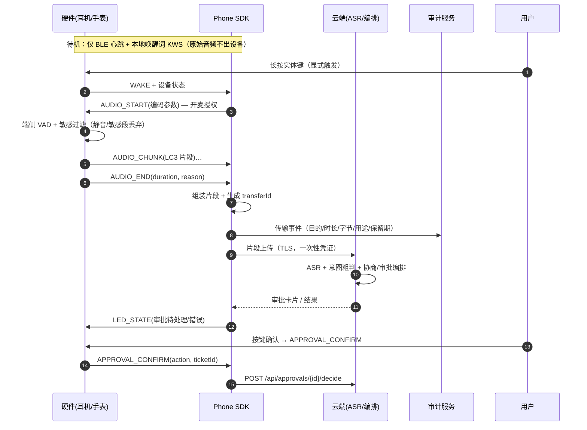

# 04 · SDK 与端侧设计

> 文档编号 04 ｜ 上游契约：[`contracts/INTERFACES.md`](../contracts/INTERFACES.md) v1.0（冻结）、[`docs/03-协议设计.md`](./03-协议设计.md)
> 覆盖：客户端 SDK 四层、硬件 BLE 桥接、隐私时序、端云分流、Skill/Harness SDK 声明式清单、版本兼容与灰度。
> **验证状态：⚠ 未编译验证。** 本机无 Flutter / Android / 嵌入式工具链，BLE 帧格式与 LC3 参数为**设计契约**，需硬件样机实测后回填（见 §7）。客户端骨架位于 `apps/clients-flutter/`（由文档 C 负责，未编译）。

## 0. 结论先行（TL;DR）

| # | 决策 | 一句话 |
|---|---|---|
| 1 | 客户端 SDK 分 UI / Controller / Adapter / Persistence 四层 | 依赖单向，网络与设备访问只允许出现在 Adapter |
| 2 | 硬件走 BLE 桥接，帧带 CRC16 与序号 | 低功耗、可重传、可审计；不把蓝牙当 IP 用 |
| 3 | 待机只维持 BLE + 本地唤醒词；**显式触发才开麦** | 上云的是"片段"不是常开流，每次上云产生可审计传输事件 |
| 4 | 端侧只做唤醒/VAD/粗分类/敏感过滤/离线降级 | 不在端侧追求完整 Agent：功耗与隐私是双陷阱 |
| 5 | Agent 代码禁止直连外部 API/DB，一切外部操作走 Skill Runtime | 否则权限门控必被旁路 |

## 1. 客户端 SDK 四层

```text
┌──────────────────────────────────────────────┐
│ UI          Flutter Widgets（审批态 / 巡视态） │
├──────────────────────────────────────────────┤
│ Controller  状态编排、命令分发、乐观更新、重试   │
├──────────────────────────────────────────────┤
│ Adapter     IM PaaS / 编排 API / BLE（唯一 IO） │
├──────────────────────────────────────────────┤
│ Persistence SQLite、outbox、去重表、密钥库       │
└──────────────────────────────────────────────┘
依赖方向：UI → Controller → Adapter → Persistence（单向，禁止反向与跨层直达）
```

| 层 | 职责 | 允许依赖 | **禁止** |
|---|---|---|---|
| UI | 渲染审批卡片/会话/状态；输入手势；无障碍 | Controller 的只读状态与命令 | 直接持有 HTTP/BLE 客户端；直接读写持久化 |
| Controller | 状态机、命令幂等、乐观更新与回滚、重试/退避策略 | Adapter 接口、Persistence 接口 | 拼协议 JSON；直接调平台 API |
| Adapter | IM PaaS 收发、编排 API 调用、BLE 连接与帧编解码 | Persistence（outbox/inbox）、平台网络库 | 依赖 Controller 或 UI；自行决定业务状态 |
| Persistence | 本地消息、outbox、去重表、密钥/凭证存储 | 仅本地存储与系统 Keychain | 发起网络请求；依赖上层 |

硬性规则：

1. **IO 只在 Adapter**：UI 与 Controller 不得出现 `http` / BLE / 文件系统调用；通过接口注入以便单测替身。
2. **命令模型**：Controller 只接受幂等命令（`SendApprovalDecision`、`MarkRead`、`SubmitIntent`），命令携带 `commandId`，落 outbox 后由 Adapter 投递，成功后按 `bizId` 对账。
3. **先本地后网络**：审批决定必须写本地 outbox 再上行；离线时队列积压，恢复后按 `bizSeq` 顺序补发，超过保留期（建议 24 h）标记失败并提示。
4. **状态以服务端为准**：本地为缓存；`/api/state` 或推送到达后做差量对账，冲突以服务端状态机为最终裁判。

## 2. 硬件 BLE 桥接协议

### 2.1 GATT 与链路

| 项 | 约定 |
|---|---|
| 服务 UUID | 厂商自定义 128-bit UUID（⚠ 需硬件厂商分配后回填，禁止编造） |
| CMD 特征 | Write With Response（手机 → 设备，控制帧） |
| DATA 特征 | Write Without Response + Notify（设备 → 手机，音频/状态） |
| 连接参数 | 连接间隔 15–30 ms；从机延迟 0；监督超时 4 s（⚠ 需按功耗实测调整） |
| MTU | 协商 247；有效载荷按 244 B 计算 |
| 安全 | LE Secure Connections + 绑定；未绑定设备拒绝 0x10 审批确认 |
| 重连 | 断连自动重连；重连后从最后确认的 `seq` 续传 |

### 2.2 帧格式

| 偏移 | 字段 | 长度 | 说明 |
|---|---|---|---|
| 0–1 | SOF | 2 B | 固定 `0xA5 0x5A` |
| 2 | VER / TYPE | 1 B | 高 4 位版本（当前 `0x1`），低 4 位帧类型 |
| 3 | SEQ | 1 B | 每连接内递增，回绕后跳过 0；用于去重与重传 |
| 4–5 | LEN | 2 B | 小端，payload 字节数（0–236） |
| 6… | PAYLOAD | LEN B | 命令/音频数据 |
| 6+LEN | CRC16 | 2 B | CRC-16/CCITT-FALSE（poly `0x1021`，init `0xFFFF`），覆盖 VER 到 payload |

单帧总长 = 8 + LEN ≤ 244 B。CRC 失败或长度不符 ⇒ 回 `NACK(0x01/0x05)`，发送方按同 `SEQ` 重传，≤3 次后上报断链。

### 2.3 帧类型与指令集

| TYPE | 名称 | 方向 | 载荷 | 语义 / ACK |
|---|---|---|---|---|
| 0x1 | WAKE | 手机 → 设备 | 空 | 唤醒设备、读取电量/固件版本；回 `WAKE_ACK` 或 `ACK` |
| 0x2 | AUDIO_START | 手机 → 设备 | 编码参数（采样率/帧长/码率） | **显式授权开麦**；设备点灯"录音中"；开始 LC3 流 |
| 0x3 | AUDIO_CHUNK | 设备 → 手机 | `[frameCount:1][LC3 帧…]` | 音频分片，Notify；每片带 `SEQ` |
| 0x4 | AUDIO_END | 设备 → 手机 | `totalFrames:2, durationMs:2, reason:1` | 结束片段（松键/静音超时/手动停止） |
| 0x5 | HEARTBEAT | 双向 | 电量、状态位 | 10 s 周期；连续 3 次丢失视为断链 |
| 0x6 | AUDIO_ABORT | 手机 → 设备 | 空 | 立即停麦（隐私硬停），设备回 ACK 并点灭灯 |
| 0x10 | APPROVAL_CONFIRM | 设备 → 手机 | `ticketIdLen:1, ticketId, action:1, longPressMs:2` | 手表/耳机端审批确认；action: 1=APPROVE 2=REJECT 3=MODIFY；**必须绑定设备** |
| 0x11 | APPROVAL_RESULT | 手机 → 设备 | `ticketIdLen:1, ticketId, state:1` | 回执：设备 LED 绿/红/黄闪一次 |
| 0x20 | LED_STATE | 手机 → 设备 | `mode:1, rgb:3, blink:1` | mode: 0 待机 1 录音 2 思考 3 错误 4 审批待处理 |
| 0x30 | CONFIG | 手机 → 设备 | VAD 阈值、语言、录音上限 | 配置下发，掉电保存；版本不符拒绝并回 NACK |
| 0x7E | NACK | 双向 | `refSeq:1, reason:1` | reason 见 §2.6 |
| 0x7F | ACK | 双向 | `refSeq:1` | 确认收到；重复 `SEQ` 直接丢弃并回 ACK |

### 2.4 分片与重传

- `AUDIO_CHUNK` 每片最多 5 个 LC3 帧（5×40 B + 1 B 计数 = 201 B ≤ 236 B），片内帧数由设备决定。
- 手机侧按 `SEQ` 重组；检测到缺口立即 `NACK(refSeq, 0x02)`，设备重传最近 32 片（环形缓冲）。
- 音频片段有最大时长上限（建议 15 s/段，⚠ 需产品与法务确认），到限自动 `AUDIO_END(reason=MAX_DURATION)`。
- 顺序语义：同一片段内严格按 `SEQ`；跨片段不保证顺序，由云端按 `sessionId + segmentIndex` 排序。

### 2.5 LC3 编解码

| 参数 | 取值 | 说明 |
|---|---|---|
| 采样率 | 16 000 Hz | 语音场景足够；48 kHz 仅音乐场景 |
| 帧长 | 10 ms | 低延迟；20 ms 可省 1 B/帧头开销 |
| 码率 | 32 kbps | 40 B/帧（32 000 × 0.01 ÷ 8） |
| 声道 | 1（单声道） | 隐私与带宽 |
| 编码位置 | 设备端 DSP/专用编码器 | 原始 PCM 不出设备 |
| 解码位置 | 手机 SDK（本地回放）或云端 | 云端解码为 ASR 输入 |

上行带宽 ≈ 4 KB/s + 帧开销，BLE 1M PHY 下余量充足。⚠ 需复核具体编码器对 16 kHz/10 ms/32 kbps 的支持与实测功耗。

### 2.6 NACK 原因码

| reason | 含义 | 处置 |
|---|---|---|
| 0x01 | CRC 校验失败 | 同 SEQ 重传 |
| 0x02 | 序号缺口 | 补发缺失片 |
| 0x03 | 设备忙（缓冲满） | 退避 50 ms 后重发 |
| 0x04 | 未授权（未绑定设备做审批确认） | 拒绝并提示重新绑定 |
| 0x05 | 长度/版本不符 | 双方回到 `CONFIG` 重新协商 |

## 3. 隐私时序（关键）

### 3.1 五条硬规则

| # | 规则 | 实现 |
|---|---|---|
| 1 | 待机只维持 BLE + 本地唤醒词 | 麦克风仅供低功耗 KWS DSP；音频不编码、不缓存、不出设备 |
| 2 | 显式触发才开麦 | 实体键长按 / 明确 UI 点击；`AUDIO_START` 是唯一开麦指令 |
| 3 | 端侧 VAD + 敏感过滤先于上传 | 静音段不上传；命中敏感规则（身份证/银行卡/转账话术）本地丢弃并提示 |
| 4 | 上云是"片段"不是常开流 | 每段音频独立上传、独立生命周期；无持续推流 |
| 5 | 每次上云产生可审计传输事件 | 本地 + 服务端双写；用户可查、可删（对应 `memory-store.purge`） |

### 3.2 时序图



### 3.3 传输事件字段（每次上云必写）

| 字段 | 说明 |
|---|---|
| `transferId` | 唯一，关联音频片段与云端请求 |
| `sessionId` / `segmentIndex` | 会话与片段序号 |
| `trigger` | `button` / `wake_word+confirm` / `ui`（**禁止**隐式触发） |
| `startedAt` / `endedAt` / `durationMs` | 片段实际时长（VAD 后） |
| `bytes` / `codec` | 上传字节数 / `LC3-16k-10ms-32k` |
| `destination` | 云端服务标识（不写具体 IP） |
| `purpose` | `asr` / `approval` / `negotiation` |
| `sensitiveFiltered` | 端侧过滤命中数（不含内容） |
| `retention` | 保留期策略标识 |
| `contentHash` | 片段哈希（审计对账，不存原始音频） |

### 3.4 降级与硬停

| 场景 | 行为 |
|---|---|
| 无网络 | 本地记录片段与摘要，预置审批卡片离线展示；恢复后用户确认再上传（不自动补传音频） |
| 云端超时 | 重试 ≤2 次，仍失败则本地标记"未处理"，LED 错误态 + 手表提示 |
| 低电量 | 关闭 KWS，仅保留 BLE 与审批确认；明确告知用户 |
| 物理静音 | 硬件开关直接断麦，软件不可覆盖（隐私硬停） |
| 用户删除 | 删除本地片段 + 云端按 `memory-store.purge` 级联 + 审计墓碑 |

## 4. 端侧 / 云端分流边界

| 能力 | 位置 | 时延预算 | 隐私等级 | 理由 |
|---|---|---|---|---|
| 唤醒词 KWS | 端侧 DSP | <50 ms | 音频不出设备 | 常开功耗最低；误唤醒可本地抑制 |
| VAD | 端侧 | 20 ms 窗 | 音频不出设备 | 减少无效上传流量与隐私暴露 |
| 意图粗分类 | 端侧小模型 | <100 ms | 仅上传标签 | 决定是否值得唤醒云端；可离线 |
| 敏感过滤 | 端侧规则 + 轻量模型 | <30 ms | 命中即丢弃 | 最敏感内容在离开设备前拦截 |
| 离线降级 | 端侧 | 即时 | 本地存储 | 本地记录 + 预置审批卡片 |
| 协商 / 多步规划 | 云端 | 秒级 | 结构化数据 | 需要大模型与跨 Agent 会话 |
| 专业推理（法律/医疗等） | 云端 | 秒–分钟 | 需审批链 | 质量与合规要求 |
| 记忆检索 | 云端 | <300 ms | 按 Agent 隔离 | 需要共享与隔离策略 |

**为什么不在端侧追求完整 Agent**：

1. **功耗陷阱**：常开大模型推理量级在瓦级，而耳夹/手表的电池与散热预算只有毫瓦到百毫瓦级；端侧只做 KWS/VAD 这类专用 DSP 才能撑住"全天在线"（具体功耗 ⚠ 需样机实测）。
2. **隐私陷阱**："端侧闭环"听起来更私密，但端侧模型难以集中审计、更新与吊销；一旦模型被提取或绕过，敏感数据仍会以不可控方式处理。把敏感过滤做在端侧、把决策做在可审计的云端，是更稳的分工。
3. **能力陷阱**：端侧小模型无法承载多步规划与跨会话记忆；硬塞只会得到"看起来智能、实际不可审计"的体验。端侧的目标是**极低功耗的感知与触发**，不是替代云端 Agent。

## 5. Skill SDK / Harness SDK 声明式清单

### 5.1 Skill manifest 示例（YAML）

```yaml
skill_id: acme.order_flowers        # 强制 vendor.skill；NFKC 归一化后全局唯一
version: 1.0.0
display_name: 订花
runtime:
  kind: mcp-server                  # 无状态核心；serverless 部署
  command: ["node", "server.mjs"]   # 或 url（HTTPS）
required_capabilities:
  - order.create
  - payment.charge
financial_impact:
  is_financial: true
  max_amount_cents: 50000           # 单次金额上限（整数分）
  currency: CNY
trust_zone_min: 2                   # 允许条件 levelOf <= trustZoneMin（数值越大信任越低；2=TRUSTED）
approval_policy:
  mode: AMOUNT_THRESHOLD            # NONE | AMOUNT_THRESHOLD | ALWAYS
  amount_threshold_cents: 10000
  required_approvals: 1
io:
  input_schema: ./schemas/order.input.json
  output_schema: ./schemas/order.output.json
tool_hints:
  - tool: create_order
    read_only: false
    destructive: true
egress:
  max_output_length: 2000
  ruleset_version: "2026-10"
timeout_ms: 10000
idempotency:
  scope: tool_call
  key_from: [ticket_id, tool_name, input_hash]
telemetry:
  audit: required
```

### 5.2 字段规范与 INTERFACES.md 映射

| 字段 | 类型 | 必填 | 默认 | INTERFACES.md 对应 |
|---|---|---|---|---|
| `skill_id` | string | 是 | — | `allowedSkills[]` 的元素（`SKILL` kind 的 agentId 亦用此值） |
| `version` | semver | 是 | — | 无（技能自身版本） |
| `runtime.kind` | enum | 是 | `mcp-server` | 无（Phase1 起） |
| `required_capabilities` | string[] | 是 | `[]` | `allowedSkills` / 能力声明 |
| `financial_impact` | object | 是 | `{is_financial:false}` | `budgetCentsPerDay` / `approvalThresholdCents` |
| `trust_zone_min` | 0–4 | 是 | `4`（STRANGER） | `trustZoneMin` |
| `approval_policy.mode` | enum | 是 | `ALWAYS`（涉资金） | 门控 `REQUIRE_APPROVAL` 的触发条件 |
| `tool_hints.destructive` | bool | 是 | `true` | `destructiveSkills` |
| `egress` | object | 是 | 全局默认 | `egress-guard` 规则集 |
| `timeout_ms` | int | 否 | 10000 | 调用协议超时 |

### 5.3 铁律：Agent 不得绕过 Skill Runtime

> **Agent 代码（含其提示词生成的动作）不得直接访问外部 API / 数据库；一切外部操作必须经 Skill Runtime 调用 Skill，由 Runtime 统一过 CapabilityGate 与 EgressGuard。**

| 旁路手段 | 为何不可 | 强制手段 |
|---|---|---|
| 直接 `http` 调外部 API | 绕过门控与审批 | 网络出口白名单：只允许 Runtime/网关地址；DNS 与安全组兜底 |
| 直接连数据库 | 越权读写、无审计 | Agent 容器不注入 DB 凭据；仅 Runtime 持有短期凭证 |
| 自行读环境变量取密钥 | 密钥泄露面扩大 | 密钥只经 Runtime 临时签发（任务级令牌 §03-10.2） |
| 在提示词里"口头承诺"审批 | 模型不可信 | 门控是代码层短路，审批单是执行前置条件，不依赖模型自觉 |
| 绕过 MCP 直接调 Skill 内部函数 | 跳过 schema 与审计 | Skill 只暴露 MCP 端点，进程内不导出内部函数 |
| 伪造 Skill 调用日志 | 审计失真 | 调用计数与网络流量对账，差异告警 |

### 5.4 Harness SDK 提供与禁止

| 提供 | 禁止 |
|---|---|
| 模型路由（`cloud-large` 等）、流式输出、Token 计量 | 自行拼 HTTP 请求外部服务 |
| `memory` 客户端（按 Agent 隔离，仅拿 digest） | 直接读他 Agent 的原始记忆 |
| `negotiation` 客户端（Open/Turn/GetArtifact） | 自行维护会话状态或跳过 Turn 预算 |
| `gate` 客户端（evaluate/assertAllowed，含审计） | 先执行后补门控 |
| `approval` 客户端（create/decide 回调/等待） | 自动替人类决策 |
| `egress` 客户端（inspect/assertPass） | 发送前不过审 |
| `trace` 传播（`TraceContext`） | 丢弃或伪造 traceId |

## 6. 版本兼容与 SDK 发布节奏

| 版本对象 | 规则 |
|---|---|
| 契约主版本 | 与 SDK 主版本对齐；契约 1.x ⇒ SDK 1.x；SDK 启动时校验 `x-contract-version` 主版本 |
| Skill manifest | `version` 与 `skill_id` 独立演进；不兼容升级需新 major + 重新审核 |
| BLE 协议 | 帧头 `VER` 4 位；手机端同时支持 N 与 N-1；不支持时拒绝连接并提示升级 |
| 客户端兼容 | 服务端至少支持最近 2 个 App 大版本；响应不得依赖新客户端字段 |
| 弃用 | 标 `deprecated` 后至少保留 1 个发布周期，移除需主版本 |

| 灰度开关 | 作用域 | 默认 | 回滚方式 |
|---|---|---|---|
| `skill.<id>.rollout` | 按用户/租户百分比 | 0% | 置 0 立即停用 |
| `gate.mode` | shadow / enforce | shadow（Phase0 观察） | 切回 shadow（只记录不拦截） |
| `negotiation.budget` | maxRounds/maxTokens 配置 | 5 / 4000 | 配置回滚 |
| `mcp.stateless_runtime` | Skill 部署形态 | false（Phase0）→ true（Phase1） | 切回常驻进程 |
| `ble.proto_version` | 设备固件/App 组合 | v1 | 拒绝连接并升级 |
| `egress.ruleset_version` | 规则集 | 当前发布版 | 回滚规则集同时保留审计 |

发布节奏：Phase0 契约冻结 + 内部实现；Phase1 MCP/无状态 Skill 灰度；Phase2 全量；Phase3 边界网关与 A2A 并行双栈。每个阶段先 shadow 后 enforce，任一阶段指标回退即回滚（Go/No-Go 指标见 docs/09）。

## 7. 未验证清单

| # | 项 | 原因 | 下一步 |
|---|---|---|---|
| 1 | Flutter SDK 未编译 | 本机无 Flutter SDK | CI 执行 `flutter analyze` / `flutter test` |
| 2 | BLE 帧格式未上机 | 无硬件样机 | 用两台手机 + 样机做 CRC/重传/重连测试 |
| 3 | LC3 参数与功耗 | 需编码器实测 | 回填实际帧长/码率/电流曲线 |
| 4 | GATT UUID 与特征属性 | 需厂商分配 | 硬件定型后回填，禁止占位 UUID 上线 |
| 5 | 麦克风时长上限与法务 | 涉及录音合规 | 法务确认后写入 `CONFIG` 默认值 |
| 6 | 离线 outbox 保留期 | 与 IM PaaS 重放窗口相关 | 核实后与 §03-6 的 dedupe TTL 对齐 |
| 7 | 端侧功耗/时延数字 | 均为预算值 | 样机实测后替换并注明日期 |

## 8. v2 修订：Agent SDK 与连接模型

> 本节是 R4（v2.0）增量：v1 的「客户端 SDK 四层」不变（UI/Controller/Adapter/Persistence），新增的是**Agent 侧 SDK**——Agent 从"服务端内部组件"变成"消息内核的一等客户端"（V2-1）。
> 权威来源：[`contracts/INTERFACES.md`](../contracts/INTERFACES.md) §11–§16；线格式见 [`contracts/proto/`](../contracts/proto/)（**均未编译验证**，本机无 protoc/buf，CI 补 `buf lint` + `protoc` + `buf breaking`）。协议语义见 [docs/03 §12](./03-协议设计.md)。

### 8.0 结论先行

| # | 决策 | 一句话 |
|---|---|---|
| 1 | Agent 三种接入形态，鉴权分三档 | 内置=平台托管密钥；第三方托管=自签卡片+token；外部 A2A=边界网关代验 |
| 2 | 生产用长连接（WS/QUIC），演示用 SSE 下行 + POST 上行 | 两者**同一 transport 接口**，业务代码零改动 |
| 3 | transport 接口只有两个方法：`{ send(obj), close() }` | 少到可以手写实现，也少到无法偷偷夹带权限逻辑 |
| 4 | 订阅 = **频道集合**，不是全局广播 | 未订阅就收不到；投递过滤在服务端 |
| 5 | 重连靠 `seq` 补拉；`CMD` **不重放** | 状态消息可恢复，控制消息不重复执行 |
| 6 | 客户端不得携带 scope/principal/domains | 服务端绑定（docs/03 §12.4 定论） |

### 8.1 三种 Agent 接入形态与鉴权

| 形态 | 部署位置 | 密钥归属 | 卡片来源 | 鉴权链路 | 协议 | 限制 |
|---|---|---|---|---|---|---|
| **内置 Agent** | 平台侧（butler/subagent） | 平台密钥库托管 | `IdentityService.IssueCard`（服务端签发） | 内部身份 → token → 网关 | `AGENT_WS` / `IM_CUSTOM` | 可访问内部数据，但**读侧仍受可见域约束** |
| **第三方托管 Agent** | 第三方机房/云函数 | **第三方自持 Ed25519 私钥** | 自签 `signAgentCard` → `VerifyCard` 注册 | 卡片验签 + 用户授权 → token → 网关 | `AGENT_WS`（推荐）/ `IM_CUSTOM` | 作用域以 token 内的 principal/domains 为上限 |
| **外部 A2A Agent** | 外部组织 | 外部组织自持 | 外部 AgentCard（**仅 Phase3**） | 边界网关验签 + 映射为内部身份 + 注入两层令牌 | `A2A_JSONRPC` | 只走边界网关，绝不直连内核；⚠ 外部规范字段需复核 |

| 形态 | 拿到 token 的方式 | 谁不能做 | 失败码 |
|---|---|---|---|
| 内置 | 注册流程内部签发（`issueToken`，TTL 15 min） | — | `NOT_CONFIGURED` / `UNAVAILABLE` |
| 第三方 | 用户在其侧确认授权后，平台签发并安全回跳（⚠ **下发通道未冻结，见 docs/03 §12.7 A1**） | **Agent 不得自签 token** | `UNAUTHENTICATED` / `PRINCIPAL_MISMATCH` |
| A2A | 网关按对端白名单注入 | 外部不得直接持有内部 token | `UNAUTHENTICATED` / `EGRESS_BLOCKED` |

统一铁律：**卡片证明"你是谁"，token 证明"你代表谁、能做什么"**。两者都要，缺一即 `UNAUTHENTICATED`；`token.agentId !== card.agentId` → `TOKEN_MISMATCH`。

### 8.2 连接模型：长连接 vs 演示 SSE + POST 上行

| 维度 | 生产：WebSocket / QUIC | 演示：SSE 下行 + POST 上行 | 结论 |
|---|---|---|---|
| 双向 | 原生双向帧 | 下行 SSE、上行独立 HTTP POST | 演示版多一次 RTT，且无服务端推送 ACK |
| 心跳/在线 | 内建 ping/pong，`heartbeat` 直达 | 靠 SSE 连接存活推断 + POST 心跳 | 演示版在线状态精度低 |
| 多路复用 | 单连接多频道 | SSE 一路 + POST 每请求一连接 | 演示版连接开销高 |
| 断线补拉 | 同连接重连 + 游标补拉 | SSE 重连（`Last-Event-ID` 或显式游标） | 一致：都按 `seq` 补拉 |
| 部署门槛 | 需 WS 网关/QUIC 支持 | 只需 HTTP（本机零依赖可跑） | 演示版可单机跑通 |
| 适用 | Phase1 起 | 仅 Demo / 单测 / 断网回归 | 演示版不得作为生产默认 |

**为什么演示坚持 SSE+POST**：本仓库的参考实现跑在零依赖 Node 上，SSE 用原生 `http` 即可实现、POST 上行天然幂等可断言；而 WS 在无第三方库时需要自己实现帧解析，性价比低。SSE 只解决"下行推送"，上行一律走独立 POST（⚠ 具体路径未进 OpenAPI，暂记 `/api/agent/publish`），因此**不存在"SSE 假双向"的隐患**。

transport 抽象（§15 冻结接口，SDK 只允许依赖它）：

```js
// 唯一传输契约：send 必须是异步、可失败的；close 必须幂等
const transport = {
  async send(obj) { /* 序列化并按当前承载发送；失败必须 throw */ },
  async close() { /* 释放连接；重复调用不得抛错 */ }
};
```

| 适配器 | 实现 | 用途 | 备注 |
|---|---|---|---|
| `WebSocketTransport` | `ws.send(JSON.stringify(obj))` / `close()` | 生产 | QUIC/WebTransport 可作为另一适配器（⚠ 移动端省电与穿透需实测） |
| `SsePostTransport` | 下行 SSE 事件回调 → 派发；`send` → `POST` | Demo/本地 | ⚠ 需复核 SSE 断线语义与移动端后台保活 |
| `MemoryTransport` | 直接调测试替身，记录 `sent[]` | 单测 | 契约测试用：断言"未订阅不投递" |

SDK 不得在 transport 之上实现权限判断；`send` 抛错时由会话层置 `OFFLINE` 并计入 `failed`（§15 规则），**不静默丢消息**。

### 8.3 订阅与在线状态：订阅 = 频道集合，非全局广播

| 概念 | 语义 | 契约 |
|---|---|---|
| 订阅 | `subscribe({agentId, channelId})`；集合而非流 | §15 `subscribe` / `unsubscribe` |
| 投递 | 只投给「在线 + 已订阅该频道」的 Agent | §15 `push` → `{delivered, failed}` |
| 未订阅 | 不报错，但投递被跳过，不出现在 `deliveredTo` | §14 `AGENT_NOT_SUBSCRIBED` |
| 在线 | `CONNECTING / ONLINE / OFFLINE / REVOKED` 四态 | §15 `SESSION_STATE` |
| 多端 | 同一 Agent 多实例 → 第二个 connect 返回 `ALREADY_ONLINE` | §15（分布式租约需上层实现，⚠ 需复核） |
| 心跳 | 90 s 无心跳 → `sweepStale` 置 `OFFLINE` | §15 `heartbeatTimeoutMs` |

推论（直接约束 SDK 设计）：
1. **不存在"全局广播"**：Agent 不订阅就收不到任何业务消息，因此 SDK 的 `connect()` 必须显式传 `subscriptions`，且重连后**重建同一集合**。
2. 未读归属在频道成员上：`AGENT_NEGOTIATION` 频道对人类成员**恒为 0**（§14），因此 Agent SDK 不需要、也不允许替人类"清未读"。
3. 一个 Agent 可同时订阅多个频道；建议按"任务/对象"分频道，而不是做一个大频道（未读与权限都按频道算）。

### 8.4 幂等、序号与重连

| 消息类别 | 是否落盘 | 是否有 `seq` | 断线补拉 | 重连后重放 | 计未读 |
|---|---|---|---|---|---|
| `TEXT` / `AGENT_TURN` / `APPROVAL_CARD` / `INTENT` | 是 | 是（频道内单调） | 是 | 是（按 seq） | 是（协商频道对人类恒 0） |
| `CMD` | **否**（`stored=false`） | 否（不持久化） | **否** | **否** | 否 |

- **seq 语义**：`seq` 是**频道内**单调递增（不是全局），由服务端分配；客户端只读。缺口即补拉：`GET /channels/{id}/messages?sinceSeq=N`（HTTP 面，⚠ 需复核是否并入 OpenAPI）。
- **重连流程**：`connect` → 认证（卡片+token）→ 恢复订阅集合 → 对每个频道上报 `lastSeq` → 服务端补拉 → **CMD 一律不补**（控制指令过期即失效，重放会造成重复执行）。
- **幂等键**（两层，互不替代）：

| 层 | 键 | 窗口 | 行为 |
|---|---|---|---|
| 业务消息 | `bizId`（v1，§6） | 24 h | 重复投递返回首次结果并标 `duplicate:true` |
| 频道发言 | `(channelId, seq)` | 由保留策略决定 | 同一 `seq` 重复 `Post` 返回首次结果（⚠ §14 未显式冻结该幂等语义，见 docs/03 §12.7 A2） |
| 网关动作 | `(agentId, action, traceId)` | 每次请求 | 由签名审计 `auditSeq` 反查，重复成功动作不重复执行（⚠ 需复核是否要求 `idempotencyKey` 字段） |

- **token 过期**：`SCOPE_EXPIRED` / `TOKEN_REVOKED` 是**不可自动重试**的会话终止态；SDK 必须重新走 §12.3 握手，**不得**用旧 token 重放积压消息。
- **重连后的执行顺序**：认证 → 订阅 → 补拉 → 才允许 `send`。顺序反了会出现"发出去但服务端认为你未订阅"的竞态（`AGENT_NOT_SUBSCRIBED`）。

### 8.5 Agent SDK 方法面

| SDK 方法 | 对应契约 | 幂等 | 主要错误码 |
|---|---|---|---|
| `identity.create()` | §11 `createAgentIdentity` | — | `INVALID_KEY` |
| `identity.card()` / `card.sign()` | §11 `createAgentCard` / `signAgentCard` | 是 | `BAD_CARD` |
| `identity.verifyCard(card)` | §11 `verifyAgentCard` / `IdentityService.VerifyCard` | 是 | `HASH_MISMATCH` / `SIGNATURE_INVALID` / `CARD_EXPIRED` |
| `session.connect({transport, subscriptions})` | §15 `connect` | 否 | `TRANSPORT_REQUIRED` / `ALREADY_ONLINE` |
| `session.heartbeat()` / `subscribe()` / `unsubscribe()` | §15 | 是 | `NOT_ONLINE` / `UNKNOWN_AGENT` |
| `channel.post({channelId, kind, payload})` | §14 `post` / `ChannelService.Post` | 按 `(channelId, seq)` | `NOT_MEMBER` / `POST_DENIED` / `TYPE_INVALID` |
| `gateway.route({action, payload})` | §12 `route` / `AgentGateway.Route` | 否（由审计去重） | `GATEWAY_CODE` 全集（docs/03 §12.6） |
| `visibility.project({resource, fields})` | §13 `project`（**内部调用，不暴露给 Agent**） | 是 | `VISIBILITY_CODE` 全集 |

> SDK 不提供、也不得新增：`setScope()` / `setPrincipal()` / `setTrustCeiling()`。这类方法一旦存在，就会有人调用（这是 API 设计的自证预言）。

### 8.6 错误处理与重试策略（与 docs/03 §12.6 对齐）

| 错误类别 | 代表码 | SDK 行为 | 重试 |
|---|---|---|---|
| 身份不可信 | `SIGNATURE_INVALID` / `HASH_MISMATCH` / `BAD_CARD` | 终止，提示重新签卡 | 否 |
| 令牌类 | `TOKEN_MISMATCH` / `TOKEN_REVOKED` / `SCOPE_EXPIRED` | 重新握手/重新授权 | 否（自动重试会放大风险） |
| 限流/抖动 | `RATE_LIMITED` / `UNAVAILABLE` / `DEADLINE_EXCEEDED` | 指数退避 + 抖动 | 是（≤3 次） |
| 权限/门控 | `GATE_DENIED` / `VISIBILITY_*` / `POST_DENIED` / `NOT_MEMBER` | 不重试；`REQUIRE_APPROVAL` 走审批 | 否 |
| 内容拦截 | `EGRESS_BLOCKED` | 改内容后重试 | 否（原样重试必再拒） |
| 一致性 | `AGENT_NOT_SUBSCRIBED` / `NOT_ONLINE` | 先 subscribe/heartbeat 再重试 | 是（1 次） |
| 服务端缺陷 | `SIGNER_REQUIRED` / `CHAIN_BROKEN` | 告警，停止写入 | 否（人工介入） |

### 8.7 v2 未验证清单

| # | 项 | 原因 | 下一步 |
|---|---|---|---|
| 1 | `SsePostTransport` 断线/重连语义 | 无浏览器端到端环境 | 用 demo-server 做断网回归，核对补拉不重放 CMD |
| 2 | QUIC/WebTransport 适配器 | 本机无运行时 | Phase2 评估；当前只用 WS 适配器 |
| 3 | 第三方 Agent 的 token 下发通道 | 契约未冻结（docs/03 §12.7 A1） | Lead 裁定后补 SDK 方法 `auth.redeem()` |
| 4 | `(channelId, seq)` 幂等语义 | §14 未显式冻结 | 与实现方对齐后回填 §14 或标为约定 |
| 5 | 多实例同一 Agent 在线（租约） | §15 只保证单进程语义 | 分布式场景需频道内 leader 选举，⚠ 需复核 |
| 6 | `sinceSeq` 补拉接口是否进 OpenAPI | 当前 HTTP 面未覆盖 | 与网关实现一并补齐 |
