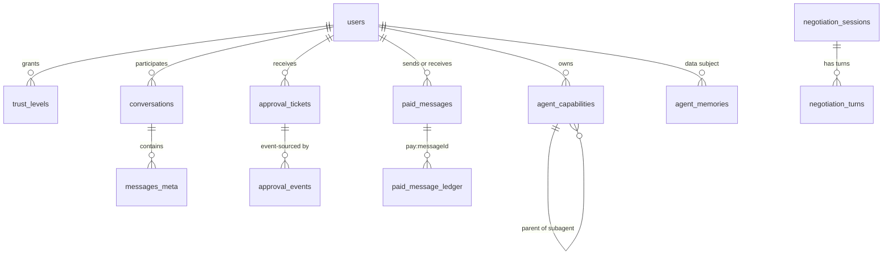

# 05 · 数据模型与存储

> 版本 v1.1（v2 修订）· 对应契约 contracts/INTERFACES.md v1.0（内部修订 R4）· 作者：架构组
> **v2 新增表见 §15**（8 张：身份/卡/令牌/频道/成员/会话/签名审计/检查点）。§1–§14 的表语义不变。

## 0. 设计原则

1. **PostgreSQL 是治理与业务状态的唯一事实源**。Redis 只做加速与序号分配，对象存储只放正文与归档，MongoDB/OpenSearch 只做 Phase2 起的归档检索；「只存在缓存里」的状态视为缺陷。
2. **金额一律 `bigint` 分（cents）**，字段名以 `Cents` 结尾（契约全局约定），不用浮点/`numeric` 做金额计算。
3. **时间 `timestamptz`（UTC 存储）**；契约 `*At` 对应 `*_at` 列，输出 ISO-8601。
4. **只追加**：账本、审批事件、审计事件禁止 UPDATE/DELETE（权限 + 触发器双保险），纠错靠新增条目。
5. **ID 前缀化**（`user-*`/`agent-*`/`msg-*`/`tkt-*`/`neg-*`）；高增长表按时间/哈希分区，清理历史 = 归档后 DETACH。
7. **参考实现映射**：`services/payment/src/ledger.mjs` 的进程内数组 ↔ `pay.paid_message_ledger`；`dedupe.mjs` 的 TTL ↔ Redis；`seq.mjs` 的 64 分片 ↔ `im.conversations.shard` + Redis `INCR`。生产必须换成下文表与约束。

以下 DDL 是**目标态**（生产 PostgreSQL，需 `vector` 扩展），不承诺无扩展环境可执行；分区子表由运维流程预建（见 §13）。

---

## 1. 公共基线

```sql
CREATE EXTENSION IF NOT EXISTS vector;     -- pgvector；⚠ 扩展版本/托管支持需复核
CREATE SCHEMA IF NOT EXISTS core;          -- 账号/关系/能力
CREATE SCHEMA IF NOT EXISTS im;            -- 人类 IM（三条流量之一）
CREATE SCHEMA IF NOT EXISTS gov;           -- 审批/审计（治理数据）
CREATE SCHEMA IF NOT EXISTS neg;           -- Agent 协商（与人可见流量物理隔离）
CREATE SCHEMA IF NOT EXISTS pay;           -- 账本与付费
CREATE SCHEMA IF NOT EXISTS mem;           -- 记忆
CREATE ROLE app_rw NOLOGIN;                -- 业务角色：追加型表只给 INSERT
```

---

## 2. 账号、关系与 Agent 能力

```sql
CREATE TABLE core.users (
  id           text PRIMARY KEY CHECK (id LIKE 'user-%'),
  display_name text NOT NULL,
  phone_hash   bytea NOT NULL,             -- 只存加盐哈希，明文不落库；⚠ 密钥管理需复核
  status       text NOT NULL DEFAULT 'ACTIVE' CHECK (status IN ('ACTIVE','FROZEN','DELETED')),
  region       text NOT NULL DEFAULT 'cn-east',
  created_at   timestamptz NOT NULL DEFAULT now(),
  deleted_at   timestamptz,
  CONSTRAINT users_phone_uq UNIQUE (phone_hash)
);
CREATE INDEX users_active_idx ON core.users (status) WHERE deleted_at IS NULL;

CREATE TABLE core.trust_levels (
  user_id    text NOT NULL REFERENCES core.users(id),   -- 授权方
  target_id  text NOT NULL,                             -- 被授权方：user-* 或 agent-*
  level      smallint NOT NULL CHECK (level BETWEEN 0 AND 4),  -- TRUST_LEVELS 0..4
  granted_by text NOT NULL,
  granted_at timestamptz NOT NULL DEFAULT now(),
  expires_at timestamptz,
  PRIMARY KEY (user_id, target_id),
  CONSTRAINT trust_self_only CHECK (level <> 0 OR user_id = target_id)
);
CREATE INDEX trust_levels_expiry_idx ON core.trust_levels (expires_at) WHERE expires_at IS NOT NULL;

CREATE TABLE core.agent_capabilities (
  agent_id                 text PRIMARY KEY CHECK (agent_id LIKE 'agent-%'),
  owner_user_id            text NOT NULL REFERENCES core.users(id),
  kind                     text NOT NULL CHECK (kind IN ('butler','subagent','skill')),
  domain                   text,
  parent_id                text REFERENCES core.agent_capabilities(agent_id),
  allowed_skills           text[] NOT NULL DEFAULT '{}',
  destructive_skills       text[] NOT NULL DEFAULT '{}',
  trust_zone_min           smallint NOT NULL DEFAULT 4 CHECK (trust_zone_min BETWEEN 0 AND 4),
  budget_cents_per_day     bigint NOT NULL DEFAULT 0 CHECK (budget_cents_per_day >= 0),
  approval_threshold_cents bigint NOT NULL DEFAULT 0 CHECK (approval_threshold_cents >= 0),
  model                    text NOT NULL DEFAULT 'cloud-large',
  created_at               timestamptz NOT NULL DEFAULT now(),
  CONSTRAINT subagent_requires_parent CHECK (kind <> 'subagent' OR parent_id IS NOT NULL)
);
CREATE UNIQUE INDEX agent_one_butler_per_owner ON core.agent_capabilities (owner_user_id) WHERE kind = 'butler';
CREATE INDEX agent_children_idx ON core.agent_capabilities (parent_id) WHERE parent_id IS NOT NULL;
```

说明：`target_id` 不设外键，因为它既可指向 `user-*` 也可指向 `agent-*`（跨 Agent 授权），存在性由服务层校验。`agent_capabilities` 是 CapabilityGate 判定的**唯一**能力来源，不允许在别处维护 `allowedSkills` 副本。

---

## 3. 人类 IM：会话与消息元数据

```sql
CREATE TABLE im.conversations (
  id           text PRIMARY KEY CHECK (id LIKE 'conv-%'),
  kind         text NOT NULL CHECK (kind IN ('direct','family_group','agent')),
  user_a_id    text NOT NULL REFERENCES core.users(id),
  user_b_id    text REFERENCES core.users(id),          -- family_group 为 NULL
  shard        smallint NOT NULL CHECK (shard BETWEEN 0 AND 63),  -- fnv1a32(user_id) % 64
  last_biz_seq bigint NOT NULL DEFAULT 0,
  created_at   timestamptz NOT NULL DEFAULT now()
);
CREATE UNIQUE INDEX conversations_direct_uq ON im.conversations (user_a_id, user_b_id) WHERE kind = 'direct';
CREATE INDEX conversations_user_b_idx ON im.conversations (user_b_id);

CREATE TABLE im.messages_meta (
  id              text PRIMARY KEY CHECK (id LIKE 'msg-%'),
  conversation_id text NOT NULL REFERENCES im.conversations(id),
  biz_seq         bigint NOT NULL CHECK (biz_seq > 0),
  biz_type        text NOT NULL CHECK (biz_type IN
                  ('APPROVAL_CARD','STRANGER_INTENT','AGENT_DIGEST','NORMAL_TEXT','SYSTEM_NOTICE')),
  sender_user_id  text NOT NULL,
  trace_id        text,
  trust_zone      smallint CHECK (trust_zone BETWEEN 0 AND 4),
  agent_context   jsonb,
  content_ref     text,          -- 对象存储 key；正文不落 PG
  created_at      timestamptz NOT NULL DEFAULT now()
) PARTITION BY RANGE (created_at);
-- 分区键必须进唯一索引；会话内顺序由 SeqAllocator + DedupeStore 保证，索引兜底
CREATE UNIQUE INDEX messages_meta_seq_uq ON im.messages_meta (conversation_id, biz_seq, created_at);
CREATE INDEX messages_meta_conv_time_idx ON im.messages_meta (conversation_id, created_at DESC);
```

说明：`biz_seq` 由 Redis 按会话 `INCR` 分配（生产不允许「先查后写」）；PG 唯一索引是最终防线。`DedupeStore` 在客户端重试/网关重复投递时做 24h TTL 去重。正文（文本/图片/语音转写）存对象存储，PG 只留元数据，便于分区与生命周期管理。

---

## 4. 审批：票据与事件

```sql
CREATE TABLE gov.approval_tickets (
  id               text PRIMARY KEY CHECK (id LIKE 'tkt-%'),
  user_id          text NOT NULL REFERENCES core.users(id),
  source_agent_id  text NOT NULL,
  ticket_type      text NOT NULL CHECK (ticket_type IN ('NEGOTIATION','PAYMENT','SKILL_CALL','EXTERNAL_ACTION')),
  state            text NOT NULL DEFAULT 'PENDING' CHECK (state IN
                   ('PENDING','REVIEWING','APPROVED','REJECTED','MODIFIED','EXECUTING','COMPLETED','FAILED','EXPIRED')),
  payload          jsonb NOT NULL DEFAULT '{}',
  patch            jsonb,
  priority         text NOT NULL DEFAULT 'normal' CHECK (priority IN ('urgent','high','normal','low')),
  deadline         timestamptz NOT NULL,
  trace_id         text,
  escalation_level smallint NOT NULL DEFAULT 0 CHECK (escalation_level BETWEEN 0 AND 2),
  last_seq         bigint NOT NULL DEFAULT 0,
  created_at       timestamptz NOT NULL DEFAULT now(),
  updated_at       timestamptz NOT NULL DEFAULT now()
);
CREATE INDEX approval_pending_list_idx ON gov.approval_tickets (user_id, state, priority, deadline);
CREATE INDEX approval_deadline_scan_idx ON gov.approval_tickets (deadline)
  WHERE state IN ('PENDING','REVIEWING','APPROVED','MODIFIED');
CREATE INDEX approval_executing_idx ON gov.approval_tickets (updated_at) WHERE state = 'EXECUTING';

CREATE TABLE gov.approval_events (
  ticket_id        text NOT NULL REFERENCES gov.approval_tickets(id),
  seq              bigint NOT NULL CHECK (seq > 0),
  event_type       text NOT NULL CHECK (event_type IN
                   ('CREATED','VIEWED','APPROVED','MODIFIED','REJECTED','EXECUTING','COMPLETED','FAILED','EXPIRED','ESCALATED')),
  actor            text,
  from_state       text,
  to_state         text,
  escalation_level smallint,
  detail           jsonb NOT NULL DEFAULT '{}',
  at               timestamptz NOT NULL DEFAULT now(),
  PRIMARY KEY (ticket_id, seq)
) PARTITION BY HASH (ticket_id);
-- 升级幂等：同一 ticket 同一 escalation_level 只能有一条 ESCALATED 事件
CREATE UNIQUE INDEX approval_escalation_once ON gov.approval_events (ticket_id, escalation_level)
  WHERE event_type = 'ESCALATED';
```

说明：`approval_events` 是事件溯源本体，`approval_tickets.state` 只是投影；`seq` 用同事务 `UPDATE ... RETURNING last_seq` 生成（参考实现里是内存数组长度）。HASH 分区让唯一键 `(ticket_id, seq)` 合法且热点分散。

---

## 5. 协商：会话与轮次

```sql
CREATE TABLE neg.negotiation_sessions (
  id                 text PRIMARY KEY CHECK (id LIKE 'neg-%'),
  topic              text NOT NULL,
  state              text NOT NULL DEFAULT 'SUBMITTED' CHECK (state IN
                     ('SUBMITTED','WORKING','INPUT_REQUIRED','AUTH_REQUIRED','COMPLETED','FAILED','CANCELED','REJECTED')),
  round              integer NOT NULL DEFAULT 0 CHECK (round >= 0),
  tokens             integer NOT NULL DEFAULT 0 CHECK (tokens >= 0),
  max_rounds         integer NOT NULL DEFAULT 5,
  max_tokens         integer NOT NULL DEFAULT 4000,
  initiator_agent_id text NOT NULL,
  initiator_user_id  text NOT NULL,
  responder_agent_id text NOT NULL,
  responder_user_id  text NOT NULL,
  terminal_reason    text CHECK (terminal_reason IN ('MAX_ROUNDS','TOKEN_BUDGET','TIMEOUT','REJECTED','CANCELED')),
  artifact           jsonb,
  created_at         timestamptz NOT NULL DEFAULT now(),
  updated_at         timestamptz NOT NULL DEFAULT now()
);
CREATE INDEX negotiation_state_idx ON neg.negotiation_sessions (state, updated_at);
CREATE INDEX negotiation_initiator_idx ON neg.negotiation_sessions (initiator_user_id);
CREATE INDEX negotiation_responder_idx ON neg.negotiation_sessions (responder_user_id);

CREATE TABLE neg.negotiation_turns (
  session_id    text NOT NULL REFERENCES neg.negotiation_sessions(id),
  seq           bigint NOT NULL CHECK (seq > 0),
  from_agent_id text NOT NULL,
  intent        text NOT NULL CHECK (intent IN ('PROPOSE','COUNTER','ACCEPT','REJECT','REQUEST_INFO','REQUEST_AUTH')),
  payload       jsonb NOT NULL DEFAULT '{}',
  tokens        integer NOT NULL DEFAULT 0 CHECK (tokens >= 0),
  at            timestamptz NOT NULL DEFAULT now(),
  PRIMARY KEY (session_id, seq)
) PARTITION BY HASH (session_id);
```

说明：`max_rounds=5`/`max_tokens=4000` 落列，便于审计还原「当时预算」；超限时 `state` 置 `INPUT_REQUIRED`、`terminal_reason='MAX_ROUNDS'|'TOKEN_BUDGET'`（契约语义，不抛异常）。协商数据不在 `im_*` schema，用户接口不暴露 turn 明细。

---

## 6. 付费消息与不可变账本

```sql
CREATE TABLE pay.paid_messages (
  id               text PRIMARY KEY CHECK (id LIKE 'msg-%'),
  sender_user_id   text NOT NULL REFERENCES core.users(id),
  sender_agent_id  text NOT NULL,
  receiver_user_id text NOT NULL REFERENCES core.users(id),
  topic            text NOT NULL,
  summary          text NOT NULL,
  billing_mode     smallint NOT NULL CHECK (billing_mode IN (1,2)),  -- SEND_PAY=1 / VIEW_REPLY_PAY=2
  amount_cents     bigint NOT NULL CHECK (amount_cents > 0),
  state            text NOT NULL DEFAULT 'INTENT' CHECK (state IN
                   ('INTENT','AWAITING_PAYMENT','REFUSED','PAID','VIEWED','REPLIED','SETTLED','REFUNDED','EXPIRED')),
  screen_verdict   text CHECK (screen_verdict IN ('PASS','BLOCK')),
  idempotency_key  text NOT NULL,
  ledger_entry_id  text,
  expire_at        timestamptz NOT NULL,
  created_at       timestamptz NOT NULL DEFAULT now(),
  paid_at          timestamptz,
  viewed_at        timestamptz,
  replied_at       timestamptz,
  settled_at       timestamptz,
  refunded_at      timestamptz,
  CONSTRAINT paid_no_self CHECK (sender_user_id <> receiver_user_id),
  CONSTRAINT paid_intent_uq UNIQUE (idempotency_key)
);
CREATE INDEX paid_receiver_list_idx ON pay.paid_messages (receiver_user_id, state, created_at DESC);
CREATE INDEX paid_sender_daily_idx ON pay.paid_messages (sender_user_id, created_at);
CREATE INDEX paid_expire_idx ON pay.paid_messages (expire_at) WHERE state IN ('INTENT','AWAITING_PAYMENT');

CREATE TABLE pay.paid_message_ledger (
  id              text PRIMARY KEY CHECK (id LIKE 'led-%'),
  idempotency_key text NOT NULL,
  type            text NOT NULL CHECK (type IN ('CHARGE','REFUND','SETTLE')),
  user_id         text NOT NULL,          -- 不设外键：法定保留优先于用户删除
  amount_cents    bigint NOT NULL CHECK (amount_cents > 0),
  ref             text,                   -- 如 msg-* 或结算批次
  meta            jsonb NOT NULL DEFAULT '{}',
  at              timestamptz NOT NULL DEFAULT now(),
  CONSTRAINT ledger_idem_uq UNIQUE (idempotency_key)
);
CREATE INDEX ledger_user_at_idx ON pay.paid_message_ledger (user_id, at DESC);
CREATE INDEX ledger_ref_idx ON pay.paid_message_ledger (ref) WHERE ref IS NOT NULL;
```

---

## 7. 审计事件

```sql
CREATE TABLE gov.audit_events (
  id        bigint GENERATED ALWAYS AS IDENTITY,
  at        timestamptz NOT NULL DEFAULT now(),
  actor     text NOT NULL,                -- user-*/agent-*/svc-*
  action    text NOT NULL,                -- 如 gate.evaluate / approval.approve
  target    text,                         -- tkt-*/msg-*/agent-*
  decision  text,                         -- ALLOW/REQUIRE_APPROVAL/DENY/PASS/REVIEW/BLOCK...
  module    text NOT NULL,                -- trust-zone / capability-gate / egress-guard...
  trace_id  text,
  detail    jsonb NOT NULL DEFAULT '{}'
) PARTITION BY RANGE (at);
CREATE INDEX audit_actor_idx ON gov.audit_events (actor, at DESC);
CREATE INDEX audit_target_idx ON gov.audit_events (target, at DESC);
CREATE INDEX audit_trace_idx ON gov.audit_events (trace_id) WHERE trace_id IS NOT NULL;
```

字段与契约 `onAudit({ at, actor, action, target, decision, detail })` 一一对应，`module`/`trace_id` 是生产补充。审计同时投递 Kafka `gov.audit.*`，DB 是取证副本。

---

## 8. 记忆：pgvector、Agent 隔离、删除权

```sql
CREATE TABLE mem.agent_memories (
  id         text PRIMARY KEY,            -- mem-*
  agent_id   text NOT NULL,
  user_id    text NOT NULL,
  layer      text NOT NULL CHECK (layer IN ('working','episodic','semantic')),
  content    text NOT NULL,
  tags       text[] NOT NULL DEFAULT '{}',
  embedding  vector(1536),                -- ⚠ 维度按最终 embedding 模型复核
  at         timestamptz NOT NULL DEFAULT now(),
  expires_at timestamptz
);
CREATE INDEX mem_agent_layer_idx ON mem.agent_memories (agent_id, layer, at DESC);
CREATE INDEX mem_user_idx ON mem.agent_memories (user_id);
CREATE INDEX mem_ttl_idx ON mem.agent_memories (expires_at) WHERE expires_at IS NOT NULL;
CREATE INDEX mem_vec_idx ON mem.agent_memories USING hnsw (embedding vector_cosine_ops);  -- ⚠ 参数/召回实测

ALTER TABLE mem.agent_memories ENABLE ROW LEVEL SECURITY;
CREATE POLICY mem_isolation ON mem.agent_memories USING (
  agent_id = current_setting('app.agent_id', true) AND user_id = current_setting('app.user_id', true))
  WITH CHECK (agent_id = current_setting('app.agent_id', true)
          AND user_id = current_setting('app.user_id', true));

CREATE VIEW mem.agent_memory_digests WITH (security_invoker = true) AS
SELECT user_id, agent_id, count(*) AS record_count, max(at) AS last_at
  FROM mem.agent_memories GROUP BY user_id, agent_id;
```

服务层每次事务必须 `SET LOCAL app.agent_id = ...; SET LOCAL app.user_id = ...`；未设置时 `current_setting(..., true)` 为 NULL，策略不通过（默认拒绝）。这与参考实现 `services/orchestrator/src/memory-store.mjs` 的 `MEMORY_ISOLATED` 是同一语义的两道防线：应用层先拒，DB 兜底。`digest()` 只返回 `coordination` 统计与由服务层生成的非原文摘要；视图不选 `content`，避免原文泄露。

**删除权（用户注销 / 撤回授权）**：

```sql
BEGIN;
DELETE FROM mem.agent_memories WHERE user_id = $1;             -- 1) 记忆物理删除
DELETE FROM core.trust_levels WHERE user_id = $1 OR target_id = $1;  -- 2) 双向信任关系
UPDATE core.users SET status='DELETED', deleted_at=now(), display_name='已注销用户' WHERE id=$1;
COMMIT;
```

**TTL 清理任务**（分批、避免长事务）：working 记忆 7 天、episodic 180 天、`expires_at` 到期即删：

```sql
DELETE FROM mem.agent_memories WHERE id IN (
  SELECT id FROM mem.agent_memories
   WHERE (layer = 'working' AND at < now() - interval '7 days')
      OR (expires_at IS NOT NULL AND expires_at < now())
   LIMIT 5000);
```

任务由独立 Job 分钟级调度（不依赖 `pg_cron`；⚠ 云托管需确认扩展可用性），单批上限 5000 行，记录 `deleted_rows` 与积压量。`episodic` 的 180 天同理，用 `layer='episodic' AND at < now() - interval '180 days'`。

---

## 9. 每表用途、约束、索引、分区与保留

| 表 | 归属服务 | 用途 | 主键/唯一约束 | 索引及理由 | 分区 | 保留 |
|---|---|---|---|---|---|---|
| `core.users` | account-svc | 账号主体 | PK `id`；`phone_hash` 唯一 | 活跃用户查询 | 无 | 注销后去标识化保留 |
| `core.trust_levels` | orchestrator-gateway | 五档信任矩阵 | PK `(user_id,target_id)` | 过期清理走 `expires_at` 部分索引 | 无 | 撤销/过期归档 1 年 |
| `core.agent_capabilities` | orchestrator-registry | 能力声明（门控唯一依据） | PK `agent_id`；每用户一个 butler 唯一 | `parent_id` 部分索引支撑 `children()` | 无 | Agent 生命周期结束保留审计 |
| `im.conversations` | im-message-svc | 会话与分片 | PK `id`；direct 唯一 | 对端查询 | 无 | 与消息同期 |
| `im.messages_meta` | im-message-svc | 消息元数据 | PK `id`；`(conversation_id,biz_seq,created_at)` 唯一 | 会话时间线、增量拉取 | RANGE 月 | 3 年（⚠ 法务） |
| `gov.approval_tickets` | approval-svc | 审批投影 | PK `id` | 待办列表、超时扫描、执行恢复 | 无 | 3 年 |
| `gov.approval_events` | approval-svc | 审批事件溯源 | PK `(ticket_id,seq)`；升级幂等部分唯一 | 按票回放 | HASH ticket | 3 年 |
| `neg.negotiation_sessions` | negotiation-svc | 协商会话 | PK `id` | 状态/双方用户查询 | 无 | 1 年 |
| `neg.negotiation_turns` | negotiation-svc | 协商轮次 | PK `(session_id,seq)` | 按会话回放 | HASH session | 1 年 |
| `pay.paid_messages` | payment-svc | 付费消息状态机 | PK `id`；`idempotency_key` 唯一；禁止自消息 | 收件箱、每日上限、过期扫描 | 无 | 3 年（⚠ 财务） |
| `pay.paid_message_ledger` | payment-svc | 不可变账本 | PK `id`；`idempotency_key` 全局唯一 | 余额聚合、按 `ref` 追溯 | 不分区（全局唯一优先） | 10 年（⚠ 法务/财务） |
| `gov.audit_events` | 审计出口（全服务） | 审计取证 | 自增 id，无跨行唯一 | actor/target/trace 查询 | RANGE 月 | 在线 3 年，归档 ≥6 年（⚠ 法务） |
| `mem.agent_memories` | memory-svc | 三层记忆 + 向量 | PK `id` | agent+layer、TTL、HNSW | 无 | working 7d / episodic 180d / semantic 至删除 |

---

## 10. 账本不可变与 exactly-once（SQL 级解释）

**不可变的强制手段**——权限挡住常规路径，触发器挡住超级用户/误操作；`gov.approval_events`、`gov.audit_events` 用同样方式保护：

```sql
REVOKE UPDATE, DELETE, TRUNCATE ON pay.paid_message_ledger FROM app_rw;
CREATE FUNCTION pay.ledger_immutable() RETURNS trigger LANGUAGE plpgsql AS $$
BEGIN RAISE EXCEPTION 'paid_message_ledger is append-only'; END $$;
CREATE TRIGGER ledger_no_update_delete BEFORE UPDATE OR DELETE ON pay.paid_message_ledger
  FOR EACH ROW EXECUTE FUNCTION pay.ledger_immutable();
```

**「重复投递不会二次扣费」的完整解释**。扣费发生在 `pay()`：`Ledger.post({ idempotencyKey: "pay:" + messageId, type:'CHARGE', ... })`。服务端执行：

```sql
BEGIN;
INSERT INTO pay.paid_message_ledger
       (id, idempotency_key, type, user_id, amount_cents, ref, meta)
VALUES ($1, 'pay:msg-20261021-0001', 'CHARGE', $2, $3, 'msg-20261021-0001', $4)
ON CONFLICT (idempotency_key) DO NOTHING
RETURNING id, idempotency_key, type, user_id, amount_cents, ref, meta, at;
-- 若返回 0 行（唯一键冲突）：
SELECT * FROM pay.paid_message_ledger WHERE idempotency_key = 'pay:msg-20261021-0001';
COMMIT;
```

- **为什么是 `DO NOTHING` 而不是 `DO UPDATE`**：`DO UPDATE` 会改写账本条目，破坏不可变性与对账；金额修正必须是新条目（`REFUND` 或新 `CHARGE` + 新键）。
- **为什么不会两次扣费**：唯一索引 `ledger_idem_uq` 在数据库层保证同一键最多一行；`INSERT` 与冲突检测在同一语句内原子完成，两个并发请求只有一个成功插入，另一个走冲突分支。
- **为什么不能先查再插**：并发下两个请求都会查到 0 行；唯一索引才是正确解法。参考实现「单线程查重+追加」的原子性，在分布式里等价于「唯一索引 + 事务」。
- **返回语义**：插入成功 → `charged=true`；冲突分支 → `charged=false`、`duplicate=true`，返回首次条目（金额/时间以首次为准）。`PaidMessage` 随后 `AWAITING_PAYMENT → PAID`，重复 `pay()` 不再触碰账本。

---

## 11. 数据留存周期表（需法务复核）

| 数据类 | 存储位置 | 建议保留期 | 依据/说明 |
|---|---|---|---|
| 消息正文（文本/图片/语音） | 对象存储 | 180 天在线，归档 3 年 | ⚠ 法务（网络日志 6 个月是底线不是上限） |
| 消息元数据 | `im.messages_meta` | 3 年 | 争议取证与增量同步 |
| 审批票与事件 | `gov.approval_*` | 3 年 | 治理可追溯；⚠ 等保/内控复核 |
| 审计事件 | `gov.audit_events` + 归档 | 在线 3 年，归档 ≥6 年 | ⚠ 合规取证年限 |
| 账本 | `pay.paid_message_ledger` | 10 年 | ⚠ 会计档案年限；只追加不可删 |
| 付费消息 | `pay.paid_messages` | 3 年 | 与账本对账期匹配，⚠ 财务复核 |
| 协商会话与轮次 | `neg.*` | 1 年 | 与人可见消息分离，用户不可见 |
| 记忆 working | `mem.agent_memories` | 7 天 | TTL 自动清理 |
| 记忆 episodic | `mem.agent_memories` | 180 天 | TTL；用户可缩短 |
| 记忆 semantic | `mem.agent_memories` | 至用户删除/注销 | 删除权优先；⚠ 响应时限需法务确认 |
| 端侧音频 | 设备本地 | 不落盘/环形缓冲 | 默认不上传；云端 ASR 模式需单独声明 |
| 遥测指标 | 时序库 | 30 天原始 + 聚合 1 年 | ⚠ 复核 |
| 对象存储归档 | 对象存储冷归档 | 与元数据同期 | 版本控制 + 合规锁定 |

**原则**：删除权（记忆/消息正文）与法定保留（账本/审计）冲突时，用「业务数据删除 + 治理数据保留」解决；账本与审计不物理删除，所有删除动作写 `TOMBSTONE` 审计事件。

---

## 12. ER 关系



---

## 13. 备份、分区运维与迁移治理

- **备份**：PG 每日全量 + 连续 WAL 归档（PITR）；账本与审计额外独立快照，恢复演练每季度一次（⚠ 频率需 SRE 复核）；对象存储开启版本控制与合规锁定。
- **分区维护**：`im.messages_meta`/`gov.audit_events` 预建未来 3 个月分区；过期分区先导出对象存储再 `DETACH`，不直接 `DROP`（审计需可恢复）。
- **DDL 变更**：只允许 expand-contract（加列/加表 → 双写 → 回填 → 切读 → 删旧），禁止破坏性变更与长事务锁表；迁移脚本进版本库，在预发与生产同版本 PG 上验证（⚠ 版本对齐需复核）。
- **对账与容量告警**：日终跑「账本 ↔ 渠道流水 ↔ 付费消息状态」「审批事件 ↔ 外部副作用」两组只读 SQL，差异进工单；库/表大小、索引膨胀、分区数量、WAL 速率、连接数、慢查询告警，阈值按 01 §5 容量假设设定（⚠ 需压测校准）。

---

## 14. ⚠ 需复核项汇总

| 项 | 影响 | 复核方式 |
|---|---|---|
| embedding 模型维度（示例 1536） | 表结构、索引、迁移成本 | 模型选型评审后定稿 |
| pgvector HNSW 参数与召回 | 记忆检索质量/延迟 | 真实数据召回评测 |
| 账本/审计保留年限 | 合规与存储成本 | 法务 + 财务评审 |
| 消息正文保留期与网络日志留存 | 合规 | 法务评审 |
| 用户删除响应时限与级联范围 | 合规/产品 | 法务 + 产品 |
| 分区表唯一索引行为 | 序号唯一性保障 | 与生产 PG 版本对齐验证 |
| `phone_hash` 加盐与密钥轮换 | 账号安全 | 安全设计评审 |
| TTL 清理调度组件 | 数据卫生 | 云托管能力确认 |

---

## 15. v2 新增表（R4 §11–§16 对应）

> 只新增，不改 §1–§14。共 8 张表：`core.agent_identities/agent_cards/agent_tokens`、`im.channels/channel_members/agent_sessions`、`gov.audit_entries/audit_checkpoints`；枚举值与契约 §11–§16 逐字一致。`gov.audit_entries` 是 v2 签名链事实源；v1 `gov.audit_events` 若保留仅作查询投影，新审计点不得绕过签名链写入（契约 §17 铁律 9）。

### 15.1 身份与令牌（`core`）

```sql
CREATE TABLE core.agent_identities (
  agent_id       text PRIMARY KEY CHECK (agent_id ~ '^agent-[A-Za-z0-9_-]{22}$'),
  key_alg        text NOT NULL DEFAULT 'ed25519' CHECK (key_alg = 'ed25519'),
  public_key_pem text NOT NULL,
  pubkey_sha256  text NOT NULL,              -- 用于重算 agentId；本表不存私钥
  status         text NOT NULL DEFAULT 'ACTIVE' CHECK (status IN ('ACTIVE','REVOKED')),
  created_at     timestamptz NOT NULL DEFAULT now(),
  revoked_at     timestamptz,
  CONSTRAINT agent_identities_pubkey_uq UNIQUE (pubkey_sha256)
);
CREATE INDEX agent_identities_active_idx ON core.agent_identities (created_at DESC) WHERE status = 'ACTIVE';
CREATE TABLE core.agent_cards (
  card_hash      text PRIMARY KEY,
  agent_id       text NOT NULL REFERENCES core.agent_identities(agent_id),
  owner_user_id  text NOT NULL REFERENCES core.users(id),
  display_name   text,
  capabilities   text[] NOT NULL DEFAULT '{}',
  domains        text[] NOT NULL DEFAULT '{}',
  trust_ceiling  smallint NOT NULL DEFAULT 4 CHECK (trust_ceiling BETWEEN 0 AND 4),
  endpoint       text,
  issued_at      timestamptz NOT NULL,
  expires_at     timestamptz NOT NULL,
  alg            text NOT NULL DEFAULT 'ed25519' CHECK (alg = 'ed25519'),
  signature      text NOT NULL,
  signer_public_key_pem text NOT NULL,
  superseded_by  text REFERENCES core.agent_cards(card_hash),
  created_at     timestamptz NOT NULL DEFAULT now()
);
CREATE INDEX agent_cards_agent_idx ON core.agent_cards (agent_id, expires_at DESC);
CREATE UNIQUE INDEX agent_cards_current_uq ON core.agent_cards (agent_id) WHERE superseded_by IS NULL;
CREATE TABLE core.agent_tokens (
  token_id          text PRIMARY KEY CHECK (token_id LIKE 'tok-%'),
  token_sha256      text NOT NULL,
  agent_id          text NOT NULL REFERENCES core.agent_identities(agent_id),
  principal_user_id text NOT NULL REFERENCES core.users(id),
  domains           text[] NOT NULL DEFAULT '{}',
  trust_ceiling     smallint NOT NULL DEFAULT 4 CHECK (trust_ceiling BETWEEN 0 AND 4),
  issued_at         timestamptz NOT NULL,
  expires_at        timestamptz NOT NULL,
  revoked_at        timestamptz,
  CONSTRAINT agent_tokens_hash_uq UNIQUE (token_sha256),
  CONSTRAINT agent_tokens_ttl_ck CHECK (expires_at > issued_at)
);
CREATE INDEX agent_tokens_live_idx ON core.agent_tokens (expires_at) WHERE revoked_at IS NULL;
```

**不变量**：私钥（含审计签名密钥）放 KMS/HSM、永不入表；`agent_id` 不可重算即拒绝入库；同一 Agent 同时最多一张有效卡（`superseded_by IS NULL`）；令牌不可反查明文。

### 15.2 频道、成员与会话（`im`）

```sql
CREATE TABLE im.channels (
  channel_id    text PRIMARY KEY CHECK (channel_id <> ''),
  type          text NOT NULL CHECK (type IN ('DIRECT','GROUP','TASK','AGENT_NEGOTIATION','STRANGER_QUEUE')),
  owner_user_id text NOT NULL REFERENCES core.users(id),
  title         text,
  last_seq      bigint NOT NULL DEFAULT 0 CHECK (last_seq >= 0),
  created_at    timestamptz NOT NULL DEFAULT now(),
  archived_at   timestamptz
);
CREATE INDEX channels_type_owner_idx ON im.channels (type, owner_user_id);
CREATE TABLE im.channel_members (
  id                bigserial PRIMARY KEY,
  channel_id        text NOT NULL REFERENCES im.channels(channel_id) ON DELETE RESTRICT,
  member_id         text NOT NULL,           -- user-* 或 agent-*；不设跨表外键
  kind              text NOT NULL CHECK (kind IN ('human','agent')),
  agent_id          text REFERENCES core.agent_identities(agent_id),
  principal_user_id text REFERENCES core.users(id),
  trust_level       smallint NOT NULL DEFAULT 4 CHECK (trust_level BETWEEN 0 AND 4),
  last_read_seq     bigint NOT NULL DEFAULT 0 CHECK (last_read_seq >= 0),
  joined_at         timestamptz NOT NULL DEFAULT now(),
  left_at           timestamptz,
  CONSTRAINT channel_members_kind_ck CHECK (
    (kind = 'human' AND agent_id IS NULL) OR
    (kind = 'agent' AND agent_id IS NOT NULL AND principal_user_id IS NOT NULL)
  )
);
CREATE UNIQUE INDEX channel_members_active_uq ON im.channel_members (channel_id, member_id) WHERE left_at IS NULL;
CREATE INDEX channel_members_of_member_idx ON im.channel_members (member_id, channel_id) WHERE left_at IS NULL;
CREATE TABLE im.agent_sessions (
  agent_id              text PRIMARY KEY REFERENCES core.agent_identities(agent_id),
  principal_user_id     text NOT NULL REFERENCES core.users(id),
  state                 text NOT NULL CHECK (state IN ('CONNECTING','ONLINE','OFFLINE','REVOKED')),
  protocol              text NOT NULL CHECK (protocol IN ('AGENT_WS','IM_CUSTOM','A2A_JSONRPC','MCP_TOOLS')),
  subscriptions         text[] NOT NULL DEFAULT '{}',   -- CMD 只投这些频道的 Agent
  connected_at          timestamptz,
  last_seen_at          timestamptz,
  heartbeat_deadline_at timestamptz,         -- last_seen_at + 90s（契约 heartbeatTimeoutMs）
  disconnected_at       timestamptz,
  revoked_at            timestamptz
);
CREATE INDEX agent_sessions_online_idx ON im.agent_sessions (protocol, last_seen_at DESC) WHERE state = 'ONLINE';
CREATE INDEX agent_sessions_sweep_idx ON im.agent_sessions (heartbeat_deadline_at) WHERE state = 'ONLINE';
```

**语义**：未读不落列，读时按 `(last_seq - last_read_seq)` 与频道类型计算（`AGENT_NEGOTIATION` 人类恒 0、`CMD` 不计未读）；`CMD` 的 `stored=false` 不落 `messages_meta`，本表只记「投给谁」；`DIRECT` 恰 2 名有效成员由服务层与迁移校验保证。

### 15.3 签名审计与检查点（`gov`）

```sql
CREATE TABLE gov.audit_entries (
  seq       bigint PRIMARY KEY,              -- 单写者分配且连续；不用 bigserial（回滚留空洞）
  at        timestamptz NOT NULL,
  source    text NOT NULL,
  action    text NOT NULL,
  actor     text, target text, decision text, detail jsonb, trace_id text,
  signer    text NOT NULL,
  alg       text NOT NULL DEFAULT 'ed25519' CHECK (alg = 'ed25519'),
  signature text NOT NULL,                   -- ed25519(identity.privateKey, hash)
  prev_hash text NOT NULL,                   -- 创世 'GENESIS'
  hash      text NOT NULL,                   -- sha256(canonical(字段) || prev_hash)
  CONSTRAINT audit_entries_hash_uq UNIQUE (hash),
  CONSTRAINT audit_entries_prev_uq UNIQUE (prev_hash)   -- 单链：同一前驱只能有一个后继
);
CREATE INDEX audit_entries_trace_idx ON gov.audit_entries (trace_id);
CREATE INDEX audit_entries_time_idx ON gov.audit_entries (at);

CREATE TABLE gov.audit_checkpoints (
  seq             bigint PRIMARY KEY REFERENCES gov.audit_entries(seq) ON DELETE RESTRICT,
  hash            text NOT NULL,
  alg             text NOT NULL DEFAULT 'ed25519' CHECK (alg = 'ed25519'),
  signature       text NOT NULL,
  signer          text NOT NULL,
  created_at      timestamptz NOT NULL DEFAULT now(),
  external_anchor text,                      -- 可选：WORM/时间戳回执（⚠ 需复核）
  CONSTRAINT audit_checkpoints_hash_uq UNIQUE (hash)
);
```

**不分区理由**：分区表唯一索引必须含分区键，`UNIQUE(prev_hash)` 会退化为分区内唯一、全局单链失效——所以审计链是单表；在线 3 年，按 checkpoint 边界导出对象存储 WORM 后再经合规审批清理。**不可变沿用 §10 模式**：`REVOKE UPDATE, DELETE, TRUNCATE` + `BEFORE UPDATE OR DELETE` 触发器，表名替换为 `gov.audit_entries` / `gov.audit_checkpoints`。

### 15.4 保留策略（§9 总表在合并 v2 时按本表补 8 行）

| 表 | 保留 | 说明 |
|---|---|---|
| `core.agent_identities` | 生命周期 + 撤销后 3 年 | 撤销不删行，支持历史验签 |
| `core.agent_cards` | 过期后 1 年 | 轮换靠 `superseded_by`，不物理删 |
| `core.agent_tokens` | 过期/撤销后 90 天 | 只存哈希，到期清理 |
| `im.channels` | 与消息同期（3 年，⚠ 法务） | 归档后按合规流程清理 |
| `im.channel_members` | 与频道同期 | 成员历史用于审计与争议 |
| `im.agent_sessions` | 离线后 30 天 | 只做排障，不含消息内容 |
| `gov.audit_entries` | 在线 3 年，归档 ≥6 年 | 只追加，不物理删（⚠ 法务/安全） |
| `gov.audit_checkpoints` | ≥6 年 | 链锚点，不得早于审计清理 |
