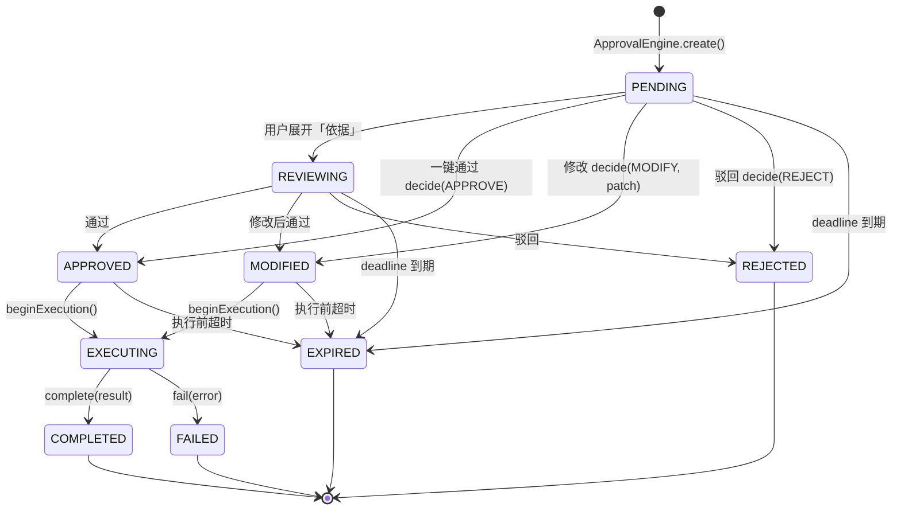

# 07 · 客户端与 UI 交互

> 文档定位：把「人机混合 IM」落到屏幕上。核心只有一句：**用户默认看到的是审批卡片，不是聊天记录。**
> 上游契约：`contracts/INTERFACES.md` v1.0。本文所有状态名、动作名、字段名与契约逐字一致：
> 审批 `TICKET_STATE` / `TICKET_TYPE`，付费消息 `MSG_STATE` / `BILLING`，协商 `TASK_STATE` / `INTENT`，
> 信任档位 `TRUST_LEVELS` / `TRUST_NAMES`，Agent 类型 `AGENT_KIND`，门控判定 `DECISION` / `GATE_CODE`，
> 消息类型 `BIZ_TYPE`，外发结论 `VERDICT`。
> 金额一律整数分（`Cents`），只在展示层换算为「¥x.xx」。
> 标记：**⚠ 需复核** = 结构估算或待用研验证。

---

## 0. 两个界面态，不是两套产品

| 维度 | 审批态（默认） | 巡视态（按需进入） |
|---|---|---|
| 用户心智 | 「我今天要拍几个板」 | 「我的管家团队在干什么」 |
| 主要对象 | `ApprovalTicket`（`tkt-*`） | `subagent` 泳道 + `Skill` 调用链 + `NegotiationSession` |
| 单次停留 | **≤30 秒完成一次决策** | 30 秒–5 分钟（有目的才进） |
| 输入 | 一键通过 / 修改 / 驳回 | 滚动、钻取、回放 |
| 通知 | 是入口（耳机/手表/推送） | 从不主动推送（除了异常告警） |
| 失败代价 | 误批 → 资金/信任损失（高） | 没看到 → 认知缺失（低） |

设计铁律：**审批态永远第一屏**；巡视态入口固定在底部第二个 Tab，不允许做成首页（否则产品退化为「监控大屏」）。

---

## 1. 审批态：卡片字段规范

### 1.1 卡片字段表（字段名与契约一致）

| 序 | 字段 | 契约来源 | 展示规则 | 上限/降级 |
|---|---|---|---|---|
| 1 | 发起子 Agent | `sourceAgentId` → 注册表 `domain` | 「采购比价 Agent」+ 领域图标 | 未知 Agent 显示 `AGENT_UNKNOWN` 灰标 |
| 2 | 做了什么 | `payload.digest` | **一句话结论 ≤28 字**，动词开头 | 缺失显示 `payload.proposedAction` |
| 3 | 建议动作 | `payload.proposedAction` | 展示为「建议：下单 2 件」 | 缺失显示「需要你决策」 |
| 4 | 涉及信任档位 | `payload.trustZone` → `TRUST_NAMES` | 徽标：本人/家庭/信任/已知/陌生 | 缺失按 `STRANGER` 展示（最保守） |
| 5 | 金额或对象 | `payload.amountCents` / `payload.targetId` | 金额右对齐加粗；对象显示脱敏名 | 无金额显示对象；都无则留空 |
| 6 | 风险等级 | `payload.riskLevel`（缺省由 `payload.gateCode` 推导） | L1 低 / L2 中 / L3 高，三色 + 文字（不只靠颜色） | 推导规则见 1.2 |
| 7 | 三个动作 | `decide.action` | 一键通过 `APPROVE` / 修改 `MODIFY` / 驳回 `REJECT` | 见 1.3 |
| 8 | 超时倒计时 | `deadline` | 「剩余 27:41」分:秒；<5 分钟转橙，<1 分钟转红 | 过期由服务端置 `EXPIRED` |
| 9 | 优先级 | `priority` | `urgent`/`high`/`normal`/`low` 排序权重 | 契约 `listPending` 已排序，客户端不得重排 |
| 10 | 依据（可展开） | `traceId` | 「凭什么这么建议 →」二段展开 | 最多 3 层，不跳新页 |
| 11 | 单号 | `id` | 卡片脚注 `tkt-…`，可复制给客服 | 长按复制 |

### 1.2 风险等级推导（客户端不得自造等级）

| 风险 | 触发条件（来自 `CapabilityGate` 的 `checks`/`code`） | 交互约束 |
|---|---|---|
| **L3 高** | `code = DESTRUCTIVE_ACTION`，或金额 ≥ `approvalThresholdCents` 且 ≥¥500，或对象含第三方 | 必须上屏；**禁止纯语音确认**；需二次确认弹窗 |
| **L2 中** | `code = AMOUNT_THRESHOLD`（金额 ≥ 阈值但 <¥500），或首次与某 `targetId` 交互 | 上屏 + 单次确认 |
| **L1 低** | `code = ALLOWED` 类只读操作、金额 0、非 destructive | 允许语音确认；卡片仍进列表 |

推导只用于**展示**，不放行任何操作：真正的门控在服务端 `CapabilityGate.evaluate()`，客户端拿到的
`decision` 已经是 `ALLOW` / `REQUIRE_APPROVAL` / `DENY`，`DENY` 的单不会以卡片形式出现。

### 1.3 三个动作的语义（与 `decide()` 一一对应）

| 动作 | 契约调用 | UI 行为 | 幂等/失败处理 |
|---|---|---|---|
| 一键通过 | `decide({action:'APPROVE'})` | 卡片右滑或主按钮；L3 弹二次确认 | 若已 `EXPIRED` → 提示「已超时，已转短信提醒」，不重试 |
| 修改 | `decide({action:'MODIFY', patch})` | 底部抽屉，只允许改**数值/对象/数量**，自由文本 ≤40 字 | `patch` 必须回传服务端校验；失败保持原卡 |
| 驳回 | `decide({action:'REJECT'})` | 长按或次按钮；可选原因（4 个预设标签 + 40 字） | 驳回即反馈信号，进入蒸馏（见 08 §4） |

「修改」不是编辑聊天消息：`patch` 是**结构化 diff**（如 `{amountCents: 3800}`），回传后由服务端
生成 `MODIFIED` 状态并重新进入执行链，用户端不本地改状态。

### 1.4 信息层级（一屏一卡）

| 层 | 内容 | 视觉权重 | 是否默认展开 |
|---|---|---|---|
| L1 结论 | 做了什么 + 建议动作 | 20sp 加粗 | 是 |
| L2 决策要素 | 金额、对象、信任档位、风险、倒计时 | 14sp | 是 |
| L3 依据 | Skill 调用链、记忆引用、中间结果 | 12sp 次要色 | 否（点击展开） |
| L4 元数据 | 单号、创建时间、traceId | 11sp | 折叠 |

### 1.5 30 秒决策的硬约束（可验收）

| 约束 | 阈值 | 验收方法 |
|---|---|---|
| 单卡一屏内完成（含动作区） | 6.1" 屏不滚动 | 三种机型截图评审 |
| 主按钮拇指热区 | ≥48dp，距屏底 ≤80dp | 设计走查 |
| 卡片首帧渲染 | ≤150ms（本地缓存优先） | 帧耗时埋点 p95 |
| 从通知点击到可操作 | ≤800ms（热启动） | 端到端埋点 |
| 单次决策中位时间 | **≤30s**（Go/No-Go 指标） | `decide` 埋点 `cardShownAt→decideAt` |
| 单卡行动作数 | 恰好 3 个（不加「稍后」为第 4 个） | 设计评审否决项 |

### 1.6 批量与优先级

| 规则 | 内容 |
|---|---|
| 排序 | 严格用 `listPending()` 返回顺序：`urgent > high > normal > low`，同优先级按 `deadline` 升序 |
| 可批量条件 | 同 `domain` + 金额 < `approvalThresholdCents` + 非 `destructive` + 非 `urgent`（四条全满足） |
| 批量上限 | 单次 ≤10 张，且必须逐张可回滚（服务端逐单审计） |
| 禁止批量 | `PAYMENT` 类、`trustZone = SELF/FAMILY` 的对外动作、任何 `L3` 风险 |
| 空态 | 「今天没有需要你拍板的事」+ 巡视态入口（不是空白页） |
| 过期态 | `EXPIRED` 卡片留在列表底部灰显 24h，可「重新发起」（新 `tkt-*`） |

---

## 2. 巡视态：看工作流，不是读聊天记录

### 2.1 泳道可视化

| 元素 | 含义 | 契约/来源 |
|---|---|---|
| 泳道 | 每个 L1 子 Agent（工作邮件/采购比价/物业水电煤/日程预约/法律/家政维修/教育亲子/电话过滤） | `AgentRegistry.children(butlerAgentId)`，`kind=subagent` |
| 节点 | 一次 Skill 调用 | `CapabilityGate.evaluate()` 的 `checks` + `GATE_CODE` |
| 节点颜色 | `ALLOW` 绿 / `REQUIRE_APPROVAL` 琥珀 / `DENY` 红 | `DECISION` |
| 连线 | 同一 `traceId` 内的调用顺序 | `payload.traceId` |
| 顶部摘要 | 今日完成数 / 待审批数 / 被拦截数 / 花费（分） | 见 2.3 指标 |
| 展开 | 点节点 → 底部抽屉三页：调用链 / 记忆读取 / 中间结果 | 见 2.2 |

**视觉纪律**：巡视态里**不出现聊天气泡**。Agent 之间不「聊天」，它们提交结构化任务与 Skill 调用记录。

### 2.2 执行轨迹钻取（三页）

| 页 | 内容 | 数据来源 | 隐私约束 |
|---|---|---|---|
| 调用链 | 时间轴：Skill 名 → 入参摘要 → 结论 → 耗时 | `audit_events` | 入参中个人信息脱敏 |
| 记忆读取 | 读了哪层记忆（`working`/`episodic`/`semantic`）、命中标签、条数 | `MemoryStore.read/search` 审计 | **只有 `digest()`**：`contentExposed:false`，总管读不到子 Agent 原文 |
| 中间结果 | 比价表、日程候选、邮件分类结果 | Skill 返回 | 大文件（>1MB）只给摘要与下载链接 |

钻取层级上限 3 层（卡片 → 轨迹 → 记忆摘要），第 4 层跳「导出原文」需二次确认并写审计。

### 2.3 异常告警呈现

| 告警 | 触发阈值（初始值 ⚠ 需复核） | 呈现 | 一键处置 |
|---|---|---|---|
| 子 Agent 频繁调用某 Skill | 单 Agent 单 Skill >20 次/分钟 或 >200 次/天 | 泳道顶部红色条 + 推送 | 暂停该子 Agent（降级为只读） |
| 超预算 | 当日花费 >80% `budgetCentsPerDay` | 琥珀条 | 调预算 / 暂停 |
| 触碰信任边界 | 单日 `TRUST_TOO_LOW` DENY ≥3 次 | 红色条 + 强制查看 | 收紧阈值 / 拉黑对象 |
| 协商失控 | 同一 `topic` 当日 `INPUT_REQUIRED`/`AUTH_REQUIRED` >3 次 | 黄色条 | 查看协商摘要 |
| 出口拦截 | `VERDICT = BLOCK` 触发 | 黄色条（按小时聚合） | 查看被拦内容与规则 |
| 蒸馏漂移 | 某子 Agent 修改率周环比 +10pp | 周报弹窗 | 进入阈值校准（见 08 §4） |

处置动作必须落审计事件：`{at, actor, action:'subagent.pause', target: agentId, decision, detail}`。

---

## 3. 陌生人「来意卡片」

### 3.1 卡片结构（预审通过后才会出现）

| 区块 | 内容 | 契约字段 |
|---|---|---|
| 顶部 | 「一位陌生人想联系你」+ 紧急程度 | `payload.urgency` |
| 来意四要素 | **谁**（脱敏身份+共同群/共同联系人）、**为什么**、**期望什么**、**多紧急** | `payload.intent = {who, why, expect, urgency}` |
| 协商摘要 | 双方 Agent 协商轮次与结论摘要（不是原文） | `NegotiationSession.round`、`artifact.summary` |
| 预审结论 | 「你的 Agent 预审：通过（命中 2/3 条准入规则）」 | `screen({verdict:'PASS'})` |
| 计费 | 计费模式 + 金额：`SEND_PAY` 发送即扣 / `VIEW_REPLY_PAY` 看到且回复才扣 | `BILLING`、`amountCents` |
| 动作 | **忽略**（不扣费）/ **接受并查看**（扣费并进入会话） | `pay()` |

### 3.2 为什么把「付费决策」和「注意力保护」合并成一个动作

一句话：**「值不值得占用我 30 秒」和「值不值得花这笔钱」是同一次判断的两个面。**

| 若拆成两步 | 后果 |
|---|---|
| 先付费 → 再看内容 | 用户为垃圾信息付了钱 → 退款申诉潮 + 信任崩塌；且付费变成「盲盒」 |
| 先看内容 → 再付费 | 内容已占用注意力，付费变成「勒索感」；且免费看会重新打开垃圾入口 |
| **合并为一次「忽略 / 接受并查看」** | 一次点击同时完成：注意力准入 + 付费授权 + 会话创建（`INTENT → AWAITING_PAYMENT → PAID`）；拒绝即零成本 |

配套铁律（来自契约）：**付费永远发生在预审之后**。`screen({verdict:'BLOCK'})` 的消息直接进 `REFUSED`，
用户根本看不到卡片，也就不存在「花钱解封」的路径——付费只能买「通道」，不能买「绕过过滤」。

### 3.3 状态呈现映射（`MSG_STATE` 逐字）

| `MSG_STATE` | 来意卡片显示 | 用户可见动作 |
|---|---|---|
| `INTENT` | 「对方 Agent 正在说明来意…」 | 无（不可操作） |
| `AWAITING_PAYMENT` | 完整来意卡片 + 计费金额 | 忽略 / 接受并查看 |
| `REFUSED` | 不展示（仅审计与发送方可见结果） | 无 |
| `PAID` | 「已付费，待你打开」 | 打开 |
| `VIEWED` | 会话页 | 回复 / 举报 |
| `REPLIED` | 会话页 | 等待结算 |
| `SETTLED` / `REFUNDED` / `EXPIRED` | 会话页灰态 + 原因 | 申诉（`REFUNDED` 除外） |

错误码要翻译成人话，不允许把 `NEEDS_SCREENING` / `NOT_PAYABLE` 直接抛给用户：
`NEEDS_SCREENING` → 「对方还在说明来意，稍后查看」；`NOT_PAYABLE` → 「这条消息未通过预审」。

---

## 4. 熟人五档权限 UI

### 4.1 默认矩阵（**这是本文最需要产品拍板的表**，初始值 ⚠ 需复核）

| 领域动作 | 本人 SELF | 家庭 FAMILY | 信任 TRUSTED | 已知 KNOWN | 陌生 STRANGER |
|---|---|---|---|---|---|
| 读取日程空闲 | 自主 | 自主 | 自主 | 需审批 | 禁止 |
| 代发消息/回执 | 自主 | 需审批 | 需审批 | 禁止 | 禁止 |
| 金额 <¥50 代付 | 自主 | 自主 | 需审批 | 禁止 | 禁止 |
| 金额 ≥¥50 代付 | 需审批 | 需审批 | 禁止 | 禁止 | 禁止 |
| 家庭地址/门锁授权 | 自主 | 需审批 | 禁止 | 禁止 | 禁止 |
| 转接来电/视频 | 自主 | 自主 | 自主 | 需审批 | 禁止 |
| 接收陌生人付费消息 | 自主 | 自主 | 需审批 | 需审批 | 需审批 |

矩阵落到契约即 `AgentRegistry.register({trustZoneMin, approvalThresholdCents, budgetCentsPerDay})`；
客户端只**编辑**这些数字，不得在前端实现「看起来通过」的假门控。

### 4.2 设置界面

| 屏 | 内容 | 交互 |
|---|---|---|
| 权限总览 | 5 档 × 7 领域网格，单元格三态：自主 / 需审批 / 禁止 | 点击切换，切换即刻显示影响摘要 |
| 单档详情 | 该档位下的「谁属于这一档」列表 + 授权到期时间 | 支持移除（`revoke`）与设置到期（`expiresAt`） |
| 变更确认 | 放开类变更（禁止→自主）**必须**二次确认 + 说明风险 | 输入/勾选确认，不接受「知道了」单击 |
| 审计 | 每次 `grant`/`revoke` 的 `history()` 列表 | 按时间倒序，可导出（PD 导出走 L2 客服） |

### 4.3 二次确认规则

| 变更方向 | 确认强度 |
|---|---|
| 收紧（自主→需审批→禁止） | 单击即可，无需确认（安全方向默认放行） |
| 放开（禁止→需审批，或需审批→自主） | 二次确认 + 一句话风险说明 + 可选「仅 24 小时」时限 |
| 涉及资金额度的放开 | 二次确认 + 短信/生物识别一次 |
| 任何变更 | 写审计，并在「最近变更」卡片置顶 7 天 |

---

## 5. 手表端三屏（决策端，不是浏览端）

| 屏 | 内容 | 尺寸约束 | 动作 |
|---|---|---|---|
| 屏 1 审批卡片 | 一行结论（≤14 字）+ 金额 + 倒计时 | 44mm 表盘 1 屏内 | **是** / **否** / **稍后** |
| 屏 2 未读摘要 | 「3 条待办：2 高 1 中」+ 最早截止 | 一屏 4 行 | 抬腕查看 → 引导到手机 |
| 屏 3 紧急联系人 | 3 个预设联系人大按钮 | 一屏 3 按钮 | 长按 2s 触发（防误触） |

**为什么手表是决策端而不是浏览端**：① 抬腕窗口只有 3–5 秒，滚动与钻取必然失败；
② 屏幕面积不足以呈现「依据」，只够呈现「结论 + 金额」；③ 手表上做浏览会与手机争夺同一批「深度阅读」时段，
收益为负。因此手表严格限幅：**只能 APPROVE/REJECT 的 L1/L2 单**，L3 单手表示意「去手机处理」，
`MODIFY` 在手表上不可用。手表动作同样走 `decide()`，并带 `channel:'watch'` 进审计（升级链路可追溯）。

---

## 6. 硬件语音交互（耳机）与安全约束

### 6.1 主链路（目标 ≤15 秒完成一次低风险决策）

| 步 | 用户 | 系统 | 时延预算 |
|---|---|---|---|
| 1 | 说唤醒词 | 本地 KWS 命中，亮硬件指示灯 | ≤300ms |
| 2 | （静默） | 播报：「采购 Agent 建议下单 2 件，共 86 元，剩余 27 分钟」 | ≤1.5s 首字 |
| 3 | 「通过」 | 本地确认词识别 → 云端 `decide({action:'APPROVE'})` | ≤1.2s |
| 4 | — | 播报：「已通过，正在执行」 | ≤800ms |
| 5 | — | 执行完播报结果（按 `TICKET_STATE → COMPLETED/FAILED`） | 异步 |

### 6.2 安全约束（硬性，写进验收）

| 约束 | 规则 |
|---|---|
| 审批不可只靠语音（资金类） | 金额 ≥ `approvalThresholdCents` 或 L3 风险：语音只允许「转手机/手表」，不允许确认 |
| 审批不可只靠语音（第三方） | 涉及第三方（`targetId` 非本人/家庭）必须屏上二次确认 |
| 播报内容限幅 | 公共场所默认**不播报金额与对象全名**，只播「有一条高优先级审批，是否查看」 |
| 防误触 | 需「唤醒词 + 明确确认词」两步；确认词后 8 秒内无语音则自动「稍后」 |
| 不可逆提示 | 播报结束时必说「已通过，10 分钟内可在手机撤回」——撤回走 `REFUNDED`/新单，不篡改历史 |
| 录音 | 端侧不落盘、原始音频不出端（见 06 §4） |

---

## 7. 审批单在客户端各视图的生命周期（`TICKET_STATE` 全显式）

视图映射：`PENDING`/`REVIEWING` → 审批态卡片；`APPROVED`/`MODIFIED`/`EXECUTING` → 巡视态泳道；
`COMPLETED`/`FAILED` → 泳道历史 + 结果回执；`REJECTED` → 反馈信号（→ 阈值校准，见 08 §4）；
`EXPIRED` → 列表底部灰态。**客户端不得引入契约外的状态**（如 `DONE`、`CANCELED`、`READ`）。

---

## 8. 无障碍与降级

### 8.1 无障碍

| 项 | 要求 | 验收 |
|---|---|---|
| 屏幕阅读器 | 卡片朗读顺序：结论 → 金额 → 风险 → 倒计时 → 三个动作 | TalkBack/VoiceOver 手测 |
| 动态字号 | 200% 字号下三动作仍完整可见（可换行但不重叠） | 系统字号 200% 走查 |
| 颜色 | 风险等级同时用**颜色 + 文字 + 图标**，色盲可辨 | 灰度截图评审 |
| 单手 | 主要动作在下半屏，支持右滑/左滑手势（可关闭） | 6.1"+ 单手操作测试 |
| 动效 | 「减弱动效」下取消卡片飞入与倒计时脉冲 | 系统开关跟随 |

### 8.2 降级矩阵（离线/断连/PaaS 不可用）

| 故障 | 客户端表现 | 用户可做什么 | 数据一致性 |
|---|---|---|---|
| 完全离线 | 顶部黄色「离线，展示的是缓存」；禁用三动作 | 浏览缓存卡片（只读） | 动作按钮置灰，不入队（避免过期误操作） |
| 弱网（RTT >3s） | 提交按钮转菊花 + 「仍在尝试」；8s 超时提示 | 重试 / 复制单号给客服 | `idempotencyKey` 保证不重复扣费 |
| BLE 断开（耳机） | 卡片提示「耳机未连接」；手表/推送接替 | 手机直接处理 | 服务端 `escalateOverdue` 照常升级 |
| IM PaaS 不可用 | 熟人消息进入「待发送」队列（≤24h），审批卡片**不受影响**（走自有 API） | 审批照常 | 审批与消息通道**物理隔离**（见 01 文档三条流量） |
| 摄像头/扫码不可用 | 备用「输入单号」入口 | 手动输入 | — |
| 服务端 5xx | 错误页 + 「重试」+ 客服入口；不丢已填 `patch` | 重试 | `patch` 本地暂存 10 分钟 |
| 设备时间错误 | 倒计时以服务端 `deadline` 与响应头 `Date` 校准，不信任本地时钟 | — | 偏差 >2 分钟时以服务端为准并提示 |

---

## 9. 性能与埋点预算

| 指标 | 阈值 | 采集点 |
|---|---|---|
| 冷启动到审批态可交互 | ≤1.2s（p90） | 客户端启动埋点 |
| 卡片列表 100 张滚动 | 掉帧率 <1% | FrameTimeline |
| `GET /api/state` 轮询 | 前台 5s / 后台 30s / 息屏暂停；失败指数退避至 60s | SDK 日志 |
| 单次决策中位时间 | ≤30s | `cardShownAt → decideAt` |
| 审批态周活跃使用率 | ≥40%（Phase0 Go/No-Go） | 周维度 UV |
| 崩溃率 | <0.1%（灰度门禁） | Crash 平台 |

埋点最小集：`approval_card_shown` / `approval_decided{action}` / `approval_modified{patchFields}` /
`oversight_opened` / `trace_drilled{level}` / `intent_card_shown` / `intent_action{ignore|accept}` /
`voice_wake{success}` / `voice_confirm{result}`。所有埋点**不得**含金额明文以外的个人内容，且按 `traceId` 关联审计。

---

## 10. 防漂移检查表（评审用）

- [ ] 所有状态名取自 `TICKET_STATE` / `MSG_STATE` / `TASK_STATE`，无自造状态。
- [ ] 三个动作恰好映射 `APPROVE` / `MODIFY` / `REJECT`，无第四动作。
- [ ] 计费模式只使用 `BILLING.SEND_PAY` 与 `BILLING.VIEW_REPLY_PAY`。
- [ ] 陌生人卡片只在 `screen(PASS)` 之后出现；`REFUSED` 不出现在接受者界面。
- [ ] 权限矩阵只编辑 `trustZoneMin` / `approvalThresholdCents` / `budgetCentsPerDay`，不在前端做门控。
- [ ] 金额展示一律由 `Cents` 换算，无浮点存储。
- [ ] 手表只允许 `APPROVE`/`REJECT`，无 `MODIFY`。
- [ ] 语音确认排除 L3 与第三方审批。
