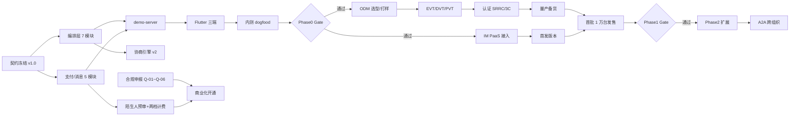

# 09 · 开发计划与里程碑

> 文档定位：M1–M18+ 的 WBS、人力、依赖、Go/No-Go、灰度与验收。
> 上游契约：`contracts/INTERFACES.md` v1.0（模块名、状态名、错误码逐字引用）。
> 关联：`docs/06`（硬件路线）、`docs/07`（交互验收口径）、`docs/08`（合规排期与运维）、`docs/10`（风险）。
> 标记：**⚠ 需复核** = 依赖外部报价/审批周期；**⚠ 待定** = 需开工前拍板。

---

## 0. 计划口径

| 项 | 定义 |
|---|---|
| 时间单位 | 周（W1 起），月（M1 = W1–W4），共 M1–M18+ |
| 阶段 | Phase0 验证 / Phase1 首发 / Phase2 扩展 / Phase3 生态 |
| 「完成」标准 | 代码合并 + 测试通过 + 文档更新 + 验收项打勾，缺一不算完成 |
| 估算法 | 三点估算取 P50，另设 15% 缓冲（关键路径 20%） |
| 不并行的东西 | 契约冻结前不写业务代码；等保测评前不做对外公测 |

---

## 1. 阶段总览

| 阶段 | 月份 | 主题 | 用户 | 团队 | 出口（Gate） |
|---|---|---|---|---|---|
| Phase0 | M1–M3 | 契约冻结 + 编排层可跑 + 内部 dogfood | 内部 30 人 | 6 | 审批态周活跃 ≥40%，决策中位 ≤30s |
| Phase1 | M4–M9 | 硬件打样 + 三端 + 小批量首发 | 内测 5000 + 首批 1 万台 | 12 | 预审拦截率 ≥95%，退货率 <8% |
| Phase2 | M10–M15 | 眼镜 Dev Kit + 两档计费 + 规模运营 | 10 万 | 18 | 越权拦截 100%，协商完成率 ≥90% |
| Phase3 | M16–M18+ | 多形态 + A2A 跨组织 + 企业版 | 30 万+ | 25+ | 跨组织任务成功率 ≥85%（⚠ 待定） |

---

## 2. WBS（按周）

### 2.1 Phase0（M1–M3，W1–W13）：把契约跑成可演示的闭环

| 编号 | 工作项 | 周 | 交付物 | 负责角色 | 依赖 | 验收标准 |
|---|---|---|---|---|---|---|
| P0-01 | 契约冻结 v1.0 评审 | W1 | `contracts/INTERFACES.md` 签核 | 架构 + 产品 | — | 9 个状态机枚举评审通过，无歧义项 |
| P0-02 | 编排层 7 模块实现 | W1–W4 | `services/orchestrator/src/*.mjs` | 后端 | P0-01 | 逐模块 `node xxx.test.mjs` 全绿；错误码全覆盖 |
| P0-03 | 支付/消息 5 模块实现 | W2–W5 | `services/{payment,messaging}/src` | 后端 | P0-01 | 账本 exactly-once、`MSG_STATE` 白名单测试通过 |
| P0-04 | demo-server（含 `/api/state`、`/api/approvals/{id}/decide`） | W4–W6 | `apps/demo-server` | 后端 | P0-02、P0-03 | 端到端脚本：造单→审批→执行→回执 |
| P0-05 | Flutter 客户端骨架（双 Tab + 轮询） | W5–W8 | `apps/clients-flutter` | 客户端 | P0-04 | 真机可跑通「拉状态→审批→状态更新」 |
| P0-06 | 审批卡片 v1 + 巡视态 v1 | W6–W9 | 设计稿 + 实现 | 设计 + 客户端 | P0-05 | 30 秒可用性测试 5/6 用户达标 |
| P0-07 | 内部 dogfood（30 人 × 4 周） | W9–W13 | 周报 + 埋点看板 | 产品 + 全员 | P0-05、P0-06 | 满足 Go/No-Go（§4） |
| P0-08 | 合规启动（Q-01/04/05/06 材料） | W2–W12 | 受理回执 | 法务 | 公司资质 | 至少 3 项进入受理 |
| P0-09 | 端侧 KWS 选型与 demo | W6–W12 | 唤醒率/误唤醒报告 | 端侧算法 | 硬件选型 | 安静态 ≥95%，误唤醒 ≤1 次/8h |

### 2.2 Phase1（M4–M9，W14–W39）：首发闭环（关键路径在硬件 ODM）

| 编号 | 工作项 | 周 | 交付物 | 负责角色 | 依赖 | 验收标准 |
|---|---|---|---|---|---|---|
| P1-01 | ODM 选型 + 结构/声学 ID | W14–W18 | 打样合同、ID 冻版 | 硬件 + 供应链 | 🅿 预算 | 2 家 ODM 比价，L/T ≤16 周 |
| P1-02 | EVT 打样（30 台） | W19–W23 | EVT 样机 + 测试报告 | 硬件 | P1-01 | 续航 ≥12h（3 台均值） |
| P1-03 | 耳机固件（BLE/唤醒/指示灯/静音开关） | W17–W26 | 固件 + 产测工具 | 端侧算法 + 硬件 | P0-09、P1-02 | P-01/P-02 硬件隐私项验收 100% |
| P1-04 | 三端客户端（手机/手表/PC） | W16–W28 | 发版 | 客户端 | P0-05 | 审批三动作、来意卡片、权限矩阵齐全 |
| P1-05 | BLE 桥接 + 端云分流 | W20–W28 | SDK | 客户端 + 后端 | P1-03 | 上行不含原始音频（抓包审计） |
| P1-06 | IM PaaS 接入（熟人五档） | W18–W26 | 接入完成 | 后端 | 契约 | `BIZ_TYPE` 全类型互通，幂等去重通过 |
| P1-07 | 陌生人预审 + 两档计费 | W20–W30 | 上线 | 后端 + 算法 | P0-03 | BLOCK 不可付费；`pay` 幂等；日限额生效 |
| P1-08 | DVT/PVT + 认证（SRRC/3C） | W24–W33 | 量产许可 | 硬件 | P1-02 | 认证取证，良率 ≥95% |
| P1-09 | 灰度 G0–G3（1%→10%） | W31–W37 | 灰度报告 | SRE + 产品 | P1-04~07 | 崩溃率 <0.1%，无 P0 |
| P1-10 | 首批 1 万台发售 + 售后周转池 | W36–W39 | 售卖页、备件池 300 台 | 运营 | P1-08 | 退货率 <8%（30 天口径） |
| P1-11 | 等保三级测评 | W22–W36 | 测评报告 | 安全合规 | Q-04 | 测评通过并备案 |

### 2.3 Phase2（M10–M15，W40–W65）：扩展与规模化

| 编号 | 工作项 | 周 | 交付物 | 负责角色 | 依赖 | 验收标准 |
|---|---|---|---|---|---|---|
| P2-01 | 眼镜 Dev Kit（500 台，无摄像头） | W40–W50 | 硬件 + 固件 | 硬件 | P1-08 | 提示端可用，佩戴 8h 无异常 |
| P2-02 | 协商引擎 v2（轮次/Token 预算、`INPUT_REQUIRED` 上抛） | W40–W48 | 服务 | 后端 | P0-02 | 轮次超限不抛异常、返回 `INPUT_REQUIRED` |
| P2-03 | 巡视态 v2（轨迹回放、异常告警、自动降级） | W42–W52 | 客户端 + 后台 | 客户端 + 算法 | P2-02 | A-01~A-07 告警可复现 |
| P2-04 | 蒸馏健康度（阈值校准）+ 用户可撤销 | W44–W54 | 服务 + UI | 算法 + 客户端 | P0-07 样本 | 校准步长/频率受控，审计可见 |
| P2-05 | 两档计费规模化 + 风控规则 | W44–W56 | 风控系统 | 风控 + 后端 | P1-07 | 退款率 ≤8%，诈骗拦截率 ≥95% |
| P2-06 | 客服体系 L1/L2/L3 上线 | W46–W56 | 工单系统 + SLA | 运营 | P1-10 | L2 首响 ≤24h 达标率 ≥95% |
| P2-07 | 多地域部署（双活） | W48–W58 | 部署方案 | SRE | P1-09 | 单地域故障切换 ≤5 分钟 |
| P2-08 | 10 万台供应链与备件 | W52–W62 | 产能协议 | 供应链 | P2-01 | L/T ≤12 周，缺件率 ≤0.5% |

### 2.4 Phase3（M16–M18+，W66–W78+）：生态

| 编号 | 工作项 | 月 | 交付物 | 负责角色 | 依赖 | 验收标准 |
|---|---|---|---|---|---|---|
| P3-01 | A2A 跨组织协议（任务级授权令牌） | M16–M17 | 协议 + 实现 | 架构 + 后端 | P2-02 | 无令牌不可跨组织，审计完整 |
| P3-02 | 企业版（团队管家） | M16–M18 | 产品 + 部署 | 产品 + 后端 | P3-01 | 5 家试点客户验收 |
| P3-03 | 指环/夹子评估（只做可行性，不做量产） | M17 | 可行性报告 | 硬件 | P2-01 | 决策：做/不做，明确否决理由 |
| P3-04 | 多形态统一体验（同一契约） | M17–M18+ | 发版 | 客户端 | P3-02 | 无业务规则分叉（评审否决项） |

---

## 3. 人力配置（角色 × 人数 × 阶段）

| 角色 | Phase0 | Phase1 | Phase2 | Phase3 | 关键职责 |
|---|---|---|---|---|---|
| 产品经理 | 1 | 2 | 2 | 3 | 契约、优先级、Go/No-Go |
| 架构师 | 1（兼后端） | 1 | 1 | 1 | 契约守门、跨模块决策 |
| 后端（Go/Node） | 1 | 3 | 5 | 7 | 编排层、支付、消息 |
| 客户端（Flutter/原生） | 1 | 2 | 3 | 5 | 三端 + 硬件桥接 |
| 端侧算法 | 1 | 1 | 2 | 2 | KWS/VAD、端云分流 |
| 算法/Agent 编排 | 1 | 1 | 2 | 3 | 提示、蒸馏、评测 |
| 硬件/供应链 | — | 2 | 2 | 3 | ODM、认证、售后 |
| 设计（UI/UX） | 1（兼） | 1 | 2 | 2 | 双态范式、可穿戴限幅 |
| 测试/SRE | 1（兼） | 2 | 3 | 4 | 灰度、SLO、对账 |
| 安全合规 | — | 1 | 1 | 2 | 等保、审核、审计 |
| 运营/客服 | — | 1 | 2 | 4 | 分层客服、活动 |
| 数据/增长 | — | — | 1 | 2 | 北极星与分层指标 |
| **合计** | **6** | **12** | **18** | **25+** | |

Phase0 的 6 人必须包含「契约守门人」角色，否则并行开发阶段 5 个模块必然漂移。

---

## 4. 依赖图与关键路径

**关键路径**：`契约冻结 → 编排层 → demo-server → 客户端 → dogfood → Gate → ODM 打样 → 认证 → 量产 → 发售`。
其中 **ODM 打样 + 认证（W14–W33，约 20 周）是 Phase1 的硬关键路径**，任何延误 1 周，首发推后 1 周。
**并行轨道**：合规申报（Q-01~Q-06，3–6 个月）与研发并行，但**不能压缩**，因此必须在 W2 启动（见 08 §1.2）。
**非关键但高风险**：IM PaaS 功能滞后（风险 R-07），需在 W18 前完成「PaaS 不可用时审批链路照常」的隔离验证。

---

## 5. Go/No-Go 量化标准

| 阶段 | 指标 | 阈值 | 测量方法 | 样本/周期 | 决策人 |
|---|---|---|---|---|---|
| Phase0 | 审批态周活跃使用率 | **≥40%** | 周内至少完成 1 次审批的用户 / 周活 | 30 人 × 4 周 | 产品 + 架构 |
| Phase0 | 单次决策中位时间 | **≤30s** | `cardShownAt→decideAt` 中位数 | ≥500 次决策 | 产品 |
| Phase0 | 契约偏差 | 0 处 | 5 模块契约对照评审 | 全量 | 架构 |
| Phase0 | 账本差异 | 0 笔 | 内部对账脚本 | 4 周 | 财务 |
| Phase1 | 陌生人预审拦截率 | **≥95%** | 人工标注 500 条应拦消息，Agent `screen(BLOCK)` 命中率 | 500 条 | 安全合规 |
| Phase1 | 付费消息误放（BLOCK 后仍可付） | **0 例** | 全量回归 + 渗透测试 | 每版本 | 安全 |
| Phase1 | 硬件退货率 | **<8%** | 30 天退货/发货 | ≥3000 台 | 供应链 |
| Phase1 | 崩溃率 | <0.1% | Crash 平台 | 灰度期 | SRE |
| Phase1 | 等保三级 | 通过 | 测评报告 | — | 安全合规 |
| Phase2 | 越权 Skill 拦截率 | **100%** | 红队构造 200 个越权用例 | 200 例 | 安全 |
| Phase2 | 协商 Task 完成率 | **≥90%** | `COMPLETED / (COMPLETED+FAILED+REJECTED+CANCELED)` | 7 天全量 | 算法 |
| Phase2 | 协商失控率 | ≤2% | `INPUT_REQUIRED`/`AUTH_REQUIRED` 占比 | 7 天 | 算法 |
| Phase2 | 审核误杀率 | ≤0.5% | 500 条/周人工复核 | 4 周 | 内容安全 |
| Phase3 | A2A 跨组织任务成功率 | ≥85%（⚠ 待定） | 试点客户统计 | 5 家 | 产品 |

**否决规则**：任一 Gate 指标未达标 → 不进入下一阶段，先做 2 周专项整改再复评；
出现 P0（资金/隐私/数据泄露）→ 无条件回滚并重新 Gate。

---

## 6. 灰度策略与风控开关

### 6.1 灰度节奏

| 轮次 | 流量 | 时长 | 进入条件 | 退出条件（任一） |
|---|---|---|---|---|
| G0 | 内部 200 人 | 2 周 | Gate 通过 | 崩溃率 <0.1% 且无 P0 |
| G1 | 1% | 24–48h | G0 通过 | 崩溃率 <0.1%、`decide` 失败率 <0.5% |
| G2 | 5% | 24–48h | G1 通过 | 客诉率 <0.5%、审核 SLA 达标 |
| G3 | 10% | 24–48h | G2 通过 | 退款率 ≤8%、误杀率 ≤0.5% |
| G4 | 30% | 24–48h | G3 通过 | 留存不劣化、无新增 P1 |
| 全量 | 100% | — | 连续 3 天稳定 | — |

每轮必须做**同批次 A/B**（新老版本各半），只看「灰度组 vs 对照组」的差值，不看绝对值。

### 6.2 风控开关（Kill Switch，按秒级生效）

| 开关 | 关闭后的行为 | 影响 | 生效时延 | 负责人 |
|---|---|---|---|---|
| `agent.autonomy` | 全部子 Agent 降级为「需审批」 | 自主率→0，审批量上升 | ≤10s | 后端值班 |
| `approval.voice` | 关闭语音审批，只留屏上 | 耳机价值下降但可用 | ≤10s | 客户端 |
| `paid.message` | 新消息只读，禁止发起与扣费 | 收入暂停，已有会话可读 | ≤10s | 支付值班 |
| `stranger.intent` | 关闭陌生人来意入口 | 无新增陌生人消息 | ≤10s | 风控 |
| `negotiation` | 协商上限降为 1 轮，之后 `INPUT_REQUIRED` | 自动协商退化 | ≤10s | 算法 |
| `agent.egress` | 全部外发转人工审批 | 时延上升 | ≤10s | 安全 |
| `hardware.upload` | 关闭端侧上云（仅本地审批缓存） | 远场功能不可用 | ≤10s | 端侧 |

开关操作必须双人确认（值班 + 安全），并在 5 分钟内通报；每次开关写审计。

---

## 7. 阶段交付物与验收清单

### 7.1 交付物清单

| 阶段 | 交付物 |
|---|---|
| Phase0 | 契约 v1.0、编排层 7 模块 + 测试、支付/消息 5 模块 + 测试、demo-server、Flutter 骨架、双态设计稿 v1、dogfood 周报、合规受理回执 |
| Phase1 | 耳机 EVT/DVT/PVT 报告、固件与产测工具、三端客户端、BLE 桥接 SDK、陌生人与两档计费、等保报告、灰度报告、首批 1 万台、售后周转池 |
| Phase2 | 眼镜 Dev Kit、协商 v2、巡视态 v2、蒸馏校准、风控规则库、客服体系、多地域部署 |
| Phase3 | A2A 协议与实现、企业版、指环/夹子可行性结论、统一体验版本 |

### 7.2 验收清单（可直接当评审 checklist）

**通用（每阶段）**
- [ ] 所有状态名与 `TICKET_STATE` / `MSG_STATE` / `TASK_STATE` 逐字一致，无自造枚举
- [ ] 金额全链路整数分，前后端无浮点
- [ ] 所有治理动作有审计事件，可按 `traceId` 回放
- [ ] 失败路径有明确错误码与用户可读文案
- [ ] 文档与实现同步更新（契约变更走 Lead 授权）

**Phase0**
- [ ] 7 模块测试逐文件直跑通过（禁止 `node --test`）
- [ ] 账本重复投递返回 `duplicate:true` 且只入账一次
- [ ] `screen(BLOCK)` 后 `pay` 抛 `NOT_PAYABLE`
- [ ] 协商 `COUNTER` 超 `maxRounds` 返回 `INPUT_REQUIRED` 而不抛异常
- [ ] 30 人 4 周 dogfood 达到 Go/No-Go 两项阈值
- [ ] 卡片 30 秒可用性测试 ≥5/6 用户达标

**Phase1**
- [ ] P-01/P-02/P-03/P-04 硬件隐私项 100% 通过（拆机 + 抓包）
- [ ] 单次续航 ≥12h、盒内 ≥44h（3 台均值）
- [ ] 预审拦截率 ≥95%（500 条标注集）
- [ ] 退货率 <8%（≥3000 台）
- [ ] 等保三级测评通过
- [ ] 灰度崩溃率 <0.1%，账本差异 0 笔
- [ ] 支付通道合规、退款链路演练通过

**Phase2**
- [ ] 越权 Skill 拦截 100%（红队 200 例）
- [ ] 协商 Task 完成率 ≥90%
- [ ] 异常告警 A-01~A-07 全部可复现且自动降级只收紧
- [ ] 蒸馏校准有样本量/步长/频率约束，用户可撤销
- [ ] L2 客服首响 ≤24h 达标率 ≥95%
- [ ] 多地域切换 ≤5 分钟

**Phase3**
- [ ] A2A 无令牌不可跨组织、审计完整
- [ ] 5 家试点客户验收通过
- [ ] 指环/夹子给出「做/不做」明确结论与否决理由

---

## 8. 计划风险与缓冲

| 风险 | 影响 | 缓冲策略 |
|---|---|---|
| ODM 打样/认证延期（R-08） | 首发整体后移 | 关键路径留 20% 缓冲（+4 周），认证与打样并行 |
| 资质审批延期（R-09） | 无法收费 | W2 启动申报；灰度期用体验券/虚拟额度 |
| 契约变更 | 全模块返工 | 契约冻结后变更需 Lead 授权 + 影响评估 |
| 关键人依赖 | 单点 | 每个模块至少 2 人可读可改 |
| Go/No-Go 未过 | 阶段阻塞 | 预留 2 周专项整改窗口 |
