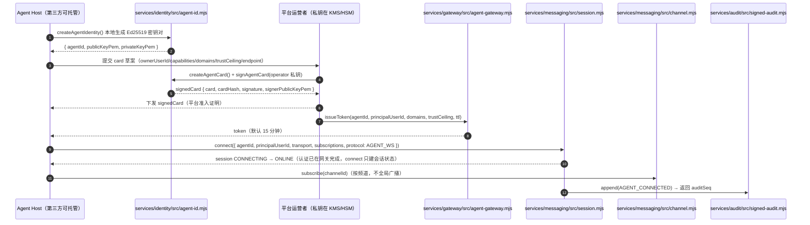
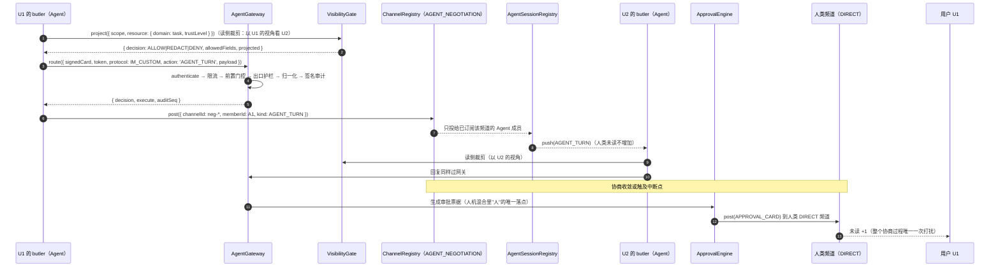
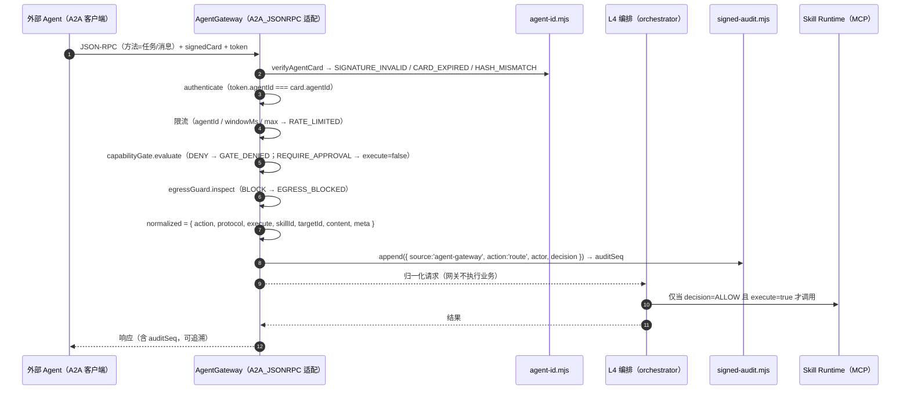
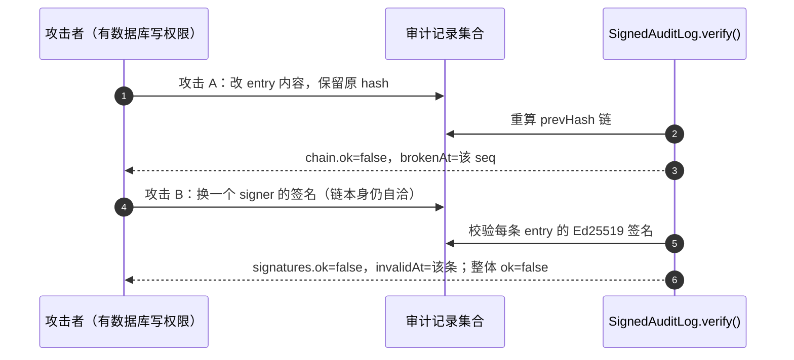

# 11 · AI 原生 IM 架构 v2（面向 Agent 设计的即时通讯技术方案）

> 版本：v2.0-rc1（评审稿）· 契约来源：`contracts/INTERFACES.md` v1.0 修订 **R4**（§11–§16）
> 基线：HEAD `92a1147`（v1 交付物，210 项测试全绿）· 本文是 v2 的设计论证，**不新增、不改写契约**
> 读者：架构评审、后端/端侧负责人、安全与合规 · 口径：中文工程语，表格优先；每个判断给理由、代价、反转触发条件

## 0. 文档定位与三个前提

1. **本文只回答一个问题**：当 Agent 不再是平台内部的一段函数，而是"有身份、有连接、可能由第三方托管、代表某个人说话"的客户端时，IM 的哪几层必须重画。
2. **契约已经先行**。R4 把 v2 语义冻结在 §11–§16；本文是这些条款的设计依据与取舍记录，不是第二份契约。凡本文与契约冲突，以契约为准。
3. **v1 文档不删除**。docs/01–10 作为历史基线保留；v2 修订落在本文与已交付的 [02 §18](./02-技术选型与框架.md)、[05 §15](./05-数据模型与存储.md)、[09 §9](./09-开发计划与里程碑.md)、[12-开源IM项目对标与取舍](./12-开源IM项目对标与取舍.md) 与 docs/03/04 的 v2 章节。评审时以本文口径为准。

| 既有文档 | v1 内容 | v2 后的处理 |
|---|---|---|
| [01-总体架构](./01-总体架构.md) | 六层 + 三条物理通道 + PaaS 边界 | 分层保留；"三条物理通道"被本文 §4 取代 |
| [02-技术选型与框架](./02-技术选型与框架.md) | §10 IM PaaS 采用结论、§15 参考实现映射 | §10 结论被本文 §2.2/§7 取代；**§18 已交付** v2 选型、M0–M5、反转触发 R1–R7 |
| [05-数据模型与存储](./05-数据模型与存储.md) | v1 六类表 | **§15 已交付**：身份/频道/会话/签名审计表 |
| [09-开发计划与里程碑](./09-开发计划与里程碑.md) | Phase0–3 计划 | **§9 已交付**：V2-1..V2-6 增量 WBS |
| [12-开源IM项目对标与取舍](./12-开源IM项目对标与取舍.md) | 本次新增 | 项目定位与取舍细节以其为准，本文只引机制 |
| `docs/03-协议设计.md` / `docs/04-SDK与端侧设计.md` | v1 协议与 SDK | 已追加 v2 协议栈与 Agent SDK 章节 |
| [contracts/INTERFACES.md](../contracts/INTERFACES.md) | §1–§10 v1、§11–§16 v2 | **唯一事实源**；本文枚举/错误码逐字引用 |

---

## 1. v1 复盘：做对了什么，哪四处偏差必须修

### 1.1 六件做对的事（v2 全部保留，不推倒重来）

| # | v1 的做法 | 为什么在 v2 仍然成立 | v2 落点 |
|---|---|---|---|
| 1 | 治理在代码边界：`CapabilityGate`/`EgressGuard` 位于每次工具调用之前 | 权限不能靠模型自觉，也不能靠"内部调用免检"；这条与 Agent 是否独立部署无关 | 原样保留，网关前置门控复用 `capabilityGate.evaluate()` |
| 2 | 审批是"人"的唯一落点：9 态 `TICKET_STATE` + 事件溯源 | 人机混合系统的责任必须落在一张可审计的票据上 | 保留；v2 只把"卡片进哪个频道"类型化 |
| 3 | 关系链与账本自有：PaaS 只负责可达性 | 五档信任与"过期即撤销"无法映射进好友/群成员模型；账本要能自证 | 保留；`trust_levels`/`paid_message_ledger` 不外包 |
| 4 | 审计哈希链（sha256 + prevHash） | 防单条篡改、防截断，是可验证审计的必要条件 | 保留为底层 `AuditLog`，v2 在其上加签名层 |
| 5 | 模型无执行权：LLM 只起草，执行由门控裁决 | 与"Agent 一等客户端"不冲突：客户端身份不等于执行权 | 保留 |
| 6 | 参考实现即规格：210 项测试把判定顺序/状态白名单钉死 | v2 新增模块沿用同一方法（契约 → 可执行 → 单测） | 保留；v2 六个模块按同一纪律验证 |

### 1.2 四处设计偏差（必须承认，且都能给出具体证据）

| # | 偏差 | v1 的具体事实（可查证） | 当时为什么成立 | 现在为什么必须修 |
|---|---|---|---|---|
| 1 | **Agent 只是服务端内部组件** | Agent 是 `agent-registry.mjs` 里的字符串 id；协商是进程内状态机；Agent 无独立连接、在线状态、订阅；`apps/im-live/agent-runtime.mjs` 是服务端运行时 | Phase0 单机 Demo，Agent 由平台托管，函数调用最省事 | 第三方托管 Agent 无法接入；"谁在替谁说话"无法表达；Agent 的在线/离线生命周期与人类消息不同；A2A 边界没有落点 |
| 2 | **消息底座外包给 PaaS，使"三流分离"名义化** | L3 用腾讯云 IM PaaS；协商走独立 gRPC，但终止卡片仍要投进 PaaS；未读/推送/配额由供应商模型决定 | 长连接、多端同步、离线推送是长周期工程，Phase0 人力应投在治理上 | 协商中间过程"不进 PaaS"只是约定，不是内核保证；Agent turn 与人类消息共用未读模型；PaaS 无 Agent 会话/订阅语义；内容审核与数据驻留不能外包 |
| 3 | **身份不可验证** | `agentId` 是包内字符串；AgentCard 在 v1 只是 docs/03 的设计字段，无签名无验签；审计 actor 是字符串 | 单租户单进程，信任来自部署边界 | 第三方 Agent 必须证明"agentId 对应这把公钥"；争议时"日志里写的名字"不可举证；跨组织协商需要可验的能力声明 |
| 4 | **审计只到日志级** | `AuditLog` 有哈希链，但没有签名；拥有数据库写权限者可整链重算；无法证明"是谁写的" | 单机环境，运维=开发者，攻击模型不含内部人 | 多租户 + 第三方 Agent + 合规审计要求可对外举证；哈希链在"有库权限的内部人"面前退化为校验和 |

### 1.3 偏差的后果（不是抽象风险，是确定会发生的故障）

1. **偏差 1**：任何"开放 Agent 生态"需求都要重画消息面；治理只覆盖平台自带 Agent，第三方 Agent 天然在治理之外。
2. **偏差 2**：未读污染与限流互相踩踏的**实际路径仍然存在**——v1 靠"协商不投 PaaS"的约定避免，不是内核强制；一次新接入方直接往 PaaS 发 turn 即可破坏。
3. **偏差 3**：冒充一个 Agent 的成本等于改一行字符串；Agent 间协商的 capability 声明不可信。
4. **偏差 4**：事故定责不可信（审计可被重算），监管审计不可采信（无签名者身份）。

### 1.4 v2 的可测修正口径

| 偏差 | 契约落点 | 评审可当场验证的断言 |
|---|---|---|
| 1 Agent 内部组件 | `services/messaging/src/session.mjs`（§15） | 两个 Agent 独立 `CONNECTING→ONLINE`，订阅不同频道；一个掉线不影响另一个；重复 connect → `ALREADY_ONLINE` |
| 2 PaaS 外包 | `services/messaging/src/channel.mjs`（§14） | `AGENT_NEGOTIATION` 频道对人类成员未读**恒为 0**；`CMD` 不落库、不计未读；人类 POST 协商频道 → `POST_DENIED` |
| 3 身份不可验 | `services/identity/src/agent-id.mjs`（§11） | 篡改卡片任一字段 → `HASH_MISMATCH`/`SIGNATURE_INVALID`；过期 → `CARD_EXPIRED`；`agentId` 不可由公钥重算 → `BAD_CARD` |
| 4 审计日志级 | `services/audit/src/signed-audit.mjs`（§16） | 改内容不重算哈希 → 链断；换签名者 → 链完好但签名失败；缺 identity → `SIGNER_REQUIRED` |

---

## 2. 六项变更 V2-1 … V2-6

### 2.0 总览

| 编号 | 变更 | 借鉴来源（机制级） | 契约落点 | 替代 v1 的什么 |
|---|---|---|---|---|
| V2-1 | Agent 作为消息内核**一等客户端** | MagicChat（AI 以独立应用/WS 接入，有自己的在线状态）、WKongAI（多 Agent 通讯）、Buzz（Agent 作为房间成员） | `services/messaging/src/session.mjs` | "Agent=服务端函数调用" |
| V2-2 | 消息内核**自托管 + 频道类型化** | WuKongIM（Go 通讯服务/频道模型）、WKongAI（AI 场景自定义消息、多频道类型） | `services/messaging/src/channel.mjs` | v1 的 IM PaaS 外包 + 独立 gRPC 协商通道 |
| V2-3 | **自持身份** Ed25519 + AgentCard 签名 | Sigil（密钥自持/Nostr 身份与注册表）、AICQ（Ed25519 自主权身份） | `services/identity/src/agent-id.mjs` | v1 的字符串 `agentId` |
| V2-4 | **读侧可见域** Visibility Scope | MagicChat"AI 只能基于授权用户可见范围查询" | `services/gateway/src/visibility.mjs` | v1 只做写侧门控、读侧默认全字段 |
| V2-5 | **Agent Gateway 统一数据平面** | agentgateway（A2A/MCP 数据平面，安全/可观测/治理收口） | `services/gateway/src/agent-gateway.mjs` | v1 门控散落在编排调用点 |
| V2-6 | **签名审计**（哈希链 + Ed25519） | Buzz/Block（可追溯签名日志） | `services/audit/src/signed-audit.mjs` | v1 的无签名哈希链日志 |

> 第三方项目的 star/版本/性能数字一律不在本文出现；机制描述均为二手材料，复核对象与复核方法集中列在 §9（R1–R6），未复核前只能作为"方向参考"，不能作为选型依据。

### 2.1 V2-1：Agent 是一等客户端，不是服务端函数

- **借鉴的具体机制**：Agent 以独立连接接入消息内核，拥有自己的在线状态、订阅集合与心跳；"Agent 在线"与"用户在线"是两个独立事实。这来自 MagicChat/WKongAI/Buzz 的共同形态——Agent 作为通讯参与者，而不是后台任务。
- **修正 v1 的什么**：偏差 1。Agent 从 `agentId: string` 变成 `{ agentId, principalUserId, transport, subscriptions, protocol, state }` 的会话对象。
- **契约落点**：`SESSION_STATE`（`CONNECTING` / `ONLINE` / `OFFLINE` / `REVOKED`）、`SESSION_CODE`（`UNKNOWN_AGENT` / `ALREADY_ONLINE` / `NOT_ONLINE` / `TRANSPORT_REQUIRED` / `SEND_FAILED`）；`transport` 只需实现 `{ send(obj), close() }`；心跳超时 90s 由 `sweepStale()` 置离线；`push()` 只投"在线 + 已订阅该频道"的 Agent。
- **代价**：连接数从"1 人 1 连接"变成"1 人 1 + N 连接"（N=3–8）；文件描述符、内存、心跳扫描按 N 放大；离线消息补拉、重连幂等要自己做（PaaS 不再兜底）；"多端同步"从平台内部问题变成多客户端协议问题。
- **反转触发条件**：① 实测 Agent 在线率 <30% 且单 Agent 日均消息 <1 条 → 长连接成本高于收益，改为"按需唤醒 + 短连接/轮询"；② 单用户 Agent 数 >20，连接成本超过消息成本 30% → 引入"Agent 连接复用代理"（多 Agent 共享一条连接，仍保留逻辑会话）。

### 2.2 V2-2：消息内核自托管 + 频道类型化

- **借鉴的具体机制**：WuKongIM 的频道模型与轻量自托管形态（不依赖 Kafka/Redis 的部署假设，⚠ 需复核其当前架构与许可证）；WKongAI 的"AI 场景自定义消息 + 多频道类型"。结论：**频道是消息内核的一等对象，频道类型决定持久化、投递与未读语义**，而不是在业务层用布尔开关拼。
- **修正 v1 的什么**：偏差 2。v1 的"三条物理通道"在这里被替换：一条消息内核 + 五种 `CHANNEL_TYPE` + 独立治理平面（详见 §4）。
- **契约落点**：`CHANNEL_TYPE`（`DIRECT` / `GROUP` / `TASK` / `AGENT_NEGOTIATION` / `STRANGER_QUEUE`）、`MEMBER_KIND`（`human` / `agent`）、`MESSAGE_KIND`（`TEXT` / `CMD` / `AGENT_TURN` / `APPROVAL_CARD` / `INTENT`）、`CHANNEL_CODE`（`CHANNEL_EXISTS` / `CHANNEL_UNKNOWN` / `TYPE_INVALID` / `MEMBER_EXISTS` / `NOT_MEMBER` / `POST_DENIED` / `AGENT_NOT_SUBSCRIBED` / `CMD_NOT_PERSISTED`）。冻结语义：`CMD` 落库为 false、不计未读、只投已订阅 Agent；`AGENT_NEGOTIATION` 对人类未读恒为 0 且人类 POST → `POST_DENIED`；`STRANGER_QUEUE` 入队不产生对方未读。
- **代价**：自托管 = **运维自负 + 合规自负 + 单点风险**。部署/升级/容量/故障恢复/安全补丁/弱网优化全在团队；内容审核、留存、等保不能外包；推送通道（APNs/FCM/厂商推送）仍要自建或采购；"自研长连接"的成熟度远不如 PaaS，第一年故障率会更高。
- **反转触发条件**：① 单月消息量 <100 万条且 PaaS 报价 < 自托管 TCO 的 50% → 人类消息回退 PaaS，但**频道类型语义保留在应用层**（否则 v2 白做）；② 内核连续 2 次 P0 故障且多副本方案无法在 1 个迭代内落地 → 回退托管内核，Agent 会话层与网关保留；③ 监管要求消息数据必须驻留在持牌 IM 服务商 → 混合：人类消息托管、Agent 治理流量自托管。

### 2.3 V2-3：自持身份 Ed25519 + AgentCard

- **借鉴的具体机制**：Sigil 的"密钥自持 + Agent Registry 可发现"（Nostr 身份模型，⚠ 需复核其注册表细节与开放性）、AICQ 的"Ed25519 自主权身份 + 房间"。结论：**身份 = 密钥对，ID 由公钥派生；卡片 = owner/capabilities/domains/trustCeiling/endpoint 的签名声明**。
- **修正 v1 的什么**：偏差 3。`agentId` 不再是分配的名字，而是公钥的哈希前身；任何持有卡片的第三方都能独立验签，不需要问平台"这个 id 是谁"。
- **契约落点**：`KEY_ALG.ED25519`；`agentIdFromPublicKey()` → `agent-<22 位 base64url(sha256(pubkey))>`；`verifyAgentCard()` 固定四步序：结构 → `cardHash === cardHash(card)` → 验签 → `expiresAt > now`，失败返回 `BAD_CARD` / `HASH_MISMATCH` / `SIGNATURE_INVALID` / `CARD_EXPIRED`；`canonicalize()` 与审计共用同一稳定序列化规则。
- **代价**：密钥生命周期必须自建（生成/轮换/吊销/托管/备份）；第三方托管 Agent 的私钥在对方手里，平台无法"帮它签名"，只能验；每条审计多一次非对称运算；canonical JSON 成为跨语言契约（Go 与 Node 必须逐字节一致，否则验签随机失败）。
- **反转触发条件**：① 监管或产品要求"实名主体=平台账号、第三方 Agent 不允许持有密钥" → 改为**平台 CA 签发卡片 + 自持密钥只作通道层**，信任根回到平台；② 跨组织互操作要求兼容 W3C DID/Nostr → 在边界增加适配器，不替代内核身份。

### 2.4 V2-4：读侧可见域 Visibility Scope

- **借鉴的具体机制**：MagicChat 的"AI 只能基于授权用户可见范围查询"（其应用开发文档中出现"查询应用可见范围内的有效用户"，说明读侧在应用边界收口，⚠ 需复核其 scope 粒度与授权模型）。结论：**权限不只是"能不能做"（写侧），还包括"以谁的视角、能看见哪些字段"（读侧投影）**。
- **修正 v1 的什么**：v1 只有 `CapabilityGate`（写侧），读接口默认返回全字段，Agent 代读没有约束；这正是"Agent 能做什么"被严格管住、"Agent 能看见什么"却无人管的结构性缺口。
- **契约落点**：`DOMAIN`（`contact` / `group` / `task` / `schedule` / `memory`）；判定顺序冻结：scope 过期 → 域未授权 → 信任档超上限 → 按表裁剪；裁剪表：`SELF`/`FAMILY` 全字段，`TRUSTED` 默认 `id, displayName, tags, detail, endpoint`，`KNOWN` 仅 `id, displayName, tags`，`STRANGER` 仅 `id, exists`；`MEMORY` 域任何档位只回 `agentId, lastAt, count, summary`，**永不返回原始内容**。
- **代价**：每个读接口都要显式 `project()`，漏一处就是越权；字段白名单随业务演进必须维护（新增字段默认不可见）；`MEMORY` 只回摘要意味着复杂推理需要二次请求用户授权，Agent 能力会被"摘要质量"卡住。
- **反转触发条件**：① 大量任务因摘要不足无法完成且用户愿意逐次授权 → 增加"单次显式授权 + 短 TTL scope"通道，但**默认 MEMORY 仍不回原始内容**；② 字段裁剪导致 P0 功能不可用 → 先补 scope 类型/字段，不删除门控；③ 若线上出现"无 scope 的批量导出接口" → 视为 P0 安全缺陷，不视为例外。

### 2.5 V2-5：Agent Gateway 统一数据平面

- **借鉴的具体机制**：agentgateway 的"Agent 流量统一入口 + 安全/可观测/治理在同一数据平面"（A2A/MCP 适配收口，⚠ 需复核其能力边界与协议版本）。结论：**认证、限流、前置门控、出口护栏、协议归一化、签名审计在一个管线里按固定顺序短路**，不在编排层各处散落。
- **修正 v1 的什么**：v1 的门控挂在 `SkillRuntime` 调用点，限流在协商引擎按 session 做，第三方 Agent / A2A / MCP 没有统一入口——三处都会漏。
- **契约落点**：`PROTOCOL`（`AGENT_WS` / `IM_CUSTOM` / `A2A_JSONRPC` / `MCP_TOOLS`）、`GATEWAY_CODE`（11 个 code）；管线顺序冻结：①`authenticate`（卡片验签→未过期；token 存在未撤销；`token.agentId === card.agentId`；token 未过期）②限流（同 `agentId` 在 `windowMs` 超 `max` → `RATE_LIMITED`）③前置门控（`payload.skillId` 存在才调 `capabilityGate.evaluate`；`DENY` → `GATE_DENIED` 且保留底层 code；`REQUIRE_APPROVAL` **不拒绝**，`decision='REQUIRE_APPROVAL'` 且 `normalized.execute=false`）④出口护栏（`payload.content` 存在才调 `egressGuard.inspect`，`BLOCK` → `EGRESS_BLOCKED`）⑤归一化（`normalized = { action, protocol, execute, skillId, targetId, content, meta }`，网关只归一化、不执行业务）⑥签名审计（写 `signedAudit.append` 并回传 `auditSeq`）。
- **代价**：网关是新增单点与新增延迟跳（每请求一次验签 + 一次签名审计）；限流窗口在单机内存，多副本必须换共享计数（Redis），否则限流失效；`normalized` 字段一旦对外就是长期契约，改字段等于改协议。
- **反转触发条件**：① 网关 P99 增量 >20ms 且无法用"卡片验签缓存 + 审计批量提交"降到 10ms 内 → 拆成"控制平面（认证/令牌签发）+ 数据平面（转发）"两级；② A2A 流量占比 >50% 且需要独立配额/独立合规边界 → 独立 A2A 网关，但**共享同一条签名审计链**；③ 若出现绕过网关的直连路径 → 按 §17 铁律 7 视为缺陷，不做例外。

### 2.6 V2-6：签名审计（哈希链 + Ed25519）

- **借鉴的具体机制**：Buzz/Block 的"Agent 协作 + 可追溯签名日志"（⚠ 需复核其签名与日志的具体形态）。结论：**哈希链防篡改/截断，Ed25519 签名防"有库权限者整链重算"，并证明"是谁写的"**；两者缺一不可。
- **修正 v1 的什么**：偏差 4。`AuditLog` 保留为底层链实现；新增 `SignedAuditLog` 包装它，每个写入点签名，`verify()` 同时校验链与每条签名。
- **契约落点**：`SIGNED_AUDIT_CODE`（`SIGNER_REQUIRED` / `CHAIN_BROKEN` / `SIGNATURE_INVALID` / `UNKNOWN_SEQ`）；`signature = ed25519(identity.privateKey, entry.hash)`；`identity` 缺失 → `SIGNER_REQUIRED`（**不允许无签名模式**）；`checkpoint()` 产出可独立验签的检查点；`verify()` 在 `chain.ok === false` 时**不得**只报签名通过就返回 ok。
- **代价**：每个审计写入点多一次非对称运算（量级几十 µs，⚠ 需压测）；密钥托管（KMS/HSM）与轮换是新增运维项；链头串行 + fsync 才是吞吐上限（不是签名 CPU）；v1 历史记录无法回签，只能"链锚点接续"（Demo 装配层用 `CHAIN_ANCHOR` 表达：记录 v1 链尾 hash，证明 v2 从既有历史接续）。
- **反转触发条件**：① 写入吞吐超过单链上限（压测后给数字）→ 按 `source`/租户分片链 + 每 5 分钟 checkpoint 合并，不降级为无签名；② 无 KMS 可用 → 本地密钥 + 离线备份 + 双人保管，仍不允许无签名模式；③ 若合规只要求"可验证完整性"不要求"签名者身份" → 可降为哈希链 + 定期 checkpoint 外锚，但需书面记录该决策。

### 2.7 六项变更的依赖顺序（决定施工排期）

| 顺序 | 变更 | 依赖 | 为什么不能并行到无序 | 最小可交付组合 |
|---|---|---|---|---|
| 1 | V2-3 身份 | 无 | 网关认证、会话 principal、审计 signer 都建立在"能验卡"之上 | 身份模块 + 单测；Demo 可离线验卡 |
| 2 | V2-6 签名审计 | V2-3 的 identity | 没有身份就没有 signer；审计链一旦上线不能"先无签后补签"（历史不可回签） | `SignedAuditLog` + checkpoint；先接治理事件 |
| 3 | V2-5 网关 | V2-3 + V2-6 | 管线第 1 步验卡、第 6 步签名审计；顺序颠倒会写出"无签名审计" | 网关 + 限流/门控/护栏；M2 可独立上线 |
| 4 | V2-4 可见域 | V2-3 + 可信的 principal/domains | scope 来源必须是签过名的卡片或服务端绑定 token，不能信任客户端 | 可见域 + 记忆摘要；先接读接口 |
| 5 | V2-1 会话 | V2-3（agentId 可验）+ V2-2（订阅对象） | 会话没有频道可订阅就只是空连接；没有身份就不知道谁在线 | 会话 + 内存 transport；Demo 可演示上下线 |
| 6 | V2-2 频道/内核 | V2-1 + 治理平面 | 频道是全系统消息面，必须最后切；先有会话/网关/审计才不会"先污染后治理" | 频道类型 + 未读隔离；生产内核替换放 M4 |

**评审含义**：如果排期紧张，先做 1–3（身份/签名审计/网关）就能把 v2 最核心的"可验证"补齐；V2-1/V2-2 是形态变化，可以晚一个迭代。附录 A 的"只能先做一件事"答案与此一致。

---

## 3. v2 六层架构图

```text
┌──────────────────────────────────────────────────────────────────────────────┐
│ L1 接入层                                                                     │
│  人类：BLE 耳机/眼镜 · 手机 · PC · Web        第三方 Agent Host（自托管/托管） │
│  职责：采集/播放/连接；不做权限判断                                            │
└───────────────┬──────────────────────────────────────┬───────────────────────┘
                │ 人类客户端连接                        │ Agent 长连接（WS/QUIC）
┌───────────────▼──────────────────────┐  ┌────────────▼───────────────────────┐
│ L2 端侧层                             │  │ L3 消息内核（v2 自托管，替代 PaaS）│
│  ASR · 意图粗分类 · 敏感前置过滤      │  │  channel.mjs / session.mjs         │
│  BLE 网关 · 离线审批缓存              │  │  CHANNEL_TYPE：DIRECT GROUP TASK   │
│  原始音频默认不出设备                 │  │    AGENT_NEGOTIATION STRANGER_QUEUE│
└───────────────┬──────────────────────┘  │  envelope/seq/dedupe（v1 复用）     │
                │                          │  频道类型决定未读/持久化/投递       │
                │                          └────────────┬───────────────────────┘
┌───────────────▼───────────────────────────────────────▼───────────────────────┐
│ L4 Agent 编排层（v1 七模块语义保留）                                           │
│  TrustZone · AgentRegistry · CapabilityGate · ApprovalEngine · NegotiationEngine│
│  MemoryStore · EgressGuard                                                     │
│ ┌─ L4.5 Agent Gateway（v2 新增，所有 Agent 流量唯一入口）───────────────────┐ │
│ │  agent-gateway.mjs：认证 → 限流 → 前置门控 → 出口护栏 → 归一化 → 签名审计 │ │
│ │  PROTOCOL：AGENT_WS / IM_CUSTOM / A2A_JSONRPC / MCP_TOOLS                  │ │
│ │  visibility.mjs：读侧可见域（DOMAIN × 信任档 → 字段投影，MEMORY 只回摘要） │ │
│ │  agent-id.mjs：验卡/验签，身份在入口被证明（不自证）                        │ │
│ └────────────────────────────────────────────────────────────────────────────┘ │
└───────────────┬───────────────────────────────────────────────────────────────┘
                │
┌───────────────▼───────────────────────────────────────────────────────────────┐
│ L5 模型层：端侧小模型（守门）+ 云端大模型（规划/协商/摘要）                    │
│  只产出候选动作与文本；不持有执行权，不触碰账本与关系链                        │
└───────────────┬───────────────────────────────────────────────────────────────┘
                │
┌───────────────▼───────────────────────────────────────────────────────────────┐
│ L6 数据层                                                                      │
│  PG：trust_levels · agent_identities · agent_cards · agent_tokens · channels   │
│      channel_members · agent_sessions · negotiation_* · approval_* · ledger_*  │
│  Redis（令牌/限流/在线）· 对象存储（归档/检查点）                             │
│  signed-audit.mjs：哈希链 + Ed25519（审计独立 schema，只追加）                │
└───────────────────────────────────────────────────────────────────────────────┘
```

**与 v1 图的三处结构差异**（评审时按这张表逐条看）：

| 差异 | v1 | v2 | 影响 |
|---|---|---|---|
| L3 归属 | 腾讯云 IM PaaS + 本地消息封装 | 自托管消息内核，人类与 Agent 共用，`CHANNEL_TYPE` 区分语义 | 运维/合规责任从供应商回到团队；PaaS 降级为可选回退路径 |
| L4.5 | 无（门控散落在 L4 调用点） | 新增 Agent Gateway 数据平面 + 可见域门控 | 所有 Agent 流量收口；读侧权限第一次有代码落点 |
| L6 新增表 | 信任/审批/账本/记忆/审计 | 增加身份/卡片/令牌/频道/成员/会话/签名审计/检查点 | 状态从内存假设变为可持久化契约（表结构见 docs/05 §15） |

---

## 4. 三条流的 v2 表述：一条内核 + 频道类型隔离 + 独立治理平面

### 4.1 v1 的"三条物理通道"为什么必须改口径

v1 把人类消息、Agent 协商、审批审计画成三条物理上分离的通道（PaaS / 独立 gRPC / Kafka）。问题不在"分离"这个目标，而在**分离靠的是部署约定，不是内核保证**：

1. 协商终止卡片仍要投进 PaaS，未读模型仍被污染，只是"约定中间过程不投"；
2. 第三方 Agent 接入时，它可以绕过"独立 gRPC 通道"直接调消息服务；
3. 三条通道意味着三套连接/在线/重试/监控，运维面 ×3，而收益只是"看不见"；
4. 一旦 Agent 需要独立部署/托管，"独立通道"与"独立进程"绑死，部署形态无法演进。

### 4.2 v2 的定义

> **一条消息内核承载所有"消息"；频道类型决定未读与投递语义；审批与审计不占频道，而是独立治理平面。**

| 维度 | 人类消息流 | Agent 协商流 | 审批 / 审计流 |
|---|---|---|---|
| 载体 | 消息内核 `DIRECT` / `GROUP` / `STRANGER_QUEUE` | 消息内核 `AGENT_NEGOTIATION` / `TASK` | 审批卡片 `APPROVAL_CARD` 投递到 `DIRECT`；审计走 `signed-audit` |
| 产生方 | 人 | Agent（butler/subagent） | 门控/审批/账本/护栏 |
| 未读语义 | 计未读 | 对人类**恒为 0** | 卡片计未读——**唯一打扰人的东西** |
| 可见性 | 用户可见 | 默认不可见（巡视态可看） | 用户授权范围 / 运营审计后台 |
| 持久化 | 是 | 是（按留存策略） | 审计独立 schema，只追加 + 签名 |
| 限流对象 | 用户/频道 | 网关 `agentId` + 会话轮次/token | 写入吞吐（链头串行） |
| 故障后果 | 用户当场可见 | Agent 重试/降级为请示 | 治理失效，事后不可补救 |

### 4.3 为什么这样更好

| 收益 | 机制 | 可验证方式 |
|---|---|---|
| 运维简单 | 一套连接/在线/多端同步/重连补拉，频道类型在应用层区分 | 内核只有一份 `sessions.presence()`；v1 的"三套通道"监控面板合并为一张 |
| Agent 可独立部署 | 会话层与 transport 解耦（`{send, close}` 即可），第三方可自带 WS/SSE | 注入内存 transport 与注入第三方 transport 跑同一组测试 |
| 未读不污染 | `AGENT_NEGOTIATION` 对人类未读恒 0 是**类型级不变量**，不是约定 | `unreadFor({ memberId: human })` 在该频道返回 0；人类 POST → `POST_DENIED` |
| 治理平面独立 | 签名审计独立 schema/独立链，业务库读路径看不到审计记录 | 审计 `entries()` 与业务消息集合无交集；`verify()` 与消息表无关 |
| 审计可举证 | 每条 entry 有 signer + signature，第三方可独立验 | `checkpoint()` 在离线环境验签通过 |

### 4.4 风险：内核成为单点（必须写进预算，不许隐藏）

| 风险 | 具体表现 | 补偿 | 反转条件 |
|---|---|---|---|
| 单点故障 | 内核不可用 → 人类消息与 Agent 协商**同时**不可用（v1 至少 PaaS 故障时 Agent gRPC 还活着） | 多副本 + 跨 AZ；控制平面与数据平面分离；人类消息优先配额 | 单次内核故障导致全站不可用 >30 分钟且无跨 AZ 方案 → 人类消息回退 PaaS |
| 资源争抢 | 协商高峰挤占人类消息带宽/推送队列 | 网关按 `agentId` 限流；内核按频道类型分配额；`AGENT_NEGOTIATION` 低优先级队列 | 人类消息 P99 因 Agent 流量恶化 >20% → 内核侧加硬配额 |
| 故障域扩大 | 一次内核升级/一个频道类型 bug 影响全站 | 灰度按频道类型；`AGENT_NEGOTIATION` 可先关（降级为纯审批） | 同一类型故障 2 次 → 频道类型下线开关必须常备 |
| 合规边界 | 业务消息与审计同库，删除权与法定留存冲突 | 审计独立 schema + 只追加 + 签名；删除走业务表，审计只做脱敏不回删 | 监管要求物理分离审计库 → 审计迁独立实例（链不变） |

### 4.5 结论

**一内核 + 类型隔离 + 独立治理平面**是当前阶段更优解：它把"分离"从部署约定变成内核不变量，同时把运维面收敛到一套。代价是内核单点与合规自负——这两项必须在 Phase1 预算里显式列出（见 §7），不能靠"我们会做多副本"一句话带过。

### 4.6 三流对账（v2 版，日常必跑）

| 对账项 | 方法 | 失败含义 | 处置 |
|---|---|---|---|
| 频道未读 vs 消息条数 | 对每个人类成员重算 `unreadFor()` 与消息表计数 | `AGENT_NEGOTIATION` 出现非 0 → 类型隔离被绕过 | 阻断发布；按 §17 铁律查直连路径 |
| 审批卡片 vs 审计事件 | 每张 `APPROVAL_CARD` 必须有对应审批审计 entry | 卡片无审计 = 有人绕过网关发卡片 | 立即回滚该功能开关 |
| 审计链 vs 业务状态 | `SignedAuditLog.verify()` + 每小时 checkpoint | 链断/签名失败 | fail-closed，停止写入并告警；不可"先跑后补" |
| 在线状态 vs 连接 | `sessions.presence()` 与内核连接数对账 | 僵尸在线（心跳超时未清） | 触发 `sweepStale()`；检查心跳扫描 |
| 网关放行 vs 编排执行 | 网关 `auditSeq` 必须能在编排执行日志中找到 | 存在"未经网关的执行" | 视为 P0；按 §17 铁律 7 处理 |

---

## 5. 关键时序

### 5.1 Agent 首次接入（身份签发 → 卡片签发 → token → WS 连接 → 订阅）



**要点**：① 私钥永不离开 Agent Host；平台只签发"准入卡片"，不能替 Agent 签名。② token 绑定 `principalUserId` 与 `domains`，**服务端绑定，不信任客户端携带 scope**（见 §10 分歧 2）。③ `agent-id.mjs` 的验卡发生在网关认证（每次 `route`）与 token 签发两步，`connect` 只建立会话状态，不重复验卡。④ 订阅是频道集合，不是全局广播——这是"未读不污染"的前提。

### 5.2 一次跨 principal 的 Agent 协商



**要点**：协商中间态全部落在 `AGENT_NEGOTIATION`，对人类未读恒 0；只有终止态生成 `APPROVAL_CARD` 进人类频道。可见域是**读侧**动作（Agent 先裁剪再起草），不替代网关的写侧门控。若协商失败/超轮次，同样只产出一张"请示卡"，不把中间过程倒给用户。

### 5.3 第三方 Agent 经 A2A 边界接入 → 归一化 → 门控 → 执行



**要点**：A2A/MCP 的差异只在网关适配层；网关**只归一化不执行**，执行权仍在 L4 门控之后。任何 `REQUIRE_APPROVAL` 的请求不得因"外部 Agent 很急"而跳过审批。

### 5.4 篡改与冒充的两种失败（签名审计的验证口径）



---

## 6. 迁移路径：从 v1 产线增量演进

### 6.1 四条原则

1. **契约先行**：v2 六模块先按 §11–§16 实现并通过单测，再接应用；不先改 Demo 再补契约。
2. **v1 语义不动**：`TRUST_LEVELS`、`TICKET_STATE`、`TASK_STATE`、`MSG_STATE`、账本幂等语义一律不重定义。
3. **每个阶段可回滚**：v1 路径保留到 v2 对应模块通过验收为止；回滚只回退一个阶段，不整体回退。
4. **Demo 不是实现证据**：装配层能跑不等于模块通过契约测试；验收以 `node scripts/test.mjs --filter=...` 退出码为准。

### 6.2 复用 / 改造 / 重写

| 类别 | 对象 | 处置 | 理由 |
|---|---|---|---|
| 直接复用 | `services/orchestrator/src/*.mjs`（7 模块） | 判定语义逐字保留，作为 v2 网关/编排的被调方 | 契约 §1–§7 未变；v2 只换调用入口 |
| 直接复用 | `services/payment/src/*.mjs`、`services/audit/src/audit-log.mjs` | 保留；`SignedAuditLog` 包装 `AuditLog` | 账本与哈希链语义正确，缺的只是签名层 |
| 直接复用 | `services/messaging/src/{envelope,seq,dedupe}.mjs` | 保留，频道层在其上组合 | 序号/去重/业务封装仍适用 |
| 直接复用 | `apps/im-live/{llm,skills,auth,store}.mjs` | 保留；`auth` 的 principal 可绑定到 `ownerUserId` | v1 已有 scrypt 登录 + SQLite 持久化 |
| 改造 | `negotiation-engine` | 轮次/token/熔断语义保留，传输从独立通道改为 `AGENT_NEGOTIATION` 频道 | 治理语义是规格，传输是实现 |
| 改造 | `memory-store` | 读接口保留，对外输出改走 `VisibilityGate` 的 `MEMORY` 投影 | 防止 Agent 代读拿到原文 |
| 改造 | `egress-guard` | 规则保留，调用点前移到网关第 4 步 | 出口护栏必须在数据平面收口 |
| 重写/新增 | 消息内核（生产 Go）、`channel.mjs`、`session.mjs` | 新写 | v1 无此两层 |
| 重写/新增 | `identity/agent-id.mjs`、`gateway/{agent-gateway,visibility}.mjs`、`audit/signed-audit.mjs` | 新写 | v1 无身份/网关/可见域/签名审计 |
| 暂不动 | `apps/demo-server`（治理控制台）、`apps/clients-flutter` | 本轮不改；Flutter 骨架仍标注未编译 | 避免扩大验证面 |

### 6.3 六个迁移步（M0–M4 + M5 收尾，每步独立可验收）

| 步 | 内容 | 依赖 | 回滚点 | 验收（退出码/断言） |
|---|---|---|---|---|
| M0 | 冻结契约 R4；v2 六模块单测 | 无 | 不动 v1 路径 | `--filter=identity` / `gateway` / `audit` / `messaging` 全 exit 0 |
| M1 | 身份与签名审计接入本地 Demo（不碰消息路径） | M0 | 关掉 v2 装配层即回 v1 | 改审计记录 → `verify().ok=false`；冒充卡片 → `SIGNATURE_INVALID` |
| M2 | Agent 动作全部改走网关（v1 Skill 调用收口） | M1 | 保留旧调用点开关一个版本 | 绕过网关的调用在测试中无法构造；`REQUIRE_APPROVAL` 时 `execute=false` |
| M3 | 新增频道/会话层；协商从独立通道迁入 `AGENT_NEGOTIATION`；DIRECT 先双写 | M2 | 双写期内可只读 v1 | 协商频道人类未读恒 0；`CMD` 不落库；订阅投递正确 |
| M4 | 自托管内核替换 PaaS（生产 Go 网关）；PaaS 保留为人类消息回退通道 | M3 | 一个版本内可切回 PaaS | 连接/消息/推送/补拉达标；内核故障演练通过 |
| M5 | Phase2 末下线 PaaS 适配器（不可逆，需 Gate） | M4 稳定运行 | 无（保留只读归档） | 连续 8 周无回滚、成本达标、合规审计通过（口径与 02 §18.6 一致） |

### 6.4 与 docs/02 §15 / §18 的关系

[02-技术选型与框架](./02-技术选型与框架.md) §15 的"Node 模块 → 生产 Go 服务"映射表继续有效，v2 需新增六行（`agent-id` → identity-svc、`agent-gateway`/`visibility` → gateway-svc、`channel`/`session` → im-message-svc、`signed-audit` → audit-svc）。选型层面的"PaaS 结论反转"论证在 02 §18（已交付），其中 M0–M5 迁移步骤与本文 §6.3 的 M0–M4 对齐；02 多出的 **M5（Phase2 末下线 PaaS 适配器，需连续 8 周无回滚且成本达标）** 是本文 M4 之后的可逆收尾，评审时以 02 §18.6 为准。成本反转阈值见 02 §18.7 R1–R7，本文 §2.2 只保留三条主触发条件。

---

## 7. 成本与容量重算（全部为假设，必须压测复核）

### 7.1 自托管 vs PaaS 的成本结构

| 成本项 | PaaS（v1） | 自托管内核（v2） | 说明 |
|---|---|---|---|
| 通道费 | 按 DAU/连接/消息量计费 | 服务器 + 带宽 + 对象存储 | 量大后自托管边际成本更低，拐点需按报价算 ⚠ |
| 人力 | 对接/联调约 0.5–1 人 | SRE/后端 2–3 人（部署/升级/故障/容量/安全） | 预算假设，需用团队实际单价折算 |
| 合规 | 供应商承担部分资质 | 内容审核/留存/等保全部自负 | v2 不能把审核外包给 PaaS，这是硬约束 |
| 推送 | PaaS 含离线推送 | APNs/FCM/厂商推送自建或采购 | 国内厂商推送需逐家适配 ⚠ |
| 多地域 | 供应商能力 | 自建跨 AZ/跨地域 | 第一阶段只做主备 |
| 故障责任 | 供应商 SLA（数字按合同 ⚠） | 全在自己 | 单点风险见 §4.4 |
| 可迁移性 | 供应商锁定 | 高（协议自有） | v2 的战略收益 |

### 7.2 连接数模型

假设：10 万 DAU，每个用户 3–8 个 Agent 在线（低活跃 3、重度 8），人类 1 个连接/人。

| 项 | 计算 | 结果 |
|---|---|---|
| 人类连接 | 10 万 × 1 | 10 万 |
| Agent 连接 | 10 万 × 3～8 | 30–80 万 |
| 总连接（含 1.2 冗余） | (10 + 30～80) 万 × 1.2 | **48–108 万** |
| 单实例假设（8C16G） | 5–10 万连接/实例 ⚠ 需压测 | 8–22 实例 |
| 心跳扫描 | 90s 超时，每分钟扫全量 | 每实例每秒约 1000–2000 次检查；连接多时须增量扫描而非全量遍历 |

**结论**：v2 的连接数由 Agent 数主导（3–8 倍），不是由人类数主导。容量规划必须按"Agent 连接"做，而不是按 DAU 拍脑袋。如果 Agent 在线率低于 30%，改用"按需唤醒"能把连接数降一个量级（见 §2.1 反转条件）。

### 7.3 签名开销

| 操作 | 量级（⚠ 需在目标机型压测） | 出现频率 | 结论 |
|---|---|---|---|
| Ed25519 签名 | 约几十 µs（20–60µs 量级） | 每条审计 entry 一次 | 不是主要瓶颈 |
| Ed25519 验签 | 约签名的 1.5–3 倍 | 每请求验卡片 + 验 token | 可加卡片验签缓存（TTL 内复用） |
| 哈希链 append（串行 + fsync） | 毫秒级（存储层） | 每条审计 entry 一次 | **真正的吞吐上限** |
| 报文规范化 JSON | 微秒级 | 每次签名/验签前 | 必须与 Go 侧逐字节一致 |

按 10 万 DAU、日均 70 条消息/人（含 Agent turn）估算：约 700 万条/日 ≈ 81 条/秒均值，峰值按 10× ≈ 810 条/秒。若"每条消息都进签名审计"，CPU 不是问题（签名总耗时 <0.1 核），问题在**链头串行写**：单链 810 次/秒的 fsync 在普通云盘上会先于 CPU 饱和。这正是 §2.6 反转条件"按 source 分片链"的来源。

### 7.4 审计存储与保留

| 场景 | 条数/日 | 单条估算 | 原始量/日 | 3 年（含 1.5× 索引与检查点） |
|---|---|---|---|---|
| 仅治理事件（门控/审批/网关路由/账本） | 50–100 万 | 0.6–1.0 KB ⚠ | 0.3–1 GB | 0.5–1.6 TB |
| 每条消息都审计 | 700 万 | 0.6–1.0 KB ⚠ | 4–7 GB | 6–12 TB |

**建议**：默认"治理事件全量签名 + 业务消息只签摘要/批次哈希"；保留年限按合规（审计 3 年、账本 10 年为假设，⚠ 需法务复核），按日分区 + 每小时 checkpoint，冷数据转对象存储 WORM。

### 7.5 延迟与容量目标（v2 必须给出可测目标）

| 指标 | v1 基线 | v2 目标 | 验证方式 |
|---|---|---|---|
| 审批卡片推送 P99 | ≤2s（docs/01 §5.2） | 不变（内核 hop 不增加端到端预算） | 压测 + 埋点 |
| 在线 Agent WS 端到端 P99 | 无 | ≤500ms（同城，与 02 §18.2 对齐） | 压测 + 埋点 |
| 内核连接建立 P99 | 无 | ≤300ms（与 02 §18.2 对齐） | 压测 |
| 网关单请求增量 | 无网关 | ≤3ms（验卡缓存 + 审计异步入链）⚠ | 对照压测 |
| 协商轮次上限 | 5 轮 / 4000 token / 300s（契约 §5） | 不变 | 单测 |
| 单实例连接 | 未测 | 5–10 万（8C16G）⚠ | 压测 |
| 单实例消息吞吐 | 未测 | ≥5000 条/秒（小消息）⚠ | 压测 |
| 内核可用性 | PaaS SLA（按合同） | 99.95%（主备 + 跨 AZ） | 故障演练 |

### 7.6 单点与可用性预算

- 内核多副本 + 至少 2 个可用区；控制平面（token 签发/限流配置）与数据平面分离。
- 人类消息保留独立优先级配额；`AGENT_NEGOTIATION` 可整体降级（停止投递、只保留审批卡片）而不影响人类消息。
- 审计链写入失败时**宁可拒绝该动作**（fail-closed），不允许"先执行后补审计"——这是 §17 铁律 9 的直接推论。

---

## 8. 契约映射与枚举索引（评审对照用）

| 契约 | 模块 | 关键导出 | 状态/错误码 | 验证过滤 |
|---|---|---|---|---|
| §11 | `services/identity/src/agent-id.mjs` | `createAgentIdentity` / `createAgentCard` / `signAgentCard` / `verifyAgentCard` / `signPayload` / `verifyPayload` / `canonicalize` | `KEY_ALG`；`IDENTITY_CODE`：`INVALID_KEY` `BAD_CARD` `CARD_EXPIRED` `SIGNATURE_INVALID` `HASH_MISMATCH` | `--filter=identity` |
| §12 | `services/gateway/src/agent-gateway.mjs` | `AgentGateway`：`issueToken` / `revokeToken` / `authenticate` / `route` / `events` | `PROTOCOL` 四类；`GATEWAY_CODE` 11 个 | `--filter=gateway` |
| §13 | `services/gateway/src/visibility.mjs` | `VisibilityGate`：`buildScope` / `evaluate` / `project` | `DOMAIN` 五域；`VISIBILITY_CODE`：`VISIBILITY_DENIED` `DOMAIN_NOT_GRANTED` `TRUST_CEILING_EXCEEDED` `SCOPE_EXPIRED` `RESOURCE_NOT_FOUND` | `--filter=gateway` |
| §14 | `services/messaging/src/channel.mjs` | `ChannelRegistry`：`create` / `join` / `leave` / `get` / `members` / `channelsOf` / `post` / `unreadFor` / `markRead` / `assertCanPost` | `CHANNEL_TYPE` 五类；`MEMBER_KIND`；`MESSAGE_KIND`；`CHANNEL_CODE` 8 个 | `--filter=messaging` |
| §15 | `services/messaging/src/session.mjs` | `AgentSessionRegistry`：`connect` / `heartbeat` / `disconnect` / `subscribe` / `unsubscribe` / `presence` / `sweepStale` / `push` | `SESSION_STATE` 四态；`SESSION_CODE` 5 个 | `--filter=messaging` |
| §16 | `services/audit/src/{audit-log,signed-audit}.mjs` | `AuditLog`（v1 保留）+ `SignedAuditLog`：`append` / `verify` / `checkpoint` / `entries` / `head` | `SIGNED_AUDIT_CODE` 4 个；`GENESIS_HASH='GENESIS'` | `--filter=audit` |

**铁律（契约 §17，v2 三条）**：所有 Agent 外部动作必须经 `AgentGateway`；Agent 代用户读数据必须带 `VisibilityScope`（`MEMORY` 永不返回原文）；新增审计写入点一律走 `SignedAuditLog`。

---

## 9. ⚠ 需复核清单（评审会必须指定复核人）

| # | 需复核项 | 为什么不能直接写死 | 复核对象 | 复核方法 | 阻塞什么 |
|---|---|---|---|---|---|
| R1 | WuKongIM/WKongAI 的频道模型与许可证 | 本文只借"频道类型"思想，未读过其当前架构 | 仓库 README、docs、LICENSE | 逐项对照：频道元数据/未读/订阅/部署依赖 | 生产内核选型 |
| R2 | MagicChat 可见域的实现边界 | "AI 只能基于授权可见范围查询"是产品表述，scope 粒度未知 | 其应用开发文档与 API | 找 scope 定义/字段裁剪/授权模型 | V2-4 字段表是否需要扩展 |
| R3 | Sigil 的 Agent Registry 与 Nostr 身份细节 | 只取"密钥自持 + 注册表可发现" | 仓库与协议文档 | 检查注册表发现机制、开放性 | 跨组织互操作是否兼容 |
| R4 | AICQ 的 Ed25519 身份规范 | 只取"自主权身份"思路 | 协议规范/仓库 | 对照签名对象、ID 派生、轮换 | V2-3 是否需兼容 |
| R5 | Buzz 的签名日志形态 | 只取"可追溯签名日志" | 仓库/设计文档 | 检查签名粒度与链结构 | V2-6 checkpoint 设计 |
| R6 | agentgateway 的管线能力 | 只取"统一数据平面"形态 | 官方文档 | 对照认证/限流/审计/协议适配 | V2-5 管线是否需扩展 |
| R7 | Ed25519 在目标机型的 sign/verify 耗时 | 本文"几十 µs"是量级假设 | 目标机型压测 | `node:crypto` 与 Go 各测 10 万次 | 容量与 §7.3 结论 |
| R8 | 单机连接数/消息吞吐 | 5–10 万连接、5000 条/秒是假设 | 目标规格压测 | 长连接 + 小消息压测 | §7.5 目标 |
| R9 | PaaS 当前报价与 SLA | 影响自托管拐点判断 | 商务合同/报价单 | 按 10 万 DAU 算三年 TCO | §2.2 反转条件 |
| R10 | 审计/账本法定保留年限 | 3 年/10 年是工程假设 | 法务/合规 | 按业务资质逐项确认 | §7.4 存储预算 |

---

## 10. 评审会必须拍板的 3 个 v2 分歧点

### 分歧 1：消息内核的切换节奏——一步替换，还是双轨？

| 选项 | 内容 | 支持理由 | 反对理由 |
|---|---|---|---|
| A 一步替换 | M4 时直接以自托管内核替代 PaaS | 架构干净、少一套运维面 | 内核未经历真实流量；首年故障风险集中爆发 |
| B 双轨（建议） | 人类消息先留在 PaaS，Agent 流量走自托管内核；M4 后再迁人类消息 | 风险按流量类型隔离；Agent 流量是新增量，失败只影响新功能 | 两套内核一段时间内要同时维护，"三流分离"名义化风险回潮 |

**我方建议**：B，但设硬期限（不超过 2 个季度）与量化迁移条件（内核连续 30 天 P99/可用性达标、故障演练通过）。**最晚决定点**：M3 结束前。若不定，v2 会停在"Demo 能跑、生产不敢切"的状态。

### 分歧 2：身份信任根——平台 CA 签发，还是 Agent 自持 + owner 绑定？

| 选项 | 内容 | 支持理由 | 反对理由 |
|---|---|---|---|
| A 平台 CA | 卡片由平台密钥签发，Agent 身份=平台账号的延伸 | 吊销/轮换/合规简单；责任清晰 | 第三方 Agent 无法脱离平台；"自持身份"退化为营销词 |
| B 自持 + owner 绑定（建议） | Agent 自持私钥，卡片由平台签"准入"，owner 关系进卡片并受 `principalUserId` 约束 | 可跨平台验签；第三方可独立托管；符合 V2-3 方向 | 密钥生命周期复杂；私钥丢失=身份丢失；平台无法代签 |

**我方建议**：B，但**准入与身份分离**：平台签的是"这个 agentId 被允许接入、其 owner 是 U、能力上限是 X"，不是"这个 agentId 等于 U"。同时必须定义：密钥轮换（旧卡过期 + 新卡签发）、吊销（token 撤销 + 卡片黑名单）、私钥丢失恢复（owner 重新签发新身份，旧审计不可否认性保留）。**最晚决定点**：M1 前，因为它决定 `agent_cards` 表结构与网关认证顺序。

### 分歧 3：签名审计的覆盖面与外部锚定——全量签名，还是治理全量 + 业务抽样？

| 选项 | 内容 | 支持理由 | 反对理由 |
|---|---|---|---|
| A 全量签名 | 每条消息/每个事件都进签名链 | 举证最强，无遗漏 | 存储 6–12 TB/3 年；链头串行成为吞吐瓶颈；成本高 |
| B 治理全量 + 业务抽样/批次哈希（建议） | 门控/审批/账本/网关路由全签；业务消息按批次哈希入链 | 覆盖治理风险，成本可控 | "某条消息是否被改"无法逐条自证，只能证明批次 |
| C 治理全量 + 外部锚定 | B + 每小时 checkpoint 写入外部 WORM/时间戳服务 | 防"整库重算 + 换签名者"的最后一道 | 引入外部依赖与合规审查 |

**我方建议**：B 起步，并在 Phase1 内补 C 的 checkpoint 外锚（至少写到对象存储 WORM）。**最晚决定点**：M2 前，因为它决定审计表分区与保留策略。若选 A，必须同时接受 §7.3 的吞吐结论并先做分片链。

> 另有 2 项次要分歧（可会后代决）：① 可见域 scope 粒度按"域"还是"域 × 资源"；② `STRANGER_QUEUE` 转 `DIRECT` 的自动/人工阈值。

---

## 11. 验收口径

### 11.1 命令

```powershell
cd E:\GPT\agent-im
node scripts/verify.mjs                    # 文档/契约/代码一致性（含链接可解析）
node scripts/test.mjs --filter=identity    # V2-3
node scripts/test.mjs --filter=gateway     # V2-4 / V2-5
node scripts/test.mjs --filter=messaging   # V2-1 / V2-2
node scripts/test.mjs --filter=audit       # V2-6
node scripts/test.mjs                      # 全量（v1 210 项 + v2 新增；v2 修订交付时 307 项全绿，exit 0）
```

### 11.2 六条可测断言（对应六项变更）

1. 两个 Agent 独立上线、订阅不同频道；重复 connect → `ALREADY_ONLINE`（V2-1）。
2. `AGENT_NEGOTIATION` 对人类未读恒 0；`CMD` 落库 false、不计未读；人类 POST → `POST_DENIED`（V2-2）。
3. 篡改卡片 → `HASH_MISMATCH`/`SIGNATURE_INVALID`；过期 → `CARD_EXPIRED`（V2-3）。
4. `STRANGER` 投影只剩 `id, exists`；`MEMORY` 任何档只回四字段（V2-4）。
5. 未认证/限流/门控 `DENY`/护栏 `BLOCK` 分别给出 `UNAUTHENTICATED`/`RATE_LIMITED`/`GATE_DENIED`/`EGRESS_BLOCKED`；`REQUIRE_APPROVAL` 不抛异常且 `execute=false`（V2-5）。
6. 改审计内容 → 链断；换签名者 → 签名失败；缺 identity → `SIGNER_REQUIRED`（V2-6）。

### 11.3 本文自身的验收

- 行数 400–600；一级/二级标题与任务单 a–g 七项一一对应（§1 / §2 / §3 / §4 / §5 / §6 / §7）。
- 枚举与错误码与契约 §11–§16 逐字一致（§8 索引）；未出现契约外状态名。
- 所有第三方机制判断均未编造指标；不确定项进 §9 且标注「⚠ 需复核」。
- 与 [架构总览-图与实现对照 v0.2](./架构总览-图与实现对照-v0.1.md) 的 v2 六行状态一致（交付时全量 307 项测试全绿、`scripts/verify.mjs` 11/11 通过）。

---

## 附录 A：一页速查（给评审主持）

| 问题 | 一句话回答 |
|---|---|
| v1 最大的问题是什么？ | 治理很强，但 Agent 不在消息内核里、身份不可验、审计不可举证——治理对象本身是"服务端函数"。 |
| v2 最贵的是什么？ | 自托管内核的运维/合规自负 + 单点风险；不是代码量。 |
| v2 最容易被误读的是什么？ | "三条物理通道"被"一条内核 + 频道类型 + 独立治理平面"取代，不是取消隔离。 |
| 如果只能先做一件事？ | 先做"身份 + 签名审计 + 网关"这一组（V2-3/5/6）：它们补齐认证/限流/门控/审计四个漏点，且不依赖内核切换。 |
| 什么情况下回退？ | PaaS 成本显著更低且消息量小；或内核连续故障且多副本未落地。回退的是"内核"，不是"身份/网关/可见域/签名审计"。 |

## 附录 B：术语速查（与契约逐字对应）

| 术语 | 定义 | 契约位置 |
|---|---|---|
| Agent 一等客户端 | Agent 有独立长连接、在线状态、订阅集合与协议，不是服务端函数调用 | §15 `SESSION_STATE` |
| 频道类型 | 消息内核中的一等字段，决定未读/持久化/投递语义；五种取值 | §14 `CHANNEL_TYPE` |
| AgentCard | 由平台签名、声明 owner/capabilities/domains/trustCeiling/endpoint/有效期 的卡片 | §11 `createAgentCard` / `signAgentCard` |
| 可见域 scope | 读侧权限的载体：principal + agentId + domains + trustCeiling + 有效期 | §13 `buildScope` |
| 字段投影 | 按信任档裁剪后返回给 Agent 的字段集合，裁剪发生即 `REDACT` | §13 `project` |
| 治理平面 | 审批（`ApprovalEngine`）+ 签名审计（`SignedAuditLog`），不占用频道 | §4 / §16 |
| 归一化 | 网关把 A2A/MCP/IM_CUSTOM 适配成统一 `normalized` 结构，网关不执行业务 | §12 管线第 5 步 |
| 链锚点 | 把 v1 哈希链尾写入 v2 签名链，证明跨版本连续性（历史不回签） | §16 `checkpoint` / Demo `CHAIN_ANCHOR` |
| fail-closed | 审计写不进去就拒绝动作，不允许"先执行后补审" | §17 铁律 9 |

---

来源：本文为 v2 架构评审稿，依据 `contracts/INTERFACES.md` R4（§11–§16）与 v1 交付基线（HEAD `92a1147`）编写；第三方项目仅引用机制，指标与版本一律标注「⚠ 需复核」。
