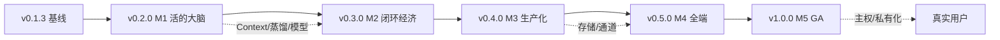

# 36 · 演进路线与版本总规划（IM2A：v0.1.3 → v1.0）

> 状态：**策划 & 设计阶段**（本文只规划，不含功能代码）
> 基线：主线 `main` = **v0.1.3** · 契约 **R24**（§1–§52）· 数据 schema **2** · 732 项测试
> 配套文档：[docs/37 技术架构演进](./37-技术架构演进设计.md) · [docs/38 模块与接口契约规划](./38-模块与接口契约规划.md) · [docs/39 版本计划与资源门槛](./39-版本计划与资源门槛.md)

---

## 0. 一页结论

**一句话**：IM2A 不是"更聪明的聊天机器人"，而是**以个人 Context 为资产、以可验证授权为信任边界、以 IM 为人机协同界面**的个人 Agent 运行时。

**三不可妥协原则（贯穿所有版本）**：

1. **付费发生在 Agent 预审之后** —— 钱买的是"已被预审的有效触点"，不是"绕过门控的通行证"；
2. **信任边界由代码层门控强制** —— 不是提示词、不是模型自觉，越权在 API 层就被拒绝；
3. **"原始音频不上传"必须是可验证的** —— 不是声明，要有可检查的证据链（端侧日志/审计/断网测试）。

**路线结论**：从 v0.1.3 出发，按 **M1 活的大脑 → M2 闭环经济 → M3 生产化 → M4 全端 → M5 GA** 五步走，
对应主线版本 **v0.2.0 → v0.3.0 → v0.4.0 → v0.5.0 → v1.0.0**。

---

## 1. 编号对齐：为什么主线版本不是从 v0.6 开始

产品路线图（v0.6 → v1.0）用的是"里程碑代号 + 版本号"混编；本仓库主线已经从 `v0.0.1` 走到 **`v0.1.3`**（25 个 tag）。若直接跳到 `v0.6`，会产生三个问题：

| 问题 | 后果 |
|---|---|
| 版本号出现 0.2–0.5 空洞 | 无法解释"为什么没有这些版本"，发布检查与 tag 语义混乱 |
| 已发布 tag 与图不一致 | `v0.1.3-fix` 之后突然 `v0.6`，回滚/对照时无法线性排序 |
| 里程碑别名与版本号混淆 | 讨论"v0.7 做了什么"时，无法区分是代号还是可发布版本 |

**决策**：主线**保持单调语义版本**，图里的 `v0.6…v1.0` 作为**里程碑别名**保留（便于对外沟通），映射如下：

| 里程碑 | 图中别名 | 主线版本 | 一句话交付 |
|---|---|---|---|
| M1 活的大脑 | v0.6–v0.8 | **v0.2.0** | Context 基底 + 蒸馏闭环 + 云端模型路由 |
| M2 闭环经济 | v0.9–v0.10 | **v0.3.0** | 陌生人付费闭环 + 协商双向流 |
| M3 生产化 | v0.11–v0.12 | **v0.4.0** | PG+向量 + Kafka + 真实 IM 通道 |
| M4 全端 | v0.13–v0.15 | **v0.5.0** | Flutter/PC/BLE/手表 |
| M5 GA | v1.0 | **v1.0.0** | 数据主权 + 私有化 + 可验证承诺 |

> 规则写入 [docs/34 §0](./34-主线与版本策略.md)：里程碑只作为"交付批次"，**发布的唯一标识是主线版本号 + tag**。

---

## 2. 现状基线（v0.1.3）：已经有什么、什么是 mock

> 口径：✅ 本机实测可复现；⚠ 已实现但外部依赖为 mock/未真机；⛔ 未实现。

### 2.1 已建成（不要重造）

| 能力 | 落点 | 状态 | 对应图 |
|---|---|---|---|
| 三级 Agent 体系（总/子/Skill） | `agent-registry`、`capability-gate`、`tool-policy` | ✅ | M1 前置已具备 |
| 五档信任矩阵 + 代码门控 | `trust-zone`、`capability-gate`、`visibility` | ✅ | 三原则② |
| 双通道分离（人类 IM / Agent 协商） | `channel`（`AGENT_NEGOTIATION` 人类未读恒 0）、`negotiation-engine` | ✅ 逻辑层 | M2 部分 |
| 陌生人付费状态机 + 账本幂等 | `paid-message`、`ledger`、`wallet`、`dispute` | ✅ 逻辑层；渠道 mock | M2 部分 |
| 审核链（机审→人审→申诉，fail-closed） | `moderation` | ✅ 机审 mock | M2/M3 |
| Context 分层 + 锁定 | `person-runtime`（§33）、`context-lock`（§34） | ✅ 内存/persist | **M1 已提前做了一半** |
| 人格与记忆生命周期 | `persona-memory`（§17） | ✅ | M1 部分 |
| 模型路由 / 预置降级 | `model-router`、`llm.mjs`（template→fallback→real） | ✅ 无真实 key | M1 部分 |
| 可观测（漏斗/告警/追溯） | `metrics`、`trace` | ✅ | 横切 |
| 韧性（熔断/降级/备份） | `provider-guard`、`backup` | ✅ | 横切 |
| 多端同步（SSE + 多节点总线） | `turn-inbox`、`broadcast` | ✅（双机未验） | M2 部分 |
| 支付渠道抽象 + 对账 | `channel-adapter`、`reconcile` | ✅ 渠道 mock | M2/M3 |
| Web/PWA 客户端 | `public/app` | ✅ | M4 部分 |
| 发布工程（版本/schema/发布检查/签核模板） | `version.mjs`、`migrate-state`、`release-check`、`docs/35` | ✅ | 横切 |

### 2.2 关键缺口（决定 M1–M5 的必要性）

| 缺口 | 现状 | 影响 | 归属 |
|---|---|---|---|
| Context 服务只有进程内实现 | jsonfile + 内存；无检索/无跨设备 | 换机/扩容即失效，飞轮转不起来 | M1 |
| 蒸馏只有阈值"只收紧"的规则 | 无独立 Improvement Memory 模块 | 反馈无法沉淀为可审计的改进记录 | M1 |
| 模型只有路由 + 三档降级 | 无 provider 抽象/配额/成本核算 | 换模型要改调用点；成本不可见 | M1 |
| 协商只有"逻辑状态机 + 轮次内投递" | 无双向实时流（WebSocket） | 双方 Agent 协商靠轮询，实时性不达标 | M2 |
| 存储只有 jsonfile/pg 未接 | 无 PG/pgvector/Kafka | 无法承载真实用户量与语义检索 | M3 |
| IM 底座只有适配层 + PaaS 未接 | 无 UserSig/Webhook/三流量隔离验证 | 真实人类 IM 通道缺失 | M3 |
| 客户端只有 Web/PWA | Flutter/手表/BLE 未编译/未实现 | "随身 24h"承诺无法兑现 | M4 |
| 数据主权只有导出包设计 | 无本地加密/私有化部署/可验证承诺 | GA 的合法性基础不足 | M5 |

---

## 3. 路线总图（M1–M5）

| 里程碑 | 目标（可验收） | 新增/替换模块 | 硬门槛（不过不启动） |
|---|---|---|---|
| **M1** v0.2.0 | Context 可迁移、可检索；反馈沉淀为改进记录；模型可替换且成本可见 | `context-service`、`improvement-memory`、`model-provider`（提案 §53/§54/§55） | 不破坏 schema 2（或附迁移）；Context 导出/导入演练通过 |
| **M2** v0.3.0 | 协商双向实时不丢不重；付费"预审→定价→扣费→查看→退款"端到端 | `negotiation-stream`（扩展 §5/§48）、付费链路强化（扩展 §49） | 8 态推送有断言；终止只推一张卡；真实定价/扣费/退款链路可回放 |
| **M3** v0.4.0 | 数据可承载真实用户；事件可治理；人类 IM 通道真实可用 | `store-adapter-postgres`、`event-bus-kafka`、`im-adapter-tencent`（提案 §56/§57/§58） | PG 迁移演练 + 双写一致性；Kafka 与 §48 分工验证；IM 通道联调 |
| **M4** v0.5.0 | 三端一致审批；端侧不传原始音频；手表安全审批 | `client-bridge`、`ble-gateway`（提案 §59/§60） | Flutter 真机/手表审批二次确认；BLE 断网测试；三端同步一致 |
| **M5** v1.0.0 | 个人数据主权：导出/导入、本地加密、私有化部署、可验证承诺 | `data-sovereignty`（提案 §61）、`compatibility-policy`（§62） | 私有化部署验收；导出包可校验；"不上传"有证据链 |

> 详细技术设计见 [docs/37](./37-技术架构演进设计.md)，契约草案见 [docs/38](./38-模块与接口契约规划.md)，排期/资源/门禁见 [docs/39](./39-版本计划与资源门槛.md)。

---

## 4. 需求 → 现状 → 目标版本（能力矩阵）

| # | 需求（来自产品稿） | 现状 | 目标版本 | 关键证据 |
|---|---|---|---|---|
| 1 | 总 Agent 持核心 Context，负责任务路由 | ✅ 注册表/路由；Context 分散在 §33/§17 | v0.2.0 统一为 Context Service | 迁移后同一用户换实例可续跑 |
| 2 | 子 Agent 按场景细分 + 蒸馏进化 | ✅ 注册表/人格；⚠ 无 Improvement Memory | v0.2.0 | 反馈事件→改进记录→阈值变化可审计 |
| 3 | 硬件只做感知，云端推理 | ⛔ 无端侧代码 | v0.5.0 | BLE 端侧网关 + 断网仍可唤醒 |
| 4 | 审批态 30 秒处理 | ✅ Web/PWA 三态；⚠ Flutter 未编译 | v0.5.0 | 三端一致 + 手表一键审批 |
| 5 | 巡视态看 Agent 工作轨迹 | ✅ `trace` + `/api/ops/trace` | 持续增强（M2 起接实时流） | 完整链/缺环显式 |
| 6 | 双通道物理隔离 | ✅ 逻辑隔离（未读恒 0）；⚠ 无物理多流 | v0.3.0（双向流）+ v0.4.0（三流量） | 协商事件不进人类未读；流量隔离验证 |
| 7 | 五档信任矩阵代码强制 | ✅ | — | `capability-gate` 单测 |
| 8 | 陌生人付费（自定价/两种扣费） | ✅ 状态机；⚠ 渠道 mock | v0.3.0 完整闭环 | 预审→定价→扣费→退款 e2e |
| 9 | Context 飞轮（纠错/授权边界/习惯） | ✅ 锁定 + 分层；⚠ 无检索/无沉淀 | v0.2.0 | 三层记忆检索 + 改进记录 |
| 10 | 数据主权（本地加密/导出） | ⚠ 导出包设计，无加密/无私有化 | v1.0.0 | 导出可校验 + 私有化部署 |
| 11 | 可验证承诺（原始音频不上传） | ⛔ 无端侧证据 | v1.0.0 | 断网/抓包/审计三证据 |

---

## 5. 每个版本必须回答的三个问题

任何一版发布前，必须在 CHANGELOG 与签核 Issue 里回答（否则不允许打 tag）：

1. **交付了什么**？（功能 + 模块 + 契约章节）
2. **证据在哪**？（测试名 / release-check / accept 报告 / 人工签核项）
3. **下一版明确不做什么**？（防止路线膨胀）

---

## 6. 规划期决策记录（本轮定下，后续变更需写进本文）

| # | 决策 | 理由 | 可回退性 |
|---|---|---|---|
| D1 | 主线保持 0.1.x → 0.2.0 单调编号；图 v0.6–v1.0 只作里程碑别名 | 避免版本空洞与 tag 语义混乱 | 若对外必须用图编号，可在 Release 标题里加别名，不改 tag |
| D2 | **M1 先做 Context Service，不先做多端** | Context 是壁垒；客户端是展示层，晚做不阻塞 | 高（客户端可并行预研） |
| D3 | 复用现有 §33/§34/§17，不新造第二套记忆系统 | 避免"两套真相"与迁移灾难 | 高 |
| D4 | 生产化不引入重框架（Temporal/K8s 等） | 内测阶段运维成本 > 收益 | 中（M3 可复议） |
| D5 | 数据主权放 M5，不提前 | 需要真实用户与合规前提 | 中 |
| D6 | 每个里程碑都必须"能回滚"：代码 tag + 数据备份 + 迁移脚本 | 内测不能拿用户数据冒险 | 高 |
| D7 | **章节编号采用 §53–§62**（insert 到 §52 之后），原 §53 禁止事项/§54 验证命令顺延为 §63/§64 | 与 docs/38 冻结稿一致，避免两套编号并行 | 中（冻结前可改号） |
| D8 | **M1/v0.2.0 采用 schema 3**，附 2→3 迁移脚本与演练（不是"保持 schema 2"） | Context 要可迁移必须落盘；不改 schema 就只能继续"假持久化" | 中（发布前可退回 2，但要放弃 Context 迁移） |
| D9 | M3 生产适配器允许 **单一依赖例外**（`pg`/`kafkajs`）并做供应链审计 | 生产化不能靠手写 PG/Kafka 协议；破例范围与审计方案待评审确认 | 高（可退回自研/HTTP 网关） |

---

## 7. 明确不做（防路线膨胀）

| 不做 | 原因 |
|---|---|
| 在 0.1.x 期间加功能 | 违反 docs/34 版本规则；缺陷优先 |
| 0.2.0 就做硬件/端侧 | 供应链与合规未就绪；M4 才启动 |
| 自研共识/分布式存储 | 内测规模用不到；M3 先用成熟组件 |
| 多租户 / 分账 / 发票 | 商业阶段再做（docs/30 缺口清单已登记） |
| "什么都能做的超级 Agent" | 壁垒在 Context 与门控，不在模型能力堆叠 |
| 用提示词代替门控 | 违反三原则②；任何"请模型自行判断权限"的设计直接拒绝 |

---

## 8. 风险与触发信号

| 风险 | 触发信号 | 应对 |
|---|---|---|
| 规划过细导致返工 | 每版设计文档行数 > 实现代码行数 | 设计到"可写测试"即停，细节随实现走 |
| Context 迁移破坏既有数据 | schema 变更未附迁移/演练 | 强制走 `migrate-state` + 备份 + 冒烟 |
| 真实依赖迟迟不到位 | M1 结束仍无短信/实名/机审/支付任一 | 冻结功能开发，转为"证据与文档"工作 |
| 双通道实时化的复杂度被低估 | 协商丢包/重复率 > 0 | 先做状态机幂等，再做流；以事件 id 去重 |
| 端侧承诺无法验证 | 无断网/抓包证据 | M4 前定义"可验证"三件套，否则不宣称 |
| 合规（实名/内容/数据出境） | 法务评审未过 | M5 前置；M3 起所有对外接口留审计 |

---

## 9. 与现有文档的关系（代替关系）

| 文档 | 角色 |
|---|---|
| **docs/36（本文）** | **路线总纲**：里程碑、编号对齐、能力矩阵、决策记录 |
| docs/37 | 技术架构演进设计（怎么实现） |
| docs/38 | 模块与契约规划（接口长什么样、§53+ 提案） |
| docs/39 | 版本计划与资源门槛（什么时候做、需要什么） |
| docs/34 | 主线归属与版本规则（本文引用） |
| docs/35 | 发布 SOP（本文不重复发布步骤） |
| docs/30 | v0.1.0 RC 发布说明与 17 条缺口（历史快照） |

---

## 10. 变更记录

| 日期 | 变更 |
|---|---|
| 2026-10-22 | 建立本文：在 v0.1.3 基线上对产品路线图做编号对齐与里程碑规划；确定 M1–M5 ↔ v0.2.0–v1.0.0；登记 D1–D6 决策与"不做"清单 |
