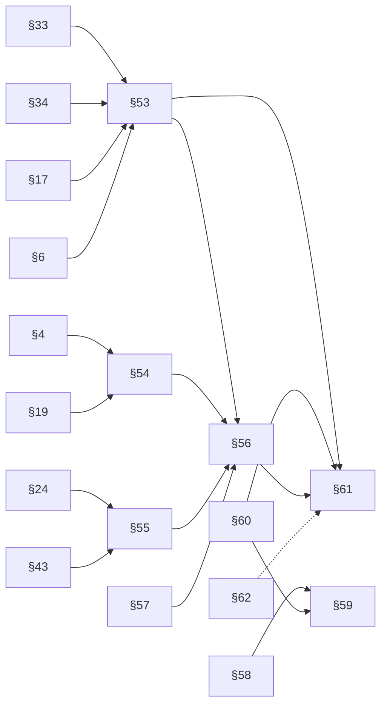

# 38 · 模块与接口契约规划（v0.1.3 → v1.0.0）

> 状态：策划 & 设计（只规划契约，不含功能代码，不做 git）· 基线：**v0.1.3 / R24（§1–§52）/ schema 2 / 732 测试**
> 版本对齐（必须遵守）：**M1→v0.2.0、M2→v0.3.0、M3→v0.4.0、M4→v0.5.0、M5→v1.0.0**；图中 `v0.6–v1.0` 仅里程碑别名，**发布唯一标识仍是版本号 + tag**。
> 配套：[docs/36 总纲](./36-演进路线与版本总规划.md) · [docs/37 架构演进](./37-技术架构演进设计.md) · [docs/39 版本计划](./39-版本计划与资源门槛.md)。外部范式只引机制，不写 star/版本/性能数字，不确定处标 **⚠ 需复核**。

---

## 0. 一页结论

| 项 | 结论 |
|---|---|
| 新增顶级章节 | **§53–§62 共 10 个模块**（插入在 §52 之后、现 §53 禁止事项之前；原 §53→§63、§54→§64） |
| 里程碑归属 | M1：§53/§54/§55；M3：§56/§57/§58；M4：§59/§60；M5：§61/§62；M2 不新增章节，只扩展 §5/§48/§49 |
| 版本映射 | **M1→v0.2.0、M2→v0.3.0、M3→v0.4.0、M4→v0.5.0、M5→v1.0.0**；图中 v0.6–v1.0 仅里程碑别名 |
| 修订登记 | R25–R29 各登记一个里程碑的加法；每行只追加，不改历史语义 |
| 数据 schema | M1 升 schema **3**（context/lock/improvement/usage 新表，加法迁移）；M3 升 **4**（PG+pgvector 物理迁移）；M5 升 **5**（主权导出/承诺证据） |
| 硬规则 | 见 §1：只加不改；破坏性变更升契约 v2.0 + 并行期 + 迁移脚本 |
| 最该先做但最容易被跳过 | **§53 `snapshot/restore` 的 hash 与版本闸门**——没有它，M1 的"Context 可迁移"只是换机丢数据的另一种说法 |

---

## 1. 契约演进规则

### 1.1 默认只加不改

| 允许（加法，R# 递增） | 禁止（破坏性，必须升主版本） |
|---|---|
| 新增顶级章节（§53+）或小节 | 改已有状态名、错误码字符串、方法名 |
| 新增方法、可选参数（追加在签名尾部） | 改已有方法前 N 个位置参数的含义 |
| 新增 `*_CODE` 键、Error 子类 | 改变已有错误码语义（如把 DENY 改成放行） |
| 新增可选字段 / 只读方法 | 删除或重命名导出常量/类 |
| 澄清性文字（不改可观察行为） | 改状态机白名单或迁移方向 |

**判定口径**：任何"已有调用方无需改代码即可继续工作"的变更 = 加法；否则 = 破坏性。与 docs/34 §3 一致：**0.1.x 只修缺陷；加能力进 0.2.0；破坏性数据变更升 schema**。

### 1.2 破坏性变更怎么升版本

| 层 | 变更 | 动作 |
|---|---|---|
| 契约 | 状态/错误码/签名不兼容 | 契约升 **v2.0**，保留 v1 并行期 ≥1 个里程碑；`CONTRACT_REVISION` 继续 R# 递增；旧调用方读 v1 文档 |
| 数据 | 字段删除/类型变化/无法回填 | `schemaVersion + 1`；必须提供 `scripts/migrate-state.mjs` 路径（先备份→原子改写→加载核对→失败回滚） |
| 产品 | 对用户可观察的不兼容 | 按 semver：M5 前 `0.y.0` 起跳；M5（v1.0.0）后只允许 `v2.0.0`，且需 ≥12 个月弃用期 |
| 协议 | OpenAPI/proto 不兼容 | OpenAPI 升主版本或新路径版本；proto 字段号永不复用，删除字段 `reserved` |
| 依赖 | M3 需 PG/Kafka/IM 驱动，与零依赖红线冲突 | 提案修订 §63：仅 `persistence`/`observability`/`messaging` 适配文件允许**受审单一依赖**（锁文件 + 供应链审计 + 离线安装演练）；业务层仍零依赖（docs/37 方案 A） |

**红线**：不得用"改文档迁就实现"的方式绕过破坏性判定（verify.mjs 的术语校验会拦）。

### 1.3 R# 变更记录格式（R25 起）

在 `INTERFACES.md` 顶部变更记录表追加一行，字段固定：

| 修订 | 时间 | 变更 | 性质 |
|---|---|---|---|
| R25 | 2026-XX-XX | **M1 增补**：§53 context-service / §54 improvement-memory / §55 model-provider；原 §53→§63、§54→§64；schema 2→3 | 加法 |
| R26 | 2026-XX-XX | **M2 增补**：§5 协商流式扩展、§48 UI 扇出与治理事件分离、§49 付费链路强化（不新增顶级章节） | 加法 |
| R27 | 2026-XX-XX | **M3 增补**：§56 store-adapter-postgres / §57 event-bus-kafka / §58 im-adapter-tencent；schema 3→4 | 加法 |
| R28 | 2026-XX-XX | **M4 增补**：§59 client-bridge / §60 ble-gateway | 加法 |
| R29 | 2026-XX-XX | **M5 增补**：§61 data-sovereignty / §62 compatibility-policy；schema 4→5 | 加法 |

规则：①只追加，不改已发布行；②每行必须能映射到具体章节与测试；③"性质"只允许 `加法` / `澄清` / `破坏性` 三种；④`破坏性` 必须同时给主版本与迁移方案。

### 1.4 新章节编号与插入位置

- 插入点：**§52 `scripts/release-check.mjs` 之后、现 §53 禁止事项之前**。
- 顺序：§53→§62 连续编号；禁止事项与验证命令顺延为 **§63/§64**。交叉引用同步改号（`verify.mjs` 检查 `§\d+` 越界/重号）；标题格式沿用 `## 53. ...（v0.2.0 M1 新增）`。docs/37 提示过"若冻结改用 §55–§64 仅改编号不改语义"；本方案按指定 §53–§62 + §63/§64 执行，冻结前如需改号须同步 docs/36/37/39。

### 1.5 错误码与返回值命名约定

| 约定 | 规则 | 示例 |
|---|---|---|
| 错误码常量 | `export const X_CODE = Object.freeze({ KEY: 'KEY', ... })`；键值同名 | `CONTEXT_CODE.SECRET_IN_LAYER` |
| 错误类 | `export class XError extends Error {}`，实例带 `code ∈ X_CODE` | `new ContextError('...', 'ISOLATED')` |
| 跨模块重名 | `NOT_FOUND` / `ILLEGAL_STATE` / `ILLEGAL_TRANSITION` / `FORBIDDEN` 允许复用；**语义必须一致** | 不存在=404 语义、非法状态=409 语义 |
| 新码 | 不得与既有模块语义冲突；同一含义不得新造第二种写法 | 不新增 `STATE_ILLEGAL`（已有 `ILLEGAL_STATE`） |
| 判定 vs 异常 | 校验类返回 `{ ok, code }`（verdict 不抛）；动作失败抛 Error | `verify()` 返回判定，`propose()` 失败抛 |
| 返回值 | 一律 `Object.freeze`；状态变更返回**新对象**，不原地改 | 与 §0 全局约定一致 |
| 敏感信息 | 错误 message 不得含手机号/身份证/密钥/UserSig | 只回错误码与脱敏摘要 |
| 时间/金额 | 注入 `clock`；金额整数分，字段以 `Cents` 结尾 | `costCents` / `amountCents` |

### 1.6 新章节冻结模板（7 项齐全才允许标 R#）

1. **职责**（一句话，说明它解决什么，不重复既有模块）；
2. **不变量**（≥3 条，必须可用测试证伪）；
3. **导出接口**（`*_CODE` + Error 类 + 类/函数签名，≤8 个公开方法）；
4. **判定（冻结）**（顺序、边界、fail-closed 路径）；
5. **与既有模块的边界**（一句"不做什么"，防止第二套真相）；
6. **数据归属**（是否新增 schema/表/索引，是否进可迁移包）；
7. **测试钉死**（3–6 条断言，落在 docs/38 §3 与本模块测试文件）。

> 不满足第 5 项的一律驳回：本项目最大的架构债是"两套记忆/两套审批/两套账本"，不是模块太少。

---

## 2. 拟新增模块清单

| # | 模块名 | 路径 | 提议章节 | 借鉴来源（只引机制） | 里程碑 | 依赖 | 状态 |
|---|---|---|---|---|---|---|---|
| 1 | context-service | `services/context/src/context-service.mjs` | §53 | 自研；范式参考 MyContext 确认锁定 / HMO 三层（⚠ 需复核，仅范式） | M1 / v0.2.0 | §33、§34、§17、§6、§56（后续） | 设计 |
| 2 | improvement-memory | `services/orchestrator/src/improvement-memory.mjs` | §54 | 自研（阈值只收紧 + 证据留痕） | M1 / v0.2.0 | §4、§19、§16、§41 | 设计 |
| 3 | model-provider | `services/orchestrator/src/model-provider.mjs` | §55 | 自研；参考 OpenAI 兼容网关的"统一入口"范式（⚠ 需复核） | M1 / v0.2.0 | §24、§43、`llm.mjs` | 设计 |
| 4 | store-adapter-postgres | `services/persistence/src/store-adapter-postgres.mjs` | §56 | PostgreSQL + pgvector 官方文档（⚠ 需复核）；不引 ORM | M3 / v0.4.0 | §51、§44、§8 幂等键 | 设计 |
| 5 | event-bus-kafka | `services/messaging/src/event-bus-kafka.mjs` | §57 | Kafka 消费组/outbox 范式（⚠ 需复核）；与 §48 分工 | M3 / v0.4.0 | §48、§16、§4、§8 | 设计 |
| 6 | im-adapter-tencent | `services/messaging/src/im-adapter-tencent.mjs` | §58 | 腾讯云 IM UserSig/Webhook 文档（⚠ 需复核，只实现接口不引 SDK） | M3 / v0.4.0 | §31、§14、§25 | 设计 |
| 7 | client-bridge | `services/gateway/src/client-bridge.mjs` | §59 | 自研（§47 Web/PWA + §12 网关抽象） | M4 / v0.5.0 | §12、§47、§60 | 设计 |
| 8 | ble-gateway | `services/edge/src/ble-gateway.mjs` | §60 | 自研（docs/04 BLE 帧 + LC3；端侧不传原始音频） | M4 / v0.5.0 | docs/04、§59、§16 | 设计 |
| 9 | data-sovereignty | `services/sovereignty/src/data-sovereignty.mjs` | §61 | 自研（§33 snapshot + §35 回执 + node:crypto） | M5 / v1.0.0 | §33、§34、§17、§44、§51、§60 | 设计 |
| 10 | compatibility-policy | `services/acceptance/src/compatibility-policy.mjs` | §62 | semver 语义 + §51 schema 闸门（自研） | M5 / v1.0.0 | §51、§52、docs/34、docs/35 | 设计 |

**M2 不新增顶级章节**（避免章节膨胀），以扩展方式登记：

| 扩展项 | 落点 | 契约动作 | 验收口径 |
|---|---|---|---|
| 协商双向实时流（docs/37 提案名 `negotiation-stream`） | §5 + §48 | §5 增加 `subscribe()` 语义；§48 增加治理事件与 UI 扇出边界 | 8 态推送有断言；断线重连不丢不重；终止只推一张卡 |
| 付费链路强化 | §49 + §37 + §4 | §49 增加"预审→定价→扣费→查看→退款"状态对账钩子 | 全链 e2e 可回放；退款只走账本幂等键 |
| 巡视态实时轨迹 | §42 + §47 | §42 增加实时追踪只读接口 | 缺环显式；不触发状态迁移 |

---

## 3. 接口草案（§53–§62）

> 说明：以下为**契约草案**，冻结时写入 INTERFACES.md；实现必须与签名、错误码、不变量逐字一致。每条"测试钉死"都是可执行断言（`node <module>.test.mjs` 直跑）。

### 3.1 §53 `context-service`（M1 / v0.2.0）

**职责**：Context 的统一读写门面——把 §33（三层状态）、§34（确认锁定）、§17（人格/记忆生命周期）组合成"可迁移、可检索、子 Agent 隔离、锁定结论只读"的单一入口。
**不变量**：①**不新增层枚举**：对外三层层名统一为 §17 `MEMORY_STAGE`（WORKING/EPISODIC/SEMANTIC），内部映射 §33（PERSONAL→SEMANTIC、TASK→EPISODIC、WORKING→WORKING，映射表随 §53 冻结）；②`PERSONAL` 写入先经 §34 `propose/confirm`，Agent 无权直接落库；③`LOCKED` 的 key 对所有 Agent 只读；④子 Agent 只能拿 `digest`，拿不到原始内容；⑤`WORKING` 永不进 `snapshot`，`secret:*` 拒绝入层。

```js
export const CONTEXT_CODE = Object.freeze({
  NOT_FOUND: 'NOT_FOUND', ILLEGAL_LAYER: 'ILLEGAL_LAYER', ISOLATED: 'ISOLATED', FORBIDDEN: 'FORBIDDEN',
  SECRET_IN_LAYER: 'SECRET_IN_LAYER', LOCK_CONFLICT: 'LOCK_CONFLICT',
  VERSION_MISMATCH: 'VERSION_MISMATCH', HASH_MISMATCH: 'HASH_MISMATCH', IMPORT_REJECTED: 'IMPORT_REJECTED'
});
export class ContextError extends Error {}   // code ∈ CONTEXT_CODE

export class ContextService {
  constructor({ clock = () => new Date(), runtime, locks, persona = null, store = null, onAudit = () => {} });
  put({ userId, key, value, layer, sourceAgentId = null, evidence = [] });  // -> 冻结 entry
  get({ userId, key, requesterAgentId = null });                            // -> entry | null（locked 只读）
  search({ userId, query, layers = null, limit = 5 });                      // -> [{ entry, score }] 确定性词频
  digest({ userId, butlerAgentId });                                        // -> { coordination, contentExposed:false }
  lock({ userId, key, byUserId });                                          // 仅属主；转 §34 confirm
  snapshot({ userId });                                                     // -> 可迁移包（含 hash/version）
  restore({ bundle, expectUserId });                                        // hash/version 不符即拒绝
  stats({ userId });
}
```
**测试钉死**：
- *snapshot 不含 WORKING*：写入 `WORKING` 后 snapshot，断言键不存在；
- *secret:* key → `SECRET_IN_LAYER`*；
- *非属主 lock → `FORBIDDEN`*（透传 §34 语义）；
- *子 Agent get 原文 → `ISOLATED`，digest 可用*；
- *restore 改一个字节 → `HASH_MISMATCH`，换 userId → `IMPORT_REJECTED`*。

### 3.2 §54 `improvement-memory`（M1 / v0.2.0）

**职责**：把审批/纠错/申诉等反馈沉淀为**不可变改进记录**，并把"阈值自适应"限制在**只收紧不放宽**；放宽必须走人类审批单。
**不变量**：①同一 `feedbackId` 重复记录幂等；②阈值方向只允许收紧（`approvalThresholdCents↓`、`trustZoneMin↓`、`maxRounds↓`）；③样本数 `< minSamples` 不生效（`UNDER_SAMPLES`）；④不直接改 §19 `ToolPolicy`，只经注入的 `policySink` 应用并记录 `appliedRef`；⑤记录只追加，`revert` 通过新记录实现。

```js
export const IMPROVEMENT_KIND = Object.freeze({ FEEDBACK: 'FEEDBACK', THRESHOLD: 'THRESHOLD', RULE: 'RULE' });
export const IMPROVEMENT_STATE = Object.freeze({ PROPOSED: 'PROPOSED', ACTIVE: 'ACTIVE', REVERTED: 'REVERTED', REJECTED: 'REJECTED' });
export const IMPROVEMENT_CODE = Object.freeze({
  NOT_FOUND: 'NOT_FOUND', ILLEGAL_STATE: 'ILLEGAL_STATE', DIRECTION_FORBIDDEN: 'DIRECTION_FORBIDDEN',
  UNDER_SAMPLES: 'UNDER_SAMPLES', FORBIDDEN: 'FORBIDDEN', APPLY_FAILED: 'APPLY_FAILED', ALREADY_REVERTED: 'ALREADY_REVERTED'
});
export class ImprovementError extends Error {}

export class ImprovementMemory {
  constructor({ clock = () => new Date(), policySink = null, minSamples = 20, onAudit = () => {} });
  recordFeedback({ feedbackId, agentId, kind, ticketId = null, evidence = [] });  // -> 冻结 record
  summary({ agentId = null, windowMs = 30 * 864e5 } = {});                        // -> { samples, approveRate, modifyRate, rejectRate }
  proposeThreshold({ agentId, field, from, to, reason });                         // -> 冻结 proposal
  apply({ proposalId, byUserId });                                                // 仅属主 + 证据齐全
  revert({ proposalId, byUserId, reason });
  list({ state = null, agentId = null } = {}); stats();
}
```
**测试钉死**：
- *同一 feedbackId 记录两次只产生一条*；
- *放宽阈值（approvalThresholdCents↑）→ `DIRECTION_FORBIDDEN`*；
- *样本 19 < minSamples → 不 ACTIVE，返回 `UNDER_SAMPLES`*；
- *apply 调用 policySink 且记录 appliedRef；sink 抛错 → 状态不 ACTIVE*；
- *revert 后旧值恢复，且原记录不可改*。

### 3.3 §55 `model-provider`（M1 / v0.2.0）

**职责**：LLM 调用统一入口——provider 注册、按 §24 路由、成本/配额核算、规则降级；不新增第二套 tier 枚举。
**不变量**：①`tier` 复用 §24 `MODEL_TIER`；②路由为 `LOCAL` 时**绝不调用 CLOUD provider**（`SENSITIVE_DOMAIN_REQUIRED_LOCAL`）；③成本按整数分累加，与钱包账本分离（模型成本不进 §8 账本）；④降级必须 `usedFallback:true` + `causeCode`；⑤没有可用 provider 时显式失败，不返回空串假成功。

```js
export const PROVIDER_CODE = Object.freeze({
  PROVIDER_UNKNOWN: 'PROVIDER_UNKNOWN', PROVIDER_UNAVAILABLE: 'PROVIDER_UNAVAILABLE',
  SENSITIVE_DOMAIN_REQUIRED_LOCAL: 'SENSITIVE_DOMAIN_REQUIRED_LOCAL', BUDGET_EXCEEDED: 'BUDGET_EXCEEDED',
  QUOTA_EXCEEDED: 'QUOTA_EXCEEDED', INVALID_RESPONSE: 'INVALID_RESPONSE', FALLBACK_USED: 'FALLBACK_USED'
});
export class ModelProviderError extends Error {}

export class ModelProvider {
  constructor({ clock = () => new Date(), router, guard = null, budgetCentsPerDay = 0, providers = [], onAudit = () => {} });
  register({ providerId, tier, models, call, costPer1kPromptCents = 0, costPer1kCompletionCents = 0 });
  complete({ taskId, agentId, domain, prompt, tier = null, maxTokens = 512, allowFallback = false });
  // -> { text, providerId, model, tier, usage:{promptTokens,completionTokens}, costCents, usedFallback, causeCode, route }
  rule({ taskId, reason, template });   // 规则降级：无网络也返回确定文本（标注 RULE）
  usage({ agentId = null } = {});       // -> { calls, promptTokens, completionTokens, costCents, byTier }
  stats();
}
```
**测试钉死**：
- *域 `family` 路由 LOCAL 时 cloud provider 调用次数为 0*（spy）；
- *无 provider → 抛 `PROVIDER_UNAVAILABLE`*，不返回空串；
- *成本 = ⌈tokens/1000⌉ × 单价，两轮后整数累加*；
- *允许 fallback 时 `usedFallback:true` 且 `causeCode` 非空*；
- *超日预算 → `BUDGET_EXCEEDED` 且不调用 provider*。

### 3.4 §56 `store-adapter-postgres`（M3 / v0.4.0）

**职责**：存储适配器（memory/jsonfile/postgres 同构）与 schema 迁移执行器；PG + pgvector 只是 kind 之一，业务语义不得依赖具体存储。
**不变量**：①业务语义不因存储变化（同构接口）；②**启动不自动迁移**，只有显式 `migrate()`；③`idempotencyKey` 在 PG 上是唯一索引；④pgvector 不可用时 `vectorSearch` 显式 `VECTOR_UNAVAILABLE`，不静默退化为文本搜索；⑤事务失败整体回滚。

```js
export const STORE_KIND = Object.freeze({ MEMORY: 'memory', JSONFILE: 'jsonfile', POSTGRES: 'postgres' });
export const STORE_CODE = Object.freeze({
  NOT_CONNECTED: 'NOT_CONNECTED', MIGRATION_REQUIRED: 'MIGRATION_REQUIRED', SCHEMA_MISMATCH: 'SCHEMA_MISMATCH',
  UNSUPPORTED: 'UNSUPPORTED', TX_FAILED: 'TX_FAILED', DUPLICATE_KEY: 'DUPLICATE_KEY', VECTOR_UNAVAILABLE: 'VECTOR_UNAVAILABLE', CURRENT: 'CURRENT'
});
export class StoreError extends Error {}

export class StoreAdapter {
  constructor({ clock = () => new Date(), kind = 'memory', dsn = null });
  connect(); health(); schemaInfo();                                  // { schemaVersion, engine, vector }
  registerMigration({ from, to, up, verify });                        // 扩展点：迁移可插拔
  migrate({ target = null, dryRun = false });                         // 幂等；未来版本 → UNSUPPORTED
  get({ namespace, key }); put({ namespace, key, value, version = null });
  list({ namespace, prefix = null, limit = 100 }); transaction(fn);
  vectorSearch({ namespace, embedding, limit = 5, filter = null });   // 无 pgvector → VECTOR_UNAVAILABLE
}
```
**测试钉死**：
- *migrate 第二次 → `CURRENT`（幂等），不重复执行*；
- *目标版本高于本端 → `UNSUPPORTED`，不猜测降级*；
- *同 idempotencyKey put 两次 → 一条记录 + `duplicate:true`*；
- *无 pgvector 环境 → `VECTOR_UNAVAILABLE`（不返回空数组冒充成功）*；
- *transaction 内抛错 → 数据完全回滚*。

### 3.5 §57 `event-bus-kafka`（M3 / v0.4.0）

**职责**：生产级**治理事件总线**（审批状态、账本流水、签名审计、改进记录）；与 §48 的 UI 扇出分工，不混用。
**不变量**：①只承载 `GOVERNANCE`/`TELEMETRY`，UI 事件仍走 §48（UI 总线不持久化、无订阅即丢）；②`eventId` 去重，消费端每事件最多处理一次；③同 `key` 保序；④发布失败进 outbox 并显式返回错误，不静默丢；⑤`schemaVersion` 不匹配 → `SCHEMA_UNSUPPORTED`（消费端拒收并告警）。

```js
export const EVENT_CLASS = Object.freeze({ GOVERNANCE: 'GOVERNANCE', TELEMETRY: 'TELEMETRY', UI: 'UI' });
export const BUS_CODE = Object.freeze({
  PRODUCER_UNAVAILABLE: 'PRODUCER_UNAVAILABLE', PUBLISH_FAILED: 'PUBLISH_FAILED', DUPLICATE_EVENT: 'DUPLICATE_EVENT',
  SCHEMA_UNSUPPORTED: 'SCHEMA_UNSUPPORTED', CONSUMER_LAG: 'CONSUMER_LAG', NO_BROKER: 'NO_BROKER', OUTBOX_FULL: 'OUTBOX_FULL',
  INVALID_ARGUMENT: 'INVALID_ARGUMENT'
});
export class EventBusError extends Error {}

export class GovernanceEventBus {
  constructor({ clock = () => new Date(), brokers = [], clientId, outbox = null, maxPayloadBytes = 1_048_576 });
  publish({ topic, key, eventId, type, payload, schemaVersion = 1 });  // -> { accepted, duplicate }
  consume({ topic, groupId, handler, fromBeginning = false });
  ack({ topic, groupId, eventId }); lag({ topic, groupId }); stats({ topic = null } = {});
}
```
**测试钉死**：
- *同 eventId 发布两次，handler 只执行一次*；
- *同 key 两条事件消费顺序与发布一致*；
- *broker 不可用 → `PUBLISH_FAILED` 且 outbox 保留（可重试）*；
- *UI 事件走本总线 → 拒绝（`INVALID_ARGUMENT`）*；
- *schemaVersion 不匹配 → `SCHEMA_UNSUPPORTED`，不进 handler*。

### 3.6 §58 `im-adapter-tencent`（M3 / v0.4.0）

**职责**：腾讯云 IM PaaS 适配器——实现 §31 的统一 `MessageEvent` 能力契约，补齐 UserSig、Webhook 验签、三流量隔离；**平台 SDK 不进业务代码**。
**不变量**：①UserSig 仅服务端生成/校验，**永不入日志/响应**；②Webhook 先验签再归一化，时间窗 + `eventId` 去重防重放；③能力缺口显式 `CAPABILITY_MISSING`，不静默降级；④人类消息/Agent 协商/审计事件按不同 topic 隔离；⑤密钥缺失 → `SECRET_MISSING`（不启动假适配器）。

```js
export const TENCENT_CODE = Object.freeze({
  SECRET_MISSING: 'SECRET_MISSING', USERSIG_INVALID: 'USERSIG_INVALID', WEBHOOK_SIGNATURE_INVALID: 'WEBHOOK_SIGNATURE_INVALID',
  EVENT_REPLAYED: 'EVENT_REPLAYED', TIMESTAMP_EXPIRED: 'TIMESTAMP_EXPIRED', CAPABILITY_MISSING: 'CAPABILITY_MISSING',
  PLATFORM_ERROR: 'PLATFORM_ERROR', RATE_LIMITED: 'RATE_LIMITED'
});
export class TencentImError extends Error {}

export class TencentUserSig {
  constructor({ appId, secretKey, clock = () => new Date(), ttlMs = 3600e3 });
  sign({ userId }); verify({ userId, userSig });        // 返回判定，不抛
}
export function createTencentAdapter({ appId, secretKey, adminUserId, clock = () => new Date(), capabilities = [], transport = null });
// -> 满足 §31 register({adapterId, platform:'tencent-im', capabilities, send, verifyEvent}) 的适配器对象
//    + { issueUserSig({userId}), normalize({raw}), stats() }
```
**测试钉死**：
- *篡改 Webhook 签名 → `WEBHOOK_SIGNATURE_INVALID`，不产生 MessageEvent*；
- *同 eventId 重放 → `EVENT_REPLAYED`（幂等）*；
- *时间戳超窗 → `TIMESTAMP_EXPIRED`*；
- *缺 secret → 构造即 `SECRET_MISSING`*；
- *未声明 `UNREAD_SHAPING` 而要求该能力 → `CAPABILITY_MISSING`*；
- *返回对象与日志不含 secret/UserSig 原文*。

### 3.7 §59 `client-bridge`（M4 / v0.5.0）

**职责**：Flutter/PC/手表/WEB 的统一客户端 API 边界——会话令牌、意图提交与防重放、审批二次确认；客户端永不直连内部写接口。
**不变量**：①客户端不持有 admin token；②写操作按 `intentId` 幂等、按 `nonce + signedAt + clientSeq` 防重放；③手表审批必须带 `confirm`（来自 §60 的一次性 `confirmToken`）；④客户端能力缺口显式 `CAPABILITY_MISSING`；⑤`readState` 只读，不产生副作用。

```js
export const CLIENT_KIND = Object.freeze({ WEB: 'web', FLUTTER_MOBILE: 'flutter-mobile', FLUTTER_DESKTOP: 'flutter-desktop', WATCH: 'watch' });
export const CLIENT_CODE = Object.freeze({
  UNAUTHENTICATED: 'UNAUTHENTICATED', SESSION_EXPIRED: 'SESSION_EXPIRED', INTENT_REPLAYED: 'INTENT_REPLAYED',
  INTENT_GAP: 'INTENT_GAP', SIGNED_AT_EXPIRED: 'SIGNED_AT_EXPIRED', COMMAND_NOT_ALLOWED: 'COMMAND_NOT_ALLOWED',
  CAPABILITY_MISSING: 'CAPABILITY_MISSING', APPROVAL_CONFIRM_REQUIRED: 'APPROVAL_CONFIRM_REQUIRED', FORBIDDEN: 'FORBIDDEN'
});
export class ClientBridgeError extends Error {}

export class ClientBridge {
  constructor({ clock = () => new Date(), gateway, identity = null, nonceStore = null, sessionTtlMs = 15 * 60e3, clockSkewMs = 60e3 });
  openSession({ clientKind, deviceId, userId, challenge });    // -> { sessionToken, expiresAt, capabilities }
  submitIntent({ sessionToken, intentId, command, payload = {}, clientSeq, signedAt, confirm = null });
  readState({ sessionToken }); heartbeat({ sessionToken }); closeSession({ sessionToken }); capabilities({ sessionToken });
}
```
**测试钉死**：
- *同 intentId 提交两次 → 首次结果 + `duplicate:true`（不重复执行）*；
- *nonce 复用 → `INTENT_REPLAYED`*；
- *signedAt 超时钟偏移 → `SIGNED_AT_EXPIRED`*；
- *clientSeq 跳号 → `INTENT_GAP`，要求重同步*；
- *watch 审批无 confirm → `APPROVAL_CONFIRM_REQUIRED`*；
- *未知命令 → `COMMAND_NOT_ALLOWED`*。

### 3.8 §60 `ble-gateway`（M4 / v0.5.0）

**职责**：端侧网关语义——唤醒/VAD/敏感前置过滤/审批确认；**原始音频不出端**，每次上云先写传输审计。
**不变量**：①任何返回值不含 PCM/LC3 原始数据，只允许 `segmentRef`/hash/计数；②录音必须显式 `trigger`（按键或唤醒词+确认），无隐式开麦；③命中敏感规则 → 本地丢弃负载，只上报命中计数（`SENSITIVE_BLOCKED`）；④上传前必须写传输审计，写失败则**拒绝上传**（fail-closed）；⑤物理静音优先级最高，软件不可覆盖。

```js
export const EDGE_EVENT = Object.freeze({
  WAKE: 'WAKE', VAD_START: 'VAD_START', VAD_END: 'VAD_END', SENSITIVE_BLOCKED: 'SENSITIVE_BLOCKED',
  SEGMENT_READY: 'SEGMENT_READY', APPROVAL_CONFIRM: 'APPROVAL_CONFIRM', LED: 'LED'
});
export const EDGE_CODE = Object.freeze({
  DEVICE_UNKNOWN: 'DEVICE_UNKNOWN', BINDING_REQUIRED: 'BINDING_REQUIRED', AUDIO_NOT_ALLOWED: 'AUDIO_NOT_ALLOWED',
  SENSITIVE_BLOCKED: 'SENSITIVE_BLOCKED', SEGMENT_TOO_LONG: 'SEGMENT_TOO_LONG', TRANSMISSION_NOT_LOGGED: 'TRANSMISSION_NOT_LOGGED',
  CONFIRM_REQUIRED: 'CONFIRM_REQUIRED', PAYLOAD_TOO_LARGE: 'PAYLOAD_TOO_LARGE'
});
export class EdgeError extends Error {}

export class BleGateway {
  constructor({ clock = () => new Date(), sensitiveRules = [], maxSegmentMs = 15_000, onAudit = () => {} });
  bind({ deviceId, userId, deviceKey });
  beginCapture({ deviceId, trigger });         // trigger: 'button' | 'wake_word_confirm'
  appendChunk({ captureId, lc3Frames });       // 只累计，不回传
  endCapture({ captureId });                   // -> { segmentRef, durationMs, transferId, logged:true }
  confirmApproval({ deviceId, ticketId, action, longPressMs, nonce });  // -> { confirmToken }
  onFrame({ deviceId, seq, frame }); stats();
}
```
**测试钉死**：
- *无 trigger 开麦 → `AUDIO_NOT_ALLOWED`*；
- *返回值深扫描无音频缓冲（无 PCM/LC3 字节）*；
- *敏感命中 → 负载丢弃、只留计数，且不上传*；
- *审计写入失败 → `TRANSMISSION_NOT_LOGGED`，上传被拒*；
- *审批确认长按 < 阈值 → `CONFIRM_REQUIRED`；成功签发一次性 confirmToken*。

### 3.9 §61 `data-sovereignty`（M5 / v1.0.0）

**职责**：个人数据主权——本地加密、Context 导出/导入、私有化部署清单、可验证承诺（不上传原始音频等）。
**不变量**：①导出只能由属主本人发起，且一次性短 TTL；②落盘只有密文（`node:crypto` scrypt + AEAD），口令/密钥不落盘不入日志；③导入先验 hash/版本/属主，失败不部分导入；④"承诺"必须有证据链支撑，无证据 → `NO_EVIDENCE`，禁止自我认证；⑤删除级联留 tombstone，审计可证"曾存在"。

```js
export const SOVEREIGN_CODE = Object.freeze({
  EXPORT_FORBIDDEN: 'EXPORT_FORBIDDEN', PASSPHRASE_WEAK: 'PASSPHRASE_WEAK', ENCRYPTION_FAILED: 'ENCRYPTION_FAILED',
  INTEGRITY_FAILED: 'INTEGRITY_FAILED', EXPORT_EXPIRED: 'EXPORT_EXPIRED', IMPORT_REJECTED: 'IMPORT_REJECTED',
  NO_EVIDENCE: 'NO_EVIDENCE', COMMITMENT_INVALID: 'COMMITMENT_INVALID'
});
export const COMMITMENT_KIND = Object.freeze({
  NO_RAW_AUDIO_UPLOAD: 'NO_RAW_AUDIO_UPLOAD', OWNER_ONLY_EXPORT: 'OWNER_ONLY_EXPORT',
  DELETION_CASCADE: 'DELETION_CASCADE', NO_THIRD_PARTY_SHARE: 'NO_THIRD_PARTY_SHARE'
});
export class SovereigntyError extends Error {}

export class DataSovereignty {
  constructor({ clock = () => new Date(), identity = null, evidence = null });
  exportContext({ userId, byUserId, passphrase, ttlMs = 60e3 });   // -> 密文包（含 hash/version/kdf 参数）
  importContext({ bundle, passphrase, expectUserId });            // 全验通过才写入
  verifyCommitment({ kind, userId, windowMs = 30 * 864e5 });      // -> { ok, code, missing: [] }
  deletion({ userId, requestId }); privateDeployManifest({ env = process.env }); stats();
}
```
**测试钉死**：
- *非属主导出 → `EXPORT_FORBIDDEN`*；
- *篡改密文一位 → `INTEGRITY_FAILED`；错误口令同样不泄露差异*；
- *导入换 userId/版本 → `IMPORT_REJECTED`，且无部分写入*；
- *承诺无证据（原始音频上传证据缺失）→ `NO_EVIDENCE`，不返回 ok*；
- *删除后 tombstone 可查、内容不可读*。

### 3.10 §62 `compatibility-policy`（M5 / v1.0.0）

**职责**：版本兼容与弃用策略的**纯判定模块**——客户端/契约/schema 三方对齐，废弃必须提前声明且不可提前移除。
**不变量**：①只读、纯函数判定，不修改任何状态；②`major` 不匹配拒（`MAJOR_MISMATCH`），`minor` 未知仅警告；③数据 schema 比本端新 → `SCHEMA_TOO_NEW`，不猜测降级；④弃用必须给 `reason` + `replacement` + `removeAfterAt > sinceAt`；⑤未到 `removeAfterAt` 前调用被弃用项 → `DEPRECATED`（仍可用），移除后 → `REMOVED`。

```js
export const COMPAT_CODE = Object.freeze({
  MAJOR_MISMATCH: 'MAJOR_MISMATCH', MINOR_UNKNOWN: 'MINOR_UNKNOWN', SCHEMA_TOO_NEW: 'SCHEMA_TOO_NEW',
  DEPRECATED: 'DEPRECATED', REMOVED: 'REMOVED', DEPRECATION_INVALID: 'DEPRECATION_INVALID', REMOVAL_TOO_EARLY: 'REMOVAL_TOO_EARLY'
});
export const DEPRECATION_STATE = Object.freeze({ ACTIVE: 'ACTIVE', DEPRECATED: 'DEPRECATED', REMOVED: 'REMOVED' });
export class CompatibilityError extends Error {}

export class CompatibilityPolicy {
  constructor({ clock = () => new Date(), contractMajor = 1, minSupported = { major: 1, minor: 0 }, schemaVersion = 0 });
  check({ clientMajor, clientMinor, contractRevision = null, schemaVersion = null });  // -> { ok, code, warnings, upgradeRequired }
  declareDeprecation({ item, sinceAt, removeAfterAt, reason, replacement = null });
  list({ state = null } = {}); assertCallable({ item, now = null });
}
```
**测试钉死**：
- *clientMajor 不同 → `MAJOR_MISMATCH` 且 `ok:false`*；
- *clientMinor 高 → `ok:true` + `MINOR_UNKNOWN` 警告*；
- *schema 高于本端 → `SCHEMA_TOO_NEW`*；
- *弃用缺 replacement/reason → `DEPRECATION_INVALID`*；
- *removeAfterAt 前移除 → `REMOVAL_TOO_EARLY`；到期后调用 → `REMOVED`*。

---

## 4. 依赖 DAG 与并行策略

### 4.1 模块级 DAG



### 4.2 里程碑依赖（谁等谁）

| 里程碑 | 必须已完成 | 可并行 | 出口（可验收） |
|---|---|---|---|
| M1 / v0.2.0 | R24 基线 | §54 与 §55 在 §53 契约冻结后可并行 | Context 导出/导入演练通过；阈值只收紧有测试；模型成本可见 |
| M2 / v0.3.0 | M1 的 §53（会话状态承接） | 协商流与付费强化可并行 | 8 态推送不丢不重；付费全链可回放 |
| M3 / v0.4.0 | M1 的 §53/§54（新表数据源）、M2 事件语义 | §56 与 §57 可并行；§58 独立 | PG 迁移演练 + 双写一致；Kafka 与 §48 分工验证；IM 联调 |
| M4 / v0.5.0 | M3 的 §58（人类通道）、§59 契约 | §60 与 §59 可并行；§60 无硬件可先做模拟器 | Flutter 真机审批；BLE 断网测试；三端一致 |
| M5 / v1.0.0 | M1–M4 全部 | §62 可提前设计，实现随发布 | 私有化部署验收；导出包可校验；"不上传"三证据 |

### 4.3 必须串行 vs 可并行

**必须串行**：§53 契约冻结 → §54/§55 使用同一 Context 语义；§56 迁移执行器 → §57 事件 outbox 持久化；§59 会话/意图协议 → §60 审批 confirmToken 消费；§61 依赖 §60 证据链。**可并行**：§54 与 §55、§57 与 §58、§62（纯判定可提前写）。**禁止**两人同时改同一契约章节（防止"各写一半"）。

---

## 5. 数据与迁移

### 5.1 schema 边界

| schemaVersion | 里程碑 | 新增/变化 | 迁移方式 | 回滚 |
|---|---|---|---|---|
| 2（当前） | v0.1.3 | 账户/手机号/会话 + 支付订单 + 账本 | — | 备份 restore |
| **3** | M1 | `context_entries` / `context_locks` / `improvement_records` / `model_usage`（加法）。备选：M1 保持 schema 2，Context 走 §33 快照、改进记录并入 §16 审计附带；二选一在 M1 冻结前定稿（本文默认 schema 3） | `migrate-state.mjs` 2→3，补空表 + 回填派生索引 | 恢复 `.pre-3.bak` |
| **4** | M3 | 逻辑同 3，物理迁到 PG；新增 `context_embeddings`（pgvector） | jsonfile→PG 双写 + 迁移脚本 + 计数/哈希核对 | 配置切回 jsonfile（双写期内） |
| 4 | M4 | 无 schema 变更（客户端/端侧） | — | — |
| **5** | M5 | `sovereignty_exports` / `commitment_evidence` / `deletion_tombstones` | `migrate-state.mjs` 4→5（加法） | 备份恢复 + 导出包校验 |

### 5.2 M3 jsonfile → PG 双写/切换/回滚

| 阶段 | 动作 | 验收 |
|---|---|---|
| 1 影子写 | 主写 jsonfile，异步写 PG；PG 失败只告警不阻塞 | PG 写入成功率 ≥99.9%，差异表可查 |
| 2 影子读 | 读 PG 与 jsonfile 对比，仅记录差异（不对外） | 连续 24h 差异为 0（或差异全部可解释） |
| 3 切读 | 读 PG、写双写 | 业务测试全绿；对账脚本 0 差异 |
| 4 切写 | 只写 PG，jsonfile 转冷备 | 连续 72h 无回滚信号 |
| 回滚 | 任阶段失败 → 配置切回 jsonfile + 用 §44 备份恢复 + 对账 | 回滚后余额/消息/审批数一致 |

**红线**：迁移期间不得同时改业务语义；schema 变更必须先有迁移脚本与演练记录（docs/34 §3、docs/35 §0）。

### 5.3 迁移工具扩展点

- `migrate-state.mjs` 保持"先备份→原子改写→加载核对→失败回滚"五步，新增 `--to=<schema>` 与 `--engine=pg` 参数；
- 迁移注册表：`registerMigration({from, to, up, verify})`，按 `from` 升序、幂等执行；核对口径 = 条数（agents/tickets/messages/ledger/audit/accounts/orders）+ 逻辑哈希（canonical JSON 的 sha256）；
- 未来 schema → `UNSUPPORTED`；已是当前 → `CURRENT`；**启动永不自动迁移**（§51 既有约定延续）。

---

## 6. 契约测试策略

### 6.1 在 verify.mjs 新增机械校验（防三方漂移）

| # | 校验 | 失败含义 |
|---|---|---|
| 1 | §53–§62 在 INTERFACES.md 中连续且唯一，禁止事项=§63、验证命令=§64 | 编号漂移 |
| 2 | docs/38 清单中每个"设计"模块在契约中有同名章节（实现后文件存在且首行含"模块职责"） | 文档超前/实现滞后 |
| 3 | 每个新 `*_CODE` 为 `Object.freeze` 且存在 `*Error extends Error`；状态枚举契约/实现出现次数一致 | 错误码/状态名漂移 |
| 5 | docs/36 里程碑表与 docs/38 §2 的里程碑/版本映射逐项一致 | 版本对齐失守 |
| 6 | docs/38 中提到的迁移脚本/测试文件真实存在（设计项可带 `设计` 白名单） | 空口承诺 |
| 7 | 文档内部相对链接可解析；术语白名单外的新状态名 → 失败 | 术语漂移 |
| 8 | docs/38 行数 400–560、8 个规定一级/二级结构齐全 | 规划文档失真 |

### 6.2 新模块最小测试清单（每个模块 6 项）

1. 正常路径 1 条（方法返回冻结对象、字段正确）；
2. `*_CODE` 每个错误码至少触发一次（`assert.throws(fn, { code })`）；
3. 状态机/白名单的非法迁移（或非法参数）各 1 条；
4. 幂等/重放：同 id 重复调用结果一致且不产生第二条记录；
5. fail-closed 与不变量：依赖/审计/证据失败必须拒绝；至少 2 条"不可能发生"断言（WORKING 不进 snapshot、raw audio 不出端）。

### 6.3 先契约后实现的三步走

| 步 | 动作 | 门禁 |
|---|---|---|
| 1 契约桩 | 在 INTERFACES.md 写入 §53 标题 + `*_CODE` + 方法签名（仅签名，无实现） | Lead 批准 + R25 登记 |
| 2 红测试 | 新增 `<module>.test.mjs`，按 §3 断言写红 | `node <test>.mjs` 必须失败且失败原因正确 |
| 3 实现转绿 | 按签名实现；每条不变量至少一条测试 | 单文件直跑绿 + `node scripts/test.mjs --filter=<domain>` 绿 + `verify.mjs` 绿 |

> 顺序不可颠倒：先写实现再补契约，等于让实现定义契约——这正是本项目在 v1 阶段避免的事故类型。

---

## 7. 明确不新增的东西

| 不做 | 理由 |
|---|---|
| 大而全 Workflow Engine（Temporal 式） | M3 前无跨天长任务规模；状态机 + `wait/resume`（§33）+ outbox 已够；引入后运维成本 > 收益（docs/36 D4） |
| 第二套记忆/审批/账本系统 | 违反 docs/36 D3；§33/§34/§17 与 §4/§8 是唯一真相 |
| 通用 RAG 平台 / 向量数据库全家桶 | M1 用确定性检索；M3 只接 pgvector 作为索引，不建独立 RAG 服务 |
| 端侧完整 Agent Loop | 功耗与审计双陷阱（docs/04 §4）；端侧只做感知/守门/MCP 原子能力 |
| 多租户 / 分账 / 发票 / 订阅计费 | 商业阶段（docs/30 缺口清单），M1–M5 不做 |
| 自研 IM 内核 / 分布式存储 / 共识 | 内测规模用不到；M3 用成熟组件（docs/36 §7） |
| 通用插件市场 / Skill 商店 | 先有审核与门控的证据，再谈开放生态 |
| 第二套授权协议（PAP/PACT 全栈） | 只借机制：§35 scope + §30 委托已覆盖 |
| 多模态生成 / 自研模型训练 | 模型可租（docs/20 判据）；壁垒在 Context 与门控 |

---

## 8. 风险

| # | 风险 | 触发信号 | 缓解 |
|---|---|---|---|
| R1 | 契约膨胀（§53+ 越加越多） | 单里程碑新增章节 >3；章节平均方法 >8 | 每版硬上限；新章节必须证明"复用不了现有模块"；季度复审 |
| R2 | 过度抽象（接口漂亮但没人用） | 抽象层只有一个实现且无测试替身 | 只有 ≥2 个真实消费者才抽接口；否则先实现后抽象 |
| R3 | 跨里程碑返工 | 契约在 M2 被 M3 改签名 | 先冻结后实现；加法优先；破坏性变更走 §1.2 |
| R4 | mock 与真实差异 | mock 全绿、真实依赖未接 | mock 必须标 `mock`；真实依赖用 §43/§45 门禁；docs/36 "完成=证据"口径 |
| R5 | 数据迁移失败 | schema 变更无迁移/演练 | §5 五步迁移 + 双写 + 回滚演练；禁止启动自动迁移 |
| R6 | 端侧承诺不可验证 | 无断网/抓包/审计证据 | §60 传输审计 fail-closed；M4 前定义"可验证三件套"，否则不宣称 |
| R7 | 文档与实现漂移 | verify.mjs 红 / 术语表出现新状态名 | §6 机械校验；先契约后实现；测试名与章节号互相引用 |
| R8 | 里程碑资源不足 | M1 结束仍无真实依赖（docs/34 §5） | 冻结功能开发转为证据/文档工作；不硬启 M2 |

---

## 9. 变更记录

| 日期 | 变更 | 依据 |
|---|---|---|
| 2026-10-22 | 建立本文：契约演进规则、10 个拟新增模块（§53–§62）与接口草案、依赖 DAG、schema 3/4/5 迁移边界、契约测试策略、不做清单、风险；里程碑↔版本↔修订↔schema 对齐见 §0/§2 与 docs/36 | docs/36 M1–M5 与版本对齐；docs/34/35 版本与发布规则；docs/20 Context 飞轮；INTERFACES.md R24（§1–§52） |
