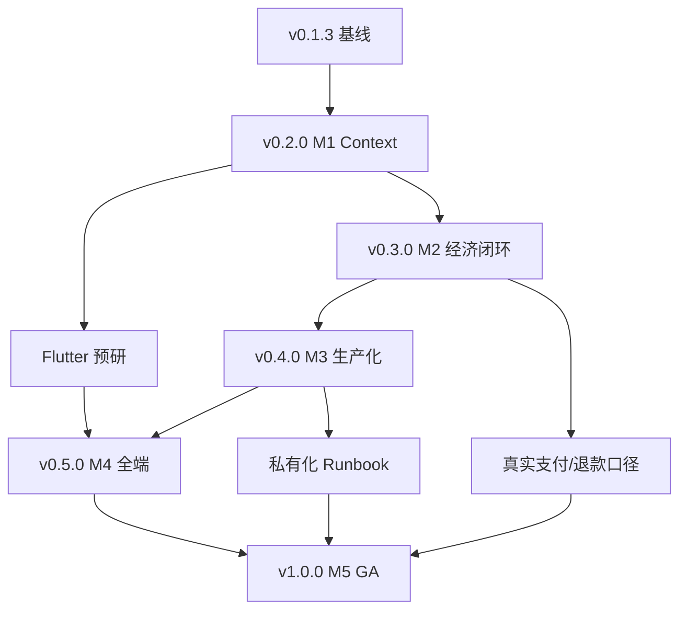

# 39 · 版本计划与资源门槛（IM2A：v0.1.3 → v1.0.0）

> 定位：**计划层文档**——回答"什么时候做、先做什么、没有什么就不许启动"。
> 基线：主线 `main` = **v0.1.3** · 契约 **R24**（§1–§52）· 数据 schema **2** · 732 项测试 / verify 146 / release-check 6/6 · 25 个 tag。
> 配套：[36 演进路线与版本总规划](./36-演进路线与版本总规划.md)（M1–M5 与能力矩阵）· `docs/37` 技术架构演进设计（怎么实现）· `docs/38` 模块与接口契约规划（§53+ 提案）。
> （37/38 与本文件同批交付，故此处用纯文本引用，避免交接期出现坏链；两文落地后可改为相对链接。）
> 规则来源：[34 主线与版本策略 §3/§5](./34-主线与版本策略.md)（版本规则与 0.2.0 启动条件）· [35 版本发布 SOP](./35-版本发布SOP.md)（发布门禁与签核）。
> 状态口径（沿用 [36 §2](./36-演进路线与版本总规划.md)）：**✅ 已具备/可复现** · **⚠ 部分具备或外部依赖未验证** · **⛔ 未实现**。
> **本文不含日期承诺、不含人力承诺**；工作量一律写"估算区间"，且不含采购/审批/打样等外部等待时间。

---

## 0. 一页结论

**一句话**：五个版本按"**先 Context、再钱、再生产、再端、最后主权**"排序；每一版的门槛不是"代码写完"，而是"**可验证的证据 + 真实资源就位**"；任一硬门槛不满足 → 该版本不启动，工作转回"证据与文档"。

### 0.1 五个版本：一句话交付 + 硬门槛

| 版本 | 里程碑别名 | 一句话交付 | 硬门槛（不过不启动 / 不发布） |
|---|---|---|---|
| **v0.2.0** | M1 活的大脑（图 v0.6–v0.8） | Context 可迁移、可检索；反馈沉淀为可审计的改进记录；模型可替换且成本可见 | 新增模块单测全绿 + Context 导出/导入演练通过 + schema 2 不被破坏（或附迁移脚本与演练） |
| **v0.3.0** | M2 闭环经济（图 v0.9–v0.10） | 协商双向实时"不丢不重"；付费"预审→定价→扣费→查看→退款"端到端可回放 | `TASK_STATE` 八态推送有断言 + 终止只推一张卡 + 付费闭环 e2e（含退款） |
| **v0.4.0** | M3 生产化（图 v0.11–v0.12） | 数据可承载真实用户量；事件可治理；人类 IM 通道真实可用（三流量物理隔离） | 数据迁移演练 + 双写一致性 + 三流量隔离验证 + 真实 IM 通道联调 |
| **v0.5.0** | M4 全端（图 v0.13–v0.15） | Flutter/PC/BLE/手表四端可用；端侧不传原始音频；手表审批安全 | 三端审批一致 + BLE 原始音频不出端（抓包证据）+ 手表审批二次确认 |
| **v1.0.0** | M5 GA（图 v1.0） | 个人数据主权：导出/导入可校验、私有化可部署、"不上传"可验证 | 导出/导入可验证 + 私有化部署验收 + 可验证承诺清单（逐条有证据链接） |

### 0.2 基线快照（写计划的起点，不是成绩展示）

| 项 | 值 | 状态 |
|---|---|---|
| 主线版本 / 契约 / schema | `0.1.3 / R24 / schema 2` | ✅ |
| 测试 / 一致性 / 发布检查 | 732 passed · verify 146/146 · release-check 6/6 | ✅ |
| 已具备的 Agent 治理 | 三级 Agent、五档信任、代码门控、审批引擎、协商引擎、付费状态机、账本幂等 | ✅ 逻辑层 |
| Context 相关 | `person-runtime`（§33）、`context-lock`（§34）、`persona-memory`（§17）、`model-router`（§24） | ✅ 单模块 / ⚠ 无统一服务、无检索 |
| 真实外部依赖（短信/实名/机审/支付/IM/LLM key） | 均为 mock 或未接 | ⚠/⛔ |
| 客户端 | Web/PWA 可跑；Flutter 骨架**未编译**；手表/BLE ⛔ | ⚠/⛔ |
| 存储 / 通道 | jsonfile；PG/Redis/Kafka ⛔；腾讯云 IM 适配层未接 | ⛔ |

### 0.3 三条纪律（违反任一条，本文失效）

1. **编号单调、不跳号**：主线只走 `v0.1.3 → v0.2.0 → v0.3.0 → v0.4.0 → v0.5.0 → v1.0.0`；图中的 `v0.6…v1.0` 只是**对外沟通用的里程碑别名**，实际打的 tag 一律是主线版本号（[34 §0](./34-主线与版本策略.md)）。
2. **只在本版范围里做**：`0.1.x` 只修可复现缺陷（[34 §3](./34-主线与版本策略.md)、[32 §5](./32-v0.1.2-缺陷修复与0.1.x停止条件.md)）；加能力一律进下一个 `0.x.0`。
3. **证据先于声明**：每版发布前必须回答"交付了什么/证据在哪/下版不做什么"（[36 §5](./36-演进路线与版本总规划.md)），缺一项不得打 tag。

> ⚠ **术语去重**：本文 `M1–M5` 指**里程碑/交付批次**；[11 §6.3](./11-AI原生IM架构-v2.md) 的 `M0–M5` 指 **v2 迁移步**（身份→网关→频道→内核→下线 PaaS）。二者不是同一套编号，评审时看上下文前缀。

---

## 1. 版本总表

| 版本 | 里程碑别名 | 交付物（功能 · 模块 · 契约章节） | 必须满足的 Gate | 资源前提 | 预计工作量（估算） | 主要风险 |
|---|---|---|---|---|---|---|
| **v0.2.0** | M1 活的大脑 | ① Context 统一服务与检索 ② 反馈→改进记录（蒸馏可审计）③ 模型 provider 抽象 + 配额/成本 ④ `context-service`（提案 §53）· `improvement-memory`（§54）· `model-provider`（§55） | 新模块单测 + Context 迁移演练（导出→导入→差异比对）+ schema 2 不变或附迁移 + 契约 R25 冻结 | LLM key 与调用预算；本机可测；内测名单可并行 | **6–10 人周**（估算） | 迁移破坏既有数据；设计过细返工 |
| **v0.3.0** | M2 闭环经济 | ① 协商双向实时流（WebSocket，事件 id 去重）② 8 态推送语义 ③ 付费强化：定价/扣费/退款端到端 ④ `negotiation-stream`（扩展 §5/§48）· 付费强化（扩展 §9/§35/§49） | `TASK_STATE` 八态推送不丢/不重 + 终止只推一张卡 + 预审→定价→扣费→退款闭环可回放 | 真实短信/实名/机审/支付中至少一项用于真链路；内测名单；法务支付口径 | **8–14 人周**（估算） | 实时化丢包/重复；退款争议 |
| **v0.4.0** | M3 生产化 | ① PG + pgvector 存储适配 ② Kafka 事件总线 ③ 腾讯云 IM 适配（UserSig/Webhook）④ 三流量隔离 ⑤ `store-adapter-postgres`（§56）· `event-bus-kafka`（§57）· `im-adapter-tencent`（§58） | 数据迁移演练 + 双写一致性 + 三流量隔离验证 + 真实 IM 通道联调 | PG/pgvector、Kafka、Redis 实例；腾讯云 IM 账号与回调；Linux+域名+证书 | **12–20 人周**（估算） | 迁移窗口失控；IM 通道切换回退 |
| **v0.5.0** | M4 全端 | ① Flutter 三端 + PC ② 手表三屏 ③ BLE 网关与端侧过滤 ④ `client-bridge`（§59）· `ble-gateway`（§60） | 三端审批结果一致 + BLE 原始音频不出端（抓包/断网证据）+ 手表审批二次确认 | Flutter SDK + Windows/Android/iOS 真机 + 手表 + BLE 样机 + 固件协作方 | **16–26 人周**（估算） | 端侧承诺无法验证；编译/签名环境 |
| **v1.0.0** | M5 GA | ① 数据主权：导出/导入可校验、本地加密 ② 私有化部署包 ③ 可验证承诺清单 ④ 兼容性策略 ⑤ `data-sovereignty`（§61）· `compatibility-policy`（§62） | 导出/导入可验证 + 私有化部署验收 + "不上传"证据链齐全 + 兼容性策略冻结 | 私有化目标机；法务（隐私/二清/数据出境）；等保与 ICP；客服值班 | **18–30 人周**（估算） | 合规延期；私有化环境差异 |

**工作量口径**：合计 **60–100 人周（估算）**，只含"设计+实现+测试+文档"，不含采购、审批、打样、法务排队；区间上下沿取决于外部资源到位时间与并发度（并行上限见 §4.2）。

> ⚠ **契约现状**：§53–§62 目前是**提案**（见 `docs/38`），当前冻结版本仍是 R24。每个能力版本开工的**第一件事**是把对应提案冻结成 R25/R26/…；**未冻结不得写实现**（否则契约漂移）。

---

## 2. 逐版本计划

### 2.1 v0.2.0（M1 活的大脑）

**目标（可验收）**：把散落在 §33/§34/§17/§24 的 Context 能力**收敛成一个服务**，把用户反馈沉淀成**可审计的改进记录**，把模型调用收口到**可替换、可核算成本**的一层。

**必须复用、不重造**（[36 §6 D3](./36-演进路线与版本总规划.md) 明确决策）：

| 既有落点 | 契约 | 现状 | 本版怎么用（不重造的方式） |
|---|---|---|---|
| `person-runtime` | §33 | ✅ 12 项测试 | 作为 `context-service` 的**状态底座**：`PERSONAL/TASK` 进可迁移包、`WORKING` 永不导出；直接复用 `snapshot/restore` 与 `SECRET_IN_LAYER` 校验 |
| `context-lock` | §34 | ✅ 14 项测试 | 作为**写入权**入口：子 Agent 只能 `propose`，属主 `confirm` 才 `LOCKED`；冲突不自动合并 |
| `persona-memory` | §17 | ✅ | 作为**记忆生命周期**：阶段晋升由时间+访问次数规则决定，模型无权宣布"重要"；遗忘是软删除 |
| `model-router` | §24 | ✅ | 作为 `model-provider` 的**路由策略**：敏感域/家庭信任档 → 本地，其余云端；本版只加 provider 抽象与成本核算，不动路由判定 |

**新增/替换模块**（提案章节，冻结后才实现）：

| 模块 | 提案 | 职责（一句话） | 依赖 | 状态 |
|---|---|---|---|---|
| `context-service` | §53 | 统一 Context 读写/检索/迁移入口，屏蔽底层存储 | §33/§34/§17 | ⛔ 未冻结 |
| `improvement-memory` | §54 | 把"审批通过/驳回/修改"反馈沉淀为可审计改进记录，供阈值校准引用 | §4 审批引擎、§33 | ⛔ 未冻结 |
| `model-provider` | §55 | 模型供应商抽象 + 配额 + 单次/按域成本核算 | §24 路由 | ⛔ 未冻结 |

**Gate（缺一不发布）**：

| # | Gate 项 | 判定标准 | 证据 | 自动化 | 当前 |
|---|---|---|---|---|---|
| 1.1 | 新模块单测 | `context-service`/`improvement-memory`/`model-provider` 各自可 `node <file>.test.mjs` 直跑全绿 | 测试文件 + 通过数 | ✅ 自动 | ⛔ |
| 1.2 | Context 迁移演练 | 导出 → 换实例导入 → 差异比对为空；`WORKING` 不在包内；凭证不落包 | 演练脚本输出 + 审计 | ✅ 自动 | ⛔ |
| 1.3 | schema 不破坏 | schema 仍为 2；若必须变更 → 升 `schemaVersion` + `migrate-state.mjs` + dry-run 演练记录 | 迁移报告 + 冒烟 | ⚠ 半自动 | ⛔ |
| 1.4 | 契约冻结 | §53–§55 冻结为新 R#，变更记录写明"是否加法" | `INTERFACES.md` 变更记录 | 人工 | ⛔ |
| 1.5 | 既有门禁不回归 | `test/verify/deploy-lint/quickstart/release-check` 全绿 | `reports/RELEASE-REPORT.md` | ✅ 自动 | ✅ 基线 |
| 1.6 | 成本可见 | 任一模型调用可回答"哪个 provider、多少 token、折多少钱" | 指标/日志 | ⚠ 人工抽查 | ⛔ |

**本版不做**：不做多端；不做硬件/端侧；不做 PG/Kafka/真实 IM；不改付费与协商的对外语义（只允许"加法"）。

**工作量拆分（估算）**：Context 服务与迁移 2.5–4 人周 · 改进记忆与蒸馏口径 1.5–3 人周 · 模型 provider/成本 1.5–2 人周 · 测试与文档 0.5–1 人周 → **6–10 人周**。

**风险与回滚**：主风险是"迁移破坏既有用户数据"（触发信号：迁移后条数/哈希不一致）。回滚 = 切回 `v0.1.3` tag + 用迁移前备份 `restore`（人工确认，不自动应用，[35 §7.2](./35-版本发布SOP.md)）。

### 2.2 v0.3.0（M2 闭环经济）

**目标（可验收）**：协商从"状态机 + 轮询"升级为**双向实时流**且语义不丢不重；付费链路从"状态机正确"升级为**端到端可回放**（预审→定价→扣费→查看→退款）。

**范围与契约章节**：

| 项 | 内容 | 契约 | 说明 |
|---|---|---|---|
| 协商实时流 | 双向推送，事件 id 去重，断线补拉 | 扩展 §5（`TASK_STATE` 八态不变）、§48 广播 | 八态：`SUBMITTED/WORKING/INPUT_REQUIRED/AUTH_REQUIRED/COMPLETED/FAILED/CANCELED/REJECTED` |
| 终止语义 | 终态才产出 artifact，且**只推一张卡** | §5 `artifact()` | 中间轮次不产生用户可见通知（既有不变量，不放松） |
| 定价 | 来意金额/授权 scope 价格只**记录**，不扩大权限 | §9 `amountCents`、§35 `priceCents` | "付费不扩权"是红线 |
| 扣费/退款 | 幂等键 `pay:<messageId>`；退款仅 `PAID/VIEWED` | §8/§9 | 已回复不可退（争议走人工，契约 §39 争议模块） |
| 通道隔离 | 协商事件不进人类未读（`channel` 不变量） | §14 | M3 才做物理三流，本版先做"逻辑+推送"不混流 |

**Gate（缺一不发布）**：

| # | Gate 项 | 判定标准 | 证据 | 自动化 | 当前 |
|---|---|---|---|---|---|
| 2.1 | 八态推送不丢/不重 | 构造 8 态 × 断线重连，客户端收到的事件集合与状态迁移一一对应；重复率 0 | 推送断言测试 + 事件 id 去重日志 | ✅ 自动 | ⛔ |
| 2.2 | 终止只推一张卡 | 一次协商到终态，用户侧仅 1 张卡/1 次通知（`INPUT_REQUIRED`/`AUTH_REQUIRED` 例外，按"需要人介入"推） | 端到端脚本 + 前端截图 | ⚠ 半自动 | ⛔ |
| 2.3 | 付费闭环可回放 | 同一 `messageId`：预审 PASS → 定价 → 扣费（1 条 CHARGE）→ 查看 → 回复 → 退款窗口校验 | 账本 + trace 报告 | ✅ 自动 | ⚠ 逻辑层已有，渠道 mock |
| 2.4 | 退款边界 | `REPLIED/SETTLED` 退款 → `REFUND_WINDOW_CLOSED`；重放不增加退款 | 测试 + 账本 | ✅ 自动 | ✅ 基线 |
| 2.5 | 真实链路（若资源就位） | 至少一个真实渠道跑通"回调验签 + 入账幂等 + 日切对账" | accept 报告 + 对账 | ⚠ 人工签核 | ⛔ |

**本版不做**：不做 PG/Kafka/真实 IM 替换（那是 M3）；不做硬件；不做多租户/分账/发票。

**工作量拆分（估算）**：实时流与去重 3–5 人周 · 推送语义与状态断言 1.5–3 人周 · 付费/退款端到端 2–3.5 人周 · 测试与对账 1.5–2.5 人周 → **8–14 人周**。

**风险与回滚**：主风险是"实时化引入丢包/重复"（触发信号：协商事件重复率 >0 或状态回退）。回滚 = 关流式开关回轮询（保留一个版本的轮询路径），代码切回上一 tag。

### 2.3 v0.4.0（M3 生产化）

**目标（可验收）**：数据从 jsonfile 迁到 **PG + pgvector**，事件从进程内总线迁到 **Kafka**，人类 IM 从适配层迁到**真实通道**，并验证**三流量隔离**（人类 IM / Agent 协商 / 审批审计）。

**范围与契约章节**：

| 项 | 内容 | 提案章节 | 顺序约束 |
|---|---|---|---|
| 存储适配 | PG 迁移 + pgvector 语义检索；jsonfile 保留为回退 | §56 | **先**：迁移脚本 + 备份 + dry-run |
| 事件总线 | Kafka（topic 与 §48 广播分工写清：本地订阅 vs 跨节点） | §57 | 存储稳定**后** |
| IM 适配 | 腾讯云 IM：UserSig、Webhook、消息补拉、未读隔离 | §58（扩展 §14/§31） | **最后**：通道切换是最不可逆的一步 |
| 三流量隔离 | 三类流量物理/逻辑分离并有验证脚本 | §14/§16/§48 | 与 IM 适配同步验收 |
| 横向扩展 | Redis Pub/Sub（多节点） | §48 迁移清单 | 与 Kafka 二选一先行，不双上 |

**Gate（缺一不发布）**：

| # | Gate 项 | 判定标准 | 证据 | 自动化 | 当前 |
|---|---|---|---|---|---|
| 3.1 | 数据迁移演练 | 全量 dry-run → 实迁 → 条数/哈希/抽样一致；失败可回退 | 迁移报告 + 冒烟 | ⚠ 半自动 | ⛔ |
| 3.2 | 双写一致性 | 双写窗口内 jsonfile 与 PG 读结果一致；差异可解释且有补偿 | 对账脚本 + 差异清单 | ✅ 自动 | ⛔ |
| 3.3 | 三流量隔离 | 协商事件不进人类未读；审批审计独立可查；三流各自的 backlog/延迟可见 | 隔离验证脚本 + 指标 | ✅ 自动 | ⚠ 逻辑层已隔离 |
| 3.4 | 真实 IM 联调 | UserSig 签发→登录→收发→补拉→Webhook 回调全通；断线重连不丢 | 联调报告 | ⚠ 人工 | ⛔ |
| 3.5 | 回退演练 | 关闭新通道后 30 分钟内回 PaaS/旧适配且消息不丢 | 演练记录 | 人工 | ⛔ |
| 3.6 | 既有门禁不回归 | 五命令全绿 + 新增迁移用例 | `RELEASE-REPORT.md` | ✅ 自动 | ✅ 基线 |

**本版不做**：不引入 Temporal/K8s 等重框架（[36 D4](./36-演进路线与版本总规划.md)）；不做自研共识/分布式存储；不做多租户隔离。

**工作量拆分（估算）**：PG 适配与迁移 4–7 人周 · Kafka/总线 2–3.5 人周 · IM 适配与联调 4–6 人周 · 隔离验证与回退演练 2–3.5 人周 → **12–20 人周**。

**风险与回滚**：主风险是"迁移窗口停写过久/切换后消息丢失"。回滚 = 停写→切旧存储→恢复备份→对账（`/api/ops/reconcile`）；IM 侧保留双通道一个版本（[11 §6.3](./11-AI原生IM架构-v2.md) 的 M4 建议）。

### 2.4 v0.5.0（M4 全端）

**目标（可验收）**：Web/PWA 之外补齐 **Flutter 三端 + PC + 手表**，BLE 网关让硬件只做感知，端侧过滤后才上云；手表承担"二值/三值决策"。

**范围与契约章节**：

| 项 | 内容 | 提案章节 | 现状 |
|---|---|---|---|
| Flutter 三端 | 审批态/巡视态/来意卡片；编译与签名 | —（[04](./04-SDK与端侧设计.md) 四层 SDK） | ⚠ 骨架未编译 |
| PC 端 | 巡视态深钻、批量审批 | — | ⛔ |
| 手表三屏 | 审批卡（是/否/稍后）、未读摘要、紧急联系人 | — | ⛔ |
| BLE 网关 | 帧格式/CRC/重传/重连；端侧 KWS/VAD 后才上云 | §60 | ⛔ |
| 客户端桥接 | 统一 Controller/Adapter，三端状态一致 | §59 | ⛔ |
| 隐私证据 | 断网/抓包/审计三证据 | §60 + [06 §4](./06-产品形态与硬件.md) P-01–P-07 | ⛔ |

**Gate（缺一不发布）**：

| # | Gate 项 | 判定标准 | 证据 | 自动化 | 当前 |
|---|---|---|---|---|---|
| 4.1 | 三端审批一致 | 三端同时对同一 `tkt-*` 决策，最终状态与账本一致（并发只允许一个成功，其余 `ILLEGAL_TRANSITION`） | 三端联调记录 + 审计 | ⚠ 人工 | ⛔ |
| 4.2 | BLE 原始音频不出端 | 抓包无 PCM/编码音频上行；端侧环形缓冲命中即清；传输事件可对账 | 抓包文件 + 传输事件清单 | ⚠ 人工（需样机） | ⛔ |
| 4.3 | 手表审批二次确认 | 资金/第三方类（L3）在手表上一律"去手机处理"；手表只能 `APPROVE/REJECT` | UI 走查 + 审计字段 `channel` | 人工 | ⛔ |
| 4.4 | 断网可用 | 断网仍可唤醒/播报本地缓存摘要；重连后按 `createdAt` 补投、过期由服务端判 `EXPIRED` | 断网演练 | ⚠ 半自动 | ⛔ |
| 4.5 | 编译与门禁 | `flutter analyze`/`flutter test` 进 CI；仍保持 Node 主门禁全绿 | CI run | ✅ 自动 | ⛔ |

**本版不做**：不做眼镜量产（第二形态）；不做指环/夹子；不做 24h 单次续航宣称（口径按 [06 §3](./06-产品形态与硬件.md)"管家在线、耳机每天回盒"）。

**工作量拆分（估算）**：Flutter 三端 5–8 人周 · 手表 2–4 人周 · BLE 网关与端侧 4–6 人周 · 隐私证据与联调 3–5 人周 · 构建/签名/CI 2–3 人周 → **16–26 人周**。

**风险与回滚**：主风险是"端侧承诺无法验证"（触发信号：拿不出抓包/断网证据）。处置：M4 前先冻结"可验证三件套"，否则**不宣称**该能力；回滚 = 硬件功能开关关闭，App 退回 PWA/网页入口。

### 2.5 v1.0.0（M5 GA）

**目标（可验收）**：把"个人 Context 是资产"落成**可迁移、可校验、可私有化**的产品事实；给出**可验证承诺清单**（逐条有证据），而不是一份隐私政策。

**范围与契约章节**：

| 项 | 内容 | 提案章节 | 复用 |
|---|---|---|---|
| 数据主权 | 导出包（签名/哈希/版本）、导入（校验/冲突显式）、本地加密 | §61 | §17 `exportPortable/importPortable`、§33 `snapshot/restore`、§44 备份 |
| 私有化 | Linux 单机部署包 + 升级/回滚/备份恢复 Runbook | §61 | [35 §7](./35-版本发布SOP.md)、[26](./26-v0.0.6-真实环境验收Runbook.md) |
| 可验证承诺 | "原始音频不上传/不落盘/可审计"三证据 + 用户可自查页 | §62 | [06 §4](./06-产品形态与硬件.md)、[04 §3](./04-SDK与端侧设计.md) |
| 兼容性策略 | 版本/契约/schema 兼容矩阵与弃用策略 | §62 | [34 §3](./34-主线与版本策略.md) |

**Gate（缺一不发布）**：

| # | Gate 项 | 判定标准 | 证据 | 自动化 | 当前 |
|---|---|---|---|---|---|
| 5.1 | 导出/导入可验证 | 导出→篡改 1 字节→校验失败；导入版本不符拒绝；冲突显式列出不静默覆盖 | 测试 + 报告 | ✅ 自动 | ⛔ |
| 5.2 | 私有化部署验收 | 纯净 Linux 目标机安装→启动→`/healthz`→核心链路冒烟→升级→回滚 全通 | accept 报告 + 运维记录 | ⚠ 人工 | ⛔ |
| 5.3 | 可验证承诺清单 | 每条承诺对应可执行证据（抓包/断网/审计/自查页），缺证据的承诺**删掉而不是保留** | 承诺→证据映射表 | 人工签核 | ⛔ |
| 5.4 | 合规材料 | 隐私政策/用户协议/二清口径/数据留存期/出境（如涉及）已评审 | 法务签字 | 人工 | ⛔ |
| 5.5 | GA 五方核验 | CI 绿 + 版本三元组一致 + 资产 sha256 + Release 记录 + 兼容性 | 五方核验表 | ⚠ 半自动 | ⛔ |
| 5.6 | Stable 批准 | **只有用户/产品负责人可批**，技术负责人不得自批 | `gate-signoff.yml` 签字 | 人工 | ⛔ |

**本版不做**：不做多租户/组织版；不做分账/发票/chargeback（缺口 #14–#16 留给商业阶段）；不做 A2A 跨组织开放。

**工作量拆分（估算）**：主权导出/导入与加密 6–10 人周 · 私有化包与 Runbook 4–7 人周 · 承诺证据链 3–5 人周 · 兼容性策略与文档 2–3 人周 · 全量验收与签核 3–5 人周 → **18–30 人周**。

**风险与回滚**：主风险是"合规延期导致不能对外 GA"（触发信号：法务评审未过/资质未下）。处置：GA 前保持 RC，不宣称 Stable；回滚 = 私有化包按上一版重装 + 数据备份恢复。

---

## 3. 资源门槛（硬）

### 3.1 判定原则

| 档 | 含义 | 依据 | 适用 |
|---|---|---|---|
| **启动门槛** | 低于此不得开始写该版代码 | [34 §5](./34-主线与版本策略.md)："至少满足一条" | 内部开发/演示 |
| **开放门槛** | 低于此不得对真实用户开放 | [32 §6](./32-v0.1.2-缺陷修复与0.1.x停止条件.md) 的 8 项资源清单：**没有它就不许上线** | 内测/Stable |

> 本文取**更严的一档做发布门槛**：`0.2.0` 允许按 [34 §5](./34-主线与版本策略.md) 一条资源启动开发，但**对真实用户开放前**必须补齐 [32 §6](./32-v0.1.2-缺陷修复与0.1.x停止条件.md) 对应项；不重复论证，只引用。

### 3.2 资源 × 首次需要版本

| # | 资源 | 首次需要 | 缺它的后果 | 依据 |
|---|---|---|---|---|
| 1 | LLM API key + 调用预算 | v0.2.0 | provider 抽象与成本核算无真实输入 | [32 §6.1](./32-v0.1.2-缺陷修复与0.1.x停止条件.md) 同源要求 |
| 2 | 真实短信（签名/模板/回执） | v0.2.0 开放 / v0.3.0 真链路 | 真实用户收不到验证码 | [34 §5](./34-主线与版本策略.md) |
| 3 | 真实实名（持牌三要素 + 数据协议） | v0.2.0 开放 / v0.3.0 真链路 | 付费准入无追责主体 | [34 §5](./34-主线与版本策略.md) |
| 4 | 真实机审（账号/模型版本/降级） | v0.2.0 开放 / v0.3.0 真链路 | 内容风险无兜底 | [34 §5](./34-主线与版本策略.md) |
| 5 | 真实支付渠道（商户号/证书/沙箱） | v0.3.0 | 资金闭环不可验证 | [34 §5](./34-主线与版本策略.md) |
| 6 | Linux 目标机 + 域名 + 有效 HTTPS 证书 | v0.2.0 开放 | 公网内测无从部署（预检 `TLS_INSECURE` 会拦） | [34 §5](./34-主线与版本策略.md) |
| 7 | 20 人级内测名单 + 通知渠道 | v0.2.0 开放 | 没有用户就没有验收 | [34 §5](./34-主线与版本策略.md) |
| 8 | 法务：隐私/协议/支付二清口径 | v0.2.0 开放（收费前必须） | 不得对真实用户收费 | [32 §6 #7](./32-v0.1.2-缺陷修复与0.1.x停止条件.md) |
| 9 | 客服/值班（话术/工单/SLA/升级） | v0.3.0（开始收费） | 争议无人兜底 | [32 §6 #8](./32-v0.1.2-缺陷修复与0.1.x停止条件.md) |
| 10 | PG + pgvector 实例 | v0.4.0 | 无法承载真实数据量/语义检索 | [36 §2.2](./36-演进路线与版本总规划.md) |
| 11 | Kafka（或等价事件总线） | v0.4.0 | 跨节点事件治理缺失 | [36 §3](./36-演进路线与版本总规划.md) |
| 12 | Redis（多节点 Pub/Sub） | v0.4.0 | 横向扩展无成熟方案 | [30 §6 #8](./30-v0.1.0-发布说明RC.md) |
| 13 | 腾讯云 IM 账号 + UserSig + Webhook 回调地址 | v0.4.0 | 真实人类 IM 通道缺失 | [36 §3](./36-演进路线与版本总规划.md) |
| 14 | Flutter SDK + 三端真机 | v0.5.0 | 客户端不可编译/不可发版 | [04 §7 #1](./04-SDK与端侧设计.md) |
| 15 | 手表设备（Wear OS/watchOS） | v0.5.0 | 手表三屏无法验收 | [07 §5](./07-客户端与UI交互.md) |
| 16 | BLE 样机 + 固件协作方 | v0.5.0 | BLE 帧/隐私时序无法上机 | [04 §7 #2](./04-SDK与端侧设计.md) |
| 17 | 私有化目标机（纯净 Linux） | v1.0.0 | 私有化部署无法验收 | [35 §7.1](./35-版本发布SOP.md) |
| 18 | 等保/ICP 等合规材料 | v1.0.0（对外商业化前） | 不能公开商业运营 | [30 §6 #17](./30-v0.1.0-发布说明RC.md) |

### 3.3 每版"没有它不得启动"（逐条打勾）

**v0.2.0 启动**
- [ ] 提案 §53–§55 进入冻结流程（能给出 R# 与变更记录草案）
- [ ] LLM key（或明确"本版只用 template/fallback 验证抽象层"，并在 CHANGELOG 写明）
- [ ] Context 迁移演练环境（可与生产同构的副本）
- [ ] 数据备份可用（`backup` 验签 + `restore` 不自动应用，[35 §7.2](./35-版本发布SOP.md)）

**v0.3.0 启动**
- [ ] 真实支付沙箱（商户号/证书）或明确"本版只做 mock 渠道的价值验证"
- [ ] 推送/流式基础设施（本地 WebSocket 即可，但断线重连测试环境到位）
- [ ] 退款与争议处理口径（客服 + 财务 + 法务三方确认）

**v0.4.0 启动**
- [ ] PG + pgvector + Redis + Kafka 实例（可用容器/云实例）
- [ ] Linux 目标机 + 域名 + 证书（预检可跑）
- [ ] 腾讯云 IM 账号与回调白名单
- [ ] 迁移窗口与停写公告流程（运维 + 产品）

**v0.5.0 启动**
- [ ] Flutter SDK + 可编译 CI（`flutter analyze` 能进流水线）
- [ ] 三端真机 + 手表 + BLE 样机
- [ ] 端侧过滤方案与"可验证三件套"定义（抓包/断网/审计）
- [ ] 法务确认录音相关口径（麦克风时长上限等，[04 §7 #5](./04-SDK与端侧设计.md)）

**v1.0.0 启动**
- [ ] 私有化目标机 + 安装/升级/回滚 Runbook 演练通过
- [ ] 隐私政策/用户协议/二清口径/出境评估（如涉及）法务签核
- [ ] 等保/ICP（或明确"GA 仅限邀请制私有化、不公开运营"）
- [ ] 7×24 或明确值班窗口（[08 §3](./08-运营客服运维与合规.md)）

### 3.4 资源未到位时做什么（不许"边等边加功能"）

| 情况 | 处置 | 不做 |
|---|---|---|
| 真实短信/实名/机审/支付任一未到位 | 冻结该能力开发，转做"证据与文档"：补测试、补演练、补指标口径 | 不假装已接入；不把 mock 写进 CAPABILITIES |
| PG/Kafka 未到位 | v0.4.0 不启动；先在 v0.3.0 把事件模型/迁移方案设计到"可写测试" | 不提前写两套存储 |
| Flutter/真机未到位 | 客户端只做 PWA/网页；Flutter 骨架保持"未编译"标注 | 不宣称"三端已支持" |
| 法务未过 | 不对真实用户收费；GA 保持 RC | 不以"内测"名义收费 |

---

## 4. 里程碑依赖与并行度

### 4.1 必须串行（不可并行、不可倒序）

| # | 串行链 | 为什么必须串行 | 违反后果 |
|---|---|---|---|
| S1 | 契约提案冻结 → 模块实现 → 单测 → 发布 | 未冻结就写 = 契约漂移，后续全部返工 | 版本作废/回滚 |
| S2 | schema 设计 → 迁移脚本 → dry-run → 实迁 → 冒烟 → 对账 | 数据只有一次机会；迁移不可回放 | 用户数据损坏 |
| S3 | 存储切换（jsonfile→PG）稳定 → 事件总线（Kafka）→ IM 通道切换 | 通道切换最不可逆，必须最后做且可回退 | 消息丢失/双写不一致 |
| S4 | 双写 → 一致性对账 → 关闭旧写 → 观察窗口 → 删除旧路径 | 双写期必须能只读回退 | 回退时数据分叉 |
| S5 | 端侧过滤实现 → 断网/抓包证据 → 才允许对外宣称"不出端" | 承诺必须有证据（[36 原则③](./36-演进路线与版本总规划.md)） | 合规与信任事件 |
| S6 | 全部门禁绿 → 打 tag → 复跑 release-check | tag 与版本不一致等于没发布 | 违反 [35 §10](./35-版本发布SOP.md) 红线 |

### 4.2 可以并行（但有上限）

| 工作流 | 可并行于 | 上限/约束 |
|---|---|---|
| 文档（37/38/39 与各版设计稿） | 全部版本 | 设计只到"可写测试"即停（[36 §8](./36-演进路线与版本总规划.md)） |
| 客户端/PWA 体验迭代 | v0.2.0/v0.3.0 | 不依赖新后端语义，只消费既有 API |
| Flutter 预研（编译/CI） | v0.2.0 起 | 预研不算交付；未编译不得写进 README "已支持" |
| BLE 协议预研（帧/CRC/功耗） | v0.2.0 起 | 只做文档与台架，不承诺时间 |
| 观测指标与看板（docs/24 口径） | 全部版本 | 不新增指标口径，先复用 §41 |
| 合规材料准备（隐私/协议/资质） | 全部版本 | 法务排队是外部时间，不计入工作量 |

### 4.3 依赖图

**关键路径**：`契约冻结 → Context 服务 → 协商实时流 → PG/IM 切换 → 端侧证据 → 私有化验收`。
**最长的外部等待**：真实支付渠道与合规资质（不在关键路径上，但决定"能不能对真实用户收费"）。

---

## 5. 每版发布检查单（引用 [35](./35-版本发布SOP.md)，不重写步骤）

### 5.1 通用 8 步（每版都做）

| # | 步骤 | 判定 | 依据 |
|---|---|---|---|
| 1 | 工作区干净、在 `main`、已同步 | `git status --short` 空 | [35 §0](./35-版本发布SOP.md) |
| 2 | 版本 bump **四处** | `version.mjs`（VERSION + CONTRACT_REVISION）/ `package.json` / `INTERFACES.md` 新增 R# / `README.md §8` 状态表 | [35 §1](./35-版本发布SOP.md) |
| 3 | CHANGELOG 四要素 | 改了什么 / 为什么 / 证据 / 未做与缺口 | [35 §2](./35-版本发布SOP.md) |
| 4 | 门禁五命令顺序执行 | `test → verify → deploy-lint → quickstart --check → release-check`（6/6） | [35 §3.1](./35-版本发布SOP.md) |
| 5 | 打 tag 并复跑 | tag 形如 `v0.2.0`/`v1.0.0`（能力版本无 `-fix`）；复跑 release-check 应 PASS | [35 §4](./35-版本发布SOP.md)、[35 §8.4](./35-版本发布SOP.md) |
| 6 | 人工签核 Issue | `gate-signoff.yml`（A1–A8/B1–B7/C1–C6/D1–D6/E1–E6 共 33 条；仅 D1/E4 自动） | [35 §5](./35-版本发布SOP.md) |
| 7 | 五方核验 | npm/Packages **永久 N/A**；Release 可选；CI 绿；资产 sha256；版本三元组 | [35 §6](./35-版本发布SOP.md) |
| 8 | 归档 + 回滚包 | `reports/RELEASE-REPORT.md` + 代码 tag + 数据备份 + 迁移脚本 | [35 §7/§8](./35-版本发布SOP.md) |

### 5.2 每版增量检查项（在通用 8 步之上）

| 版本 | 增量检查（缺一不发布） |
|---|---|
| **v0.2.0** | ☐ Context 导出/导入演练报告 ☐ schema 未变或迁移 dry-run 记录 ☐ 新模块测试计数进 README §8 ☐ 成本口径（provider/token/金额）说明 |
| **v0.3.0** | ☐ 八态推送断言清单 ☐ "终止只推一张卡"的端到端截图/日志 ☐ 退款争议口径三方确认 ☐ 日切对账演练（差异 = 0） |
| **v0.4.0** | ☐ 迁移报告（条数/哈希/抽样）☐ 双写一致性差异清单 ☐ 三流量隔离验证报告 ☐ IM 联调报告 + 回退演练 ☐ PG/Kafka 故障演练 |
| **v0.5.0** | ☐ `flutter analyze/test` CI 结果 ☐ 三端一致联调记录 ☐ BLE 抓包证据（无原始音频）☐ 断网演练 ☐ 手表 L3 拒绝路径走查 |
| **v1.0.0** | ☐ 导出包篡改检测测试 ☐ 私有化安装/升级/回滚三段演练 ☐ 承诺→证据映射表 ☐ 法务签字 ☐ **用户批准 Stable**（Agent 不得自批） |

### 5.3 回滚包（每版必须能回答"怎么退"）

| 层 | 内容 | 判定 |
|---|---|---|
| 代码 | 上一版 tag + 可重装 | `git switch --detach v上一版`（禁止 force push） |
| 数据 | 迁移前备份 + `restore` 验签（不自动应用） | 差异 = 0 或可解释 |
| 契约 | 新增 R# 为加法；若删除/改语义 → 不允许回滚，只能向前修 | 变更记录标注 |
| 客户端 | 配置开关回退（灰度/通道/端侧能力） | 10 分钟内生效 |

> 红线（违反即回滚）：未跑 release-check 就打 tag；版本号与 tag 不一致；带 schema 变更却无迁移/演练；把未验证能力写成"已完成"；强推 `main`（[35 §10](./35-版本发布SOP.md)）。

---

## 6. 度量与复盘

### 6.1 每版必须回答的三个问题（模板）

| # | 问题 | 写在哪 | 不合格的样子 |
|---|---|---|---|
| 1 | 交付了什么？（功能 + 模块 + 契约章节） | CHANGELOG + Gate 签核 Issue | 只写"优化若干" |
| 2 | 证据在哪？（测试名 / release-check / accept 报告 / 人工签核项） | 同上 + `reports/` | 口头通过、截图不留存 |
| 3 | 下一版明确不做什么？ | 本文对应版本"本版不做" | 路线膨胀、边等边加功能 |

### 6.2 北极星与内测指标（只引用，不新编数字）

| 层 | 指标 | 口径来源 | 用法 |
|---|---|---|---|
| 产品北极星 | **周审批决策数 / Agent 自主完成率** | [08 §8.1](./08-运营客服运维与合规.md)、[19 §0 #5](./19-IM2A-完整落地执行方案.md) | 每版复盘看趋势，不用单日比率下结论 |
| 付费漏斗 | `PAID_SENT → 审核通过 → CHARGE → VIEWED → REPLIED → SETTLED` 六段转化 | [24 §2](./24-v0.0.4-可观测与运营.md) | 每版必须能解释"哪一段掉了、为什么" |
| 资金/审核健康 | 机审失败率、人审积压、退款率、争议率、短信失败率、对账差异 | [24 §3](./24-v0.0.4-可观测与运营.md)（阈值已定，本文不复述） | 越线按 [24 §4.1](./24-v0.0.4-可观测与运营.md) 告警处置 |
| 内测运营 | 日看/周看/Go-No-Go/复盘模板 | [24 §6](./24-v0.0.4-可观测与运营.md) | 每版发布后一周做一次周看 |
| 端侧（M4 起） | BLE 帧错误/重连/功耗/时延 | [04 §7](./04-SDK与端侧设计.md) 未验证清单 | 样机实测后回填，不提前写数字 |
| 质量门禁 | 测试通过数 / verify 一致性 / release-check | [34 §6](./34-主线与版本策略.md) | 每版必须只升不降 |

> 指标纪律：**同一指标只有一个口径**；分母为 0 显示 0（不是 100%）；没有来源的数字不上看板（[24 §6.5](./24-v0.0.4-可观测与运营.md)）。

---

## 7. 风险登记（四类）

| # | 类别 | 风险 | 触发信号 | 应对 | 复审 |
|---|---|---|---|---|---|
| P-01 | 进度 | 规划过细导致返工 | 每版设计文档行数 > 实现代码行数 | 设计到"可写测试"即停；细节随实现走（[36 §8](./36-演进路线与版本总规划.md)） | 每版 |
| P-02 | 进度 | 串行链被并行需求打断（边等边加功能） | 出现"顺手把下版功能塞进本版"的 PR | 按 §3.4 冻结功能开发；只允许修缺陷/补证据 | 每周 |
| P-03 | 进度 | 外部等待被误当开发时间 | 里程碑讨论里出现"等短信/等资质"但仍排功能 | 外部等待单独列，不计入工作量；转做证据与文档 | 每版 |
| R-04 | 资源 | 真实短信/实名/机审/支付延迟 | M1 结束仍无任一真实资源 | 冻结功能开发；0.2.0 仅内部演示，不开放真实用户 | 每两周 |
| R-05 | 资源 | 内测名单不足（<20 人） | 招募渠道无效、协议签署率低 | 缩范围但保持"可复现证据"；不伪造用户数据 | 每月 |
| R-06 | 资源 | PG/Kafka/Redis 环境未就绪 | v0.4.0 启动清单未勾满 | v0.4.0 不启动；先在 v0.3.0 完成设计到可测 | 每周 |
| R-07 | 资源 | Flutter/真机/样机缺失 | 无法跑 `flutter analyze`；无 BLE 样机 | 客户端保持 PWA；M4 不宣称，Flutter 标"未编译" | 每两周 |
| T-08 | 技术 | Context 迁移破坏既有数据 | 迁移后条数/哈希/抽样不一致 | 停写→备份→回滚 tag；迁移一律先副本 dry-run（[33 §7](./33-v0.1.3-缺陷修复说明.md)） | 每次迁移 |
| T-09 | 技术 | 协商实时化丢包/重复 | 事件重复率 >0、状态回退、客户端收到乱序终态 | 先做状态机幂等再去重推送；保留轮询回退开关 | 每版 |
| T-10 | 技术 | 存储/通道切换不可逆 | IM 通道切换后消息补拉缺失 | 双通道保留一个版本；切换前必做回退演练 | 每次切换 |
| T-11 | 技术 | 双套真相（Context/记忆两套系统） | 出现第二套记忆实现或迁移脚本 | 强制复用 §17/§33/§34；评审时一票否决（[36 D3](./36-演进路线与版本总规划.md)） | 每版 |
| T-12 | 技术 | 端侧承诺无法验证 | 拿不出抓包/断网/审计三证据 | 不宣称该能力；把"可验证"定义写进 Gate 再开工 | M4 前 |
| C-13 | 合规 | 实名/内容/数据出境评审未过 | 法务评审未通过、资质未下 | GA 保持 RC；M3 起对外接口全留审计 | 每月 |
| C-14 | 合规 | 收费口径不明（二清/发票） | 支付通道要求补充材料 | 单商户代收；分账/发票延后（缺口 #15） | 每版 |
| C-15 | 合规 | 审计缺口导致无法举证 | trace `complete=false` 且 `missing` 无解释 | 每版 Gate 必须抽查完整链；缺环显式而非隐藏 | 每版 |

---

## 8. 明确不做（防路线膨胀）

| 不做 | 原因 | 依据 |
|---|---|---|
| 在 `0.1.x` 期间加任何能力 | 违反版本规则；缺陷优先 | [34 §3](./34-主线与版本策略.md)、[32 §5.2](./32-v0.1.2-缺陷修复与0.1.x停止条件.md) |
| v0.2.0 做硬件/端侧 | 供应链与合规未就绪；M4 才启动 | [36 §7](./36-演进路线与版本总规划.md) |
| v0.3.0 做 PG/Kafka/真实 IM | 属于 M3 范围；提前做=两套存储 | 本文 §2.2 |
| v1.0 前做多租户 / 分账 / 发票 / chargeback | 商业阶段再做；缺口已登记 | [30 §6 #14–#16](./30-v0.1.0-发布说明RC.md) |
| A2A 跨组织开放 | 授权真空未解（R-04 类风险） | [10 R-04](./10-风险与验收登记册.md) |
| 自研共识/分布式存储 | 内测规模用不到；M3 用成熟组件 | [36 §7](./36-演进路线与版本总规划.md) |
| 引入 Temporal/K8s 等重框架 | 内测阶段运维成本 > 收益 | [36 D4](./36-演进路线与版本总规划.md) |
| 用提示词代替门控 | 违反三原则② | [36 §7](./36-演进路线与版本总规划.md) |
| 把 mock/未验证能力写成"已完成" | 违反发布红线 | [35 §10](./35-版本发布SOP.md) |

---

## 9. 与其他文档的关系

| 文档 | 角色 | 本文如何引用 |
|---|---|---|
| [36 演进路线与版本总规划](./36-演进路线与版本总规划.md) | 路线总纲（M1–M5、能力矩阵、决策 D1–D6） | 编号映射与模块名一律以 36 为准 |
| `docs/37` 技术架构演进设计 | 怎么实现（设计层） | 本文只排期与门槛，不重复设计（同批交付，交付后改为链接） |
| `docs/38` 模块与接口契约规划 | §53+ 提案与接口 | 契约冻结状态以 38 为准；未冻结不得实现（同批交付） |
| [34 主线与版本策略](./34-主线与版本策略.md) | 版本规则与 0.2.0 启动条件 | 引用 §3/§5，不重写 |
| [35 版本发布 SOP](./35-版本发布SOP.md) | 发布操作唯一手册 | §5 检查单逐条引用，不复制命令细节 |
| [32 §6](./32-v0.1.2-缺陷修复与0.1.x停止条件.md) | 0.2.0 前置资源清单 8 项 | §3 资源门槛的开放档依据 |
| [30 §6](./30-v0.1.0-发布说明RC.md) | 17 条已知缺口（历史快照） | §8"不做"的缺口编号来源 |
| [24](./24-v0.0.4-可观测与运营.md) | 指标口径/告警/看板 | §6 度量全部引用，不新编数字 |

---

## 10. 变更记录

| 日期 | 变更 | 依据 |
|---|---|---|
| 2026-10-22 | 建立本文：五版本计划（M1–M5 ↔ v0.2.0–v1.0.0）、逐版 Gate、资源门槛矩阵、串行/并行约束、发布检查单、度量与风险登记 | 用户"先策划&设计再开发"要求 + [36](./36-演进路线与版本总规划.md) + [34](./34-主线与版本策略.md)/[35](./35-版本发布SOP.md) |
