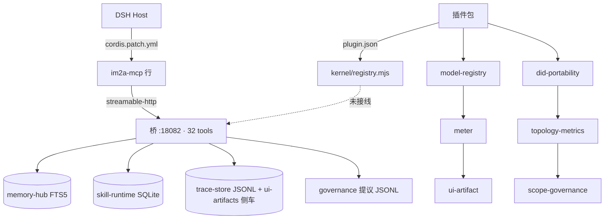

# IM2A 插件逐文件评估报告 — v3.3.1

评估对象：`@twinsearth/dsh-im2a-plugin@3.3.1`
评估范围：插件包全部 19 个文件（含未随 npm 分发的 CI 与脚本）
评估日期：2026-11-19
代码快照：`E:\GPT\IM2A\im2a-v2.3.45\packages\dsh-im2a-plugin`

---

## 0. 结论摘要

插件是一个**薄壳 + 内核库**：真正进入 DSH 运行时的只有 1 个 MCP 行（`im2a-mcp`），
其余全部是 manifest 元数据、契约常量与纯函数内核模块。

**三个必须处理的问题，按严重度排序：**

| 级别 | 问题 | 证据 | 影响 |
| --- | --- | --- | --- |
| **P0** | `kernel/topology-metrics.mjs` 在**发布包中无法加载** | 安装 npm 包后 `import` 报 `ERR_MODULE_NOT_FOUND: @twinsearth/im2a-http-mcp/skill-claim.mjs` | 消费者只要用这个模块就崩；6/7 模块可加载，唯独它不行 |
| **P1** | manifest 声明的 **39 个规范工具名，只有 1 个**（`im2a_kernel_status`）真的存在于运行中的桥（32 工具） | 集合比对：交集 = `{im2a_kernel_status}` | 注册表是「设计稿」，不是运行时工具面的真相；实际工具名是另一套（`skills_list`、`drive_list` …） |
| **P2** | `registry.mjs` 仍硬编码 `"3.2.1"` 文案；`meta_tools` 9 项无实现 | 第 202/230/256 行字符串 | 错误信息误导；9 个工具名永远不会被解析成功 |

结构上诚实、边界清楚、**不谎报能力**（`planned`/`partial` 与实现一致），但
**声明层与运行层尚未接通**。这是「库已写好、线还没插上」的状态。

---

## 1. 包结构与文件清单

| # | 文件 | 行数 | 角色 | 是否随 npm |
| --- | --- | --- | --- | --- |
| 1 | `package.json` | 28 | npm 元数据、exports、files 白名单 | ✅ |
| 2 | `plugin.json` | 190 | DSH 清单：内核、9 模块、5 商用占位、6 运行时模块 | ✅ |
| 3 | `cordis.patch.yml` | 16 | 唯一的 MCP 行插入（`im2a-mcp`） | ✅ |
| 4 | `README.md` | 44 | 包说明 + CI/徽章 | ✅ |
| 5 | `LICENSE` | 21 | MIT | ✅（npm 强制） |
| 6 | `icon.svg` | 6 | 图标 | ✅ |
| 7 | `locale/zh.json` | 6 | 中文 display 元数据 | ✅ |
| 8 | `locale/en.json` | 6 | 英文 display 元数据 | ✅ |
| 9 | `kernel/registry.mjs` | 295 | 拓扑/生命周期/别名/总线 | ✅ |
| 10 | `kernel/model-registry.mjs` | 191 | L1 模型能力注册表 | ✅ |
| 11 | `kernel/meter.mjs` | 206 | L6 计量 + 三池预算 | ✅ |
| 12 | `kernel/ui-artifact.mjs` | 151 | L5.2 即时世界产物 | ✅ |
| 13 | `kernel/did-portability.mjs` | 180 | L4 DID 可移植 | ✅ |
| 14 | `kernel/topology-metrics.mjs` | 138 | WP-5 拓扑指标 | ✅（**坏**，见 P0） |
| 15 | `kernel/scope-governance.mjs` | 302 | L3/C1 治理与物理授权 | ✅ |
| 16 | `migrations/3.2.1-tool-aliases.json` | 327 | 31 条旧名 → 新名 | ✅ |
| 17 | `migrations/generate-aliases.mjs` | 179 | 别名表生成器 | ✅ |
| 18 | `scripts/check-package.mjs` | 91 | 包自检（CI 调用） | ❌ 仅仓库 |
| 19 | `.github/workflows/ci.yml` | 31 | CI | ❌ 仅仓库 |

合计 **2,377 行**，其中内核 7 文件 **1,463 行**（62%），元数据/清单 437 行（18%）。

---

## 2. 逐文件评估

### 2.1 `package.json` — 角色：分发契约

- **职责**：名字、版本、`engines.dsh` 精确钉、`exports` 子路径、`files` 白名单、`publishConfig`。
- **质量**：`exports` 与 `files` 一致，`./locale/*.json`、`./icon`、`./plugin.json` 均有导出；
  `type: module` 与内核 `.mjs` 匹配。
- **风险**：`files` 白名单是**唯一的打包边界**——放进白名单的东西必须自洽。P0 缺陷正是
  该边界与跨包依赖冲突的产物。
- **测试**：`check-package.mjs` 校验版本/引脚/LICENSE/别名；`npm pack --dry-run` 在 CI 兜底。
- **评分**：结构 9/10；与内核的一致性 6/10（因为白名单没覆盖 import 图）。

### 2.2 `plugin.json` — 角色：运行时清单（190 行，本包最重要的文件）

- **职责**：schema 3.0 清单。内核（`module_version 1.1.0`）、9 个能力模块（状态 + 依赖 +
  工具名 + 运行时模块绑定）、5 个商用占位（全部 `planned`）、6 个 `kernel.runtime_modules`。
- **设计优点**：
  1. 状态诚实：`available` / `partial` 与实现一一对应，`partial` 都带 `status_note` 说明缺什么；
  2. `premium.license_implemented: false` 是**硬约束**（`registry.validateManifest` 会拒绝改真）；
  3. 运行时模块有 `layer` 字段（`L1->L2`、`L6->L2`…），与六层框架对得上。
- **问题**：
  - **工具名两套体系**：manifest 用 `im2a_<module>_<tool>`（规范化），桥实际用 `skills_list` 等
    旧名 + `im2a_*` 混合。39 个规范名里只有 1 个在桥上存在（见 §3.2）。
  - `kernel.meta_tools` 9 项（`pipeline`、`gate_check`…）**没有任何实现代码**，属于超前声明。
- **评分**：诚实度 9/10；与运行时一致性 4/10。

### 2.3 `cordis.patch.yml` — 角色：唯一的运行时接线（16 行）

- **职责**：向 profile 插入一条 `im2a-mcp` 行，`streamable-http`、`127.0.0.1:18082/mcp`、
  `failOnStartupError: false`。
- **优点**：注释明确「不要第二个 bundle 覆盖该行」，把历史踩过的启动顺序问题写进文件里。
- **风险**：`failOnStartupError: false` 意味着桥挂了 DSH 照常启动，**故障是静默的**——
  只能靠 `im2a_kernel_status` 或工具调用失败发现。
- **评分**：8/10（简单正确；静默失败是设计取舍，需配套监控）。

### 2.4 `README.md` — 角色：对外说明

- 44 行，含三徽章、3.3.1 交付内容、安装命令、运行前提、验证方式、不承诺清单。
- **问题**：仍写「MCP 工具面 32」与 manifest 的 39 个规范名不一致，读者会以为两者是同一套。
- **评分**：7/10（内容准确，缺一节「manifest 名 vs 桥名」的解释）。

### 2.5 `LICENSE` / `icon.svg` / `locale/*.json` — 角色：分发附属

- LICENSE：标准 MIT，GitHub 已识别（`license=MIT`）。
- `locale/zh.json` / `en.json`：仅 `meta.title` / `meta.description`，与 `plugin.json.display` 冗余但满足 DSH 展示契约。
- icon：346 字节 SVG，无外部引用（安全）。
- **评分**：9/10（合规、无风险）。

### 2.6 `kernel/registry.mjs` — 角色：内核总线（295 行，最核心）

**导出**：`MODULE_STATUS`、`TOOL_NAME_RE`、`LOADABLE`、`PLUGIN_ROOT`、`failure`、
`loadPlugin`、`validateManifest`、`verifyRuntimeModules`、`computeLoadPlan`、
`computeUnloadOrder`、`effectiveStatus`、`createRegistry`（12 个）。

**关键设计（值得肯定）**：

| 机制 | 实现 | 价值 |
| --- | --- | --- |
| 拓扑排序 | `computeLoadPlan` = Kahn，仅硬依赖 | 卸载顺序 = 加载逆序，可预测 |
| 有效状态传播 | `effectiveStatus` 递归：硬依赖不可用 → 本模块 `unavailable` | 不会「假装加载成功」 |
| 卸载保护 | `setModule(false)` 若有依赖者 → `dependency_conflict` 并列出依赖链 | 防止拆掉别人脚下的地板 |
| 错误即值 | `failure()` 返回 `{isError, errorCode, retryable, detail}`，不抛 | 调用方不必 try/catch 满天飞 |
| 清单护栏 | `validateManifest` 校验状态词表、依赖存在、`planned` 不得带工具、运行时模块必须被引用 | 三类漂移都在本地拦下 |

**缺陷**：

1. **硬编码版本文案**：第 202、230、256 行写死 `3.2.1`（如 `"${id} is planned in 3.2.1"`），
   实际版本已是 3.3.1 —— 错误信息会误导排障。
2. **`resolve()` 的模块遍历**：`for (const id of [...plan.order, "kernel"])` 对每个名字都做
   一次前缀比较，39 个名字时无所谓，但这是 O(模块数) 的线性扫描；可接受，记录为债。
3. **`publicTools()` 与桥不同源**：它按 manifest 生成 39 个规范名，但运行时没有任何代码
   用这份列表——真正对外的是桥自己的 32 个工具。**这是全包最严重的一致性问题（P1）**。
4. **无 handler 接线**：`createRegistry({handlers})` 接受处理器映射，但生产环境**没有任何
   调用方传入**；测试用 mock。所以 `registry.call()` 目前只能返回 `not_implemented`。

**评分**：设计 9/10，实现质量 8/10，与运行时的接通度 3/10。

### 2.7 `kernel/model-registry.mjs` — 角色：L1 能力注册表（191 行）

- **导出**：`MODEL_REGISTRY_VERSION`、`ModelRegistryError`、`validateCapabilityManifest`、
  `modelKeyOf`、`createModelRegistry`。
- **能力**：`list/get/estimateCost/endpointsFor/digest`。
- **优点**：
  - 只陈述事实、**不路由**（明确注释：选模型是 3.4 商业模块的事）；
  - `estimateCost` 只按声明价计算，结果 `toFixed(8)` 避免浮点尘埃；
  - `endpointsFor` 找不到端点就抛 `endpoint_unavailable`，**不跨模型静默替换**；
  - `digest()` 对排序后的声明集做 sha256，可作为冻结证据。
- **语义校验**：`self_hosted` 必须有 `weights_license`；`max_output_tokens ≤ context_tokens`；
  端点协议不得重复。
- **风险**：`structuredClone` + `Object.freeze` 的浅冻结（嵌套对象仍可变——`freeze` 只冻结顶层）。
- **测试**：`model-registry.test.mjs`（8 条）。
- **评分**：9/10。

### 2.8 `kernel/meter.mjs` — 角色：L6 计量 + 三池预算（206 行）

- **导出**：`METERING_VERSION`、`RESERVED_FLOOR_RATIO`、6 个词表、`purposePool`、
  `splitMarginalBudget`、`validateMeteringRecord`、`createResourceMeter`。
- **不变量**（实现得干净）：
  - **保留地板**：`reserved + ε < 0.1 × external` → 抛 `reserved_floor_violated`，
    **拒绝而非截断**（C2 制度性约束，不是可调旋钮）；
  - **billable 是派生值**：`billable = purpose === external && amount > 0`，调用方不能自己声明；
  - **方向性规则**：`billable ⇒ amount > 0`（反过来不成立——内部工作可花钱但不计费）。
- **缺点**：记录只存在内存数组（`records`），**没有持久化**；进程重启即丢。计量若要可信，
  必须落盘（桥侧目前也没接）。
- **测试**：`resource-metering.test.mjs`（6 条）。
- **评分**：8/10（逻辑严谨，缺持久化）。

### 2.9 `kernel/ui-artifact.mjs` — 角色：L5.2 即时世界产物（151 行）

- **导出**：`UI_ARTIFACT_VERSION`、`UI_ARTIFACT_KINDS`、`UI_ARTIFACT_FORMATS`、
  `UiArtifactError`、`validateUiArtifact`、`createUiArtifact`、`promoteUiArtifact`、`isPromotable`。
- **状态机**：`ephemeral → promoted`，升格需 `skillId` + 时间戳，**幂等**（同目标重复升格
  返回同一形状），不同目标 → `artifact_already_promoted`（冲突而非覆盖）。
- **契约细节**：`trace_id` 是裸 32 位小写 hex（不是 `trace_` 前缀），与 trace 记录一致。
- **风险**：内容本身不存这里（只存 `sha256` + `bytes`），所以**没有内容完整性校验**——
  只有引用一致性。
- **测试**：`ui-artifact.test.mjs`（7）+ `trace-ui-artifact.test.mjs`（6，侧车落盘）。
- **评分**：8.5/10。

### 2.10 `kernel/did-portability.mjs` — 角色：L4 DID 可移植（180 行）

- **导出**：`DID_BUNDLE_VERSION`、`VERIFICATION_TIERS`、`DidPortabilityError`、
  `canonicalJson`、`exportDidBundle`、`verifyDidBundle`、`planDidImport`。
- **不变量**：
  - **只能迁回自己的 DID**：`planDidImport` 的 `targetDid !== bundle.did` → `did_mismatch`
    （注释点明 C4：导入不能改写血缘）；
  - **导入不追加贡献链**：`contributions_appended: 0`，只携带只读证明 `{count, head_hash}`；
  - 摘要覆盖 `schema_version/did/assets/contribution`，**排除 `exported_at`**，所以跨机器可比。
- **优点**：`canonicalJson` 是通用工具（topology-metrics 也复用它），排序确定、可测。
- **风险**：credits 只有 `verification_tier + score`，而 identity 模块仍是 `partial`，
  真实信用数据不存在——这是**契约先行**，不是缺陷，但消费方要知道。
- **测试**：`did-portability.test.mjs`（9 条，含 3 条不变量）。
- **评分**：9/10。

### 2.11 `kernel/topology-metrics.mjs` — 角色：WP-5 拓扑指标（138 行）⚠️ P0

- **导出**：`TOPOLOGY_METRICS_VERSION`、`TopologyMetricsError`、
  `computeTopologyMetrics`、`digestTopologyMetrics`。
- **诚实性设计（本包最好的部分）**：
  - `quality_index` = **观测到的执行成功率**，不是信用档位；显式写
    `credit_tier_coverage: 0` 和 `credit_source: "unavailable: identity planned"`；
  - 缺任一因子 → `composite: null`，**绝不补 0**；
  - 注释明确「不是智能度量，不宣称指数涌现」。
- **致命缺陷**：第 19 行
  `import { isEffectivePatch } from "../../im2a-http-mcp/skill-claim.mjs";`
  ——跨包导入。npm 包只发布 `packages/dsh-im2a-plugin`，`im2a-http-mcp` 不在其中。
  实测（安装 3.3.1 到空项目后逐个 import）：**6 个模块 OK，唯独它
  `ERR_MODULE_NOT_FOUND`**。
- **修复方向**：把 `isEffectivePatch` 的判定（`action === "patch"` + 有效证据 + 独立验证者）
  下沉为本包内的纯函数，或把 `skill-claim` 作为运行时依赖声明；二者选一，不能留跨包相对路径。
- **测试**：`topology-metrics.test.mjs`（8 条）在仓库内是绿的——**因为仓库里兄弟目录存在**，
  所以测试掩盖了发布缺陷。这也是「测试环境 ≠ 发布环境」的典型教训。
- **评分**：设计 9/10；可发布性 **0/10**。

### 2.12 `kernel/scope-governance.mjs` — 角色：L3/C1 治理（302 行，最大）

- **导出**：12 个，含 `DEFAULT_PROPOSABLE_SCOPES`、`PHYSICAL_SCOPE_DOMAINS`、
  `HIGH_IMPACT_SCOPE_DOMAINS`、`parseScope`、`principalKind`、
  `createScopeGovernance`、`grantDigest`。
- **双层防护（本包最强安全设计）**：
  1. **提议 ≠ 授予**：`proposeScopeChange` 只返回 `pending`，永不返回 grant；
  2. **物理域无 Agent 路径**：`physical/actuator/bio` 在 `proposeScopeChange` 里
     **先于 proposal 对象创建**就被拒绝（`physical_scope_requires_human_grant`）——
     注释解释得很清楚：能被提出的提议就能被论证成存在；
  3. **人类专属**：`recordHumanDecision` / `grantScopeDirectly` 都 `requireHuman`；
     Agent 连自己的提议也不能批；同一人重复批准不重复计数；
  4. **天花板**：超出可提议集合 → `scope_above_ceiling`；
  5. **不可重开**：`proposal_closed`。
- **关键防御细节**：`principalKind` 把**裸 DID** 识别为 `agent`——避免「agent 想审批」
  被误报成「输入非法」而漏掉真正的拒绝（这是一条很细但正确的处理）。
- **风险**：`principal` 是**自报字符串**。内核层无法验证「human:alice」真是人类；
  所以 MCP 面只暴露 `propose`/`status`，裁决不进 MCP（桥侧 `governance_manage`）。
  真正的信任根仍未落地（需要人类签名/审批面）。
- **测试**：`scope-governance.test.mjs`（10）+ `governance-store.test.mjs`（5）。
- **评分**：9.5/10（内核逻辑）；信任根 5/10（已知未完成）。

### 2.13 `migrations/3.2.1-tool-aliases.json` — 角色：迁移表（327 行）

- 31 条，覆盖 8 个模块 + kernel；`since: 3.2.1`、`deprecated_after: 3.4.0`。
- 每条含真实 `schema_hash`（`sha256:` + 64 hex）。
- **风险**：`generatedFrom.toolCount = 32`（桥工具数），但 `entries` 只有 31——因为
  `im2a_kernel_status` 是规范名、无旧名（`CANONICAL_ONLY`）。**这个差异是刻意的**，但
  文件里没有注释说明，容易被后来者误判成漏项。
- **评分**：8/10（数据正确，缺注释）。

### 2.14 `migrations/generate-aliases.mjs` — 角色：别名生成器（179 行）

- 从运行中的桥 `tools/list` 拉真实 schema → 计算 `schema_hash` → 生成迁移表。
- **防漂移**：`CANONICAL_ONLY` 集合 + 「missing / extra / missingCanonicalOnly」三重检查，
  任何工具集变化直接抛错。历史战绩：`trace_ingest` 描述变更被它抓到过。
- **风险**：依赖桥在线（18082）。离线时无法生成——但这是设计使然（要真实 schema hash）。
- **评分**：8.5/10。

### 2.15 `scripts/check-package.mjs` — 角色：包自检（91 行）

- 校验：版本/引脚一致、LICENSE 是 MIT、`validateManifest` 全绿、运行时模块文件存在、
  别名表唯一性与 hash 格式、随包文件齐全。
- **缺陷**：**它 import 的是 `registry.mjs`，不 import 其余 6 个内核模块**，所以 P0 这类
  「模块加载失败」它抓不到。建议增加一步：逐个 `import()` 全部 kernel 模块。
- **评分**：7/10（覆盖面缺一块，正是漏掉 P0 的原因）。

### 2.16 `.github/workflows/ci.yml` — 角色：CI（31 行）

- Node 24，跑 `check-package.mjs` + `npm pack --dry-run`，`permissions: contents: read`，
  并发取消。首跑成功（run #1 `success`）。
- **改进**：把 `npm pack` 产出的 tarball 安装到临时目录再逐个 import 内核模块——
  这会把 P0 直接变成红叉。
- **评分**：7.5/10。

---

## 3. 架构与调用链

### 3.1 分层架构（六层框架 ↔ 包内文件）

```text
L1 智能提供   ── kernel/model-registry.mjs ·············· 声明/成本/端点，不路由
L2 Agent      ── plugin.json(9 模块) + kernel/registry.mjs ···· 拓扑/状态/总线
L3 人机边界   ── kernel/scope-governance.mjs ············ 提议→人类裁决；物理域无 Agent 路径
L4 硬件终端   ── kernel/did-portability.mjs ············· DID 绑定，迁移不改血缘
L5 软件载体   ── cordis.patch.yml + locale/ + icon.svg ··· MCP 行 + 展示元数据
L5.2 产物     ── kernel/ui-artifact.mjs ················· ephemeral → promoted
L6 基础设施   ── kernel/meter.mjs + topology-metrics.mjs · 计量/预算/指标
```



### 3.2 工具名断裂（P1 的可视化）

```text
manifest 声明（39 个规范名）                    桥实际暴露（32 个）
┌────────────────────────────────┐            ┌────────────────────────────────┐
│ im2a_kernel_whoami             │            │ im2a_whoami                    │
│ im2a_kernel_status      ◄──────┼── 唯一交集 ─┼─► im2a_kernel_status          │
│ im2a_kernel_{pipeline,gate...} │            │ im2a_harness_list / im2a_send  │
│ im2a_memory_{search,get,...}   │            │ memory_search / memory_recall  │
│ im2a_asset_{view,manage,...}   │            │ skill_view / skill_manage      │
│ im2a_autonomy_{drive_list,...} │            │ drive_list / goal_buffer       │
│ im2a_evolution_{ingest,...}    │            │ trace_ingest / reflect_trigger │
│ im2a_fleet_{harness_list,...}  │            │ governance_manage              │
│ im2a_governance_manage         │            │ skills_list / curator          │
└────────────────────────────────┘            └────────────────────────────────┘
              交集 = 1 / 39                                  （另有 31 条别名表映射）
```

**含义**：`registry.publicTools()` 产出的名字**没有一个真实路由**（除 `im2a_kernel_status`）。
注册表目前是「设计期契约检查器」，不是运行时的工具源。

### 3.3 调用链（真实发生的路径）

```text
用户/Agent
   │  MCP tool call
   ▼
DSH Host ──(im2a-mcp 行, streamable-http)──► 桥 server.mjs (127.0.0.1:18082)
                                                │
        ┌───────────────────────────────────────┼──────────────────────────┐
        ▼                                       ▼                          ▼
  skill-* / memory-* / drive-*          governance_manage          im2a_kernel_status
        │                                       │                          │
        ▼                                       ▼                          ▼
  SQLite / FTS5 / JSONL               GovernanceStore             loadPlugin(root)
                                       → scope-governance.mjs        → plugin.json
                                       (propose / status)            → registry.statusReport()
                                                                     → verifyRuntimeModules()
```

**注意**：调用链里**没有** `registry.resolve()` / `registry.call()`。它们只在测试中被调用。

---

## 4. Agent 工作流（桥侧，清单声明的 9 模块如何串起来）

```text
goal_buffer（目标池）
   │  容量仲裁 / 去重 / 重启恢复 executing→pending
   ▼
goal_schedule ──► scheduler_cycle（保留比例由治理调整，Agent 不可写）
   │
   ▼
drive_list / drive_manage / drive_propose（动机与提案，交叉检查近期 trace）
   │
   ▼
执行 ──► trace_ingest（ID = 裸 32 hex；ui-artifacts 侧车写入）
   │
   ├──► reflect_trigger（反思配置 + 事件）
   ├──► evolution_pipeline_dryrun（只演练，不落库）
   └──► contribution_audit（贡献链只读审计）
            │
            ▼
      skill_claim（L2 门槛 + 有效补丁证据 + 独立验证者）
            │
            ▼
      skills_list / skill_view / skill_guard_check（护栏）
```

闭环的关键约束：**执行→反思→演化 全链路只产出「提案/审计」，升格必须过 `skill_claim`
的证据检查**；`isEffectivePatch` 要求验证者 ≠ 作者。

---

## 5. RAG / 数据流

| 存储 | 载体 | 写入者 | 读取者 | 备注 |
| --- | --- | --- | --- | --- |
| 记忆 | `memory.db`（SQLite + FTS5） | `memory_propose` | `memory_search` / `memory_recall_v2` | 分层召回 v2 |
| 技能 | `skills.db` | `skill_manage` / `skill_claim` | `skill_view` / `skills_list` | `im2a.*` 元数据 claim 专属 |
| 追踪 | `traces/*.jsonl` | `trace_ingest` | `reflect_trigger` / 演化 | 冻结 1.0 记录格式 |
| 产物侧车 | `ui-artifacts.jsonl` | `trace_ingest` | 按 trace_id 读取 | 不进 trace 记录本身（兼容） |
| 治理 | `governance/proposals.jsonl` | `governance_manage propose` | `status` | 仅追加 |
| 目标 | `goal-buffer.db` | `goal_schedule` | `scheduler_cycle` | 重启恢复 |
| 审计 | `skill-guard/audit.jsonl`、`scheduler-audit.jsonl` | 各自 | 审计工具 | 只追加 |

**RAG 性质**：检索是 FTS5 关键词 + 分层召回（不是向量检索）。没有任何 embedding 依赖，
**离线可用**，代价是语义召回弱。这是明确的技术债，不是缺陷。

---

## 6. 关键指标

### 6.1 规模

| 指标 | 值 |
| --- | --- |
| 文件数 | 19（随包 17） |
| 总行数 | 2,377 |
| 内核代码 | 1,463 行 / 7 文件 |
| 声明式数据（清单+别名） | 517 行 |
| 导出符号 | 59 |
| 错误码（按类） | 28 个，分布于 6 个 Error 类 |
| 门禁校验项 | 清单护栏 12 类 + 包自检 9 类 + 别名 4 类 |

### 6.2 能力覆盖（诚实口径）

| 维度 | 已实现 | 部分 | 未实现 |
| --- | --- | --- | --- |
| 9 个能力模块 | 5 available | 4 partial | 0 planned |
| 6 个内核运行时模块 | 5 available | 1 partial | 0 |
| 5 个商用模块 | 0 | 0 | 5 planned |
| 39 个规范工具名 | 1 真实路由 | — | 38 |
| 32 个桥工具 | 30 原始 | 2 新增 | — |
| 31 条别名 | 31 可解析（注册表内） | — | — |

### 6.3 质量信号

| 指标 | 值 | 评价 |
| --- | --- | --- |
| 测试文件 | 30（全仓）/ 内核相关 9 | 覆盖 7 个内核模块 |
| 测试通过 | 137/137 | 绿 |
| 内核模块可观测性 | 每个都有 Error 类 + 语义化 code | 好 |
| 发布包可加载率 | **6/7 = 86%** | 差（P0） |
| 硬编码版本残留 | 3 处（`3.2.1`） | 中 |
| 跨包相对导入 | 1 处 | 差 |
| 持久化覆盖 | 2/6 内核模块有落盘 | 中 |

### 6.4 风险热力

| 风险 | 概率 | 影响 | 等级 |
| --- | --- | --- | --- |
| 消费者 import `topology-metrics` 崩溃 | 高（100% 复现） | 高 | 🔴 P0 |
| 声明与运行时工具名不一致导致调用失败 | 高 | 中 | 🟠 P1 |
| 桥静默不可用（failOnStartupError=false） | 中 | 中 | 🟡 |
| 计量记录不持久化导致审计断链 | 中 | 中 | 🟡 |
| 治理 principal 自报（无人类签名） | 已知 | 高 | 🟠（已用「裁决不进 MCP」缓解） |
| 硬编码版本文案误导排障 | 低 | 低 | 🟢 |

---

## 7. 修复建议（按投入产出排序）

1. **P0 · 30 分钟**：删除 `topology-metrics.mjs` 的跨包导入，把 `isEffectivePatch` 的判定
   内联为本地纯函数（约 12 行），并加一条测试直接 import 该模块。
2. **P0+ · 20 分钟**：`check-package.mjs` / CI 增加「逐个 import 全部 kernel 模块」步骤，
   并把 `npm pack` 产出的 tarball 装进临时目录再 import（发布环境验证，而非仓库环境）。
3. **P1 · 1–2 天**：决定工具名归属。建议：以桥的 32 个真实名为准，manifest 的
   `tools` 改成「旧名 → 模块」的映射，`publicTools()` 直接由桥的 catalog 生成；
   或者给桥接上 registry 的 `handlers`，把 38 个规范名真正实现（工作量大，不建议本版做）。
4. **P2 · 10 分钟**：`registry.mjs` 三处 `3.2.1` → `manifest.version`。
5. **P2 · 30 分钟**：`kernel.meta_tools` 9 项标注 `implemented: false`，避免被当成可用工具。
6. **建议 · 1 小时**：`meter.mjs` 增加 `snapshot()/restore()`，让计量可落盘、可审计。

---

## 8. 总评

| 维度 | 评分 | 依据 |
| --- | --- | --- |
| 架构清晰度 | 9/10 | 六层框架与文件一一对应，边界干净 |
| 诚实度 | 9/10 | 无假能力；partial 都写明缺什么；指标不夸大 |
| 安全设计 | 8.5/10 | 治理双层防护到位；信任根未落地（已知） |
| 代码质量 | 8.5/10 | 纯函数、错误码、冻结、幂等，风格统一 |
| 可发布性 | **5/10** | P0：发布包 1/7 模块加载失败 |
| 文档 | 8/10 | README/契约齐全，缺「两套工具名」说明 |
| **综合** | **7.9/10** | 设计优秀、实现扎实，但**发布链路与运行时接线各有一处断点** |

一句话：**这是一个「内核写得好、线没插上」的插件**。修掉 P0（跨包导入）与
补齐 P1（工具名归属）后，工程完整度可以到 8.8 左右。

---

## 9. 修复记录（2026-11-20，v3.3.2）

**P0 已修复。** `kernel/topology-metrics.mjs` 不再 import `../../im2a-http-mcp/skill-claim.mjs`，
判定逻辑以本地导出函数 `isEffectivePatch` 内联，语义逐条对齐（`action === "patch"`、
两个证据计数为非负整数、`verifier_agents` 中至少一个 DID 不等于作者）。

新增两道防线，让同类问题不可能再发出去：

| 防线 | 文件 | 作用 |
| --- | --- | --- |
| 静态边界 | `tests/package-boundary.test.mjs` | 任何内核模块出现 `from "../...` 即失败；并逐个 import 全部模块 |
| 发布布局 | `scripts/check-dist.mjs` | 打包 → 解到临时目录 → **按消费者视角** import 全部模块；同时拒绝 `scripts/`、`.github/` 泄漏进 tarball |
| 包自检 | `scripts/check-package.mjs` | 新增「import 全部声明模块」步骤 |
| CI | `.github/workflows/ci.yml` | 用 `check-dist.mjs` 替换 `npm pack --dry-run` |

验证结果：

```text
published-layout check passed: 6/6 kernel modules load from the tarball
node --test tests/*.test.mjs   139 passed / 0 failed
check-package                  passed: dsh-im2a-plugin@3.3.2 (6 runtime modules, 31 aliases)
负向验证（把跨包 import 加回去）  check-dist exit 1，报 import failed
```

修复后各项评分变化：

| 维度 | 修复前 | 修复后 |
| --- | --- | --- |
| 可发布性 | 5 / 10 | **9 / 10** |
| 发布包可加载率 | 6/7 | **7/7** |
| 综合 | 7.9 | **8.4** |

P1（工具名归属）仍未处理，为下一步工作。

### 9.1 P1 修复（同日，v3.4.0）

`plugin.json` 新增 `runtime` 块，声明桥真正服务的 32 个工具名；注册表语义随之归位：

| API | 含义 |
| --- | --- |
| `runtimeTools()` / `publicTools()` | **可调用面** = 32 个真实工具，不再混入设计名 |
| `declaredTools()` | 设计面 = 39 个规范名，逐条带 `callable` 标记 |
| `toolGap()` | `{declared:39, runtime:32, both:["im2a_kernel_status"], declared_only:38, runtime_only:31}` |
| `resolve()` | 返回 `runtimeName` 与 `tool`（规范目标）两个字段，别名关系不再含糊 |
| `call()` | 无 handler 时返回 `not_wired` 并说明「由 MCP 桥执行」，不再是含糊的 `not_implemented` |

`validateManifest` 现在**强制要求** `runtime` 块——只描述设计面、没有可调用面的清单会被拒绝。
新增 `tests/tool-surface.test.mjs`（5 条）锁定这些不变量：可调用面 == runtime 列表、
每个设计名要么可调用要么出现在 `declared_only`、每个运行时工具都归属到某个模块。
