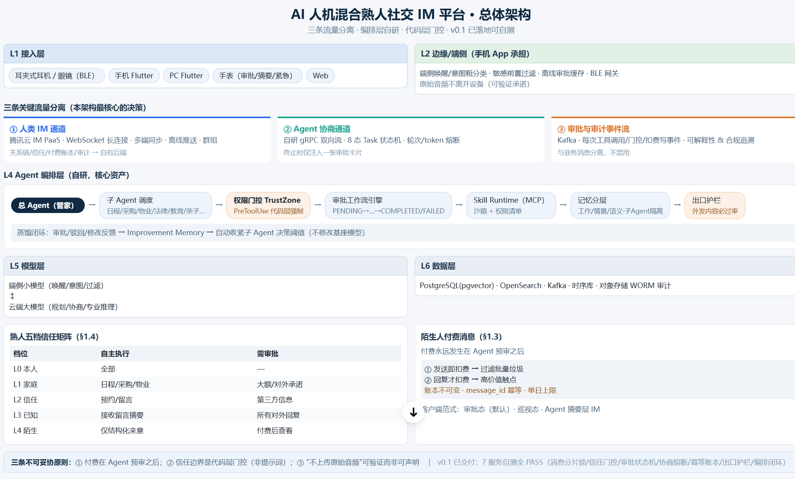

# 架构总览 · 图与实现对照（v0.2）

> 本文件把「AI 人机混合熟人社交 IM 平台 · 总体架构」总览图与仓库实现逐层对照。
> 目的不是把图画得更漂亮，而是回答一个问题：**图上每一层，今天到底有没有代码、有没有验证。**
>
> **v0.2 变更（2026-10-21，v2 修订）**：保留 v0.1 的 v1 逐层对照，新增「v2 六项变更」落点与状态；图上没有画出的 v2 结构（Agent Gateway、身份、可见域、频道类型、会话、签名审计）用 §2 的表格 + 文字增补。**图资产本身仍是 v0.1 的 PNG，未重绘**（图资产更新 ⏸，评审后再出 v0.2 图）。
>
> 图：（v0.1 资产，sha256 `0b864d9c…876b42`，307 KB；v2 增补见 §2/§3）
>
> 状态图例：✅ 本仓库可运行/可验证 · ⚠️ 只有契约/骨架、或实现中尚未全绿 · ⏸ 未实现 · 🔀 由另一条交付线（Mac mini Go v0.1）承担、本机未复核
>
> v2 设计论证与取舍见 [11-AI原生IM架构-v2](./11-AI原生IM架构-v2.md)；契约唯一来源是 [contracts/INTERFACES.md](../contracts/INTERFACES.md)（§11–§16 为 v2）。

## 1. v1 逐层对照（保留，`v1 状态` 为基线）

| 层 / 模块 | 图上的承诺 | 本仓库现状 | v1 状态 | 落点 |
|---|---|---|---|---|
| L1 接入层 | 耳机/眼镜 BLE、Flutter 手机/PC/手表、Web | Flutter 骨架（未编译）+ 浏览器 IM Demo 可运行 | ⚠️/✅ | `apps/clients-flutter/`、`apps/im-live/public/` |
| L2 边缘/端侧（手机 App） | 唤醒/意图粗分类、敏感前置过滤、离线审批缓存、BLE 网关；原始音频不出设备 | 仅文档与 UI 承诺；无端侧代码 | ⏸ | docs/04、docs/06 |
| ① 人类 IM 通道 | 腾讯云 IM PaaS：长连接/多端同步/离线推送/群组 | 演示用本地 HTTP + 浏览器轮询；未接 PaaS | ⏸（Demo 面 ✅） | `apps/im-live/server.mjs` |
| ② Agent 协商通道 | 自研 gRPC 双向流、8 态 Task、轮次/token 熔断，终止仅注入审批卡 | Node 版协商状态机 + 轮次/token 熔断，测试覆盖 | ✅（同语义） | `services/orchestrator/src/negotiation-engine.mjs` |
| ③ 审批与审计事件流 | Kafka；每次工具调用/门控/扣费事件、可解释、与业务消息分离 | 审计哈希链（sha256+prevHash）+ 事件溯源 | ✅（哈希链）/⚠️（无签名） | `services/audit/src/audit-log.mjs` |
| L4 总 Agent → 子 Agent 调度 | 管家路由、专家子 Agent | 注册表 + 子 Agent 列表 + 会话角色映射 | ✅（Node） | `services/orchestrator/src/agent-registry.mjs`、`apps/im-live/agent-runtime.mjs` |
| L4 权限门控 TrustZone | PreToolUse 代码层强制 | 五档信任矩阵 + Skill 声明/信任双门控 | ✅ | `trust-zone.mjs`、`capability-gate.mjs`、`apps/im-live/skills.mjs` |
| L4 审批工作流 | PENDING→…→COMPLETED/FAILED + 超时升级 | 9 态状态机 + 事件溯源 + escalateOverdue（watch/sms） | ✅ | `approval-engine.mjs` |
| L4 Skill Runtime（MCP） | 沙箱 + 权限清单 | W2M Skill 执行层（fleet.devices/fleet.run 等，真实派发已实测）；MCP 沙箱为设计 | ✅（W2M）/⏸（MCP） | `apps/im-live/skills.mjs`、docs/03 |
| L4 记忆分层 | 工作/情景/语义、隔离 | 三层记忆 store + 按 Agent 隔离 + 会话记忆 | ✅（Node） | `services/orchestrator/src/memory-store.mjs` |
| L4 出口护栏 | 外发内容必过审 | EgressGuard（关键词/身份证号/URL 等规则）+ 审计绑定 | ✅ | `egress-guard.mjs` |
| L4 蒸馏闭环 | 审批反馈 → Improvement Memory → 自动收紧阈值 | 设计已写、演示未接模型调优 | ⏸ | docs/02、docs/09 |
| L5 模型层 | 端侧小模型 + 云端大模型 | 云端：DeepSeek-V4.1-Flash 接入（OpenAI 兼容，离线降级）；端侧模型无 | ⚠️（云端 ✅） | `apps/im-live/llm.mjs` |
| L6 数据层 | PostgreSQL/pgvector、OpenSearch、Kafka、时序库、WORM 审计 | 记忆为内存；消息/审计为内存 + 哈希链；无 PG/Kafka/OpenSearch；v2 起 SQLite 可持久化审计链 | ⏸ | docs/05（DDL 已给） |
| 五档信任矩阵 | L0-l4 自主/需审批边界 | 矩阵 + 门控 + 关系升级（审批通过升 KNOWN）已实现并测试 | ✅ | `trust-zone.mjs`、e2e 测试 |
| 陌生人付费消息 | 先预审后付费、两档计费、幂等账本、单日限制 | 9 态状态机 + 不可变账本 + 幂等 + 日限，HTTP 链路已通 | ✅ | `services/payment/` |
| 客户端范式 | 审批态（默认）·巡视态·Agent 摘要层 IM | 浏览器版两态 + Agent 摘要；Flutter 骨架未编译 | ✅/⚠️ | `apps/im-live/public/`、`apps/clients-flutter/` |

> `v1 状态` 的含义：这些行描述 **v1 语义层**，不因 v2 修订而失效。v2 只替换"Agent 在消息内核中的位置、身份、读侧权限、审计强度"，不重定义信任矩阵/审批状态机/账本。

## 2. v2 六项变更：落点与状态（本次新增）

| 编号 | 变更 | 实现路径（真实文件） | 状态 | 可验证证据 |
|---|---|---|---|---|
| V2-3 | 自持身份 Ed25519 + AgentCard 签名 | `services/identity/src/agent-id.mjs`、`services/identity/test/agent-id.test.mjs` | ✅ | `node scripts/test.mjs --filter=identity` → 16 项全绿（exit 0） |
| V2-6 | 签名审计（哈希链 + Ed25519） | `services/audit/src/signed-audit.mjs`、`services/audit/test/signed-audit.test.mjs`，复用 `audit-log.mjs` | ✅ | `--filter=audit` → 11 项全绿（exit 0）；篡改/冒充两类攻击均有断言 |
| V2-5 | Agent Gateway 统一数据平面 | `services/gateway/src/agent-gateway.mjs`、`services/gateway/test/agent-gateway.test.mjs` | ✅ | `--filter=gateway` → 31 项全绿（exit 0）；管线 6 步顺序与 11 个错误码有覆盖 |
| V2-4 | 读侧可见域 Visibility Scope | `services/gateway/src/visibility.mjs`、`services/gateway/test/visibility.test.mjs` | ✅ | 同上 31 项内；`STRANGER` 只剩 `id/exists`、`MEMORY` 只回摘要有断言 |
| V2-1 | Agent 作为一等客户端（会话/在线/订阅） | `services/messaging/src/session.mjs`、`services/messaging/test/session.test.mjs` | ✅ | `--filter=messaging` → 51 项全绿（exit 0，含原有 3 个 v1 测试文件） |
| V2-2 | 消息内核自托管 + 频道类型化 | `services/messaging/src/channel.mjs`、`services/messaging/test/channel.test.mjs` | ✅ | 同上；`AGENT_NEGOTIATION` 人类未读恒 0、`CMD` 不落库/不计未读有断言 |
| 集成 | v2 六项在浏览器 IM 的装配 | `apps/im-live/v2.mjs`、`apps/im-live/server.mjs`、`tests/im-live-v2.test.mjs` | ✅ | 全量 `node scripts/test.mjs` → **307 项全绿（exit 0）**；`im-live-v2` 覆盖身份/未读隔离/可见域/签名审计/网关唯一入口/`/api/state` 摘要 |

**状态口径（必须说清）**：上表 ✅ 指的是"契约模块/或装配链路 + 测试在**本机工作区**可复现"，不等于已进 HEAD 基线（R4 实现的合并提交由 Lead 统一执行），也不等于生产可用。v1 基线（HEAD `92a1147`）的 210 项测试仍是 v1 的验收线；工作区合并后全量 **307 项全绿（exit 0）**，其中 v2 六个契约模块与 `tests/im-live-v2.test.mjs` 端到端均通过——这是"本机可运行"的证据，不是"生产已就绪"的证据（生产 Go 内核/连接容量仍未压测）。

## 3. v2 六项如何落到图上（图未重绘，这里给图面增补）

| 图上位置 | v1 画法 | v2 增补（评审时按此看图） | 设计论证 |
|---|---|---|---|
| L1 接入 | 耳机/眼镜/手机/PC/Web | 右侧增加"第三方 Agent Host（自托管/托管）"，走 WS/QUIC | docs/11 §2.1、§5.1 |
| L3 消息内核 | 腾讯云 IM PaaS + 本地消息封装 | 改为**自托管消息内核**：`channel.mjs` + `session.mjs`；新增 `CHANNEL_TYPE` 五类（DIRECT/GROUP/TASK/AGENT_NEGOTIATION/STRANGER_QUEUE） | docs/11 §2.2、§4 |
| L4.5（新层） | 无 | 新增 **Agent Gateway** 数据平面：`agent-gateway.mjs`（认证→限流→前置门控→出口护栏→归一化→签名审计）+ `visibility.mjs`（读侧可见域） | docs/11 §2.4/§2.5、§5.2/§5.3 |
| 身份 | 未画；`agentId` 是字符串 | 画在 L4.5 入口：`agent-id.mjs` 验卡/验签，私钥在 Agent 侧、平台签"准入" | docs/11 §2.3、§5.1 |
| L6 数据 | PG/Redis/OpenSearch/Kafka/WORM | 新增身份/卡片/令牌/频道/成员/会话/签名审计/检查点表（docs/05 §15）；审计独立 schema | docs/11 §3、§8 |
| 三条流 | 三条物理通道 | 改为**一条内核 + 频道类型隔离 + 独立治理平面**：审批卡进 DIRECT，审计走签名链 | docs/11 §4 |

ASCII 增补（与 docs/11 §3 一致的精简版）：

```text
L1 人类客户端 ──┐                         ┌── L1 第三方 Agent Host
                ▼                         ▼
          L2 端侧                   L3 消息内核（自托管）
          ASR/过滤/缓存            CHANNEL_TYPE 五类 + session
                └──────────┬──────────────┘
                           ▼
                L4 编排（v1 七模块）
                └─ L4.5 Agent Gateway（认证/限流/门控/护栏/归一化/签名审计）
                   + visibility（DOMAIN × 信任档 → 字段裁剪）
                           ▼
                L5 模型（只起草）  →  L6 数据（+身份/频道/会话/签名审计）
```

## 4. 图与本仓库的差异（v2 更新）

**v1 遗留差异（仍在）**：

1. **L2/L5 端侧**：图上画的端侧小模型、BLE 网关，本仓库没有实现；只有文档与隐私承诺。
2. **L6 数据层**：图上 PostgreSQL/Kafka/OpenSearch/WORM；本仓库记忆与消息仍在内存，只有审计哈希链做了算法保证；DDL 在 docs/05 冻结，落库是下一步。
3. **L1 Flutter**：骨架未编译，无 Flutter SDK。

**v2 新增差异（必须让评审看到）**：

4. **L3 画的是 PaaS，代码是自托管内核语义**：`channel.mjs`/`session.mjs` 是**契约层实现**，不是生产 Go 内核；单机连接/吞吐未压测（docs/11 §7 全是假设）。
5. **L4.5 是新增层，图资产没有**：Agent Gateway 与可见域已实现且单测全绿，但总览 PNG 未重绘，看图会漏掉这一层。
6. **身份私钥**：Demo 在进程内存生成，生产应在 KMS/HSM；当前不能宣称"身份已生产可用"。
7. **签名审计的覆盖范围**：已实现逐条签名与 checkpoint 验签，但"全量 vs 抽样"的产品决策未定（docs/11 §10 分歧 3）。

## 5. 图中「v0.1 已交付：7 服务自测全 PASS」的归属（保留）

图底部标注的是 **Mac mini 那条交付线（Go + Flutter + proto）** 的 v0.1：消息分片锁 / 信任门控 / 审批状态机 / 协商熔断 / 幂等账本 / 出口护栏 / 编排闭环。
本机**没有**该仓库路径与 Go/Flutter/Docker 工具链，无法复核——详见 [统一交付物清单 v1.0](./交付物清单-统一-v1.0.md) §2。
本仓库是**另一条线**：L4 治理语义的 Node 可执行实现 + 可运行的浏览器 IM Demo + v2 身份/网关/可见域/频道/会话/签名审计的 Node 参考实现。

## 6. 下一步（按缺口排序，v2 更新）

```text
1. 固化 v2 集成回归（tests/im-live-v2.test.mjs 已全绿）→ 纳入 CI 门禁，防后续回归
2. 自托管内核 PoC：连接数/消息吞吐/弱网/推送压测 → 用实测替换 docs/11 §7 的假设数字
3. SQLite 持久化 v2 表（身份/频道/会话/审计检查点）→ 重启不丢，审计链可跨重启验签
4. 生产 Go 内核与网关（对应 docs/02 §15 映射表）→ 先灰度 Agent 流量，人类消息回退通道保留
5. 端侧/硬件（图 L1/L2/L5 端侧）→ Phase 1 硬件样机阶段，本机无法验证
```

## 7. 怎么用这张图验收

```powershell
cd E:\GPT\agent-im
node scripts/verify.mjs                    # 文档/契约/代码一致性（文档链接、术语、契约路径）
node scripts/test.mjs --filter=identity    # V2-3：身份与卡片
node scripts/test.mjs --filter=gateway     # V2-4/V2-5：可见域与网关
node scripts/test.mjs --filter=messaging   # V2-1/V2-2：会话与频道
node scripts/test.mjs --filter=audit       # V2-6：签名审计
node scripts/test.mjs                      # 全量（v1 210 + v2 新增；交付时 307 项全绿，exit 0）
node apps/im-live/server.mjs               # http://127.0.0.1:8797 对照 L4 与客户端范式
```

对照结论：**v1 的 L4 在本仓库有可执行实现与测试；v2 六项在契约模块层与浏览器集成链路均可运行、可验证（307 项全绿）；生产内核与连接容量仍是缺口，已在表中如实标注，不拿文档冒充实装。**

## 8. 版本记录

| 版本 | 日期 | 变更 | 依据 |
|---|---|---|---|
| v0.1 | 2026-10-21 | 初版：v1 逐层对照、三流分离、图与实现差异 | HEAD `92a1147` |
| v0.2 | 2026-10-21 | 增加 v2 六项落点与状态；新增 L4.5/身份/可见域/频道/会话/签名审计；保留 v1 行并标 `v1 状态`；v2 模块与浏览器集成 307 项全绿 | `contracts/INTERFACES.md` R4（§11–§16）· [docs/11](./11-AI原生IM架构-v2.md) |

---

来源：用户提供的架构总览图（2026-10-21），本文件为图与实现的对照基线；图更新时本表同步更新。v2 修订不改变"图 = 承诺、表 = 事实"的对照方法。
